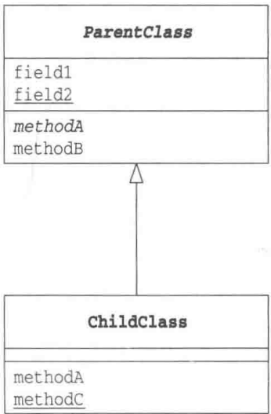
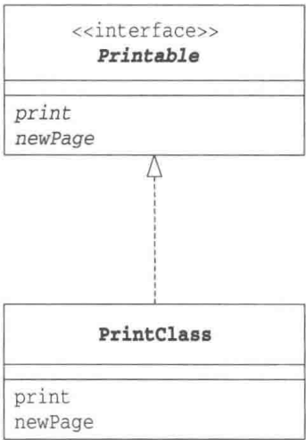
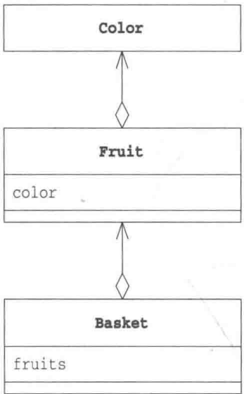
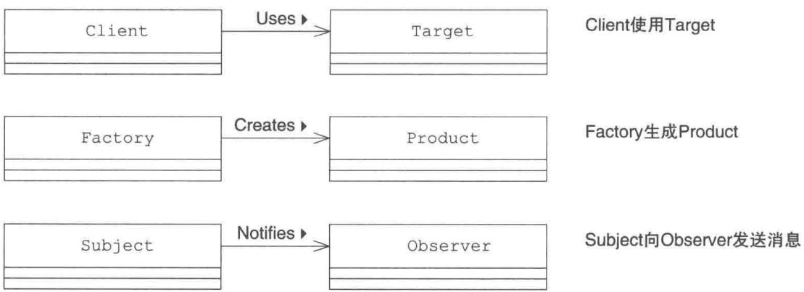
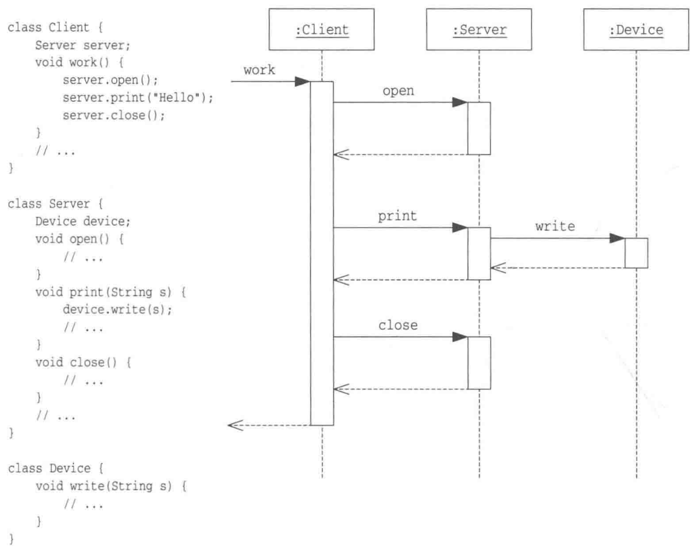

# 关于UML

> 来源：《图解设计模式》PDF 第 14–21 页，MinerU OCR 转写，如有疑问以原书为准

<!-- PDF p14 -->

## UML

UML 是让系统可视化、让规格和设计文档化的表现方法，它是 Unified Modeling Language（统一建模语言）的简称。

本书使用 UML 来表现各种设计模式中类和接口的关系，所以我们在这里稍微了解一下 UML，以方便后面的阅读。但是请大家注意，在说明中我们使用的是 Java 语言的术语。例如讲解时我们会用 Java 中的“字段”（field）取代 UML 中的“属性”（attribute），用 Java 中的“方法”（method）取代 UML 中的“操作”（operation）。

UML 标准的内容非常多，本节只对书中使用到的 UML 内容进行讲解。如果想了解更多 UML 内容，请访问以下网站。UML 的规范书也可以从该网站下载。

• UML Resource Page

http://www.omg.org/uml/

## 类图

UML中的类图（Class Diagram）用于表示类、接口、实例等之间相互的静态关系。虽然名字叫作类图，但是图中并不仅仅只有类。

## 类与层次结构

图0-1展示了一段Java程序及其对应的类图。

图0-1 展示类的层次关系的类图

```java
// UML 类图 ↔ Java 代码：抽象类、继承、静态成员

// ===== 抽象父类 =====
abstract class ParentClass {
    int field1;              // 普通字段
    static char field2;      // 静态字段（类图中带下划线）
    abstract void methodA(); // 抽象方法（类图中用斜体）
    double methodB() {       // 普通方法
        // ...
    }
}

// ===== 子类：继承父类（类图中用空心三角箭头指向父类）=====
class ChildClass extends ParentClass {
    void methodA() {         // 实现父类的抽象方法
        // ...
    }
    static void methodC() {  // 静态方法
        // ...
    }
}
```



<!-- PDF p15 · 书页 xii -->

该图展示了 ParentClass 和 ChildClass 两个类之间的关系，其中的空心箭头表明了两者之间的层次关系。箭头由子类指向父类，换言之，这是表示继承（extends）的箭头。

ParentClass 是 ChildClass 的父类，反过来说，ChildClass 是 ParentClass 的子类。父类也称为基类或超类，子类也称为派生类。

图中的长方形表示类，长方形内部被横线自上而下分为了如下3个区域。

- 类名

- 字段名

- 方法名

有时，图中除了会写出类名、字段名和方法名等信息外，还会写出其他信息（可见性、方法的参数和类型等）。反之，有时图中也会省略所有不必要的项目（因此，我们无法确保一定可以根据类图生成源程序）。

abstract 类（抽象类）的名字以斜体方式显示。例如，在图 0-1 中 ParentClass 是抽象类，因此它的名字以斜体方式显示。

static 字段（静态字段）的名字带有下划线。例如，在图 0-1 中 field2 是静态字段，因此名字带有下划线。

abstract 方法（抽象方法）的名字以斜体方式显示。例如，在图 0-1 中 methodA 是抽象方法，因此它以斜体方式显示。

static 方法（静态方法）的名字以下划线显示。例如，在图 0-1 中 ChildClass 类的 methodC 是类的静态方法，因此它的名字带有下划线。

## ▶▶ 小知识:Java 术语与 C++ 术语

Java 术语跟 C++ 术语略有不同。Java 中的字段相当于 C++ 中的成员变量，而 Java 中的方法相当于 C++ 中的成员函数。

## ▶▶ 小知识:箭头的方向

UML 中规定的箭头方向是从子类指向父类。可能会有人认为子类是以父类为基础的，箭头从父类指向子类会更合理。

关于这一点，按照以下方法去理解有助于大家记住这条规则。在定义子类时需要通过extends关键字指定父类。因此，子类一定知道父类的定义，而反过来，父类并不知道子类的定义。只有在知道对方的信息时才能指向对方，因此箭头方向是从子类指向父类。

## 接口与实现

图 0-2 也是类图的示例。该图表示 PrintClass 类实现了 Printable 接口。为了强调接口与抽象类的相似性，本书的类图中会以斜体方式显示接口的名字。不过在其他书的类图中，接口名可能并非以斜体显示。空心箭头代表了接口与实现类的关系，箭头从实现类指向接口。换言之，这是表示实现（implements）的箭头。

UML 以 «interface» 表示 Java 的接口。

<!-- PDF p16 · 书页 xiii -->

图0-2 展示接口与实现类的类图

```java
// UML 类图 ↔ Java 代码：接口与实现（类图中用虚线 + 空心三角箭头）

// ===== 接口：只声明方法 =====
interface Printable {
    abstract void print();
    abstract void newPage();
}

// ===== 实现类：必须实现接口的所有方法 =====
class PrintClass implements Printable {
    void print() {
        // ...
    }
    void newPage() {
        // ...
    }
}
```



图0-3 展示聚合关系的类图

```java
// UML 类图 ↔ Java 代码：聚合（has-a，“拥有”关系，类图中用空心菱形）
// Basket 拥有多个 Fruit，Fruit 拥有一个 Color

class Color {
    // ...
}

class Fruit {
    Color color;       // 水果“拥有”一个颜色
    // ...
}

class Basket {
    Fruit[] fruits;    // 篮子“拥有”多个水果
    // ...
}
```



## 聚合

图0-3也是类图的示例。

该图展示了 Color（颜色）、Fruit（水果）、Basket（果篮）这 3 个类之间的关系。Basket 类中的 fruits 字段是可以存放 Fruit 类型数据的数组，在一个 Basket 类的实例中可以持有多个 Fruit 类的实例；Fruit 类中的 color 字段是 Color 类型，一个 Fruit 类实例中只能持有一个 Color 类的实例。通俗地说就是在篮子中可以放入多个水果，每个水果都有其自身的颜色。

我们将这种 “持有” 关系称为聚合 (aggregation)。只要在一个类中持有另外一个类的实例——无论是一个还是多个——它们之间就是聚合关系。就程序上而言，无论是使用数组、java.util.Vector 或是其他实现方式，只要在一个类中持有另外一个类的实例，它们之间就是聚合关系。

在 UML 中，我们使用带有空心菱形的实线表示聚合关系，因此可以进行联想记忆，将聚合关系想象为在空心菱形的器皿中装有其他物品。

<!-- PDF p17 · 书页 xiv -->

## 可见性（访问控制）

图0-4也是类图的示例。

图0-4 标识出了可见性的类图

```java
// UML 类图 ↔ Java 代码：访问权限
// 类图符号：- private　# protected　+ public　~ 包内可见（不写修饰符）
class Something {
    private   int privateField;     // -  只有本类能访问
    protected int protectedField;   // #  本类、子类、同包可访问
    public   int publicField;       // +  所有地方都能访问
    int packageField;               // ~  同一个包内可访问
    private   void privateMethod() {
    }
    protected void protectedMethod() {
    }
    public   void publicMethod() {
    }
    void packageMethod() {
    }
}
```

该图标识出了方法和字段的可见性。在 UML 中可以通过在方法名和字段名前面加上记号来表示可见性。

“+”表示 public 方法和字段，可以从类外部访问这些方法和字段。

“-”表示 private 方法和字段，无法从类外部访问这些方法和字段。

“#”表示 protect 方法和字段，能够访问这些方法和字段的只能是该类自身、该类的子类以及同一包中的类。

“\~”表示只有同一包中的类才能访问的方法和字段。

## 类的关联

可以在类名前面加上黑三角表示类之间的关联关系，如图0-5所示。

图0-5 类的关联



<!-- PDF p18 · 书页 XV -->

## 时序图

UML 的时序图（sequence diagram）用来表示程序在工作时其内部方法的调用顺序，以及事件的发生顺序。

类图中表示的是“不因时间流逝而发生变化的关系（静态关系）”，时序图则与之相反，表示的是“随时间发生变化的东西（动态行为）”。

## 处理流与对象间的协作

图0-6展示的是时序图的一个例子。

图0-6 时序图示例（方法的调用）



在图 0-6 中，右侧是时序图示例，左侧是与之对应的代码片段。

该图中共有 3 个实例，如图中最上方的 3 个长方形所示。在长方形内部写有类名，类名跟在冒号（:）之后，并带有下划线，如 :Client、:Server、:Device，它们分别代表 Client 类、Server 类、Device 类的实例。

如果需要，还可以在冒号（:）之前表示出实例名，如 server:Server。

每个实例都带有一条向下延伸的虚线，我们称其为生命线。这里可以理解为时间从上向下流逝，上面是过去，下面是未来。生命线仅存在于实例的生命周期内。

在生命线上，有一些细长的长方形，它们表示实例处于某种活动中。

横方向上有许多箭头，请先看带有open字样的箭头。黑色实线箭头（→）表示方法的调用，这里表示 client 调用 server 的 open 方法。当 server 的 open 方法被调用后，server 实例处于活动中，因此在 open 箭头处画出了一个细长的长方形。

<!-- PDF p19 · 书页 xvi -->

而在 open 箭头画出的长方形下方，还有一条指向 client 实例的虚线箭头（<----），它表示返回 open 方法。在上图中，我们画出了所有的返回箭头，但是有些时序图也会省略返回箭头。

由于程序控制已经返回至 client，所以表示 server 实例处于活动状态的长方形就此结束了。

接着，client 实例会调用 server 实例的 print 方法。不过这次不同的是在 print 方法中，server 会调用 device 实例的 write 方法。

这样，我们就将多个对象之间的行为用图示的方式展示出来了。时序图的阅读顺序是沿着生命线从上至下阅读。然后当遇到箭头时，我们可以顺着箭头所指的方向查看对象间的协作。

<!-- PDF p20 -->

## 学习设计模式之前

在学习设计模式之前，我们先来了解几个小知识，以便更好地理解设计模式。

## 设计模式并非类库

为了方便地编写 Java 程序，我们会使用类库，但是设计模式并非类库。

与类库相比，设计模式是一个更为普遍的概念。类库是由程序组合而成的组件，而设计模式则用来表现内部组件是如何被组装的，以及每一个组件是如何通过相互关联来构成一个庞大系统的。

我们以白雪公主的故事为例来思考一下。在讲述故事梗概时，我们并不需要知道在演绎这个故事的电影中到底是谁扮演白雪公主、谁扮演王子。与介绍演员相比，讲述白雪公主与王子之间的“关系”更加重要。因为并非特定的演员扮演的“白雪公主”才是白雪公主，不论谁来扮演这个角色，只要是按照白雪公主的剧本进行演出，她们都是白雪公主。重要的是在这个故事中有哪些出场人物，他们之间是什么样的关系。

设计模式也是一样的。在回答“什么是 Abstract Factory 模式”时，阅读具体的示例代码有助于我们理解答案，但是并非只有这段特定的代码才是 Abstract Factory 模式。重要的是在这段代码中有哪些类和接口，它们之间是什么样的关系。

## 但是类库中使用了设计模式

设计模式并非类库，但是 Java 标准类库中使用了许多设计模式。掌握了设计模式可以帮助我们理解这些类库所扮演的角色。

典型的例子如下所示，在以后单独介绍各种设计模式的章节中，我们还会进一步学习。

- java.util.Iterator 是用于遍历元素集合的接口，这里使用了 Iterator 模式（第 1 章）

- java.util.Observer 是用于观察对象状态变化的接口，这里使用了 Observer 模式（第 17 章）

- 以下的方法中使用了Factory Method模式（第4章）

java.util.Calendar 类的 getInstance 方法

java.secure.SecureRandom 类的 getInstance 方法

```text
java.text.NumberFormat 类的 getInstance 方法
```

- java.awt.Component 和 java.awt.Container 这两个类中使用了 Composite 模式（第 11 章）

## 示例程序并非成品

设计模式的目标之一就是提高程序的可复用性；也就是说，设计模式考虑的是怎样才能将程序作为“组件”重复使用。因此，不应当将示例程序看作是成品，而应当将其作为扩展和变更的基础。

- 有哪些功能可以被扩展

- 扩展功能时必须修改哪些地方

- 有哪些类不需要修改

从以上角度看待设计模式可以帮助我们加深对设计模式的理解。

<!-- PDF p21 · 书页 xviii -->

## 不只是看图，还要理解图

本书以图解的方式讲解设计模式，其中主要使用的有类图和时序图（请参见前面“关于 UML”中的内容）。这些图并非只是简单的画，只瞥一眼是无法理解其中内容的。

在看类图时，首先看长方形（类），然后看它们里面的方法，并确认哪些是普通方法、哪些是抽象方法。接着确认类之间的箭头的指向，弄清究竟是哪个类实现了哪个接口。只有像这样循序渐进，一步一步对图中的内容刨根问底才能真正理解这幅图的主旨。

相比于类图，时序图理解起来更加容易一些。按照时间顺序自上而下一步一步确认哪个对象调用了哪个对象，就可以慢慢理解每个对象在模式中所扮演的角色。

只瞥一眼图是无法理解图中深藏的内容的，必须深入理解这些图。

## 自己思考案例

不要只是阅读书中的案例，还需要自己尝试着思考一些案例。

另外，我们还需要在自己进行设计和编程时思考一下学习过的设计模式是否适用于当前场景。

## 理解角色——谁扮演白雪公主

设计模式如同电影一样，类和接口这些“角色”之间进行各种各样的交互，共同演绎一部精彩的电影。在电影中，每个人都必须按照自己的角色做出相应的行为。主人公的行为必须像主人公，敌人则必须对抗主人公。女主角也会出场，将剧情推向高潮。

设计模式也一样。在每种设计模式中，类和接口被安排扮演各自的角色。各个类和接口如果不能理解自己所扮演的角色，就无法深入理解电影整体的剧情，无法扮演好自己的角色。这可能导致主人公屈服于敌方，或是女主角变成了坏人；又或是将喜剧演成了悲剧，将纪实片演成了虚构片。

在接下来的每章中，我们都将学习一种设计模式。同时我们也需要了解设计模式中出现的角色。请大家在阅读示例代码时，不要只盯着代码本身，而要将关注点转移到角色身上来，在阅读代码的时候，要思考各个类和接口到底在模式中扮演着什么角色。

如果模式相同，即使类名不同，它们所扮演的角色也是相同的。认清它们所扮演的角色有助于我们理解模式。这样，哪怕换了演员，我们依然可以正确地理解剧情。

如果我们现在看的是《白雪公主》，那么不论谁扮演白雪公主，王子都会爱上白雪公主。最后的结局也一定是白雪公主接受了王子的吻，苏醒了过来。

那么接下来，让我们赶快进入正题，逐个学习设计模式吧。
