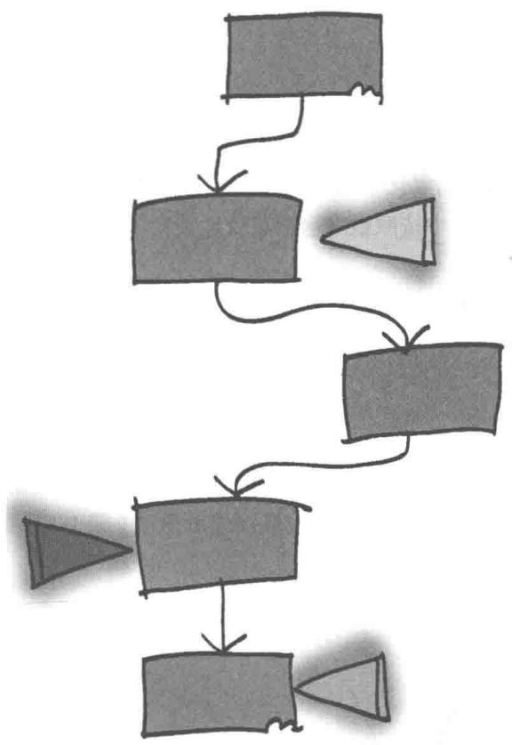
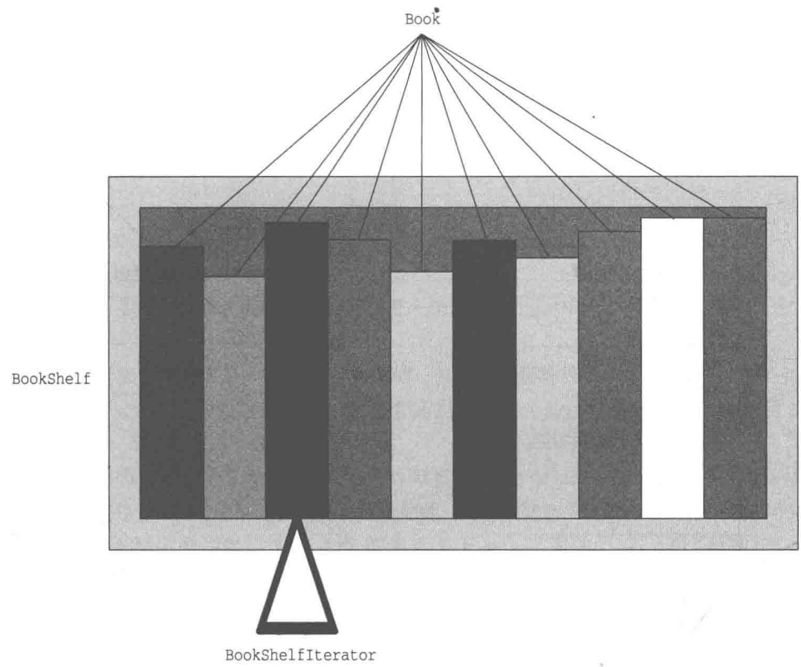
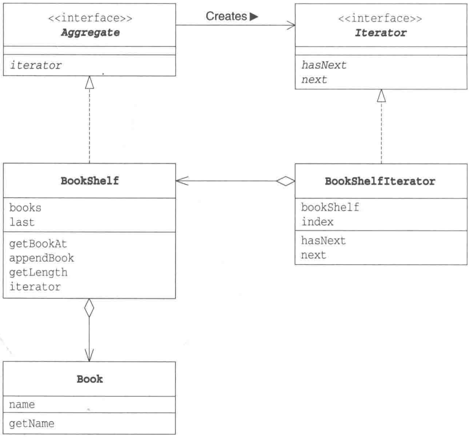
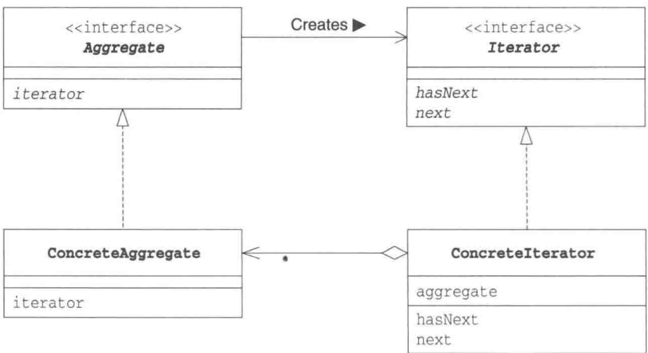

# 第1章 Iterator模式——一个一个遍历

> 来源：《图解设计模式》PDF 第 34–44 页，MinerU OCR 转写，如有疑问以原书为准

<!-- PDF p34 -->



<!-- PDF p35 · 书页 2 -->

## 1.1 Iterator 模式

使用 Java 语言显示数组 arr 中的元素时，我们可以使用下面这样的 for 循环语句遍历数组。

```java
// 最普通的遍历：用循环变量 i 逐个访问数组元素
// Iterator 模式就是把这里 i 的作用“抽象化、通用化”
for (int i = 0; i < arr.length; i++) {
    System.out.println(arr[i]);
}
```

请注意这段代码中的循环变量 i。该变量的初始值是 0，然后会递增为 1, 2, 3, …，程序则在每次 i 递增后都输出 arr[i]。我们在程序中经常会看到这样的 for 循环语句。

数组中保存了很多元素，通过指定数组下标，我们可以从中选择任意一个元素。

```text
arr[0] 最开始的元素(第 0 个元素)
arr[1] 下一个元素(第 1 个元素)
    :
arr[i] (第 i 个元素)
    :
arr[arr.length - 1] 最后一个元素
```

for 语句中的 `i++` 的作用是让 i 的值在每次循环后自增 1，这样就可以访问数组中的下一个元素、下下一个元素、再下下一个元素，也就实现了从头至尾逐一遍历数组元素的功能。

将这里的循环变量 i 的作用抽象化、通用化后形成的模式，在设计模式中称为 Iterator 模式。

Iterator 模式用于在数据集合中按照顺序遍历集合。英语单词 Iterate 有反复做某件事情的意思，汉语称为 “迭代器”。

我们将在本章中学习 Iterator 模式。

## 1.2 示例程序

首先，让我们来看一段实现了 Iterator 模式的示例程序。这段示例程序的作用是将书（Book）放置到书架（BookShelf）中，并将书的名字按顺序显示出来（图 1-1）。

<!-- PDF p36 · 书页 3 -->

图1-1 示例程序的示意图



### Aggregate 接口

Aggregate 接口（代码清单 1-1）是所要遍历的集合的接口。实现了该接口的类将成为一个可以保存多个元素的集合，就像数组一样。Aggregate 有 “使聚集” “集合” 的意思。

<!-- PDF p37 · 书页 4 -->

图1-2 示例程序的类图



表 1-1 类和接口的一览表

| 名字 | 说明 |
| --- | --- |
| Aggregate | 表示集合的接口 |
| Iterator | 遍历集合的接口 |
| Book | 表示书的类 |
| BookShelf | 表示书架的类 |
| BookShelfIterator | 遍历书架的类 |
| Main | 测试程序行为的类 |

代码清单 1-1 Aggregate 接口 (Aggregate.java)

```java
// 集合接口：表示“可以被遍历的东西”
// 只有一个方法：创建一个用于遍历自己的迭代器
public interface Aggregate {
    public abstract Iterator iterator();
}
```

在 Aggregate 接口中声明的方法只有一个——iterator 方法。该方法会生成一个用于遍历集合的迭代器。

想要遍历集合中的元素时，可以调用 iterator 方法来生成一个实现了 Iterator 接口的类的实例。

<!-- PDF p38 · 书页 5 -->

### Iterator接口

接下来我们看看 Iterator 接口（代码清单 1-2）。Iterator 接口用于遍历集合中的元素，其作用相当于循环语句中的循环变量。那么，在 Iterator 接口中需要有哪些方法呢？Iterator 接口的定义方式有很多种，这里我们编写了最简单的 Iterator 接口。

代码清单 1-2 Iterator 接口（Iterator.java）

```java
// 迭代器接口：负责一个一个地取出元素
public interface Iterator {
    public abstract boolean hasNext(); // 还有下一个元素吗？
    public abstract Object next();     // 返回当前元素，并移到下一个
}
```

这里我们声明了两个方法，即判断是否存在下一个元素的 hasNext 方法，和获取下一个元素的 next 方法。

hasNext 方法的返回值是 boolean 类型的，其原因很容易理解。当集合中存在下一个元素时，该方法返回 true；当集合中不存在下一个元素，即已经遍历至集合末尾时，该方法返回 false。hasNext 方法主要用于循环终止条件。

这里有必要说明一下 next 方法。该方法的返回类型是 Object，这表明该方法返回的是集合中的一个元素。但是，next 方法的作用并非仅仅如此。为了能够在下次调用 next 方法时正确地返回下一个元素，该方法中还隐含着将迭代器移动至下一个元素的处理。说“隐含”，是因为 Iterator 接口只知道方法名。想要知道 next 方法中到底进行了什么样的处理，还需要看一下实现了 Iterator 接口的类（BookShelfIterator）。这样，我们才能看懂 next 方法的作用。

### Book类

Book 类是表示书的类（代码清单 1-3）。但是这个类的作用有限，它可以做的事情只有一件——通过 getName 方法获取书的名字。书的名字是在外部调用 Book 类的构造函数并初始化 Book 类时，作为参数传递给 Book 类的。

代码清单 1-3 Book 类 (Book.java)

```java
// 书：只保存书名
public class Book {
    private String name;
    public Book(String name) {
        this.name = name;
    }
    public String getName() {
        return name;
    }
}
```

### BookShelf类

BookShelf 类是表示书架的类（代码清单 1-4）。由于需要将该类作为集合进行处理，因此它实现了 Aggregate 接口。代码中的 implements Aggregate 部分即表示这一点。此外，请注意在 BookShelf 类中还实现了 Aggregate 接口的 iterator 方法。

<!-- PDF p39 · 书页 6 -->

代码清单 1-4 BookShelf 类 (BookShelf.java)

```java
/**
 * 书架：集合的具体实现（ConcreteAggregate）
 * 用数组存书，并能创建自己的迭代器
 */
public class BookShelf implements Aggregate {
    private Book[] books;  // 存书的数组
    private int last = 0;  // 当前放了几本书（也是下一本要放的位置）

    public BookShelf(int maxsize) {
        this.books = new Book[maxsize]; // 书架最多放 maxsize 本
    }
    // 取第 index 本书
    public Book getBookAt(int index) {
        return books[index];
    }
    // 放一本书到最后
    public void appendBook(Book book) {
        this.books[last] = book;
        last++;
    }
    public int getLength() {
        return last;
    }
    // 创建遍历这个书架的迭代器
    public Iterator iterator() {
        return new BookShelfIterator(this);
    }
}
```

这个书架中定义了 books 字段，它是 Book 类型的数组。该数组的大小 (maxsize) 在生成 BookShelf 的实例时就被指定了。之所以将 books 字段的可见性设置为 private，是为了防止外部不小心改变了该字段的值。

接下来我们看看 iterator 方法。该方法会生成并返回 BookShelfIterator 类的实例作为 BookShelf 类对应的 Iterator。当外部想要遍历书架时，就会调用这个方法。

### BookShelfIterator 类

接下来让我们看看用于遍历书架的 BookShelfIterator 类（代码清单 1-5）。

代码清单 1-5 BookShelfIterator 类 (BookShelfIterator.java)

```java
/**
 * 书架迭代器：迭代器的具体实现（ConcreteIterator）
 * 用 index 记住“现在看到第几本”
 */
public class BookShelfIterator implements Iterator {
    private BookShelf bookShelf; // 要遍历的书架
    private int index;           // 当前位置

    public BookShelfIterator(BookShelf bookShelf) {
        this.bookShelf = bookShelf;
        this.index = 0;          // 从第 0 本开始
    }
    // 当前位置还没超过书的数量 → 还有下一本
    public boolean hasNext() {
        if (index < bookShelf.getLength()) {
            return true;
        } else {
            return false;
        }
    }
    // 取出当前这本，然后 index 后移
    public Object next() {
        Book book = bookShelf.getBookAt(index);
        index++;
        return book;
    }
}
```

<!-- PDF p40 · 书页 7 -->

因为 BookShelfIterator 类需要发挥 Iterator 的作用，所以它实现了 Iterator 接口。

bookShelf 字段表示 BookShelfIterator 所要遍历的书架。index 字段表示迭代器当前所指向的书的下标。

构造函数会将接收到的 BookShelf 的实例保存在 bookShelf 字段中，并将 index 初始化为 0。

hasNext 方法是 Iterator 接口中所声明的方法。该方法将会判断书架中还有没有下一本书，如果有就返回 true，如果没有就返回 false。而要知道书架中有没有下一本书，可以通过比较 index 和书架中书的总册数（bookShelf.getLength() 的返回值）来判断。

next 方法会返回迭代器当前所指向的书(Book 的实例)，并让迭代器指向下一本书。它也是 Iterator 接口中所声明的方法。next 方法稍微有些复杂，它首先取出 book 变量作为返回值，然后让 index 指向后面一本书。

如果与本章开头的 for 语句来对比，这里的 “让 index 指向后面一本书” 的处理相当于其中的 i++，它让循环变量指向下一个元素。

### Main类

至此，遍历书架的准备工作就完成了。接下来我们使用 Main 类（代码清单 1-6）来制作一个小书架。

代码清单 1-6 Main 类 (Main.java)

```java
// 使用：放 4 本书，然后用迭代器逐本打印书名
public class Main {
    public static void main(String[] args) {
        // 第 1 步：创建书架，放入 4 本书
        BookShelf bookShelf = new BookShelf(4);
        bookShelf.appendBook(new Book("Around the World in 80 Days"));
        bookShelf.appendBook(new Book("Bible"));
        bookShelf.appendBook(new Book("Cinderella"));
        bookShelf.appendBook(new Book("Daddy-Long-Legs"));
        // 第 2 步：获取迭代器，循环取书
        Iterator it = bookShelf.iterator();
        while (it.hasNext()) {
            Book book = (Book)it.next(); // next 返回 Object，要强转成 Book
            System.out.println(book.getName());
        }
    }
}
```

这段程序首先设计了一个能容纳4本书的书架，然后按书名的英文字母顺序依次向书架中放入了下面这4本书。

```text
Around the World in 80 Days (《环游世界 80 天》)
Bible (《圣经》)
Cinderella (《灰姑娘》)
Daddy Long Legs (《长腿爸爸》)
```

为了便于理解，笔者特意选了这4本首字母分别为A、B、C、D的书。

通过 bookShelf.iterator() 得到的 it 是用于遍历书架的 Iterator 实例。while 部分的条件当然就是 it.hasNext() 了。只要书架上有书，while 循环就不会停止。然后，程序会通过 it.next() 一本一本地遍历书架中的书。

图1-3展示了上面这段代码的运行结果。

<!-- PDF p41 · 书页 8 -->

图1-3 运行结果

```text
Around the World in 80 Days Bible
Cinderella
Daddy-Long-Legs
```

## 1.3 Iterator 模式中的登场角色

读完示例程序，让我们来看看 Iterator 模式中的登场角色。

### ◆ Iterator（迭代器）

该角色负责定义按顺序逐个遍历元素的接口(API)。在示例程序中，由 Iterator 接口扮演这个角色，它定义了 hasNext 和 next 两个方法。其中，hasNext 方法用于判断是否存在下一个元素，next 方法则用于获取该元素。

### ◆ ConcreteIterator（具体的迭代器）

该角色负责实现 Iterator 角色所定义的接口（API）。在示例程序中，由 BookShelfIterator 类扮演这个角色。该角色中包含了遍历集合所必需的信息。在示例程序中，BookShelf 类的实例保存在 bookShelf 字段中，被指向的书的下标保存在 index 字段中。

### ◆ Aggregate（集合）

该角色负责定义创建 Iterator 角色的接口 (API)。这个接口 (API) 是一个方法，会创建出 “按顺序访问保存在我内部元素的人”。在示例程序中，由 Aggregate 接口扮演这个角色，它里面定义了 iterator 方法。

### ◆ ConcreteAggregate（具体的集合）

该角色负责实现 Aggregate 角色所定义的接口（API）。它会创建出具体的 Iterator 角色，即 ConcreteIterator 角色。在示例程序中，由 BookShelf 类扮演这个角色，它实现了 iterator 方法。

图 1-4 是展示了 Iterator 模式的类图。

图1-4 Iterator模式的类图



<!-- PDF p42 · 书页 9 -->

## 1.4 拓展思路的要点

### 不管实现如何变化，都可以使用 Iterator

为什么一定要考虑引入 Iterator 这种复杂的设计模式呢？如果是数组，直接使用 for 循环语句进行遍历处理不就可以了吗？为什么要在集合之外引入 Iterator 这个角色呢？

一个重要的理由是，引入 Iterator 后可以将遍历与实现分离开来。请看下面的代码。

```java
// 关键：这个循环只用到了 Iterator 的方法，不依赖 BookShelf 的内部实现
// → 书架从数组改成 ArrayList，这段代码一行都不用改
while (it.hasNext()) {
    Book book = (Book)it.next();
    System.out.println(book.getName());
}
```

这里只使用了 Iterator 的 hasNext 方法和 next 方法，并没有调用 BookShelf 的方法。也就是说，这里的 while 循环并不依赖于 BookShelf 的实现。

如果编写 BookShelf 的开发人员决定放弃用数组来管理书本，而是用 java.util.Vector 取而代之，会怎样呢？不管 BookShelf 如何变化，只要 BookShelf 的 iterator 方法能正确地返回 Iterator 的实例（也就是说，返回的 Iterator 类的实例没有问题，hasNext 和 next 方法都可以正常工作），即使不对上面的 while 循环做任何修改，代码都可以正常工作。

这对于 BookShelf 的调用者来说真是太方便了。设计模式的作用就是帮助我们编写可复用的类。所谓 “可复用”，就是指将类实现为 “组件”，当一个组件发生改变时，不需要对其他的组件进行修改或是只需要很小的修改即可应对。

这样也就能理解为什么在示例程序中 iterator 方法的返回值不是 BookShelfIterator 类型而是 Iterator 类型了（代码清单 1-6）。这表明，这段程序就是要使用 Iterator 的方法进行编程，而不是 BookShelfIterator 的方法。

### 难以理解抽象类和接口

难以理解抽象类和接口的人常常使用 ConcreteAggregate 角色和 ConcreteIterator 角色编程，而不使用 Aggregate 接口和 Iterator 接口，他们总想用具体的类来解决所有的问题。

但是如果只使用具体的类来解决问题，很容易导致类之间的强耦合，这些类也难以作为组件被再次利用。为了弱化类之间的耦合，进而使得类更加容易作为组件被再次利用，我们需要引入抽象类和接口。

这也是贯穿本书的思想。即使大家现在无法完全理解，相信随着深入阅读本书，也一定能够逐渐理解。请大家将“不要只使用具体类来编程，要优先使用抽象类和接口来编程”印在脑海中。

### Aggregate 和 Iterator 的对应

请大家仔细回忆一下我们是如何把 BookShelfIterator 类定义为 BookShelf 类的 ConcreteIterator 角色的。BookShelfIterator 类知道 BookShelf 是如何实现的。也正是因为如此，我们才能调用用来获取下一本书的 getBookAt 方法。

也就是说，如果 BookShelf 的实现发生了改变，即 getBookAt 方法这个接口（API）发生变化时，我们必须修改 BookShelfIterator 类。

<!-- PDF p43 · 书页 10 -->

正如 Aggregate 和 Iterator 这两个接口是对应的一样，ConcreteAggregate 和 ConcreteIterator 这两个类也是对应的。

### 容易弄错“下一个”

在 Iterator 模式的实现中，很容易在 next 方法上出错。该方法的返回值到底是应该指向当前元素还是当前元素的下一个元素呢？更详细地讲，next 方法的名字应该是下面这样的。

returnCurrentElementAndAdvanceToNextPosition

也就是说，next 方法是“返回当前的元素，并指向下一个元素”。

### 还容易弄错“最后一个”

在 Iterator 模式中，不仅容易弄错 “下一个”，还容易弄错 “最后一个”。hasNext 方法在返回最后一个元素前会返回 true，当返回了最后一个元素后则返回 false。稍不注意，就会无法正确地返回 “最后一个” 元素。

请大家将 hasNext 方法理解成 “确认接下来是否可以调用 next 方法” 的方法就可以了。

### 多个 Iterator

“将遍历功能置于 Aggregate 角色之外”是 Iterator 模式的一个特征。根据这个特征，可以针对一个 ConcreteAggregate 角色编写多个 ConcreteIterator 角色。

### 迭代器的种类多种多样

在示例程序中展示的 Iterator 类只是很简单地从前向后遍历集合。其实，遍历的方法是多种多样的。

- 从最后开始向前遍历

- 既可以从前向后遍历，也可以从后向前遍历（既有 next 方法也有 previous 方法）

- 指定下标进行“跳跃式”遍历

学到这里，相信大家应该可以根据需求编写出各种各样的 Iterator 类了。

### 不需要deleteIterator

Java 在 Java 中，没有被使用的对象实例将会自动被删除（垃圾回收，GC）。因此，在 iterator 中不需要与其对应的 deleteIterator 方法。

<!-- PDF p44 · 书页 11 -->

## 1.5 相关的设计模式

### ◆ Visitor 模式（第 13 章）

Iterator 模式是从集合中一个一个取出元素进行遍历，但是并没有在 Iterator 接口中声明对取出的元素进行何种处理。

Visitor模式则是在遍历元素集合的过程中，对元素进行相同的处理。

在遍历集合的过程中对元素进行固定的处理是常有的需求。Visitor 模式正是为了应对这种需求而出现的。在访问元素集合的过程中对元素进行相同的处理，这种模式就是 Visitor 模式。

### ◆ Composite 模式（第 11 章）

Composite 模式是具有递归结构的模式，在其中使用 Iterator 模式比较困难。

### ◆ Factory Method 模式（第 4 章）

在 iterator 方法中生成 Iterator 的实例时可能会使用 Factory Method 模式。

## 1.6 本章所学知识

在本章中，我们学习了按照统一的方法遍历集合中的元素的 Iterator 模式。接下来让我们做一下练习题吧。

## 1.7 练习题

答案请参见附录A（P.294）

### 习题1-1

在示例程序的 BookShelf 类（代码清单 1-4）中，当书的数量超过最初指定的书架容量时，就无法继续向书架中添加书本了。请大家不使用数组，而是用 java.util.ArrayList 修改程序，确保当书的数量超过最初指定的书架容量时也能继续向书架中添加书本。

#### 答案（附录 A）

答案如下。无需对 Main 类中的 while 循环做任何修改。

```java
/**
 * 习题：书架改用 ArrayList 存书，超出初始容量也能继续放
 * 对外的方法不变，所以 BookShelfIterator 和 Main 都不用改
 */
import java.util.ArrayList;

public class BookShelf implements Aggregate {
    private ArrayList books;  // 改成可自动扩容的 ArrayList
    public BookShelf(int initialsize) {
        this.books = new ArrayList(initialsize); // 只是初始容量，不是上限
    }
    public Book getBookAt(int index) {
        return (Book)books.get(index);
    }
    public void appendBook(Book book) {
        books.add(book);
    }
    public int getLength() {
        return books.size();
    }
    public Iterator iterator() {
        return new BookShelfIterator(this);
    }
}
```


```java
// 测试：初始容量 4，但放了 8 本书，也能正常遍历
import java.util.*;

public class Main {
    public static void main(String[] args) {
        BookShelf bookShelf = new BookShelf(4);
        bookShelf.appendBook(new Book("Around the World in 80 Days"));
        bookShelf.appendBook(new Book("Bible"));
        bookShelf.appendBook(new Book("Cinderella"));
        bookShelf.appendBook(new Book("Daddy-Long-Legs"));
        bookShelf.appendBook(new Book("East of Eden"));        // 第 5 本：超过初始容量
        bookShelf.appendBook(new Book("Frankenstein"));
        bookShelf.appendBook(new Book("Gulliver's Travels"));
        bookShelf.appendBook(new Book("Hamlet"));
        Iterator it = bookShelf.iterator();
        while (it.hasNext()) {
            Book book = (Book)it.next();
            System.out.println(book.getName());
        }
    }
}
```

<!-- PDF p328 · 书页 295 -->

图A1-1 运行结果

```text
Around the World in 80 Days Bible
Cinderella
Daddy-Long-Legs
East of Eden
Frankenstein
Gulliver's Travels
Hamlet
```
