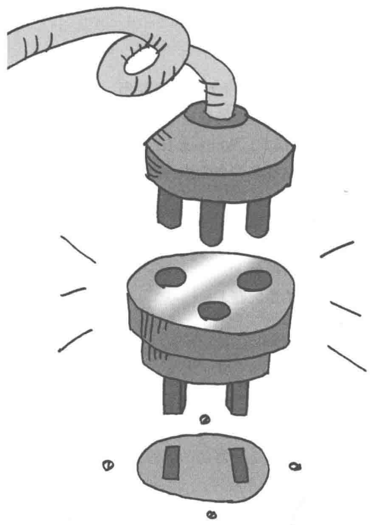
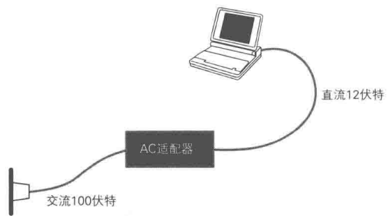
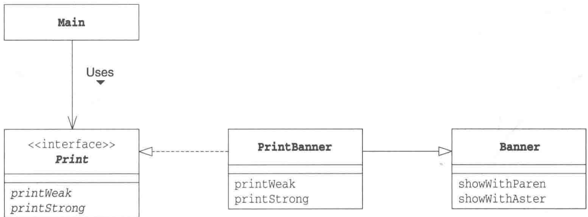
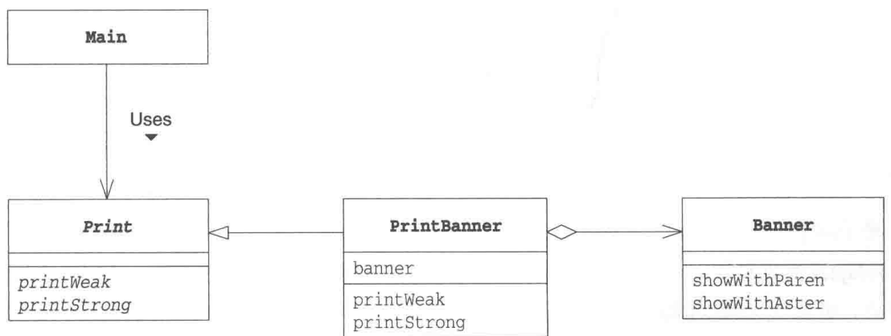
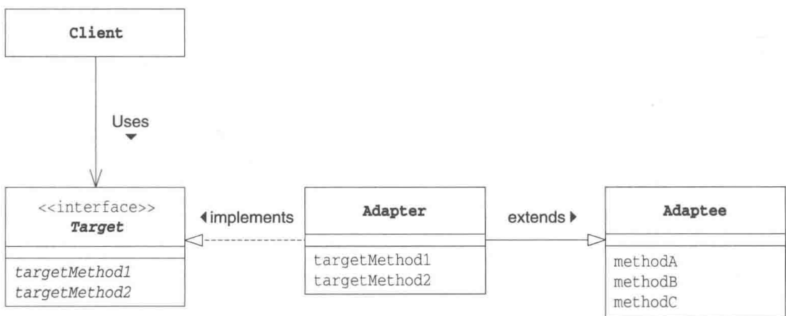
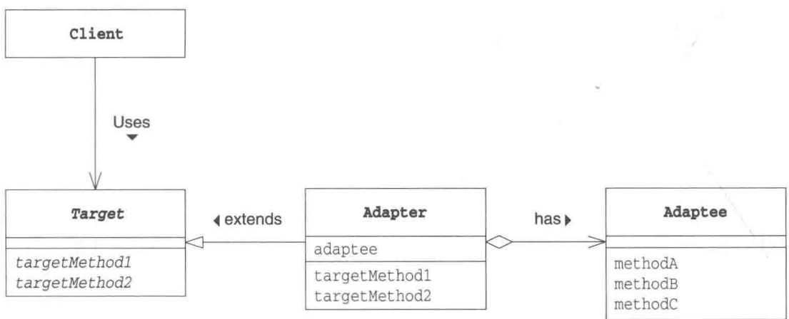
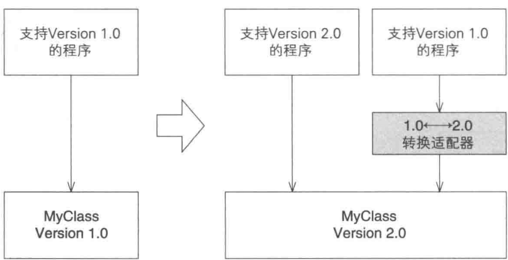

# 第2章 Adapter模式——加个“适配器”以便于复用

> 来源：《图解设计模式》PDF 第 46–55 页，MinerU OCR 转写，如有疑问以原书为准

<!-- PDF p46 -->



<!-- PDF p47 · 书页 14 -->

## 2.1 Adapter 模式

如果想让额定工作电压是直流 12 伏特的笔记本电脑在交流 100 伏特 ① 的 AC 电源下工作，应该怎么做呢？通常，我们会使用 AC 适配器，将家庭用的交流 100 伏特电压转换成我们所需要的直流 12 伏特电压。这就是适配器的工作，它位于实际情况与需求之间，填补两者之间的差异。适配器的英文是 Adapter，意思是“使……相互适合的东西”。前面说的 AC 适配器的作用就是让工作于直流 12 伏特环境的笔记本电脑适合于交流 100 伏特的环境（图 2-1）。

图2-1 适配器的角色



在程序世界中，经常会存在现有的程序无法直接使用，需要做适当的变换之后才能使用的情况。这种用于填补“现有的程序”和“所需的程序”之间差异的设计模式就是Adapter模式。

Adapter 模式也被称为 Wrapper 模式。Wrapper 有 “包装器” 的意思，就像用精美的包装纸将普通商品包装成礼物那样，替我们把某样东西包起来，使其能够用于其他用途的东西就被称为 “包装器” 或是 “适配器”。

Adapter 模式有以下两种。

- 类适配器模式（使用继承的适配器）

- 对象适配器模式（使用委托的适配器）

本章将依次学习这两种 Adapter 模式。

## 2.2 示例程序（1）（使用继承的适配器）

首先，让我们来看一段使用继承的适配器的示例程序。这里的示例程序是一段会将输入的字符串显示为（Hello）或是\*Hello\*的简单程序。

目前在 Banner 类（Banner 有广告横幅的意思）中，有将字符串用括号括起来的 showWithParen 方法，和将字符串用 \* 号括起来的 showWithAster 方法。我们假设这个 Banner 类是类似前文中的“交流 100 伏特电压”的“实际情况”。

假设 Print 接口中声明了两种方法，即弱化字符串显示（加括号）的 printWeak（weak 有弱化的意思）方法，和强调字符串显示（加 \* 号）的 printStrong（strong 有强化的意思）方法。我们假设这个接口是类似于前文中的“直流 12 伏特电压”的“需求”。

<small>① 日本的普通住宅区常用电压是100伏特，而国内居民区常用电压是220伏特，此处沿用了原文中的表述，故电压为100伏特。——译者注</small>

<!-- PDF p48 · 书页 15 -->

现在要做的事情是使用 Banner 类编写一个实现了 Print 接口的类，也就是说要做一个将“交流 100 伏特电压”转换成“直流 12 伏特电压”的适配器。

扮演适配器角色的是 PrintBanner 类。该类继承了 Banner 类并实现了“需求”——Print 接口。PrintBanner 类使用 showWithParen 方法实现了 printWeak，使用 showWithAster 方法实现了 printStrong。这样，PrintBanner 类就具有适配器的功能了。电源的比喻和示例程序的对应关系如表 2-1 所示。

表 2-1 电源的比喻和示例程序的对应关系

|  | 电源的比喻 | 示例程序 |
| --- | --- | --- |
| 实际情况 | 交流100伏特 | Banner类(showWithParen、showWithAster) |
| 变换装置 | 适配器 | PrintBanner类 |
| 需求 | 直流12伏特 | Print接口(printWeak、printStrong) |

图2-2 使用了“类适配器模式”的示例程序的类图（使用继承）



### Banner类

假设 Banner 类（代码清单 2-1）是现在的实际情况。

代码清单 2-1 Banner 类 (Banner.java)

```java
// 被适配者（Adaptee）：现成的类，已有功能但接口不符合需要
// 比喻：家里的 220V 交流电
public class Banner {
    private String string;
    public Banner(String string) {
        this.string = string;
    }
    public void showWithParen() {       // 加括号显示：(Hello)
        System.out.println("(" + string + ")");
    }
    public void showWithAster() {       // 加星号显示：*Hello*
        System.out.println("*" + string + "*");
    }
}
```

<!-- PDF p49 · 书页 16 -->

### Print接口

假设 Print 接口（代码清单 2-2）是“需求”的接口。

代码清单 2-2 Print 接口 (Print.java)

```java
// 目标接口（Target）：调用方想要的接口
// 比喻：笔记本需要的 12V 直流电
public interface Print {
    public abstract void printWeak();   // 弱化显示
    public abstract void printStrong(); // 强调显示
}
```

### PrintBanner类

PrintBanner 类(代码清单 2-3)扮演适配器的角色。它继承(extends)了 Banner 类, 继承了 showWithParen 方法和 showWithAster 方法。同时, 它又实现 (implements)了 Print 接口, 实现了 printWeak 方法和 printStrong 方法。

代码清单 2-3 PrintBanner 类 (PrintBanner.java)

```java
// 适配器（类适配器，用继承）：继承 Banner 拿到现有功能，实现 Print 对外提供需要的接口
// 比喻：电源适配器
public class PrintBanner extends Banner implements Print {
    public PrintBanner(String string) {
        super(string);
    }
    public void printWeak() {
        showWithParen();   // printWeak → 转成 showWithParen
    }
    public void printStrong() {
        showWithAster();   // printStrong → 转成 showWithAster
    }
}
```

### Main类

Main 类（代码清单 2-4）的作用是通过扮演适配器角色的 PrintBanner 类来弱化（带括号）或是强化 Hello（带 \* 号）字符串的显示。

代码清单 2-4 Main 类 (Main.java)

```java
// 使用：调用方只认识 Print 接口，完全不知道背后是 Banner
public class Main {
    public static void main(String[] args) {
        Print p = new PrintBanner("Hello");
        p.printWeak();     // 输出 (Hello)
        p.printStrong();   // 输出 *Hello*
    }
}
```

图2-3 运行结果

请注意，这里我们将 PrintBanner 类的实例保存在了 Print 类型的变量中。在 Main 类中，我们是使用 Print 接口（即调用 printWeak 方法和 printStrong 方法）来进行编程的。对 Main 类的代码而言，Banner 类、showWithParen\*方法和 showWithAster 方法被完全隐藏起来了。这就好像笔记本电脑只要在直流 12 伏特电压下就能正常工作，但它并不知道这 12 伏特的电压是由适配器将 100 伏特交流电压转换而成的。

<!-- PDF p50 · 书页 17 -->

Main 类并不知道 PrintBanner 类是如何实现的，这样就可以在不用对 Main 类进行修改的情况下改变 PrintBanner 类的具体实现。

## 2.3 示例程序（2）（使用委托的示例程序）

之前的示例程序展示了类适配器模式。下面我们再来看看对象适配器模式。在之前的示例程序中，我们使用“继承”实现适配，而这次我们要使用“委托”来实现适配。

### ▶▶小知识:关于委托

“委托”这个词太过于正式了，说得通俗点就是“交给其他人”。比如，当我们无法出席重要会议时，可以写一份委任书，说明一下“我无法出席会议，安排佐藤代替我出席”。委托跟委任的意思是一样的。在Java语言中，委托就是指将某个方法中的实际处理交给其他实例的方法。

Main 类和 Banner 类与示例程序（1）中的内容完全相同，不过这里我们假设 Print 不是接口而是类（代码清单 2-5）。

也就是说，我们打算利用 Banner 类实现一个类，该类的方法和 Print 类的方法相同。由于在 Java 中无法同时继承两个类（只能是单一继承），因此我们无法将 PrintBanner 类分别定义为 Print 类和 Banner 类的子类。

PrintBanner 类（代码清单 2-6）的 banner 字段中保存了 Banner 类的实例。该实例是在 PrintBanner 类的构造函数中生成的。然后，printWeak 方法和 printStrong 方法会通过 banner 字段调用 Banner 类的 showWithParen 和 showWithAster 方法。

与之前的示例代码中调用了从父类中继承的 showWithParen 方法和 showWithAster 方法不同，这次我们通过字段来调用这两个方法。

这样就形成了一种委托关系(图 2-4)。当 PrintBanner 类的 printWeak 被调用的时候，并不是 PrintBanner 类自己进行处理，而是将处理交给了其他实例（Banner 类的实例）的 showWithParen 方法。

图2-4 使用了“对象适配器模式”的示例程序的类图（使用委托）



<!-- PDF p51 · 书页 18 -->

### Print类

代码清单 2-5 Print 类 (Print.java)

```java
// 另一种情况：目标 Print 是抽象类而不是接口
// Java 只能单继承，PrintBanner 无法同时继承 Banner 和 Print → 只能改用委托
public abstract class Print {
    public abstract void printWeak();
    public abstract void printStrong();
}
```

### PrintBanner类

代码清单 2-6 PrintBanner 类 (PrintBanner.java)

```java
// 适配器（对象适配器，用委托）：继承 Print，内部持有一个 Banner 对象，把工作交给它
public class PrintBanner extends Print {
    private Banner banner;   // 被适配的对象
    public PrintBanner(String string) {
        this.banner = new Banner(string);
    }
    public void printWeak() {
        banner.showWithParen();   // 委托给 banner
    }
    public void printStrong() {
        banner.showWithAster();
    }
}
```

## 2.4 Adapter 模式中的登场角色

在 Adapter 模式中有以下登场角色。

### ◆ Target（对象）

该角色负责定义所需的方法。以本章开头的例子来说，即让笔记本电脑正常工作所需的直流 12 伏特电源。在示例程序中，由 Print 接口（使用继承时）和 Print 类（使用委托时）扮演此角色。

### ◆ Client（请求者）

该角色负责使用 Target 角色所定义的方法进行具体处理。以本章开头的例子来说，即直流 12 伏特电源所驱动的笔记本电脑。在示例程序中，由 Main 类扮演此角色。

### ◆ Adaptee（被适配）

注意不是 Adapt-er（适配）角色，而是 Adapt-ee（被适配）角色。Adaptee 是一个持有既定方法的角色。以本章开头的例子来说，即交流 100 伏特电源。在示例程序中，由 Banner 类扮演此角色。

如果 Adaptee 角色中的方法与 Target 角色的方法相同（也就是说家庭使用的电压就是 12 伏特直流电压），就不需要接下来的 Adapter 角色了。

### ◆ Adapter（适配）

Adapter 模式的主人公。使用 Adaptee 角色的方法来满足 Target 角色的需求，这是 Adapter 模式的目的，也是 Adapter 角色的作用。以本章开头的例子来说，Adapter 角色就是将交流 100 伏特电压转换为直流 12 伏特电压的适配器。在示例程序中，由 PrintBanner 类扮演这个角色。

<!-- PDF p52 · 书页 19 -->

在类适配器模式中，Adapter 角色通过继承来使用 Adaptee 角色，而在对象适配器模式中，Adapter 角色通过委托来使用 Adaptee 角色。

图2-5和图2-6展示了这两种Adapter模式的类图。

图2-5 类适配器模式的类图（使用继承）



图2-6 对象适配器模式的类图（使用委托）



## 2.5 拓展思路的要点

### 什么时候使用 Adapter 模式

一定会有读者认为“如果某个方法就是我们所需要的方法，那么直接在程序中使用不就可以了吗？为什么还要考虑使用 Adapter 模式呢？”那么，究竟应当在什么时候使用 Adapter 模式呢？

很多时候，我们并非从零开始编程，经常会用到现有的类。特别是当现有的类已经被充分测试过了，Bug 很少，而且已经被用于其他软件之中时，我们更愿意将这些类作为组件重复利用。

Adapter 模式会对现有的类进行适配，生成新的类。通过该模式可以很方便地创建我们需要的方法群。当出现 Bug 时，由于我们很明确地知道 Bug 不在现有的类（Adaptee 角色）中，所以只需调查扮演 Adapter 角色的类即可。这样一来，代码问题的排查就会变得非常简单。

<!-- PDF p53 · 书页 20 -->

### 如果没有现成的代码

让现有的类适配新的接口（API）时，使用 Adapter 模式似乎是理所当然的。不过实际上，我们在让现有的类适配新的接口时，常常会有“只要将这里稍微修改下就可以了”的想法，一不留神就会修改现有的代码。但是需要注意的是，如果要对已经测试完毕的现有代码进行修改，就必须在修改后重新进行测试。

使用 Adapter 模式可以在完全不改变现有代码的前提下使现有代码适配于新的接口（API）。此外，在 Adapter 模式中，并非一定需要现成的代码。只要知道现有类的功能，就可以编写出新的类。

### 版本升级与兼容性

软件的生命周期总是伴随着版本的升级，而在版本升级的时候经常会出现“与旧版本的兼容性”问题。如果能够完全抛弃旧版本，那么软件的维护工作将会轻松得多，但是现实中往往无法这样做。这时，可以使用 Adapter 模式使新旧版本兼容，帮助我们轻松地同时维护新版本和旧版本。

例如，假设我们今后只想维护新版本。这时可以让新版本扮演 Adaptee 角色，旧版本扮演 Target 角色。接着编写一个扮演 Adapter 角色的类，让它使用新版本的类来实现旧版本的类中的方法。

图 2-7 展示了这些关系的类图（请注意它并非 UML 图）。

图2-7 提高与旧版本软件的兼容性的Adapter模式



### 功能完全不同的类

当然，当 Adaptee 角色和 Target 角色的功能完全不同时，Adapter 模式是无法使用的。就如同我们无法用交流 100 伏特电压让自来水管出水一样。

## 2.6 相关的设计模式

### ◆ Bridge 模式（第 9 章）

Adapter 模式用于连接接口（API）不同的类，而 Bridge 模式则用于连接类的功能层次结构与实现层次结构。

<!-- PDF p54 · 书页 21 -->

### ◆ Decorator 模式（第 12 章）

Adapter 模式用于填补不同接口（API）之间的缝隙，而 Decorator 模式则是在不改变接口（API）的前提下增加功能。

## 2.7 本章所学知识

在本章中，我们学习了 Adapter 模式。Adapter 模式用于填补具有不同接口（API）的两个类之间的缝隙。此外，我们还学习了“使用继承”和“使用委托”这两种实现 Adapter 模式的方式和它们各自的特征。

现在大家应该对设计模式有些了解了，那么接下来让我们做两道练习题。

## 2.8 练习题

答案请参见附录A（P.295）

### 习题2-1

Java 在示例程序中生成 PrintBanner 类的实例时，我们采用了如下方法，即使用 Print 类型的变量来保存 PrintBanner 实例。

```java
// 用接口类型 Print 接收：只能调用 Print 里声明的方法
Print p = new PrintBanner("Hello");
```

请问我们为什么不像下面这样使用 PrintBanner 类型的变量来保存 PrintBanner 的实例呢？

```java
// 用具体类型 PrintBanner 接收：能调用 PrintBanner 的所有方法（但和具体类耦合了）
PrintBannerp = new PrintBanner("Hello");
```

#### 答案（附录 A）

这是想强调“只使用了 Print 接口的方法”。在本章的示例程序中，PrintBanner 类和 Print 接口对外提供的方法是相同的。但是在有些情况下，PrintBanner 类中的方法可能会比 Print 接口中的方法多。通过将对象保存在 Print 类型的变量中并使用该变量，可以明确地表明程序的意图，即“并不是使用 PrintBanner 类中的方法，而是使用 Print 接口中的方法”。

补充说明 即使将变量保存在 Print 类型的变量中，如果对象的实际类型是 PrintBanner 类型，那么依然可以通过下面这样的类型转换来调用 PrintBanner 类中独有的方法。

```java
// 想调用 PrintBanner 独有的方法，必须先强制转换类型
((PrintBanner)p).methodWhichExistsOnlyInPrintBanner();
```

如果变量 p 中保存的不是 PrintBanner 类以及它的子类，那么程序在运行时会出错（抛出 java.lang.ClassCastException 异常）。

### 习题2-2

在 java.util.Properties 类中，可以像下面这样管理键值对（属性）。

```text
year=2004
month=4
day=21
```

java.util.Properties 类提供了以下方法，可以帮助我们方便地从流中取出属性或将属性写入流中。

```java
// java.util.Properties 自带的两个方法（习题要用到）
void load(InputStream in) throws IOException
从 InputStream 中取出属性集合
void store(OutputStream out, String header) throws IOException
向 OutputStream 写入属性集合。header 是注释文字
```

请使用 Adapter 模式编写一个将属性集合保存至文件中的 FileProperties 类。

这里，我们假设在代码清单 2-7 中的 FileIO 接口（Target 角色）中声明了将属性集合保存至文件的方法，并假设 FileProperties 类会实现这个 FileIO 接口。

输入文件 file.txt 以及输出文件 newfile.txt 的内容请参见代码清单 2-9 和代码清单 2-10（以 # 开始的内容是 java.util.Properties 类自动附加的注释文字）。

<!-- PDF p55 · 书页 22 -->

当FileProperties类编写完成后，即使FileProperties类不了解java.util.Properties类的方法，只要知道FileIO接口的方法也可以对属性进行处理。还是以本章开头的电源的例子来说，java.util.Properties类相当于现在家庭中使用的100伏特交流电压，FileIO接口相当于所需要的直流12伏特电源，而FileProperties类则相当于适配器。

代码清单 2-7 FileIO 接口 (FileIO.java)

```java
// 习题的目标接口：读写 “键=值” 格式的配置文件
import java.io.*;
public interface FileIO {
    public void readFromFile(String filename) throws IOException; // 从文件读取
    public void writeToFile(String filename) throws IOException;  // 写入文件
    public void setValue(String key, String value);               // 设置一项
    public String getValue(String key);                           // 读取一项
}
```

代码清单 2-8 Main 类 (Main.java)

```java
// 习题的使用方：读 file.txt → 改 3 个值 → 写到 newfile.txt
import java.io.*;
public class Main {
    public static void main(String[] args) {
        FileIO f = new FileProperties();
        try {
            f.readFromFile("file.txt");
            f.setValue("year", "2004");
            f.setValue("month", "4");
            f.setValue("day", "21");
            f.writeToFile("newfile.txt");
        } catch (IOException e) {
            e.printStackTrace();
        }
    }
}
```

代码清单 2-10 输出文件 (newfile.txt)

```text
#written by FileProperties
#Wed Apr 21 18:21:00 JST 2004
day=21
year=2004
month=4
```

#### 答案（附录 A）

答案如下。这里使用了基于类的Adapter模式。

代码清单 A2-1 FileProperties 类 (FileProperties.java)

```java
// 习题答案：FileProperties 作为适配器
// 被适配者 = Properties（已有读写功能），目标 = FileIO
import java.io.*;
import java.util.*;
public class FileProperties extends Properties implements FileIO {
    public void readFromFile(String filename) throws IOException {
        load(new FileInputStream(filename));                         // → Properties.load
    }
    public void writeToFile(String filename) throws IOException {
        store(new FileOutputStream(filename), "written by FileProperties"); // → Properties.store
    }
    public void setValue(String key, String value) {
        setProperty(key, value);                                     // → Properties.setProperty
}
public String getValue(String key) {
    return getProperty(key, "");                                     // 没有这个 key 时返回 ""
}
}
```
