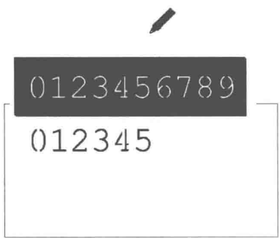
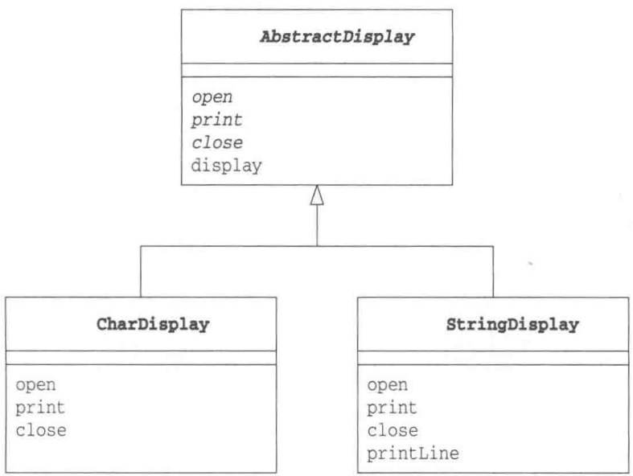
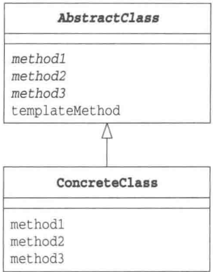

# 第3章 Template Method模式——将具体处理交给子类

> 来源：《图解设计模式》PDF 第 56–65 页，MinerU OCR 转写，如有疑问以原书为准

<!-- PDF p56 -->


<!-- PDF p57 · 书页 24 -->

## 3.1 Template Method 模式

### 什么是模板

模板的原意是指带有镂空文字的薄薄的塑料板。只要用笔在模板的镂空处进行临摹，即使是手写也能写出整齐的文字。虽然只要看到这些镂空的洞，我们就可以知道能写出哪些文字，但是具体写出的文字是什么感觉则依赖于所用的笔。如果使用签字笔来临摹，则可以写出签字似的文字；如果使用铅笔来临摹，则可以写出铅笔字；而如果是用彩色笔临摹，则可以写出彩色的字。但是无论使用什么笔，文字的形状都会与模板上镂空处的形状一致（图 3-1）。

图3-1 用签字笔临摹模板



### 什么是 Template Method 模式

本章中所要学习的 Template Method 模式是带有模板功能的模式，组成模板的方法被定义在父类中。由于这些方法是抽象方法，所以只查看父类的代码是无法知道这些方法最终会进行何种具体处理的，唯一能知道的就是父类是如何调用这些方法的。

实现上述这些抽象方法的是子类。在子类中实现了抽象方法也就决定了具体的处理。也就是说，只要在不同的子类中实现不同的具体处理，当父类的模板方法被调用时程序行为也会不同。但是，不论子类中的具体实现如何，处理的流程都会按照父类中所定义的那样进行。

像这样在父类中定义处理流程的框架，在子类中实现具体处理的模式就称为 Template Method 模式。在本章中，我们将要学习 Template Method 模式的相关知识。

## 3.2 示例程序

首先让我们来看一段 Template Method 模式的示例程序。这里的示例程序是一段将字符和字符串循环显示 5 次的简单程序。

在示例程序中会出现 AbstractDisplay、CharDisplay、StringDisplay、Main 这 4 个类（图 3-2）。

在 AbstractDisplay 类中定义了 display 方法，而且在该方法中依次调用了 open、print、close 这 3 个方法。虽然这 3 个方法已经在 AbstractDisplay 中被声明了，但都是没有实体的抽象方法。这里，调用抽象方法的 display 方法就是模板方法。

<!-- PDF p58 · 书页 25 -->

而实际上实现了 open、print、close 这 3 个抽象方法的是 AbstractDisplay 的子类 CharDisplay 类和 StringDisplay 类。

Main类是用于测试程序行为的类。

表3-1 类的一览表

| 名字 | 说明 |
| --- | --- |
| AbstractDisplay | 只实现了 display 方法的抽象类 |
| CharDisplay | 实现了 open、print、close 方法的类 |
| StringDisplay | 实现了 open、print、close 方法的类 |
| Main | 测试程序行为的类 |

图3-2 示例程序的类图



### AbstractDisplay 类

AbstractDisplay 类(代码清单 3-1)有 4 个方法, 分别是 display、open、print、close。其中只有 display 方法实现了, open、print、close 都是抽象方法。通过查看 AbstractDisplay 类中 display 方法的代码, 我们可以知道 display 方法进行了以下处理。

- 调用open方法

- 调用5次print方法

- 调用close方法

那么在 open 方法、print 方法、close 方法中各进行了什么处理呢？通过查看 AbstractDisplay 类的代码，我们可以知道这 3 个方法都是抽象方法。也就是说，如果仅仅查看 AbstractDisplay 类的代码，我们无法知道这 3 个方法中到底进行了什么样的处理。这是因为 open 方法、print 方法、close 方法的实际处理被交给了 AbstractDisplay 类的子类。

<!-- PDF p59 · 书页 26 -->

代码清单 3-1 AbstractDisplay 类 (AbstractDisplay.java)

```java
/**
 * 【Template Method 模式】父类：定好“显示”的固定流程
 * display() 是模板方法：open → print × 5 → close
 * 三个步骤具体怎么做，由子类决定
 */
public abstract class AbstractDisplay { // 抽象类 AbstractDisplay
    // ===== 留给子类实现的步骤 =====
    public abstract void open();          // 交给子类去实现的抽象方法 (1)open
    public abstract void print();         // 交给子类去实现的抽象方法 (2) print
    public abstract void close();        // 交给子类去实现的抽象方法 (3) close

    // ===== 模板方法：final 防止子类改流程 =====
    public final void display() {       // 本抽象类中实现的 display 方法
        open();                              // 首先打开……
        for (int i = 0; i < 5; i++) {   // 循环调用 5 次 print……
            print();
        }
        close();             // ……最后关闭。这就是 display 方法所实现的功能
    }
}
```

### CharDisplay 类

理解了前面的内容后，我们再来看看子类之一的 CharDisplay 类（代码清单 3-2）。由于 CharDisplay 类实现了父类 AbstractDisplay 类中的 3 个抽象方法 open、print、close，因此它并不是抽象类。

CharDisplay 类中的 open、print、close 方法的处理如表 3-2 所示。

表3-2 CharDisplay类中的open、print、close方法的处理

| 方法名 | 处理 |
| --- | --- |
| open | 显示字符串 "&lt;&lt;" |
| print | 显示构造函数接收的1个字符 |
| close | 显示字符串 ">>" |

这样，当 dipslay 方法被调用时，结果会如何呢？假设我们向 CharDisplay 的构造函数中传递的参数是 H 这个字符，那么最终显示出来的会是如下结果。

```text
<<HHHH>>
```

代码清单 3-2 CharDisplay 类 (CharDisplay.java)

```java
// 子类 1：显示单个字符，效果 <<HHHHH>>
public class CharDisplay extends AbstractDisplay { // CharDisplay 是 AbstractDisplay 的子类
    private char ch;                      // 需要显示的字符
    public CharDisplay(char ch) {      // 构造函数中接收的字符被
        this.ch = ch;                 // 保存在字段中
    }
    public void open() {                  // open 在父类中是抽象方法
                                // 此处重写该方法
        System.out.print("<<");     // 显示开始字符 "<<"
    }
    public void print() {                // 同样地，此处重写 print 方法
                                // 该方法会在 display 中被重复调用
        System.out.print(ch);       // 显示保存在字段 ch 中的字符
    }
    public void close() {                  // 同样地，此处重写 close 方法
        System.out.println(">>");   // 显示结束字符 ">>"
    }
}
```

<!-- PDF p60 · 书页 27 -->

### StringDisplay 类

接下来让我们看看另外一个子类——StringDisplay 类（代码清单 3-3）。与 CharDisplay 类一样，它也实现了 open、print、close 方法。这次，这 3 个方法中会进行怎样的处理呢？StringDisplay 类中的 open、print、close 方法的处理如表 3-3 所示。

此时，如果 dipslay 方法被调用，结果会如何呢？假设我们向 CharDisplay 的构造函数中传递的参数是 "Hello, world." 这个字符串，那么最终结果会像下面这样，文字会被显示在方框内部。

```text
+----------------+
|Hello, world.|
|Hello, world.|
|Hello, world.|
|Hello, world.|
|Hello, world.|
+----------------+
```

表 3-3 StringDisplay 类中的 open、print、close 方法的处理

| 方法名 | 处理 |
| --- | --- |
| open | 显示字符串 "+----+" |
| print | 在构造函数接收的字符串前后分别加上 "\|" 并显示出来 |
| close | 显示字符串 "+----+" |

代码清单 3-3 StringDisplay 类 (StringDisplay.java)

```java
// 子类 2：把字符串框起来显示（效果见上方）
public class StringDisplay extends AbstractDisplay {      // StringDisplay 也是
                                      // AbstractDisplay 的子类
    private String string;                          // 需要显示的字符串
    private int width;                           // 以字节为单位计算出的字符串长度
    public StringDisplay(String string) {        // 构造函数中接收的字符串被
        this.string = string;                         // 保存在字段中
        this.width = string.getBytes().length;   // 同时将字符串的字节长度也
                                      // 保存在字段中，以供后面使用
    }
    // ===== 实现父类的三个步骤 =====
    public void open() {                          // 重写的 open 方法
        printLine();                           // 调用该类的 printLine 方法画线
    }
    public void print() {                         // print 方法
        System.out.println("|" + string + "|");   // 给保存在字段中的字符串前后分别加上 "|"
                                      // 并显示出来
    }
    public void close() {                          // close 方法与
        printLine();                           // open 方法一样，调用 printLine 方法画线
    }
    // ===== 自己的辅助方法：画 +-----+ 线 =====
    private void printLine() {                  // 被 open 和 close 方法调用
                                        // 由于可见性是 private，因此只能在本类中被调用
                                        // 显示表示方框的角的 "+"
        System.out.print("+");          // 显示表示方框的角的 "+"
        for (int i = 0; i < width; i++) {   // 显示 width 个 "-"
            System.out.print("-");          // 组成方框的边框
        }
        System.out.println("+");          // 显示表示方框的角的 "+"
    }
}
```

<!-- PDF p61 · 书页 28 -->

### Main 类

Main 类（代码清单 3-4）的作用是测试程序行为。在该类中生成了 CharDisplay 类和 StringDisplay 类的实例，并调用了 display 方法。

代码清单 3-4 Main 类 (Main.java)

```java
// 使用：都调用同一个 display()，表现由各自子类决定
public class Main {
    public static void main(String[] args) {
        // 生成一个持有 'H' 的 CharDisplay 类的实例
        AbstractDisplay d1 = new CharDisplay('H');
        // 生成一个持有 "Hello, world." 的 StringDisplay 类的实例
        AbstractDisplay d2 = new StringDisplay("Hello, world.");
        // 生成一个持有 "你好，世界。" 的 StringDisplay 类的实例
        AbstractDisplay d3 = new StringDisplay("你好，世界。");
        d1.display();  // 由于 d1、d2 和 d3 都是 AbstractDisplay 类的子类
        d2.display();  // 可以调用继承的 display 方法
        d3.display();  // 实际的程序行为取决于 CharDisplay 类和 StringDisplay 类的具体实现
    }
}
```

图3-3 运行结果①

```text
<<HHHH>>                                      ← d1 的显示结果 (CharDisplay)
+----------+                                     ← d2 的显示结果 (StringDisplay)
|Hello, world.|
|Hello, world.|
|Hello, world.|
|Hello, world.|
|Hello, world.|
+----------+                                     ← d3 的显示结果 (StringDisplay)
+----------+                                     |
|你好，世界。        |
|你好，世界。        |
|你好，世界。        |
|你好，世界。        |
|你好，世界。        |
+----------+
```

## 3.3 Template Method 模式中的登场角色

在 Template Method 模式中有以下登场角色。

### ◆ AbstractClass（抽象类）

AbstractClass 角色不仅负责实现模板方法，还负责声明在模板方法中所使用到的抽象方法。这些抽象方法由子类 ConcreteClass 角色负责实现。在示例程序中，由 AbstractDisplay 类扮演此角色。

### ◆ ConcreteClass（具体类）

该角色负责具体实现 AbstractClass 角色中定义的抽象方法。这里实现的方法将会在 AbstractClass角色的模板方法中被调用。在示例程序中，由 CharDisplay 类和 StringDisplay 类扮演此角色。

<small>① 原文源代码的编码标准是 Shift\_JIS，翻译为中文后编码标准变为了 UTF-8，一个全角字符占用的字节发生了变化，因此实际的代码运行结果会与图 3-2 稍有不同。——译者注</small>

<!-- PDF p62 · 书页 29 -->

图3-4展示了这两种TemplateMethod模式的类图。

图3-4 TemplateMethod模式的类图



## 3.4 拓展思路的要点

### 可以使逻辑处理通用化

使用 Template Method 模式究竟能带来什么好处呢？这里，它的优点是由于在父类的模板方法中编写了算法，因此无需在每个子类中再编写算法。

例如，我们没使用 Template Method 模式，而是使用文本编辑器的复制和粘贴功能编写了多个 ConcreteClass 角色。此时，会出现 ConcreteClass1、ConcreteClass2、ConcreteClass3 等很多相似的类。编写完成后立即发现了 Bug 还好，但如果是过一段时间才发现在 ConcreteClass1 中有 Bug，该怎么办呢？这时，我们就必须将这个 Bug 的修改反映到所有的 ConcreteClass 角色中才行。

关于这一点，如果是使用 Template Method 模式进行编程，当我们在模板方法中发现 Bug 时，只需要修改模板方法即可解决问题。

### 父类与子类之间的协作

在 Template Method 模式中，父类和子类是紧密联系、共同工作的。因此，在子类中实现父类中声明的抽象方法时，必须要理解这些抽象方法被调用的时机。在看不到父类的源代码的情况下，想要编写出子类是非常困难的。

### 父类与子类的一致性

在示例程序中，不论是 CharDisplay 的实例还是 StringDisplay 的实例，都是先保存在 AbstractDisplay 类型的变量中，然后再来调用 display 方法的。

使用父类类型的变量保存子类实例的优点是，即使没有用 instanceof 等指定子类的种类，程序也能正常工作。

<!-- PDF p63 · 书页 30 -->

无论在父类类型的变量中保存哪个子类的实例，程序都可以正常工作，这种原则称为里氏替换原则 ① （The Liskov Substitution Principle，LSP）。当然，LSP并非仅限于Template Method模式，它是通用的继承原则。

## 3.5 相关的设计模式

### ◆ Factory Method 模式（第 4 章）

Factory Method 模式是将 Template Method 模式用于生成实例的一个典型例子。

### ◆ Strategy 模式（第 10 章）

在 Template Method 模式中，可以使用继承改变程序的行为。这是因为 Template Method 模式在父类中定义程序行为的框架，在子类中决定具体的处理。

与此相对的是 Strategy 模式，它可以使用委托改变程序的行为。与 Template Method 模式中改变部分程序行为不同的是，Strategy 模式用于替换整个算法。

## 3.6 延伸阅读:类的层次与抽象类

### 父类对子类的要求

我们在理解类的层次时，通常是站在子类的角度进行思考的。也就是说，很容易着眼于以下几点。

- 在子类中可以使用父类中定义的方法

- 可以通过在子类中增加方法以实现新的功能

- 在子类中重写父类的方法可以改变程序的行为

现在，让我们稍微改变一下立场，站在父类的角度进行思考。在父类中，我们声明了抽象方法，而将该方法的实现交给了子类。换言之，就程序而言，声明抽象方法是希望达到以下目的。

- 期待子类去实现抽象方法

- 要求子类去实现抽象方法

也就是说，子类具有实现在父类中所声明的抽象方法的责任。因此，这种责任被称为“子类责任”（subclass responsibility）。

### 抽象类的意义

对于抽象类，我们是无法生成其实例的。在初学抽象类时，有人会有这样的疑问:“无法生成实例的类到底有什么作用呢？”在学完了 Template Method 模式后，大家应该能够稍微理解抽象类的意义了吧。由于在抽象方法中并没有编写具体的实现，所以我们无法知道在抽象方法中到底进行了什么样的处理。但是我们可以决定抽象方法的名字，然后通过调用使用了抽象方法的模板方法去编写处理。虽然具体的处理内容是由子类决定的，不过在抽象类阶段确定处理的流程非常重要。

<small>① Robert C.Martin, C++ Report, March 1996. http://retis.sssup.it/\~lipari/courses/cpp09/lsp.pdf</small>

<!-- PDF p64 · 书页 31 -->

### 父类与子类之间的协作

父类与子类的相互协作支撑起了整个程序。虽然将更多方法的实现放在父类中会让子类变得更轻松，但是同时也降低了子类的灵活性；反之，如果父类中实现的方法过少，子类就会变得臃肿不堪，而且还会导致各子类间的代码出现重复。

在 Template Method 模式中，处理的流程被定义在父类中，而具体的处理则交给了子类。但是对于“如何划分处理的级别，哪些处理需要由父类完成，哪些处理需要交给子类负责”并没有定式，这些都需要由负责程序设计的开发人员来决定。

## 3.7 本章所学知识

在本章中，我们学习了在父类中定义处理的流程，在子类中实现具体处理内容的 Template Method 模式。此外，我们还分析了抽象类的意义和子类的责任。

在下一章中，我们将学习 Factory Method 模式——将 Template Method 模式用于生成实例的模式。

## 3.8 练习题

答案请参见附录 A (P.296)

### 习题3-1

Java java.io.InputStream 类使用了 Template Method 模式。请阅读官方文档（JDK 的 API 参考资料），从中找出需要用 java.io.InputStream 的子类去实现的方法。

#### 答案（附录 A）

在子类中需要实现的方法是 java.io.InputStream 的 read() 方法 (不带参数)。read() 方法会被 java.io.InputStream 的模板方法 read(byte[] b, int off, int len) 循环调用。

也就是说，程序中是子类负责实现具体的“读取1个字节”的处理，而在java.io.InputStream中只定义了“将指定数量的字节读取到数组中的指定位置”这个模板方法。

### 习题3-2

Java 示例程序中的 AbstractDisplay 类（代码清单 3-1）的 display 方法如下所示。

```java
// 模板方法加 final：子类不能重写，保证流程不被改动
public final void display() {
    ...
}
```

这里使用了修饰符final，请问这是想表达什么意思呢？

#### 答案（附录 A）

这表示在子类中无法重写 display 方法。

该类的编写者强硬地要求子类的编写者“如果想要继承这个类，不要重写display方法，请编写其他方法”。

在 GoF 书（请参见附录 E [GoF]）中明确写着不应该重写模板方法。如果想让模板方法无法被重写，那么请使用 final 修饰符。

### 习题3-3

Java 如果想要让示例程序中的 open、print、close 方法可以被具有继承关系的类和同一程序包中的类调用，但是不能被无关的其他类调用，应当怎么做呢？

#### 答案（附录 A）

可以将 AbstractDisplay 类中的 open, print, close 方法的可见性声明为 protected。这样就可以让继承该类的子类调用这些方法，而其他包中的类无法调用这些方法（不过同一个包中的类依然可以调用这些方法）。

### 习题3-4

Java 中的接口与抽象类很相似。接口同样也是抽象方法的集合，但是在 Template Method 模式中，我们却无法使用接口来扮演 AbstractClass 角色，请问这是为什么呢？

<!-- PDF p65 -->

A

#### 答案（附录 A）

这是因为 TemplateMethod 模式中的 AbstractClass 角色必须实现处理的流程。在抽象类中可以实现一部分方法（例如 AbstractDisplay 类中的 display 方法），但是在接口中是无法实现方法的。因此，在 TemplateMethod 模式中，无法用接口替代抽象类。
