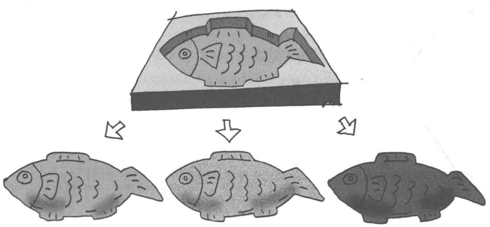
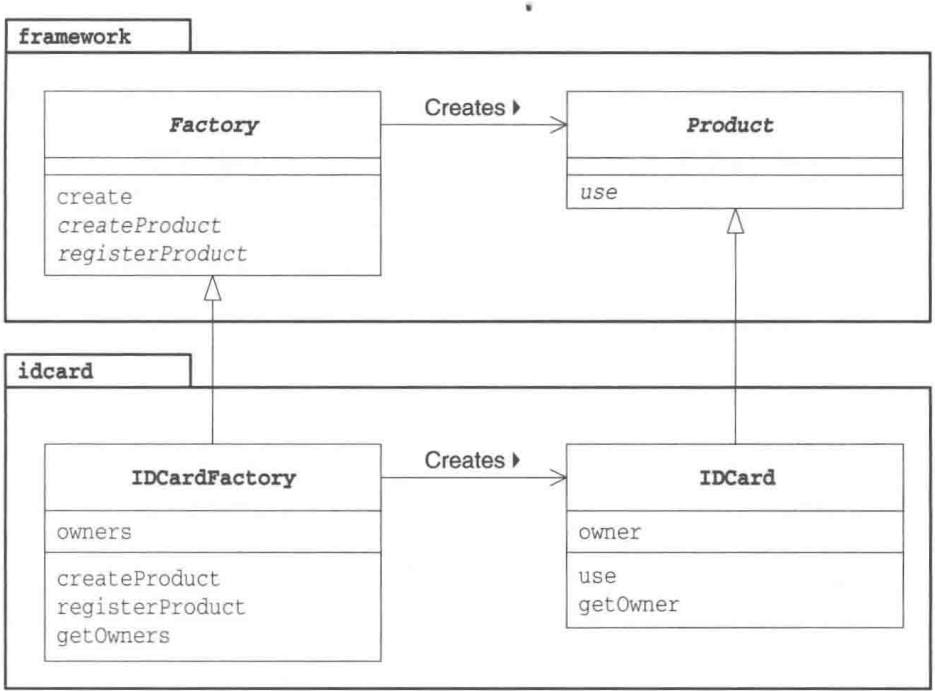
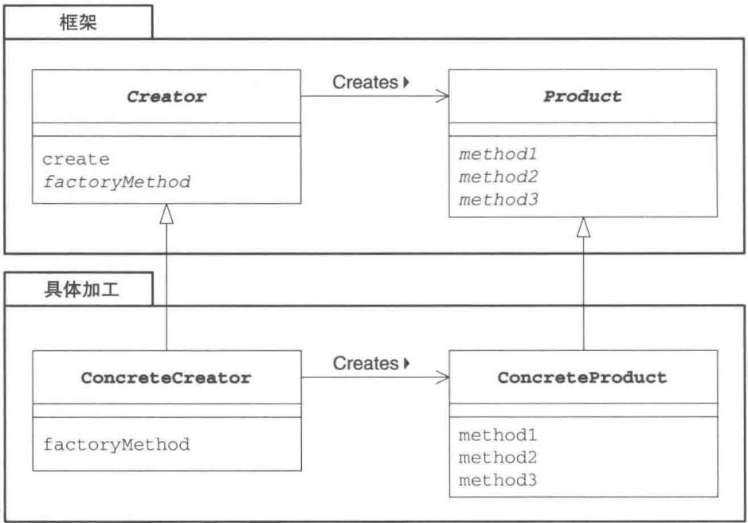

# 第4章 Factory Method模式——将实例的生成交给子类

> 来源：《图解设计模式》PDF 第 66–75 页，MinerU OCR 转写，如有疑问以原书为准

<!-- PDF p66 -->



<!-- PDF p67 · 书页 34 -->

## 4.1 Factory Method 模式

在 Template Method 模式（第 3 章）中，我们在父类中规定处理的流程，在子类中实现具体的处理。如果我们将该模式用于生成实例，它就演变为本章中我们所要学习的 Factory Method 模式。

Factory 有 “工厂” 的意思。用 Template Method 模式来构建生成实例的工厂，这就是 Factory Method 模式。

在 Factory Method 模式中，父类决定实例的生成方式，但并不决定所要生成的具体的类，具体的处理全部交给子类负责。这样就可以将生成实例的框架（framework）和实际负责生成实例的类解耦。

## 4.2 示例程序

首先让我们来看一段 Factory Method 模式的示例程序。这段示例程序的作用是制作身份证（ID 卡），它其中有 5 个类（图 4-1）。

Product 类和 Factory 类属于 framework 包。这两个类组成了生成实例的框架。

IDCard 类和 IDCardFactory 类负责实际的加工处理，它们属于 idcard 包。

Main类是用于测试程序行为的类。

在阅读示例程序时，请注意所阅读的代码属于 framework 包还是 idcard 包。

- 生成实例的框架（framework包）

- 加工处理（idcard包）

Java 注意 开发对外公开的包时，有人推荐将域名反着写，形成世界上独一无二的包名。例如，将hyuki.com这个域名反过来，以com.hyuki作为包名的前面部分。不过，此处只是为了让读者更容易理解而举的例子，笔者并没有完全遵守该规则。

表4-1 类的一览表

| 包 | 名字 | 说明 |
| --- | --- | --- |
| framework | Product | 只定义抽象方法 use 的抽象类 |
| framework | Factory | 实现了 create 方法的抽象类 |
| idcard | IDCard | 实现了 use 方法的类 |
| idcard | IDCardFactory | 实现了 createProduct、registerProduct 方法的类 |
| 无名 | Main | 测试程序行为的类 |

<!-- PDF p68 · 书页 35 -->

图4-1 示例程序的类图



### Product类

framework 包中的 Product 类（代码清单 4-1）是用来表示“产品”的类。在该类中仅声明了 use 抽象方法。use 方法的实现则被交给了 Product 类的子类负责。

在这个框架中，定义了产品是“任意的可以 use 的”的东西。

代码清单 4-1 Product 类 (Product.java)

```java
// 【Factory Method 模式】框架部分：抽象的“产品”
// framework 包只定义框架，不涉及任何具体产品
package framework;
public abstract class Product {
    public abstract void use(); // 产品都能被“使用”
}
```

### Factory类

在 framework 包中的 Factory 类（代码清单 4-2）中，我们使用了 Template Method 模式。该类还声明了用于“生成产品”的 createProduct 抽象方法和用于“注册产品”的 registerProduct 抽象方法。“生成产品”和“注册产品”的具体处理则被交给了 Factory 类的子类负责。

在这个框架中，我们定义了工厂是用来“调用 create 方法生成 Product 实例”的。而 create 方法的实现是先调用 createProduct 生成产品，接着调用 registerProduct 注册产品。

具体的实现内容根据 Factory Method 模式适用的场景不同而不同。但是，只要是 Factory Method 模式，在生成实例时就一定会使用到 Template Method 模式。

<!-- PDF p69 · 书页 36 -->

代码清单 4-2 Factory 类 (Factory.java)

```java
/**
 * 框架部分：抽象的“工厂”
 * create() 是模板方法：先生成产品，再登记产品
 * 具体生成什么、怎么登记，交给子类 → “工厂方法”就是 createProduct
 */
public abstract class Factory {
    public final Product create(String owner) {
        Product p = createProduct(owner); // 第 1 步：生成
        registerProduct(p);               // 第 2 步：登记
        return p;
    }
    protected abstract Product createProduct(String owner);   // 工厂方法
    protected abstract void registerProduct(Product product);
}
```

### IDCard类

之前我们已经理解了框架（framework 包）的代码。接下来让我们把关注点转移到负责加工处理的这一边（idcard 包）。我们先来编写表示 ID 卡的类，即 IDCard 类。为了能够明显地体现出与框架的分离，我们将这个类放在 idcard 包中。IDCard 类（代码清单 4-3）是产品 Product 类的子类。

代码清单 4-3 IDCard 类 (IDCard.java)

```java
// 具体产品：ID 卡（idcard 包负责具体实现）
package idcard;
import framework.*;
public class IDCard extends Product {
    private String owner; // 持卡人
    // 构造函数不写 public：同包的工厂才能 new，外部必须通过工厂获取
    IDCard(String owner) {
        System.out.println("制作" + owner + "的ID卡。");
        this.owner = owner;
    }
    public void use() {
        System.out.println("使用" + owner + "的ID卡。");
    }
    public String getOwner() {
        return owner;
    }
}
```

### IDCardFactory 类

IDCardFactory 类（代码清单 4-4）实现了 createProduct 方法和 registerProduct 方法。

createProduct 方法通过生成 IDCard 的实例来 “生产产品”。

registerProduct 方法则通过将 IDCard 的 owner（持有人）保存到 owners 字段中来实现“注册产品”。

代码清单 4-4 IDCardFactory 类（IDCardFactory.java）

```java
// 具体工厂：生产 ID 卡，并记录所有持卡人
package idcard;
import framework.*;
import java.util.*;
public class IDCardFactory extends Factory {
    private List owners = new ArrayList(); // 已登记的持卡人
    protected Product createProduct(String owner) {
        return new IDCard(owner);
    }
    protected void registerProduct(Product product) {
        owners.add(((IDCard)product).getOwner()); // 强转成 IDCard 才能取持卡人
    }
    public List getOwners() {
        return owners;
    }
}
```

<!-- PDF p70 · 书页 37 -->

### Main类

在Main类（代码清单4-5）中，我们使用framework包和idcard包来制作和使用IDCard。

代码清单 4-5 Main 类 (Main.java)

```java
// 使用：只依赖框架里的 Factory 和 Product，换工厂就能换产品
import framework.*;
import idcard.*;
public class Main {
    public static void main(String[] args) {
        Factory factory = new IDCardFactory();
        Product card1 = factory.create("小明");
        Product card2 = factory.create("小红");
        Product card3 = factory.create("小刚");
        card1.use();
        card2.use();
        card3.use();
    }
}
```

图4-2 运行结果

```text
制作小明的ID卡。  
制作小红的ID卡。  
制作小刚的ID卡。  
使用小明的ID卡。  
使用小红的ID卡。  
使用小刚的ID卡。
```

## 4.3 Factory Method 模式中的登场角色

在 Factory Method 模式中有以下登场角色。通过查看 Factory Method 模式的类图（图 4-3），我们可以知道，父类（框架）这一方的 Creator 角色和 Product 角色的关系与子类（具体加工）这一方的 ConcreteCreator 角色和 ConcreteProduct 角色的关系是平行的。

<!-- PDF p71 · 书页 38 -->

图4-3 FactoryMethod模式的类图



### ◆ Product（产品）

Product 角色属于框架这一方，是一个抽象类。它定义了在 Factory Method 模式中生成的那些实例所持有的接口（API），但具体的处理则由子类 ConcreteProduct 角色决定。在示例程序中，由 Product 类扮演此角色。

### ◆ Creator（创建者）

Creator 角色属于框架这一方，它是负责生成 Product 角色的抽象类，但具体的处理则由子类 ConcreteCreator 角色决定。在示例程序中，由 Factory 类扮演此角色。

Creator 角色对于实际负责生成实例的 ConcreteCreator 角色一无所知，它唯一知道的就是，只要调用 Product 角色和生成实例的方法（图 4-3 中的 factoryMethod 方法），就可以生成 Productde 的实例。在示例程序中，createProduct 方法是用于生成实例的方法。不用 new 关键字来生成实例，而是调用生成实例的专用方法来生成实例，这样就可以防止父类与其他具体类耦合。

### ◆ ConcreteProduct（具体的产品）

ConcreteProduct 角色属于具体加工这一方，它决定了具体的产品。在示例程序中，由 IDCard 类扮演此角色。

### ◆ ConcreteCreator（具体的创建者）

ConcreteCreator 角色属于具体加工这一方，它负责生成具体的产品。在示例程序中，由 IDCardFactory 类扮演此角色。

<!-- PDF p72 · 书页 39 -->

## 4.4 拓展思路的要点

### 框架与具体加工

至此，我们分别学习了“框架”与“具体加工”这两方面的内容。它们分别被封装在framework包和idcard包中。

这里，让我们用相同的框架创建出其他的“产品”和“工厂”。例如，我们这次要创建表示电视机的类Television和表示电视机工厂的类TelevisionFactory。这时，我们只需要引入（import）framework包就可以编写television包。

请注意这里我们没有修改，也根本没有必要修改 framework 包中的任何内容，就可以创建出其他的“产品”和“工厂”。

请回忆一下，在framework包中我们并没有引入idcard包。在Product类和Factory类中，并没有出现IDCard和IDCardFactory等具体类的名字。因此，即使用已有的框架生成全新的类时，也完全不需要对framework进行修改，即不需要“将television包引入到框架中”。关于这一点，我们称作是“framework包不依赖于idcard包”。

### 生成实例——方法的三种实现方式

在示例程序中，Factory 类的 createProduct 方法是抽象方法，也就是说需要在子类中实现该方法。

createProduct 方法的实现方式一般有以下 3 种。

### ◆指定其为抽象方法

指定其为抽象方法。一旦将 createProduct 指定为抽象方法后，子类就必须实现该方法。如果子类不实现该方法，编译器将会报告编译错误。这也是示例程序所采用的方式。

```java
// 工厂方法的实现方式 1：抽象方法 → 子类必须实现
abstract class Factory {
    public abstract Product createProduct(String name);
    ...
}
```

### ◆为其实现默认处理

为其实现默认处理。实现默认处理后，如果子类没有实现该方法，将进行默认处理。

```java
// 实现方式 2：父类提供默认实现 → 子类没重写就用默认的
// （这种写法要求 Product 不是抽象类，才能直接 new）
class Factory {
    public Product createProduct(String name) {
        return new Product(name);
    }
    ...
}
```

不过，这时是使用 new 关键字创建出实例的，因此不能将 Product 类定义为抽象类。

<!-- PDF p73 · 书页 40 -->

### ◆ 在其中抛出异常

在其中抛出异常的方法。createProduct 方法的默认处理为抛出异常，这样一来，如果未在子类中实现该方法，程序就会在运行时出错（报错，告知开发人员没有实现 createProduct 方法）。

```java
// 实现方式 3：默认实现直接抛异常 → 子类没重写就会在运行时报错
class Factory {
    public Product createProduct(String name) {
        throw new FactoryMethodRuntimeException();
    }
    ...
}
```

不过，需要另外编写 FactoryMethodRuntimeException 异常类。

### 使用模式与开发人员之间的沟通

不论是我们在第 3 章中学习的 Template Method 模式还是本章中学习的 Factory Method 模式，在实际工作中使用时，都会让我们感觉到比较困难。这是因为，如果仅阅读一个类的代码，是很难理解这个类的行为的。必须要理解父类中所定义的处理的框架和它里面所使用的抽象方法，然后阅读代码，了解这些抽象方法在子类中的实现才行。

通常，使用设计模式设计类时，必须要向维护这些类的开发人员正确地传达设计这些设计模式的意图。否则，维护人员在修改设计时可能会违背设计者最初的意图。

这时，我们建议在程序注释中和开发文档中记录所使用的设计模式的名称和意图。

## 4.5 相关的设计模式

### ◆ Template Method 模式（第 3 章）

Factory Method 模式是 Template Method 的典型应用。在示例程序中，create 方法就是模板方法。

### ◆ Singleton 模式（第 5 章）

在多数情况下我们都可以将 Singleton 模式用于扮演 Creator 角色（或是 ConcreteCreator 角色）的类。这是因为在程序中没有必要存在多个 Creator 角色（或是 ConcreteCreator 角色）的实例。不过在示例程序中，我们并没有使用 Singleton 模式。

### ◆ Composite 模式（第 11 章）

有时可以将 Composite 模式用于 Product 角色（或是 ConcreteProduct 角色）。

### ◆ Iterator 模式（第 1 章）

有时，在 Iterator 模式中使用 iterator 方法生成 Iterator 的实例时会使用 Factory Method 模式。

<!-- PDF p74 · 书页 41 -->

## 4.6 本章所学知识

在本章中，我们学习了使用 Template Method 模式生成实例的 Factory Method 模式。

大家习惯了设计模式的思考方式吗？在设计模式中，多个类和接口扮演各自的角色，互相协作进行工作。在分析设计模式时，不应当将其中一个类单独拿出来分析，必须着眼于类和接口之间的相互关系。只有白雪公主一个人的话，是演不了白雪公主这部话剧的。

当然，世上也有独自一人可以演出的“独角戏”。在下一章中，我们将学习类似于“独角戏”的设计模式。

## 4.7 练习题

答案请参见附录 A (P.296)

### 习题4-1

Java 在示例程序中，IDCard类（代码清单4-3）的构造函数并不是public，请问这是想表达什么意思呢？

```java
// 习题 1：IDCard 的构造函数没有 public
// → 只有同一个包（idcard）里的类能 new，强制外部通过 IDCardFactory 来创建
public class IDCard extends Product {
    ...
    IDCard(String owner) {
        ...
        this.owner = owner;
    }
    ...
}
```

#### 答案（附录 A）

这是因为想让 idcard 包外的类无法 new 出 IDCard 类的实例。这样就可以强迫外部必须通过 IDCardFactory 来生成 IDCard 的实例。

<!-- PDF p330 · 书页 297 -->

例如，在Main类（无名包）中，是无法像下面这样生成IDCard的实例的。在编译时，这行代码会报错。

```java
// 在 idcard 包外写这句会编译报错（构造函数不可见）
IDCard idcard = new IDCard("小明");
```

补充说明 在 Java 中，只有同一个包中的类可以访问不带 public、protected、private 等修饰符的构造函数和方法。

### 习题4-2

请修改示例程序，为 IDCard 类（代码清单 4-3）添加卡的编号，并在 IDCardFactory 类中保存编号与所有者之间的对应表。

#### 答案（附录 A）

代码请参见代码清单 A4-1 和代码清单 A4-2。不用修改 framework.Product 类（代码清单 4-1）、framework.Factory 类（代码清单 4-2）和 Main 类（代码清单 4-5）。请注意，即使修改了 IDCard 类和 IDCardFactory 类，也完全不用修改框架的代码。

编号是从100开始的，但是这并没有什么特别的意思。

之所以将 IDCardFactory 类的 createProduct 方法定义为 synchronized 方法，是为了防止程序在多线程运行时为不同的实例分配相同的编号。

代码清单 A4-1 添加了编号的 IDCard 类 (IDCard.java)

```java
// 习题 2：给 ID 卡加上编号 serial
package idcard;
import framework.*;
public class IDCard extends Product {
    private String owner;
    private int serial;   // 卡号
    IDCard(String owner, int serial) {
        System.out.println("制作" + owner + "(" + serial + ")" + "的ID卡。");
        this.owner = owner;
        this.serial = serial;
    }
    public void use() {
        System.out.println("使用" + owner + "(" + serial + ")" + "的ID卡。");
    }
    public String getOwner() {
        return owner;
    }
    public int getSerial() {
        return serial;
    }
}
```

代码清单 A4-2 添加了编号的 IDCardFactory 类（IDCardFactory.java）

```java
// 习题 2：工厂负责分配卡号（从 100 开始递增），并用 Map 记录“卡号 → 持卡人”
package idcard;
import framework.*;
import java.util.*;
public class IDCardFactory extends Factory {
    private HashMap database = new HashMap(); // 卡号 → 持卡人
    private int serial = 100;                 // 下一个卡号
    // synchronized：多线程同时创建时，避免拿到重复卡号
    protected synchronized Product createProduct(String owner) {
        return new IDCard(owner, serial++);
    }
    protected void registerProduct(Product product) {
IDCard card = (IDCard)product;
database.put(new Integer(card.getSerial()), card.getOwner());
}
public Hashtable getDatabase() {
return database;
}
}
```

<!-- PDF p331 -->

图A4-1 运行结果

```text
制作小明（100）的ID卡。  
制作小红（101）的ID卡。  
制作小刚（102）的ID卡。  
使用小明（100）的ID卡。  
使用小红（101）的ID卡。  
使用小刚（102）的ID卡。
```

### 习题4-3

Java 为了强制调用方向 Product 类（代码清单 4-1）的子类的构造函数中传入“产品名字”作为参数，我们采用了如下的定义方式。但是在编译代码时却出现了编译错误，请问这是为什么呢？

```java
// 习题 3：能不能这样定义？
// 不能：Java 的构造函数不能是 abstract，也不会被继承
public abstract class Product {
    public abstract Product(String name);
    public abstract void use();
}
```

<!-- PDF p75 -->

A

#### 答案（附录 A）

这是因为在 Java 中无法定义 abstract 的构造函数。在 Java 中，构造函数是不会被继承的，因此定义 abstract 的构造函数没有任何意义。

要想实现习题中的需求，不应当在构造函数中设置产品的名字，而应当另外声明一个设置产品名字的专用方法。
