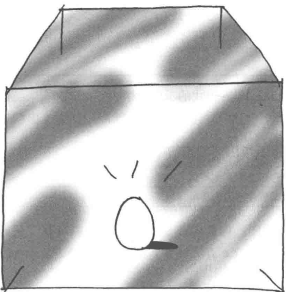

# 第5章 Singleton模式——只有一个实例

> 来源：《图解设计模式》PDF 第 76–81 页，MinerU OCR 转写，如有疑问以原书为准

<!-- PDF p76 -->



<!-- PDF p77 · 书页 44 -->

## 5.1 Singleton 模式

程序在运行时，通常都会生成很多实例。例如，表示字符串的 java.lang.String 类的实例与字符串是一对一的关系，所以当有 1000 个字符串的时候，会生成 1000 个实例。

但是，当我们想在程序中表示某个东西只会存在一个时，就会有“只能创建一个实例”的需求。典型的例子有表示程序所运行于的那台计算机的类、表示软件系统相关设置的类，以及表示视窗系统（window system）的类。

当然，只要我们在编写程序时多加注意，确保只调用一次 new MyClass()，就可以达到只生成一个实例的目的。但是，如果我们不想“必须多加注意才能确保生成一个实例”，而是要达到如下目的时，应当怎么做呢？

- 想确保任何情况下都绝对只有1个实例

- 想在程序上表现出“只存在一个实例”

像这样的确保只生成一个实例的模式被称作 Singleton 模式。Singleton 是指只含有一个元素的集合。因为本模式只能生成一个实例，因此以 Singleton 命名。

在本章中，我们将学习 Singleton 模式。

## 5.2 示例程序

首先让我们来看一段 Singleton 模式的示例程序。

表 5-1 类的一览表

| 名字 | 说明 |
| --- | --- |
| Singleton | 只存在一个实例的类 |
| Main | 测试程序行为的类 |

图 5-1 是示例程序的类图。构造函数 Singleton 前带有 “-”，表示 Singleton 函数是 private。此外，getInstance 方法带有下划线，表示该方法是 static 方法（这是 UML 的规则，请参见 P.xii）。

图5-1 示例程序的类图

| Singleton |
| --- |
| -singleton |
| -Singleton +getInstance |

### Singleton类

Singleton 类（代码清单 5-1）只会生成一个实例。Singleton 类定义了 static 字段（类的成员变量）singleton，并将其初始化为 Singleton 类的实例。初始化行为仅在该类被加载时进行一次。

<!-- PDF p78 · 书页 45 -->

Singleton 类的构造函数是 Private 的，这是为了禁止从 Singleton 类外部调用构造函数。如果从 Singleton 类以外的代码中调用构造函数 new Singleton()，就会出现编译错误。如果程序员十分小心，不会使用 new 关键字生成实例，就不需要定义构造函数为 private。但是这样的话，Singleton 模式也就没有意义了。Singleton 模式的作用在于可以确保任何情况下都只能生成一个实例。为了达到这个目的，必须设置构造函数为 private。

为了便于测试 Singleton 类的行为，我们在构造函数中输出了“生成了一个实例。”这一信息。

我们还准备了 getInstance 方法，以便于程序从 Singleton 类外部获取 Singleton 类唯一的实例。在本例中，方法名为 getInstance，不过并不是必须用这个名字。但是作为获取唯一实例的方法，通常情况下都会这样为其命名。

代码清单 5-1 Singleton 类 (Singleton.java)

```java
/**
 * 【Singleton 模式】：保证一个类只有一个实例
 * 三个要点：
 * 1. static 字段保存唯一实例，类加载时就创建好
 * 2. 构造函数 private → 外部不能 new
 * 3. static 的 getInstance() 返回这个唯一实例
 */
public class Singleton {
    private static Singleton singleton = new Singleton(); // 唯一实例
    private Singleton() {                                  // 私有构造
        System.out.println("生成了一个实例。");
    }
    public static Singleton getInstance() {               // 获取入口
        return singleton;
    }
}
```

### Main类

Main 类（代码清单 5-2）使用了 Singleton 模式。在 Main 类中，我们调用了两次 Singleton 类的 getInstance 方法，来获取 Singleton 类的实例，并将返回值分别保存在 obj1 和 obj2 中。然后通过表达式 obj1 == obj2 是否成立来判断 obj1 和 obj2 是否为同一个实例。

代码清单 5-2 使用 Singleton 模式的 Main 类 (Main.java)

```java
// 验证：两次 getInstance() 拿到的是不是同一个对象
public class Main {
    public static void main(String[] args) {
        System.out.println("Start.");
        Singleton obj1 = Singleton.getInstance();
        Singleton obj2 = Singleton.getInstance();
        if (obj1 == obj2) {   // == 比较的是“是不是同一个对象”
            System.out.println("obj1 与 obj2 是相同的实例。");
        } else {
            System.out.println("obj1 与 obj2 是不同的实例。");
        }
        System.out.println("End.");
    }
}
```

图5-2展示了程序的运行结果。

<!-- PDF p79 · 书页 46 -->

图5-2 运行结果

```text
Start.
生成了一个实例。
obj1 与 obj2 是相同的实例。
End.
```

## 5.3 Singleton 模式中的登场角色

在 Singleton 模式中有以下登场角色。

### ◆ Singleton

在 Singleton 模式中，只有 Singleton 这一个角色。Singleton 角色中有一个返回唯一实例的 static 方法。该方法总是会返回同一个实例。

图 5-3 Singleton 模式的类图


## 5.4 拓展思路的要点

### 为什么必须设置限制

Singleton 模式对实例的数量设置了限制。为什么要在程序中特意设置这个限制呢？设置限制其实就是为程序增加一项前提条件。

当存在多个实例时，实例之间相互影响，可能会产生意想不到的 Bug。

但是，如果我们可以确保只有一个实例，就可以在这个前提条件下放心地编程了。

### 何时生成这个唯一的实例

稍微注意一下示例程序的运行结果（图 5-2）就会发现，在 “Start.” 之后就显示出了 “生成了一个实例。”

程序运行后，在第一次调用 getInstance 方法时，Singleton 类会被初始化。也就是在这个时候，static 字段 singleton 被初始化，生成了唯一的一个实例。

关于类的初始化的详细信息，请参见 The Java Language Specification（附录 E[JLS]）一书中的“12.4 Initialization of Classes and Interfaces”一节。

<!-- PDF p80 · 书页 47 -->

## 5.5 相关的设计模式

在以下模式中，多数情况下只会生成一个实例。

- AbstractFactory 模式（第 8 章）

- Builder 模式（第 7 章）

- Facade模式（第15章）

- Prototype 模式（第 6 章）

## 5.6 本章所学知识

在本章中，我们学习了确保只能生成一个实例的 Singleton 模式。我们在 Singleton 模式中定义了用于获取唯一一个实例的 static 方法，同时，为了防止不小心使用 new 关键字创建实例，还将构造函数设置为 private。

在下一章中，我们将学习不根据类创建实例，而是根据一个实例来创建另外一个实例的模式。

## 5.7 练习题

答案请参见附录 A (P.298)

### 习题5-1

在下面的 TicketMaker 类（代码清单 5-3）中，每次调用 getNextTicketNumber 方法都会返回 1000,1001,1002... 的数列。我们可以用它生成票的编号或是其他序列号。在现在该类的实现方式下，我们可以生成多个该类的实例。请修改代码，运用 Singleton 模式确保只能生成一个该类的实例。

代码清单 5-3 非 Singleton 模式的 TicketMaker 类 (TicketMaker.java)

```java
// 习题 1 原题：发号机，每次调用返回下一个号码（从 1000 开始）
// 问题：如果 new 了多个 TicketMaker，就会发出重复的号码
public class TicketMaker {
    private int ticket = 1000;
    public int getNextTicketNumber() {
        return ticket++;   // 先返回当前值，再加 1
    }
}
```

#### 答案（附录 A）

代码请参见代码清单 A5-1。

这里稍微有些偏离了 Singleton 模式的话题。请注意 getNextTicketNumber 方法是 synchronized 方法，这是为了能让 getNextTicketNumber 在多线程环境下正常工作。如果没有将它定义为 synchronized 方法，在多线程环境中可能会返回相同的编号。

代码清单 A5-1 Singleton 模式的 TicketMaker 类 (TicketMaker.java)

```java
// 习题 1 答案：改成单例，全局只有一台发号机
public class TicketMaker {
    private int ticket = 1000;
    private static TicketMaker singleton = new TicketMaker(); // 唯一实例
    private TicketMaker() {
    }
    public static TicketMaker getInstance() {
        return singleton;
    }
    // synchronized：多线程同时取号时，避免拿到同一个号
    public synchronized int getNextTicketNumber() {
        return ticket++;
    }
}
```

<!-- PDF p332 · 书页 299 -->

代码清单 A5-2 调用 TicketMaker 类的 Main 类 (Main.java)

```java
// 测试：连续取 10 个号
public class Main {
    public static void main(String[] args) {
        System.out.println("Start.");
        for (int i = 0; i < 10; i++) {
            System.out.println(i + ":" + TicketMaker.getInstance() . getNextTicketNumber());
        }
        System.out.println("End.");
    }
}
```

图A5-1 运行结果

```text
Start.
0:1000
1:1001
2:1002
3:1003
4:1004
5:1005
6:1006
7:1007
8:1008
9:1009
End.
```

### 习题5-2

请编写 Triple 类，实现最多只能生成 3 个 Triple 类的实例，实例编号分别为 0,1,2 且可以通过 getInstance(int id) 来获取该编号对应的实例（在第 10 章中也出现了这样的类）。

#### 答案（附录 A）

让 Triple 类（代码清单 A5-3）的实例持有自己的编号（id）和一个静态 Triple 类型的数组，并事先在数组中保存 3 个 Triple 类的实例。getInstance 方法接收的参数是数组的下标，它会返回 1 个数组下标所对应的 Triple 的实例。

为了在用字符串表示 Triple 的实例时能看到它的编号，我们实现了 toString 方法。

代码清单 A5-3 Triple 类 (Triple.java)

```java
// 习题 2：只能有 3 个实例的类（Singleton 的扩展：“多例”）
// 用数组提前创建好 3 个，按编号取用
public class Triple {
    private static Triple[] triple = new Triple[] {
        new Triple(0),
        new Triple(1),
        new Triple(2),
    };
    private int id;
    private Triple(int id) {           // 私有构造：外部不能再创建
        System.out.println("The instance " + id + " is created.");
        this.id = id;
    }
    public static Triple getInstance(int id) {
        return triple[id];             // id 只能是 0、1、2
    }
    public String toString() {
        return "[Triple id=" + id + "]";
    }
}
```

<!-- PDF p333 · 书页 300 -->

代码清单 A5-4 调用 Triple 类的 Main 类 (Main.java)

```java
// 测试：循环 9 次，按 0、1、2、0、1、2…… 取实例
public class Main {
    public static void main(String[] args) {
        System.out.println("Start.");
        for (int i = 0; i < 9; i++) {
            Triple triple = Triple.getInstance(i % 3); // i 除以 3 的余数
            System.out.println(i + ":" + triple);
        }
        System.out.println("End.");
    }
}
```

图A5-2 运行结果

```text
Start.
The instance 0 is created.
The instance 1 is created.
The instance 2 is created.
0:[Triple id=0]
1:[Triple id=1]
2:[Triple id=2]
3:[Triple id=0]
4:[Triple id=1]
5:[Triple id=2]
6:[Triple id=0]
7:[Triple id=1]
8:[Triple id=2]
End.
```

- 请不习惯静态字段的读者注意

在代码清单 A5-3 中，Triple 类的 triple 字段会在生成 Triple 类的实例时被初始化，但这并不会形成无限循环。大家可能会有“在生成 Triple 类的实例时需要 Triple 类的实例”这种错觉，其实不然。之所以不会形成无限循环，是因为 triple 字段并不是实例的字段，而是静态字段。triple 字段的初始化只会在第一次生成时进行，之后生成 Triple 类的实例时不会再初始化 triple 字段。如果不将 triple 字段定义为静态字段，就会进入无限循环，在运行时会报错（堆栈溢出）。

### 习题5-3

某位开发人员编写了如下的 Singleton 类（代码清单 5-4）。但这并非严格的 Singleton 模式。请问是为什么呢？

<!-- PDF p81 · 书页 48 -->

代码清单 5-4 为何不是严格的 Singleton 模式 (Singleton.java)

```java
// 习题 3：这个写法（第一次用到时才创建，即“懒汉式”）有什么问题？
public class Singleton {
    private static Singleton singleton = null;  // 先不创建
    private Singleton() {
        System.out.println("生成了一个实例。");
    }
    public static Singleton getInstance() {
        if (singleton == null) {                // ⚠️ 多线程下，几个线程可能同时通过这个判断
            singleton = new Singleton();
        }
        return singleton;
    }
}
```

提示 该问题与多线程有关。该问题参考了 Java in Practice 一书（请参见附录 E 中的 [Warren]）。

#### 答案（附录 A）

这是因为在多个线程几乎同时调用 Singleton.getInstances 方法时，可能会生成多个实例。

代码清单 A5-5 多个线程调用 Singleton.getInstances 方法 (Main.java)

```java
// 验证用的多线程程序：启动 A、B、C 三个线程，各自调用 getInstance()
public class Main extends Thread {
    public static void main(String[] args) {
        System.out.println("Start.");
        new Main("A").start();
        new Main("B").start();
        new Main("C").start();
        System.out.println("End.");
    }
}
// 每个线程执行的内容
public void run() {
    Singleton obj = Singleton.getInstance();
    System.out.println(getName() + ": obj = " + obj);
}
public Main(String name) {
    super(name); // 线程名
}
```

<!-- PDF p334 · 书页 301 -->

代码清单 A5-5 的运行结果会根据运行时计算机的状态不同而不同，为了确保能生成多个实例，我们将 Singleton 类修改为代码清单 A5-6 中的代码。图 A5-3 是运行结果示例。

代码清单 A5-6 为了确保能生成多个实例，我们故意降低了程序处理速度（Singleton.java）

```java
// 在构造函数里故意睡 1 秒，放大“同时进入 if”的概率，方便看到问题
public class Singleton {
    private static Singleton singleton = null;
    private Singleton() {
        System.out.println("生成了一个实例。");
        slowdown();
    }
    public static Singleton getInstance() {
        if (singleton == null) {
            singleton = new Singleton();
        }
        return singleton;
    }
    private void slowdown() {
        try {
            Thread.sleep(1000); // 暂停 1 秒
        } catch (InterruptedException e) {
        }
    }
```

图A5-3 运行结果示例

```text
Start.
End.
生成了一个实例。          ←生成多个实例
生成了一个实例。
生成了一个实例。
A: obj = Singleton@6ec612      ←A, B, C中实例的内容不同
B: obj = Singleton@dd1f7
C: obj = Singleton@53c015
```

在以上代码中，如下条件判断是线程不安全的。

```java
// 问题出在这里：判断和创建不是一步完成的
// 线程 A 判断为 null 还没来得及创建时，线程 B 也判断为 null → 各创建一个
if (singleton == null) {
    singleton = new Singleton();
}
```

在使用 singleton == null 判断第一个实例是否为 null 后，执行了下面的语句。

```text
singleton = new Singleton();
```

<!-- PDF p335 · 书页 302 -->

但是，在赋值之前，其他线程可能会进行 singleton == null 判断。

因此，只有像代码清单 A5-7 中那样，定义 getInstance 方法为 synchronized 方法后才是严谨的 Singleton 模式（该解决方案参考了 Warren 书（请参见附录 E [Warren]）。详细内容请参见笔者的另外一本拙著《图解设计模式:多线程》 ① （附录 E [Yuki02]）中的附录 B。

代码清单 A5-7 严谨的 Singleton 模式（Singleton.java）

```java
// 修正：getInstance() 加 synchronized，同一时刻只允许一个线程进入
public class Singleton {
    private static Singleton singleton = null;
    private Singleton() {
        System.out.println("生成了一个实例。");
        slowdown();
    }
    public static synchronized Singleton getInstance() { // ✅ 加锁
        if (singleton == null) {
            singleton = new Singleton();
        }
        return singleton;
    }
    private void slowdown() {
        try {
            Thread.sleep(1000);
        } catch (InterruptedException e) {
        }
    }
}
```
