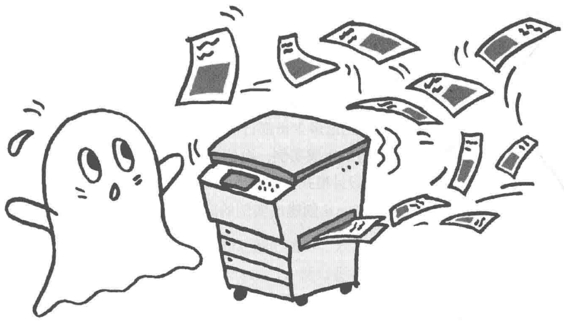
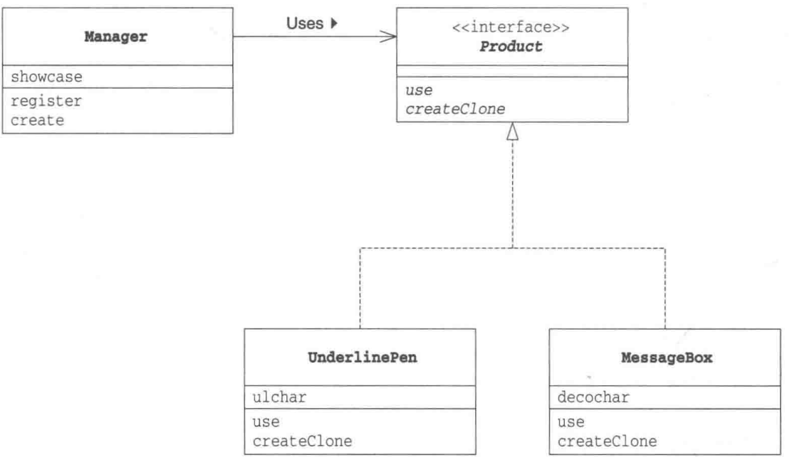
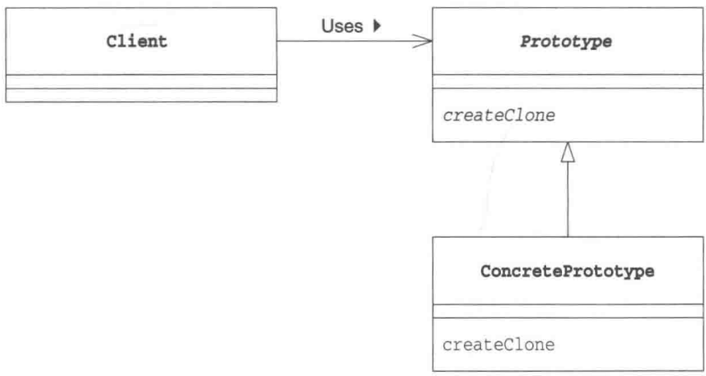

# 第6章 Prototype模式——通过复制生成实例

> 来源：《图解设计模式》PDF 第 82–93 页，MinerU OCR 转写，如有疑问以原书为准

<!-- PDF p82 -->



<!-- PDF p83 · 书页 50 -->

## 6.1 Prototype 模式

我们通常会使用以下方式生成 Something 类的实例。

```text
new Something()
```

在 Java 中，我们可以使用 new 关键字指定类名来生成类的实例。像这样使用 new 来生成实例时，是必须指定类名的。但是，在开发过程中，有时候也会有“在不指定类名的前提下生成实例”的需求。例如，在以下情况下，我们就不能根据类来生成实例，而要根据现有的实例来生成新的实例。

### (1) 对象种类繁多, 无法将它们整合到一个类中时

第一种情况是需要处理的对象太多，如果将它们分别作为一个类，必须要编写很多个类文件。

### (2) 难以根据类生成实例时

第二种情况是生成实例的过程太过复杂，很难根据类来生成实例。例如，我们假设这里有一个实例，即表示用户在图形编辑器中使用鼠标制作出的图形的实例。想在程序中创建这样的实例是非常困难的。通常，在想生成一个和之前用户通过操作所创建出的实例完全一样的实例的时候，我们会事先将用户通过操作所创建出的实例保存起来，然后在需要时通过复制来生成新的实例。

### (3) 想解耦框架与生成的实例时

第三种情况是想要让生成实例的框架不依赖于具体的类。这时，不能指定类名来生成实例，而要事先“注册”一个“原型”实例，然后通过复制该实例来生成新的实例。

根据实例生成实例与使用复印机复印文档相类似。即使不知道原来的文档中的内容，我们也可以使用复印机复制出完全相同的文档，无论多少份都行。

在本章中，我们将要学习不根据类来生成实例，而是根据实例来生成新实例的 Prototype 模式。Prototype 有 “原型” “模型” 的意思。在设计模式中，它是指根据实例原型、实例模型来生成新的实例。

在 Java 语言中，我们可以使用 clone 创建出实例的副本。在本章中，我们将学习 clone 方法与 Cloneable 接口的使用方法。

## 6.2 示例程序

首先让我们来看一段使用了 Prototype 模式的示例程序。以下这段示例程序的功能是将字符串放入方框中显示出来或是加上下划线显示出来。

示例程序中的类和接口的一览表请参见表6-1。Product接口和Manager类属于framework包，负责复制实例。虽然Manager类会调用createClone方法，但是对于具体要复制哪个类一无所知。不过，只要是实现了Product接口的类，调用它的createClone方法就可以复制出新的实例。

MessageBox 类和 UnderlinePen 类是两个实现了 Product 接口的类。只要事先将这两个类 “注册” 到 Manager 类中，就可以随时复制新的实例。

<!-- PDF p84 · 书页 51 -->

表 6-1 类和接口的一览表

| 包 | 名字 | 说明 |
| --- | --- | --- |
| framework | Product | 声明了抽象方法 use 和 createClone 的接口 |
| framework | Manager | 调用 createClone 方法复制实例的类 |
| 无名 | MessageBox | 将字符串放入方框中并使其显示出来的类。实现了 use 方法和 createClone 方法 |
| 无名 | UnderlinePen | 给字符串加上下划线并使其显示出来的类。实现了 use 方法和 createClone 方法 |
| 无名 | Main | 测试程序行为的类 |

图6-1 示例程序的类图



### Product 接口

Product 接口（代码清单 6-1）是复制功能的接口。该接口继承了 java.lang.Cloneable 接口。稍后，我们会在本章 6.6 节中对 Cloneable 接口进行详细讲解。现在大家只需要知道实现了该接口的类的实例可以调用 clone 方法来自动复制实例即可。

use 方法是用于 “使用” 的方法。具体怎么 “使用”，则被交给子类去实现。

createClone 方法是用于复制实例的方法。

代码清单 6-1 Product 接口 (Product.java)

```java
/**
 * 【Prototype 模式】：不用 new 指定类名，而是“复制一个已有的实例”来生成新实例
 * 比喻：复印机 —— 有一份样张（原型），要新的就复印一份
 * Product 继承 Cloneable：表示可以被 clone() 复制
 */
package framework;
public interface Product extends Cloneable {
    public abstract void use(String s);       // 使用：显示字符串
    public abstract Product createClone();   // 复制自己
}
```

<!-- PDF p85 · 书页 52 -->

### Manager类

Manager 类（代码清单 6-2）使用 Product 接口来复制实例。

showcase 字段是 java.util.HashMap 类型，它保存了实例的“名字”和“实例”之间的对应关系。

register 方法会将接收到的 1 组 “名字” 和 “Product 接口” 注册到 showcase 中。这里的 Product 类型的参数 proto 具体是什么呢？现在我们还无法知道 proto 到底是哪个类，但有一点可以确定的是，它肯定是实现了 Product 接口的类的实例（也就是说可以调用它的 use 方法和 createClone 方法）。

请注意，在 Product 接口和 Manager 类的代码中完全没有出现 MessageBox 类和 UnderlinePen 类的名字，这也意味着我们可以独立地修改 Product 和 Manager，不受 MessageBox 类和 UnderlinePen 类的影响。这是非常重要的，因为一旦在类中使用到了别的类名，就意味着该类与其他类紧密地耦合在了一起。在 Manager 类中，并没有写明具体的类名，仅仅使用了 Product 这个接口名。也就是说，Product 接口成为了连接 Manager 类与其他具体类之间的桥梁。

代码清单 6-2 Manager 类 (Manager.java)

```java
// 管理者：保存一批“原型”，按名字复制出新实例
// 好处：Manager 完全不知道 MessageBox、UnderlinePen 这些具体类名
package framework;
import java.util.*;
public class Manager {
    private HashMap showcase = new HashMap(); // 名字 → 原型

    // 登记原型
    public void register(String name, Product proto) {
        showcase.put(name, proto);
    }
    // 按名字找到原型，复制一份返回
    public Product create(String protoname) {
        Product p = (Product)showcase.get(protoname);
        return p.createClone();
    }
}
```

### MessageBox 类

接下来让我们看看具体的子类。MessageBox类（代码清单6-3）实现（implements）了Product接口。

decochar字段中保存的是像装饰方框那样的环绕着字符串的字符。use方法会使用decochar字段中保存的字符把要显示的字符串框起来。例如，当decochar中保存的字符为'\*', use方法接收到的字符串为Hello的时候，显示结果如下。

```text
**********
* Hello *
**********
```

createClone 方法用于复制自己。它内部所调用的 clone 方法是 Java 语言中定义的方法，用于复制自己。在进行复制时，原来实例中的字段的值也会被复制到新的实例中。我们之所以可以调用 clone 方法进行复制，仅仅是因为该类实现了 java.lang.Cloneable 接口。如果没有实现这个接口，在运行时程序将会抛出 CloneNotSupportedException 异常，因此必须用 try...catch 语句块捕捉这个异常。虽然此处 MessageBox 类只实现了 Product 接口，但是前文讲到过，Product 接口继承了 java.lang.Cloneable 接口，因此程序不会抛出 CloneNotSupportedException 异常。此外，需要注意的是，java.lang.Cloneable 接口只是起到告诉程序可以调用 clone 方法的作用，它自身并没有定义任何方法。

<!-- PDF p86 · 书页 53 -->

只有类自己（或是它的子类）能够调用 Java 语言中定义的 clone 方法。当其他类要求复制实例时，必须先调用 createClone 这样的方法，然后在该方法内部再调用 clone 方法。

代码清单 6-3 MessageBox 类 (MessageBox.java)

```java
// 具体原型 1：用指定字符把字符串框起来（效果见上方）
import framework.*;
public class MessageBox implements Product {
    private char decochar; // 边框字符，如 '*'
    public MessageBox(char decochar) {
        this.decochar = decochar;
    }
    public void use(String s) {
        int length = s.getBytes().length;
        // 上边框：字符串长度 + 4
        for (int i = 0; i < length + 4; i++) {
            System.out.print(decochar);
        }
        System.out.println("");
        // 中间：* 字符串 *
        System.out.println(decochar + " " + s + " " + decochar);
        // 下边框
        for (int i = 0; i < length + 4; i++) {
            System.out.print(decochar);
        }
        System.out.println("");
    }
    // 复制自己：调用 Java 自带的 clone()
    public Product createClone() {
        Product p = null;
        try {
            p = (Product)clone();
        } catch (CloneNotSupportedException e) { // 没实现 Cloneable 时会抛这个异常
            e.printStackTrace();
        }
        return p;
    }
}
```

### UnderlinePen类

UnderlinePen 类（代码清单 6-4）的实现与 MessageBox 几乎完全相同，不同的是在 ulchar 字段中保存的是修饰下划线样式的字符。use 方法的作用是将字符串用双引号括起来显示，并在字符串下面加上下划线。例如，当 ulchar 保存的字符为 '\~'，use 方法接收到的字符串为 Hello 时，显示结果如下。

```text
"Hello"
~~~~~
```

代码清单 6-4    UnderlinePen 类 (UnderlinePen.java)

```java
// 具体原型 2：给字符串加引号和下划线（效果见上方）
public class UnderlinePen implements Product {
    private char ulchar; // 下划线字符，如 '~'
    public UnderlinePen(char ulchar) {
        this.ulchar = ulchar;
    }
    public void use(String s) {
        int length = s.getBytes().length;
        System.out.println("\\" " + s + "\"");   // 加引号
        System.out.print(" ");
        for (int i = 0; i < length; i++) {     // 下划线
            System.out.print(ulchar);
        }
        System.out.println("");
    }
    public Product createClone() {
        Product p = null;
        try {
            p = (Product)clone();
        } catch (CloneNotSupportedException e) {
            e.printStackTrace();
        }
        return p;
    }
}
```

<!-- PDF p87 · 书页 54 -->

### Main类

Main 类（代码清单 6-5）首先生成了 Manager 的实例。接着，在 Manager 实例中注册了 UnderlinePen 的实例（带名字）和 MessageBox 的实例（带名字）（表 6-2）。

表6-2 向Manger中注册的内容

```text
名字	类和实例的内容
"strong message"(UnderlinePen 类的实例,ulchar 为 '~'
"warning box"	MessageBox 类的实例,decochar 为 '*''
"slash box"	MessageBox 类的实例,decochar 为 '/'
```

代码清单 6-5 Main 类 (Main.java)

```java
// 使用：先登记原型，再按名字复制
// （原文类名有笔误，应为 new UnderlinePen('~')、new MessageBox('*')、new MessageBox('/')）
import framework.*;
public class Main {
    public static void main(String[] args) {
        // ===== 第 1 步：准备原型并登记 =====
        // 准备
        Manager manager = new Manager();
        UnderlinePen upen = new UnderlinePenovers();
        MessageBox mbox = new MessageBoxButtons();
        MessageBox sbox = new MessageBoxButtons();
        manager.register("strong message", upen);
        manager.register("warning box", mbox);
        manager.register("slash box", sbox);
        // ===== 第 2 步：按名字复制出新实例并使用 =====
        // 生成
        Product p1 = manager.create("strong message");
        p1.use("Hello, world.");
        Product p2 = manager.create("warning box");
        p2.use("Hello, world.");
        Product p3 = manager.create("slash box");
p3.use("Hello, world.");
    }
}
```

<!-- PDF p88 · 书页 55 -->

图6-2 运行结果

```text
"Hello, world."
~~~~~~~~~~~~~
***************
* Hello, world. *
***************
//////
/ Hello, world. /
///////
```

## 6.3 Prototype 模式中的登场角色

在Prototype模式中有以下登场角色。

### ◆ Prototype（原型）

Product 角色负责定义用于复制现有实例来生成新实例的方法。在示例程序中，由 Product 接口扮演此角色。

### ◆ ConcretePrototype（具体的原型）

ConcretePrototype 角色负责实现复制现有实例并生成新实例的方法。在示例程序中，由MessageBox 类和 UnderlinePen 类扮演此角色。

### ◆ Client（使用者）

Client 角色负责使用复制实例的方法生成新的实例。在示例程序中，由 Manager 类扮演此角色。

图6-3 Prototype模式的类图



<!-- PDF p89 · 书页 56 -->

## 6.4 拓展思路的要点

### 不能根据类来生成实例吗

笔者在最初学习 Prototype 模式时也曾感觉到迷茫，既然是要创建新的实例，直接用下面这个语句不就好了吗？为什么还需要 Prototype 模式呢？

new Something()

在本章开头，我们对这个问题做了简单的回答，现在让我们回顾一下示例程序，并谈谈这个问题。

### (1) 对象种类繁多, 无法将它们整合到一个类中时

在示例程序中，一共出现了如下3种样式。

- 使用 '\~' 为字符串添加下划线

- 使用 '\*'为字符串添加边框

- 使用 '/' 为字符串添加边框

本例比较简单，只生成了3种样式，不过只要想做，不论多少种样式都可以生成。但是请试想一下，如果将每种样式都编写为一个类，类的数量将会非常庞大，源程序的管理也会变得非常困难。

### (2) 难以根据类生成实例时

本例中感觉不到这一点。大家可以试想下要开发一个用户可以使用鼠标进行操作的、类似于图形编辑器的应用程序，这样可能更加容易理解。假设我们想生成一个和用户通过一系列鼠标操作所创建出来的实例完全一样的实例。这个时候，与根据类来生成实例相比，根据实例来生成实例要简单得多。

### (3) 想解耦框架与生成的实例时

在示例程序中，我们将复制（clone）实例的部分封装在 framework 包中了。

在 Manager 类的 create 方法中，我们并没有使用类名，取而代之使用了 "strong message" 和 "slash box" 等字符串为生成的实例命名。与 Java 语言自带的生成实例的 new Something() 方式相比，这种方式具有更好的通用性，而且将框架从类名的束缚中解脱出来了。

### 类名是束缚吗

话说回来，在源程序中使用类名到底会有什么问题呢？在代码中出现要使用的类的名字不是理所当然的吗？

这里，让我们再回忆一下面向对象编程的目标之一，即“作为组件复用”。

在代码中出现要使用的类的名字并非总是坏事。不过，一旦在代码中出现要使用的类的名字，就无法与该类分离开来，也就无法实现复用。

当然，可以通过替换源代码或是改变类名来解决这个问题。但是，此处说的“作为组件复用”中不包含替换源代码。以 Java 来说，重要的是当手边只有 class 文件 (.class) 时，该类能否被复用。即使没有 Java 文件 (.java) 也能复用该类才是关键。

<!-- PDF p90 · 书页 57 -->

当多个类必须紧密结合时，代码中出现这些类的名字是没有问题的。但是如果那些需要被独立出来作为组件复用的类的名字出现在代码中，那就有问题了。

## 6.5 相关的设计模式

### ◆ Flyweight 模式（第 20 章）

使用 Prototype 模式可以生成一个与当前实例的状态完全相同的实例。

而使用 Flyweight 模式可以在不同的地方使用同一个实例。

### ◆ Memento 模式（第 18 章）

使用Prototype模式可以生成一个与当前实例的状态完全相同的实例。

而使用Memento模式可以保存当前实例的状态，以实现快照和撤销功能。

◆ Composite 模式（第 11 章）以及 Decorator 模式（第 12 章）

经常使用 Composite 模式和 Decorator 模式时，需要能够动态地创建复杂结构的实例。这时可以使用 Prototype 模式，以帮助我们方便地生成实例。

### ◆ Command 模式（第 22 章）

想要复制 Command 模式中出现的命令时，可以使用 Prototype 模式。

## 6.6 延伸阅读:clone 方法和 java.lang.Clonable 接口

### Java语言的clone

Java 语言为我们准备了用于复制实例的 clone 方法。请注意，要想调用 clone 方法，被复制对象的类必须实现 java.lang.Clonable 接口，不论是被复制对象的类实现 java.lang.Cloneable 接口还是其某个父类实现 Cloneable 接口，亦或是被复制对象的类实现了 Cloneable 接口的子接口都可以。在示例程序中，MessageBox 类和 UnderlinePen 类实现了 Product 接口，而 Product 接口则是 Cloneable 接口的子接口。

实现了 Cloneable 接口的类的实例可以调用 clone 方法进行复制，clone 方法的返回值是复制出的新的实例（clone 方法内部所进行的处理是分配与要复制的实例同样大小的内存空间，接着将要复制的实例中的字段的值复制到所分配的内存空间中去）。

如果没有实现 Cloneable 接口的类的实例调用了 clone 方法，则会在运行时抛出 CloneNotSupportedException（不支持 clone 方法）异常。

笔者对上文进行了总结，结果如下。

- 实现了Cloneable接口的类的实例

→ 复制\- 没有实现Cloneable接口的类的实例

<!-- PDF p91 · 书页 58 -->

→ 发生 CloneNotSupportedException 异常

此外，java.lang 包是被默认引入的，因此无需显式地引入 java.lang 即可调用 clone 方法。

### clone 方法是在哪里定义的

clone 方法定义在 java.lang.Object 中。因为 Object 类是所有 Java 类的父类，因此所有的 Java 类都继承了 clone 方法。

### 需要实现Cloneable的哪些方法

提到 Cloneable 接口，很容易让人误以为 Cloneable 接口中声明了 clone 方法。其实这是错误的。在 Cloneable 接口中并没有声明任何方法。它只是被用来标记 “可以使用 clone 方法进行复制” 的。这样的接口被称为标记接口（marker interface）。

### clone 方法进行的是浅复制

clone 方法所进行的复制只是将被复制实例的字段值直接复制到新的实例中。换言之，它并没有考虑字段中所保存的实例的内容。例如，当字段中保存的是数组时，如果使用 clone 方法进行复制，则只会复制该数组的引用，并不会一一复制数组中的元素。

像上面这样的字段对字段的复制（field-to-field-copy）被称为浅复制（shallow copy）。clone 方法所进行的复制就是浅复制。

当使用 clone 方法进行浅复制无法满足需求时，类的设计者可以实现重写 clone 方法，实现自己需要的复制功能（重写 clone 方法时，别忘了使用 super.clone() 来调用父类的 clone 方法）。

需要注意的是，clone 方法只会进行复制，并不会调用被复制实例的构造函数。此外，对于在生成实例时需要进行特殊的初始化处理的类，需要自己去实现 clone 方法，在其内部进行这些初始化处理。

详细信息请参见 Java 的 API 参考资料中 java.lang.Object 类的 clone 方法和 Cloneable 接口这两个相关条目。

## 6.7 本章所学知识

在本章中，我们学习了不根据类，而是根据实例来生成实例的 Prototype 模式。此外，我们还学习了 clone 方法和 Clonable 接口。

<!-- PDF p92 · 书页 59 -->

## 6.8 练习题

答案请参见附录 A (P.302)

### 习题6-1

在示例程序中，MessageBox类（代码清单6-3）和UnderlinePen类（代码清单6-4）中的createClone方法的处理完全相同。从管理的角度来讲，在一个程序的多个地方出现完全相同的方法不太好，因此我们想让这两个类共用该方法，请问应该如何做呢？

#### 答案（附录 A）

例如，有以下两种方法。

- 将 Product 接口修改为 Product 类, 在 Product 类中实现 createClone 方法 (Template Method 模式)

- 定义一个 ConcreteProduct 类作为 UnderlinePen 类和 MessagePen 类的父类，让 ConcreteProduct 类实现 Product 接口，并实现 createClone 方法

不论哪种解决方法，都是通过继承来共用 createClone 方法。

### 习题6-2

Java 在 java.lang.Object 中定义了 clone 方法, 那么请问 java.lang.Object 类实现了 java.lang.Clonable 接口了吗?

<!-- PDF p93 -->

\*

#### 答案（附录 A）

没有，java.lang.Object 类并没有实现 java.lang.Cloneable 接口。

如果 Object 类实现了 Cloneable 接口，那么无论是哪个类的实例调用 clone 方法，都不会抛出 CloneNotSupportedException 异常。

<small>① 原书名为『Java 言語で学ぶデザインパターン入門 マルチスレッド編』, 人民邮电出版社即将引进出版。——译者注</small>
