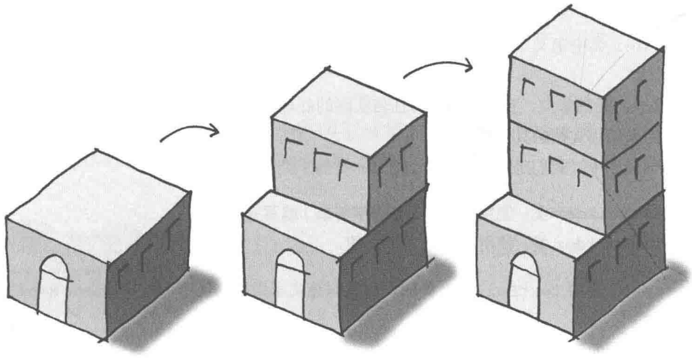
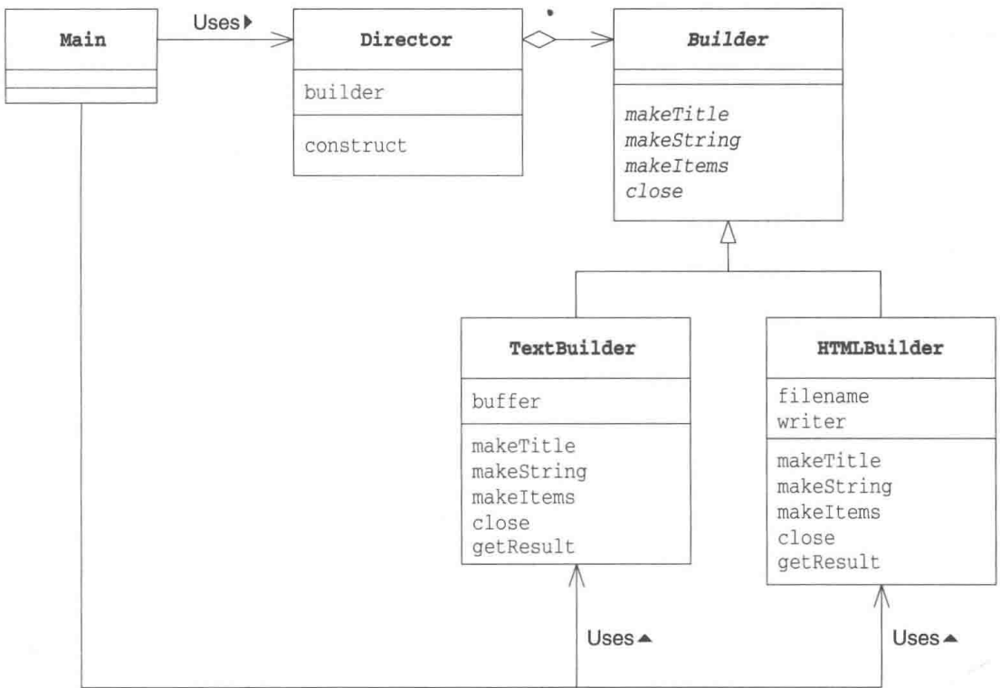
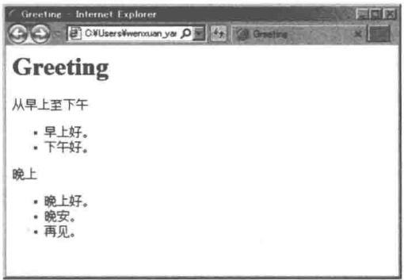
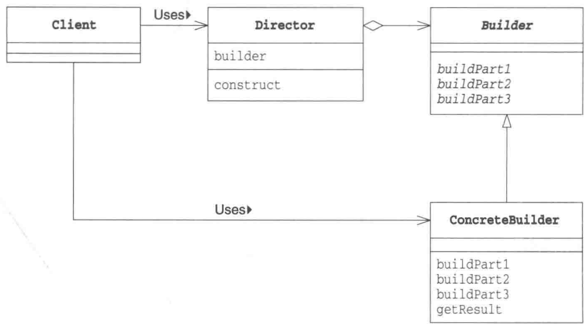
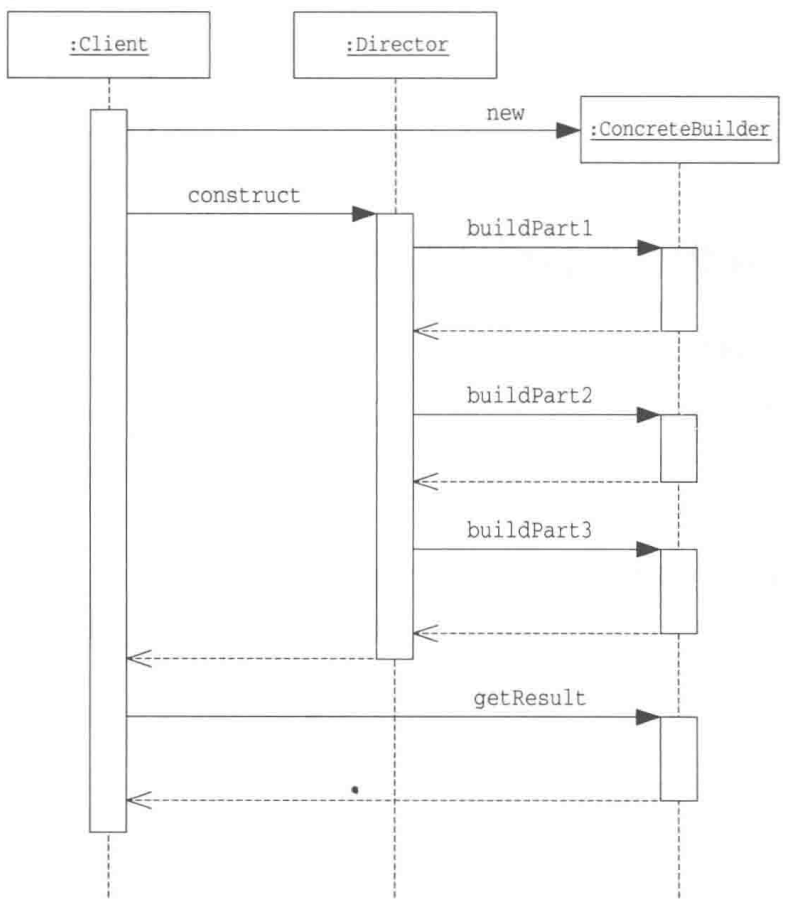
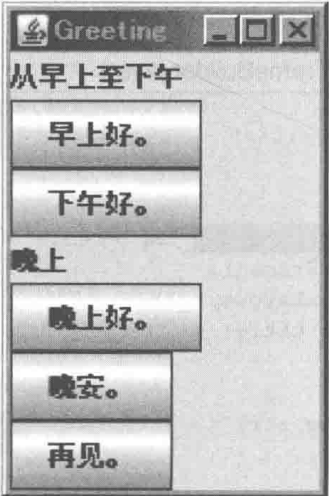

# 第7章 Builder模式——组装复杂的实例

> 来源：《图解设计模式》PDF 第 94–105 页，MinerU OCR 转写，如有疑问以原书为准

<!-- PDF p94 -->



<!-- PDF p95 · 书页 62 -->

## 7.1 Builder模式

大都市中林立着许多高楼大厦，这些高楼大厦都是具有建筑结构的大型建筑。通常，建造和构建这种具有建筑结构的大型物体在英文中称为 Build。

在建造大楼时，需要先打牢地基，搭建框架，然后自下而上地一层一层盖起来。通常，在建造这种具有复杂结构的物体时，很难一气呵成。我们需要首先建造组成这个物体的各个部分，然后分阶段将它们组装起来。

在本章中，我们将要学习用于组装具有复杂结构的实例的 Builder 模式。

## 7.2 示例程序

作为示例程序，我们来看一段使用 Builder 模式编写 “文档” 的程序。这里编写出的文档具有以下结构。

- 含有一个标题

- 含有几个字符串

- 含有条目项目

Builder 类中定义了决定文档结构的方法，然后 Director 类使用该方法编写一个具体的文档。

Builder 是抽象类，它并没有进行任何实际的处理，仅仅声明了抽象方法。Builder 类的子类决定了用来编写文档的具体处理。

在示例程序中，我们定义了以下 Builder 类的子类。

- TextBuilder类:使用纯文本（普通字符串）编写文档

- HTMLBuilder类:使用HTML编写文档

Director 使用 TextBuilder 类时可以编写纯文本文档；使用 HTMLBuilder 类时可以编写 HTML 文档。

在本章最后的习题 7-3 中，读者将尝试自己编写 Builder 类的子类。

表7-1 类的一览表

| 名字 | 说明 |
| --- | --- |
| Builder | 定义了决定文档结构的方法的抽象类 |
| Director | 编写1个文档的类 |
| TextBuilder | 使用纯文本(普通字符串)编写文档的类 |
| HTMLBuilder | 使用HTML编写文档的类 |
| Main | 测试程序行为的类 |

<!-- PDF p96 · 书页 63 -->

图7-1 示例程序的类图



### Builder类

Builder类(代码清单7-1)是一个声明了编写文档的方法的抽象类。makeTitle、makeString、makeTimes方法分别是编写标题、字符串、条目的方法。close方法是完成文档编写的方法。

代码清单 7-1 Builder 类 (Builder.java)

```java
/**
 * 【Builder 模式】：把“复杂对象的构建步骤”和“每一步的具体做法”分开
 * - Builder：定义构建文档需要哪些步骤（标题、字符串、条目、结束）
 * - Director：决定按什么顺序调用这些步骤
 * - 具体 Builder：决定每一步具体怎么做（纯文本 / HTML）
 */
public abstract class Builder {
    public abstract void makeTitle(String title);    // 编写标题
    public abstract void makeString(String str);     // 编写字符串
    public abstract void makeItems(String[] items);  // 编写条目列表
    public abstract void close();                    // 完成文档
}
```

### Director类

Director 类（代码清单 7-2）使用 Builder 类中声明的方法来编写文档。

Director 类的构造函数的参数是 Builder 类型的。但是实际上我们并不会将 Builder 类的实例作为参数传递给 Director 类。这是因为 Builder 类是抽象类，是无法生成其实例的。实际上传递给 Director 类的是 Builder 类的子类（即后面会讲到的 TextBuilder 类和 HTMLBuilder 类等）的实例。而正是这些 Builder 类的子类决定了编写出的文档的形式。

construct 方法是编写文档的方法。调用这个方法后就会编写文档。construct 方法中所使用的方法都是在 Builder 类中声明的方法（construct 的意思是“构建”）。

<!-- PDF p97 · 书页 64 -->

代码清单 7-2 Director 类 (Director.java)

```java
// 监工 Director：只调用 Builder 的方法，不知道具体是哪种 Builder
// 同一个 construct() 交给不同的 Builder，就生成不同格式的文档
public class Director {
    private Builder builder;
    public Director (Builder builder) {                  // 因为接收的参数是 Builder 类的子类
        this.builder = builder;                     // 所以可以将其保存在 builder 字段中
    }
    public void construct() {                    // 编写文档
        builder.makeTitle("Greeting");                 // 标题
        builder.makeString(" 从早上至下午 ");             // 字符串
        builder.makeItems(new String[]{            // 条目
            " 早上好。",
            " 下午好。",
        });
        builder.makeString(" 晚上 ");                   // 其他字符串
        builder.makeItems(new String[]{            // 其他条目
            " 晚上好。",
            " 晚安。",
            " 再见。",
        });
        builder.close();                    // 完成文档
    }
}
```

### TextBuilder类

TextBuilder 类（代码清单 7-3）是 Builder 类的子类，它的功能是使用纯文本编写文档，并以 String 返回结果。

代码清单 7-3 TextBuilder 类 (TextBuilder.java)

```java
// 具体 Builder 1：生成纯文本文档（效果见下方运行结果）
public class TextBuilder extends Builder {
    private StringBuffer buffer = new StringBuffer();          // 文档内容保存在该字段中
    public void makeTitle(String title) {                  // 纯文本的标题
        buffer.append("==================\n"); // 装饰线
        buffer.append("『" + title + "』\n");                 // 为标题添加『]
        buffer.append("\n");                             // 换行
    }
    public void makeString(String str) {                  // 纯文本的字符串
        buffer.append('■' + str + "\n");                 // 为字符串添加■
        buffer.append("\n");                             // 换行
    }
    public void makeItems(String[] items) {                // 纯文本的条目
        for (int i = 0; i < items.length; i++) {
            buffer.append(" ·" + items[i] + "\n");       // 为条目添加·
        }
        buffer.append("\n");                             // 换行
    }
    public void close() {                        // 完成文档
        buffer.append("==================\n"); // 装饰线
    }
    public String getResult() {                    // 完成的文档
        return buffer.toString();                 // 将 StringBuffer 变换为 String
    }
}
```

<!-- PDF p98 · 书页 65 -->

### HTMLBuilder类

HTMLBuilder类（代码清单7-4）也是Builder类的子类，它的功能是使用HTML编写文档，其返回结果是HTML文件的名字。

代码清单 7-4 HTMLBuilder 类（HTMLBuilder.java）

```java
// 具体 Builder 2：生成 HTML 文件，结果是文件名
import java.io.*;

public class HTMLBuilder extends Builder {
    private String filename;                          // 文件名
    private PrintWriter writer;                         // 用于编写文件的 PrintWriter
    public void makeTitle(String title) {            // HTML 文件的标题
        filename = title + ".html";                 // 将标题作为文件名
        try {
            writer = new PrintWriter(new FileWriter(filename));   // 生成 PrintWriter
        } catch (IOException e) {
            e.printStackTrace();
        }
        writer.println("<html><head><title>" + title + "</title></head><body>");
        // 输出标题
        writer.println("<h1>" + title + "</h1>");
    }
    public void makeString(String str) {                 // HTML 文件中的字符串
        writer.println("<p>" + str + "</p>");
    }
    public void makeItems(String[] items) {             // HTML 文件中的条目
        writer.println("<ul>");
        for (int i = 0; i < items.length; i++) {
            writer.println("<li>" + items[i] + "</li>");
        }
        writer.println("</ul>");
    }
    public void close() {                          // 完成文档
        writer.println("</body></html>");
        writer.close();                           // 关闭文件
    }
    public String getResult() {                  // 编写完成的文档
        return filename;                             // 返回文件名
    }
}
```

### Main类

Main 类（代码清单 7-5）是 Builder 模式的测试程序。我们可以使用如下的命令来编写相应格式的文档:

java Main plain: 编写纯文本文档

java Main html: 编写 HTML 格式的文档

当我们在命令行中指定参数为 plain 的时候，会将 TextBuilder 类的实例作为参数传递至 Director 类的构造函数中；而若是在命令行中指定参数为 html 的时候，则会将 HTMLBuilder 类的实例作为参数传递至 Director 类的构造函数中。

<!-- PDF p99 · 书页 66 -->

由于 TextBuilder 和 HTMLBuilder 都是 Builder 的子类，因此 Director 仅仅使用 Builder 的方法即可编写文档。也就是说，Director 并不关心实际编写文档的到底是 TextBuilder 还是 HTMLBuilder。

正因为如此，我们必须在 Builder 中声明足够多的方法，以实现编写文档的功能，但并不包括 TextBuilder 和 HTMLBuilder 中特有的方法。

```java
// 使用：根据命令行参数选择 Builder，交给同一个 Director 构建
public class Main {
    public static void main(String[] args) {
        if (args.length != 1) {        // 参数不对 → 显示用法
            usage();
            System.exit(0);
        }
        if (args[0].equals("plain")) {
            // 纯文本
            TextBuilder textbuilder = new TextBuilder();
            Director director = new Director(textbuilder);
            director.construct();                        // 按固定步骤构建
            String result = textbuilder.getResult();     // 从 Builder 取结果
            System.out.println(result);
        } else if (args[0].equals("html")) {
            // HTML
            HTMLBuilder htmlbuilder = new HTMLBuilder();
            Director director = new Director(htmlbuilder);
            director.construct();
            String filename = htmlbuilder.getResult();
            System.out.println(filename + "文件编写完成。");
        } else {
            usage();
            System.exit(0);
        }
    }
    public static void usage() {
        System.out.println("Usage: java Main plain          编写纯文本文档 ");
        System.out.println("Usage: java Main html      编写 HTML 文档 ");
    }
}
```

图7-2 运行结果（纯文本文档）

```text
java Main plain
=================
『Greeting』
■从早上至下午
·早上好。
·下午好。
■晚上
·晚上好。
·晚安。
·再见。
==================
```

<!-- PDF p100 · 书页 67 -->

图 7-3 运行结果（HTML 文档）

```text
java Main html
Greeting.html 文件编写完成。

type Greeting.html
<html><head><title>Greeting</title></head><body>
<h1>Greeting</h1>
<p>从早上至下午</p>
<ul>
<li>早上好。</li>
<li>下午好。</li>
</ul>
<p>晚上</p>
<ul>
<li>晚上好。</li>
<li>晚安。</li>
<li>再见。</li>
</ul>
</body></html>
```

图 7-4 在浏览器中查看到的 HTMLBuilder 编写的 Greeting.html



## 7.3 Builder 模式中的登场角色

Builder 模式中有以下登场角色。

### ◆ Builder（建造者）

Builder 角色负责定义用于生成实例的接口（API）。Builder 角色中准备了用于生成实例的方法。在示例程序中，由 Builder 类扮演此角色。

### ◆ ConcreteBuilder（具体的建造者）

ConcreteBuilder 角色是负责实现 Builder 角色的接口的类 (API)。这里定义了在生成实例时实际被调用的方法。此外，在 ConcreteBuilder 角色中还定义了获取最终生成结果的方法。在示例程序中，由 TextBuilder 类和 HTMLBuilder 类扮演此角色。

### ◆ Director（监工）

Director 角色负责使用 Builder 角色的接口（API）来生成实例。它并不依赖于 ConcreteBuilder 角色。为了确保不论 ConcreteBuilder 角色是如何被定义的，Director 角色都能正常工作，它只调用在Builder 角色中被定义的方法。在示例程序中，由 Director 类扮演此角色。

<!-- PDF p101 · 书页 68 -->

### ◆ Client（使用者）

该角色使用了 Builder 模式（在 GoF 的书（请参见附录 E[GoF]）中，Builder 模式并不包含 Client 角色）。在示例程序中，由 Main 类扮演此角色。

图7-5 Builder模式的类图



图7-6 Builder模式的时序图



<!-- PDF p102 · 书页 69 -->

## 7.4 相关的设计模式

### ◆ Template Method 模式（第 3 章）

在 Builder 模式中，Director 角色控制 Builder 角色。

在 Template Method 模式中，父类控制子类。 ①

### ◆ Composite 模式（第 11 章）

有些情况下 Builder 模式生成的实例构成了 Composite 模式。

### ◆ Abstract Factory 模式（第 8 章）

Builder模式和AbstractFactory模式都用于生成复杂的实例。

### ◆ Facade 模式（第 15 章）

在 Builder 模式中，Director 角色通过组合 Builder 角色中的复杂方法向外部提供可以简单生成实例的接口（API）（相当于示例程序中的 construct 方法）。

Facade 模式中的 Facade 角色则是通过组合内部模块向外部提供可以简单调用的接口（API）。

## 7.5 拓展思路的要点

### 谁知道什么

在面向对象编程中，“谁知道什么”是非常重要的。也就是说，我们需要在编程时注意哪个类可以使用哪个方法以及使用这个方法到底好不好。

请大家再回忆一下示例程序。

Main 类并不知道（没有调用）Builder 类，它只是调用了 Direct 类的 construct 方法。这样，Director 类就会开始工作（Main 类对此一无所知），并完成文档的编写。

另一方面，Director 类知道 Builder 类，它调用 Builder 类的方法来编写文档，但是它并不知道它“真正”使用的是哪个类。也就是说它并不知道它所使用的类到底是 TextBuilder 类、HTMLBuilder 类还是其他 Builder 类的子类。不过也没有必要知道，因为 Director 类只使用了 Builder 类的方法，而 Builder 类的子类都已经实现了那些方法。

Director 类不知道自己使用的究竟是 Builder 类的哪个子类也好。这是因为 “只有不知道子类才能替换”。不论是将 TextBuilder 的实例传递给 Director，还是将 HTMLBuilder 类的实例传递给 Director，它都可以正常工作，原因正是 Director 类不知道 Builder 类的具体的子类。

正是因为不知道才能够替换，正是因为可以替换，组件才具有高价值。作为设计人员，我们必须时刻关注这种“可替换性”。

<small>① 这里的控制指的是方法的调用顺序的控制。在 Builder 模式中，Director 决定了 Builder 角色中方法的调用顺序，而在 Template Method 模式中，父类决定了子类方法的调用顺序。——译者注</small>

<!-- PDF p103 · 书页 70 -->

### 设计时能够决定的事情和不能决定的事情

在 Builder 类中，需要声明编辑文档（实现功能）所必需的所有方法。Director 类中使用的方法都是 Builder 类提供的。因此，在 Builder 类中应当定义哪些方法是非常重要的。

而且，Builder类还必须能够应对将来子类可能增加的需求。在示例程序中，我们只编写了支持纯文本文档的子类和支持HTML文件的子类。但是将来可能还会希望能够编写其他形式（例如XXXX形式）的文档。那时候，到底能不能编写出支持XXXX形式的XXXXBuilder类呢？应该不需要新的方法吧？

虽然类的设计者并不是神仙，他们无法准确地预测到将来可能发生的变化。但是，我们还是有必要让设计出的类能够尽可能灵活地应对近期可能发生的变化。

### 代码的阅读方法和修改方法

在编程时，虽然有时需要从零开始编写代码，但更多时候我们都是在现有代码的基础上进行增加和修改。

这时，我们需要先阅读现有代码。不过，只是阅读抽象类的代码是无法获取很多信息的（虽然可以从方法名中获得线索）。

让我们再回顾一下示例程序。即使理解了 Builder 抽象类，也无法理解程序整体。至少必须在阅读了 Director 的代码后才能理解 Builder 类的使用方法（Builder 类的方法的调用方法）。然后再去看看 TextBuilder 类和 HTMLBuilder 类的代码，就可以明白调用 Builder 类的方法后具体会进行什么样的处理。

如果没有理解各个类的角色就动手增加和修改代码，在判断到底应该修改哪个类时，就会很容易出错。例如，如果修改 Builder 类，那么就会对 Director 类中调用 Builder 类方法的地方和 Builder 类的子类产生影响。或是如果不小心修改了 Director 类，在其内部调用了 TextBuilder 类的特有的方法，则会导致其失去作为可复用组件的独立性，而且当将子类替换为 HTMLBuilder 时，程序可能会无法正常工作。

## 7.6 本章所学知识

在本章中，我们学习了用于组装具有复杂结构的实例的 Builder 模式。组装的具体过程则被隐藏在 Director 角色中。

## 7.7 练习题

答案请参见附录 A (P.303)

### 习题7-1

Java 请将示例程序中的 Builder 类（代码清单 7-1）修改为接口并相应地修改其他类。

#### 答案（附录 A）

需要修改如下3个地方。代码清单7-2中的Director类和7-5中的Main类则无需修改。

- Builder类（代码清单7-1）中的修改点

```java
// 习题 1：把 Builder 从抽象类改成接口
public abstract class Builder
    ↓
public interface Builder
```

- TextBuilder 类（代码清单 7-3）中的修改点

```java
// 子类相应地从 extends 改成 implements
public class TextBuilder extends Builder
    ↓
public class TextBuilder implements Builder
```

- HTMLBuilder 类（代码清单 7-4）中的修改点

```java
// HTMLBuilder 同理
public class HTMLBuilder extends Builder
    ↓
public class HTMLBuilder implements Builder
```

### 习题7-2

在示例程序中的 HTMLBuilder 类（代码清单 7-4）中，需要首先调用 makeTitle 方法，但是在 TextBuilder 类（代码清单 7-3）中，则对方法调用的顺序没有要求。

<!-- PDF p104 · 书页 71 -->

请修改 Builder 类（代码清单 7-1）、TextBuilder 类（代码清单 7-3）和 HTMLBuilder 类（代码清单 7-4），确保“在调用 makeString 方法、makeItems 方法和 close 方法之前必须且只能调用一次 makeTitle 方法”。

#### 答案（附录 A）

在 Builder 类中加入检查调用顺序的方法。然后，像下面这样修改子类中需要实现的方法（Template Method 模式）。

```text
makeTitle → buildTitle
makeString → buildString
makeItems → buildItems
close      → buildDone
```

由于只有 Builder 类的子类需要使用以上这些方法，所以我们将这些方法的可见性从 public 变为 protected。

这样一来，就无需对 Director 类做任何修改了。

代码清单 A7-1 Builder 类 ( Builder.java )

```java
/**
 * 习题 2：保证 makeTitle 只能最先调用一次，之后的方法才有效
 * 做法：Builder 的 public 方法负责检查顺序，真正的构建交给 protected 的 buildXxx()
 * （这其实是 Template Method 模式）
 */
public abstract class Builder {
    private boolean initialized = false; // 标题是否已经写过

    // ===== 对外方法：先检查状态，再调用子类的实现 =====
    public void makeTitle(String title) {
        if (!initialized) {              // 只有第一次有效
            buildTitle(title);
            initialized = true;
        }
    }
    public void makeString(String str) {
        if (initialized) {               // 写过标题才有效
            buildString(str);
        }
    }
public void makeItems(String[] items) {
    if (initialized) {
        buildItems(items);
    }
}
public void close() {
    if (initialized) {
        buildDone();
    }
}
// ===== 留给子类实现的具体步骤 =====
protected abstract void buildTitle(String title);
protected abstract void buildString(String str);
protected abstract void buildItems(String[] items);
protected abstract void buildDone();
```

<!-- PDF p337 · 书页 304 -->

代码清单 A7-2 HTMLBuilder 类 (HTMLBuilder.java)

```java
// 习题 2：HTMLBuilder 改为实现 buildXxx() 方法
import java.io.*;

public class HTMLBuilder extends Builder {
    private String filename;                          // 文件名
    private PrintWriter writer;                          // 用于编写文件的 PrintWriter
    protected void buildTitle(String title) {            // HTML 文件的标题
        filename = title + ".html";                  // 将标题作为文件名
        try {
            writer = new PrintWriter(new FileWriter(filename));   // 生成 PrintWriter
        } catch (IOException e) {
            e.printStackTrace();
        }
        writer.println("<html><head><title>" + title + "</title></head><body>"); // 输出标题
        writer.println("<h1>" + title + "</h1>");
    }
    protected void buildString(String str) {                 // HTML 中的文字
        writer.println("<p>" + str + "</p>");
    }
    protected void buildItems(String[] items) {                // HTML 中的条目
        writer.println("<ul>");
        for (int i = 0; i < items.length; i++) {
            writer.println("<li>" + items[i] + "</li>");
        }
        writer.println("</ul>");
    }
    protected void buildDone() {                          // 完成文档
        writer.println("</body></html>");
        writer.close();                                // 关闭文件
    }
    public String getResult() {
        return filename;                                // 返回文件名
    }
}
```

代码清单 A7-3 TextBuilder 类 (TextBuilder.java)

```java
// 习题 2：TextBuilder 改为实现 buildXxx() 方法
public class TextBuilder extends Builder {
    private StringBuffer buffer = new *StringBuffer();          // 文档内容保存在该字段中
    protected void buildTitle(String title) {                    // 纯文本的标题
        buffer.append("=====================\n");   // 装饰线
        buffer.append("『" + title + "』\n ");                 // 为标题添加「」
buffer.append("\n");
}
protected void buildString(String str) {
buffer.append('■' + str + "\n");
buffer.append("\n");
}
protected void buildItems(String[] items) {
for (int i = 0; i < items.length; i++) {
buffer.append("·" + items[i] + "\n");
}
buffer.append("\n");
}
protected void buildDone() {
buffer.append("==================\n");
}
public String getResult() {
return buffer.toString();
}
}
```

<!-- PDF p338 · 书页 305 -->

然后，我们还可以在程序中加上 “close 方法处理完成后，不能再调用其他方法” 等限制。

以上只是一种答案。除此之外，还有很多方法可以解答该题。

### 习题7-3

请为示例程序中的Builder类（代码清单7-1）编写一个子类，让其扮演ConcreteBuilder的角色，实现可以编写纯文本文档、HTML文件以外的任意一种文档的功能。

#### 答案（附录 A）

这里，我们编写了一个基于JFC（Java Foundation Classes）的GUI界面来扮演ConcreteBuilder角色。在 FrameBuilder类中，我们使用窗口上的标签（JLabel）实现了makeString部分，使用窗口上的按钮（JButton）实现了makeItems部分。而Builder类和Director类则与示例程序完全相同。

程序运行后会显示图 A7-1 中的窗口。点击按钮中，按钮中的“早上好”会在标准输出中显示出来。

代码清单 A7-4 FrameBuilder 类 (FrameBuilder.java)

```java
/**
 * 习题 3：新增一种 Builder —— 生成 Swing 窗口
 * 标题 → 窗口标题；字符串 → 文字标签；条目 → 按钮
 * 不用改 Director，就能生成完全不同的结果
 */
import javax.swing.*;
import java.awt.event.*;
import java.awt.*;
public class FrameBuilder extends Builder implements ActionListener {
    private JFrame frame = new JFrame();               // 窗口
    private Box box = new Box(BoxLayout.Y_AXIS);       // 竖向排列的容器
    public void makeTitle(String title) {
        frame.setTitle(title);                         // 窗口标题
    }
    public void makeString(String str) {
        box.add(new JLabel(str));                      // 文字标签
    }
    public void makeItems(String[] items) {
        Box innerbox = new Box(BoxLayout.Y_AXIS);
        for (int i = 0; i < items.length; i++) {
            JButton button = new JButton(items[i]);    // 每个条目一个按钮
            button.addActionListener(this);            // 点击时调用 actionPerformed
            innerbox.add(button);
        }
        box.add(innerbox);
}
public void close() {
    frame.getContentPane().add(box);
    frame.pack();                                      // 自动调整窗口大小
    frame.addWindowListener(new WindowAdapter() {
        public void windowClosing(WindowEvent e) {     // 关闭窗口时退出程序
            System.exit(0);
        }
    });
}
public JFrame getResult() {
    return frame;
}
public void actionPerformed(ActionEvent e) {           // 按钮被点击
    System.out.println(e.getActionCommand());          // 打印按钮上的文字
}
```

<!-- PDF p339 · 书页 306 -->

代码清单 A7-5 Main 类 (Main.java)

```java
// 习题 3：使用 FrameBuilder 显示窗口
import javax.swing.*;
public class Main {
    public static void main(String[] args) {
        FrameBuilder framebuilder = new FrameBuilder();
        Director director = new Director(framebuilder);
        director.construct();
        JFrame frame = framebuilder.getResult();
        frame.setVisible(true);   // 显示窗口
    }
}
```

图A7-1 运行结果



### 习题7-4

Java 在示例程序中的 TextBuilder 类（代码清单 7-3）中，编写的文档被保存在了 buffer 字段中，但 buffer 字段并非是 String 类型的，而是 StringBuffer 类型的，请问是为什么呢？如果使用了 String 类型会有什么问题呢？

<!-- PDF p105 -->

a

#### 答案（附录 A）

可以像下面这样，使用 String 类型的变量作为参数，然后将 append 修改为 += 即可。不过当像示例程序中这样，频繁地改变和连接字符串时，使用 StringBuffer 的效率比使用 String更高。这是因为，在使用 String 修改和连接字符串时，每次都会生成一个新的 String 类的实例，产生额外的开销。

<!-- PDF p340 · 书页 307 -->

代码清单 A7-6 TextBuilder 类 (TextBuilder.java)

```java
// 习题 4：TextBuilder 用 String 拼接代替 StringBuffer
// 功能一样，但 String 每次 += 都会生成新对象，拼接多时效率更低
public class TextBuilder extends Builder {
    private String buffer = "";
    public void makeTitle(String title) {
        buffer += "==================\n";
        buffer += "『" + title + "』\n";
        buffer += "\n";
    }
    public void makeString(String str) {
        buffer += '■' + str + "\n";
        buffer += "\n";
    }
    public void makeItems(String[] items) {
        for (int i = 0; i < items.length; i++) {
            buffer += " ·" + items[i] + "\n";
        }
        buffer += "\n";
    }
    public void close() {
        buffer += "==================\n";
    }
    public String getResult() {
        return buffer;
    }
}
```
