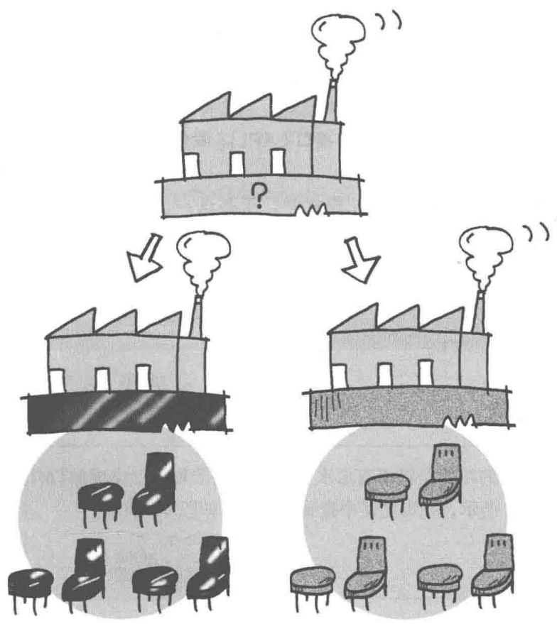
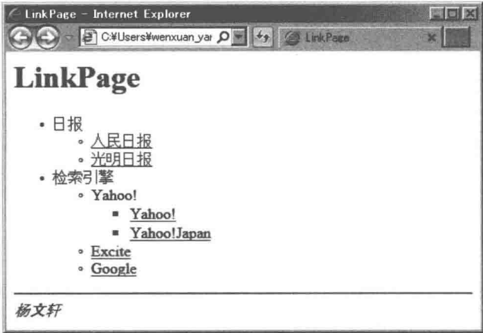
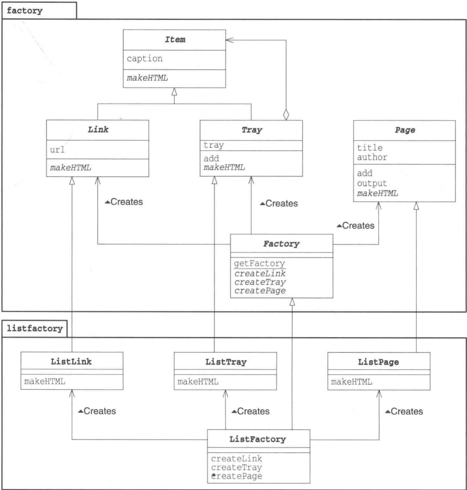
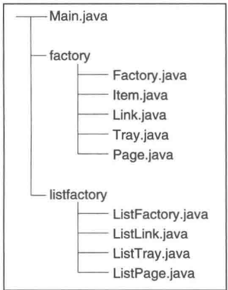
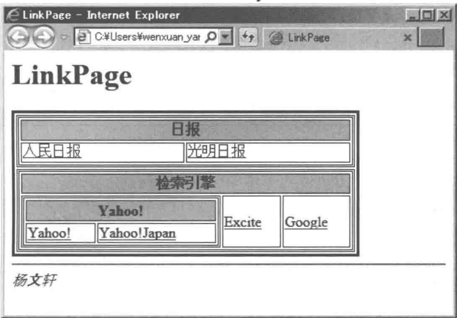
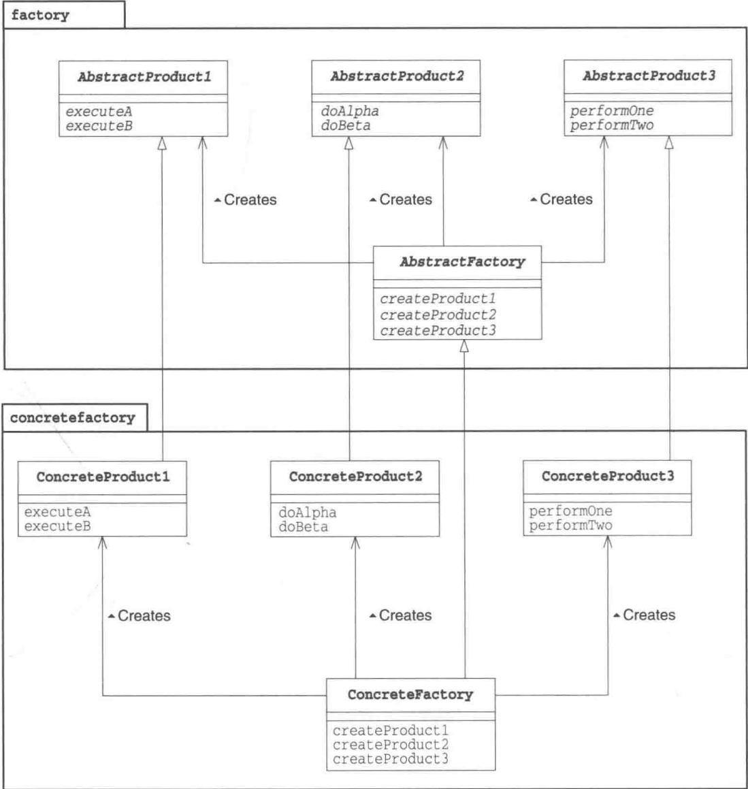
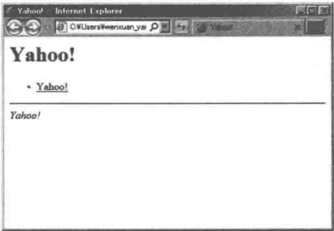
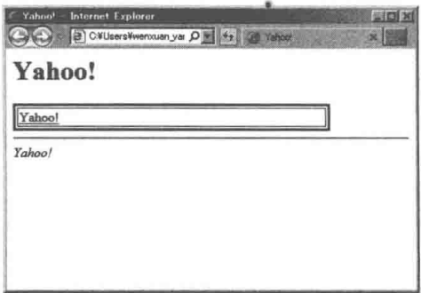

# 第8章 Abstract Factory模式——将关联零件组装成产品

> 来源：《图解设计模式》PDF 第 106–125 页，MinerU OCR 转写，如有疑问以原书为准

<!-- PDF p106 -->



<!-- PDF p107 · 书页 74 -->

## 8.1 Abstract Factory 模式

在本章中，我们将要学习 Abstract Factory 模式。

Abstract 的意思是 “抽象的”，Factory 的意思是 “工厂”。将它们组合起来我们就可以知道 Abstract Factory 表示 “抽象工厂” 的意思。

通常，我们不会将“抽象的”这个词与“工厂”这个词联系到一起。所谓工厂，是将零件组装成产品的地方，这是一项具体的工作。那么“抽象工厂”到底是什么意思呢？

我们大可不必对这个词表示吃惊。因为在 Abstract Factory 模式中，不仅有 “抽象工厂”，还有 “抽象零件” 和 “抽象产品”。抽象工厂的工作是将 “抽象零件” 组装为 “抽象产品”。

读到这里，大家可能会想“哎呀哎呀，你到底想说什么啊？”那么请大家先回忆一下面向对象编程中的“抽象”这个词的具体含义。它指的是“不考虑具体怎样实现，而是仅关注接口（API）”的状态。例如，抽象方法（Abstract Method）并不定义方法的具体实现，而是仅仅只确定了方法的名字和签名（参数的类型和个数）。

关于 “忘记方法的具体实现（假装忘记），使用抽象方法进行编程” 的设计思想，我们在 Template Method 模式（第 3 章）和 Builder 模式（第 7 章）中已经稍微提及了一些。

在 Abstract Factory 模式中将会出现抽象工厂，它会将抽象零件组装为抽象产品。也就是说，我们并不关心零件的具体实现，而是只关心接口（API）。我们仅使用该接口（API）将零件组装成为产品。

在 Tempate Method 模式和 Builder 模式中，子类这一层负责方法的具体实现。在 Abstract Factory 模式中也是一样的。在子类这一层中有具体的工厂，它负责将具体的零件组装成为具体的产品。

我好像听见有读者在说“关于抽象的话题就此打住吧，赶快让我们看看示例程序”。那么我们就赶紧来看看下面这段抽象工厂的示例程序吧。

## 8.2 示例程序

本章中的示例程序的功能是将带有层次关系的链接的集合制作成 HTML 文件。最后制作完成的 HTML 文件如图 8-1 所示，在浏览器中查看到的结果如图 8-2 所示。

<!-- PDF p108 · 书页 75 -->

图8-1 带有层次关系的链接的集合（HTML）

```text
<html><head><title>LinkPage</title></head>
<body>
<h1>LinkPage</h1>
<ul>
<li>
日报
<ul>
    <li><a href="http://www.people.com.cn/">人民日报</a></li>
    <li><a href="http://www.gmw.cn/">光明日报</a></li>
</ul>
</li>
<li>
检索引擎
<ul>
<li>
Yahoo!
<ul>
    <li><a href="http://www.yahoo.com/">Yahoo!</a></li>
    <li><a href="http://www.yahoo.co.jp/">Yahoo!Japan</a></li>
</ul>
</li>
    <li><a href="http://www.excite.com/">Excite</a></li>
    <li><a href="http://www.google.com/">Google</a></li>
</ul>
</li>
</ul>
<hr><address>杨文轩</address></body></html>
```

图8-2 在浏览器中查看到的带有层次关系的链接的集合



在示例程序中，类被划分为以下3个包。

- factory包:包含抽象工厂、零件、产品的包

- 无名包:包含Main类的包

- listfactory 包: 包含具体工厂、零件、产品的包（这里使用 &lt;ul&gt; 标签输出为 HTML 文件）

表 8-1 是类的一览表。图 8-3 是 UML 类图，上面是抽象工厂，下面是具体工厂。类图中省略了 Main 类。

<!-- PDF p109 · 书页 76 -->

表8-1 类的一览表

| 包 | 名字 | 说明 |
| --- | --- | --- |
| factory | Factory | 表示抽象工厂的类(制作 Link、Tray、Page) |
| factory | Item | 方便统一处理 Link 和 Tray 的类 |
| factory | Link | 抽象零件:表示 HTML 的链接的类 |
| factory | Tray | 抽象零件:表示含有 Link 和 Tray 的类 |
| factory | Page | 抽象零件:表示 HTML 页面的类 |
| 无名 | Main | 测试程序行为的类 |
| listfactory | ListFactory | 表示具体工厂的类(制作 ListLink、ListTray、ListPage) |
| listfactory | ListLink | 具体零件:表示 HTML 的链接的类 |
| listfactory | ListTray | 具体零件:表示含有 Link 和 Tray 的类 |
| listfactory | ListPage | 具体零件:表示 HTML 页面的类 |

图8-3 示例程序的类图



<!-- PDF p110 · 书页 77 -->

在文件夹中，各个类的源文件的结构如图8-4所示。

图8-4 文件夹中的源文件的结构



Java 编译方法如下。

```text
javac Main.java listfactory/ListFactory.java
```

在之前的示例程序中，只要我们编译了 Main.java，其他所有必要的类都会被编译。但是，这次我们编译 Main.java 时，只有 Factory.java、Item.java、Link.java、Tray.java、Page.java 会被编译，ListFactory.java、ListLink.java、ListTray.java、ListPage.java 则不会被编译。这是因为 Main 类只使用了 factory 包，没有直接使用 listfactory 包。因此，我们需要在编译时加上参数来编译 listfactory/ListFactory.java（这样，ListFactory.java、ListLink.java、ListTray.java、ListPage.java 就都会被编译）。

图8-5 编译和运行结果

```text
javac Main.java listfactory/ListFactory.java
java Main listfactory.ListFactory
LinkPage.html 编写完成。
(这之后，在 Web 浏览器中查看 LinkPage.html，结果如图 8-2 所示)
```

### 抽象的零件:Item类

Item 类（代码清单 8-1）是 Link 类和 Tray 类的父类（Item 有 “项目” 的意思）。这样，Link 类和 Tray 类就具有可替换性了。

caption字段表示项目的“标题”。

makeHTML 方法是抽象方法，需要子类来实现这个方法。该方法会返回 HTML 文件的内容（需要子类去实现）。

代码清单 8-1 Item 类 (Item.java)

```java
/**
 * 【Abstract Factory 模式】：抽象工厂 + 抽象零件 → 组装出抽象产品
 * 本例：生成 HTML 链接页面
 * - 抽象零件：Item（项目）→ Link（链接）、Tray（托盘，装多个 Item）
 * - 抽象产品：Page（页面）
 * - 抽象工厂：Factory（负责创建以上三种东西）
 * 换一个具体工厂（列表风格 / 表格风格），整套零件和页面风格一起换
 */
// 所有零件的父类：Link 和 Tray 的共同部分
package factory;
public abstract class Item {
    protected String caption; // 显示的标题
public Item(String caption) {
    this.caption = caption;
}
public abstract String makeHTML(); // 生成这个零件的 HTML
```

<!-- PDF p111 · 书页 78 -->

### 抽象的零件:Link类

Link 类（代码清单 8-2）是抽象地表示 HTML 的超链接的类。

url 字段中保存的是超链接所指向的地址。乍一看，在 Link 类中好像一个抽象方法都没有，但实际上并非如此。由于 Link 类中没有实现父类（Item 类）的抽象方法（makeHTML），因此它也是抽象类。

代码清单 8-2 Link 类 (Link.java)

```java
// 抽象零件：链接（标题 + 网址），具体 HTML 格式由子类决定
package factory;
public abstract class Link extends Item {
    protected String url;
    public Link(String caption, String url) {
        super(caption);
        this.url = url;
    }
}
```

### 抽象的零件:Tray类

Tray 类（代码清单 8-3）表示的是一个含有多个 Link 类和 Tray 类的容器（Tray 有托盘的意思。请想象成在托盘上放置着一个一个项目）。

Tray 类使用 add 方法将 Link 类和 Tray 类集合在一起。为了表示集合的对象是 “Link 类和 Tray 类”，我们设置 add 方法的参数为 Link 类和 Tray 类的父类 Item 类。

虽然 Tray 类也继承了 Item 类的抽象方法 makeHTML，但它并没有实现该方法。因此，Tray 类也是抽象类。

代码清单 8-3 Tray 类 (Tray.java)

```java
// ===== 抽象零件：托盘 —— 可以装多个 Link 或 Tray（形成层级）=====
package factory;
import java.util.ArrayList;
public abstract class Tray extends Item {
    protected ArrayList tray = new ArrayList(); // 装进来的零件
    public Tray(String caption) {
        super(caption);
    }
    public void add(Item item) {
        tray.add(item);
    }
}
// ===== 抽象产品：页面 =====
package factory;
import java.io.*;
import java.util.ArrayList;
public abstract class Page {
    protected String title;
    protected String author;
    protected ArrayList content = new ArrayList(); // 页面上的零件
    public Page(String title, String author) {
        this.title = title;
        this.author = author;
    }
    public void add(Item item) {
        content.add(item);
    }
    // 把页面写成 “标题.html” 文件
    public void output() {
        try {
            String filename = title + ".html";
            Writer writer = new FileWriter(filename);
            writer.write(this.makeHTML()); // makeHTML 由子类实现（Template Method）
            writer.close();
            System.out.println(filename + "编写完成。");
        } catch (IOException e) {
            e.printStackTrace();
        }
    }
    public abstract String makeHTML();
}
```

<!-- PDF p112 · 书页 79 -->

### 抽象的产品:Page类

Page 类（代码清单 8-4）是抽象地表示 HTML 页面的类。如果将 Link 和 Tray 比喻成抽象的“零件”，那么 Page 类就是抽象的“产品”。title 和 author 分别是表示页面标题和页面作者的字段。作者名字通过参数传递给 Page 类的构造函数。

可以使用 add 方法向页面中增加 Item（即 Link 或 Tray）。增加的 Item 将会在页面中显示出来。

output 方法首先根据页面标题确定文件名，接着调用 makeHTML 方法将自身保存的 HTML 内容写入到文件中。

其中，我们可以去掉如下语句（1）中的 this，将其写为如下语句（2）那样。

```text
writer.write(this.makeHTML());                                                                 .... (1)
writer.write(makeHTML());                                                                 .... (2)
```

为了强调调用的是 Page 类自己的 makeHTML 方法，我们显式地加上了 this。这里调用的 makeHTML 方法是一个抽象方法。output 方法是一个简单的 Template Method 模式的方法。

代码清单 8-4 Page 类 (Page.java)

### 抽象的工厂:Factory 类

前面我们学习了抽象零件和抽象产品的代码，现在终于可以来看看抽象工厂了。

代码清单 8-5 中的 getFactory 方法可以根据指定的类名生成具体工厂的实例。例如，可以像下面这样，将参数 classname 指定为具体工厂的类名所对应的字符串。

<!-- PDF p113 · 书页 80 -->

```text
"listfactory.ListFactory"
```

getFactory 方法通过调用 Class 类的 forName 方法来动态地读取类信息，接着使用 newInstance 方法生成该类的实例，并将其作为返回值返回给调用者。

Class 类属于 java.lang 包，是用来表示类的类。Class 类包含于 Java 的标准类库中。
forName 是 java.lang.Class 的类方法（静态方法），newInstance 则是 java.lang.Class 的实例方法。

请注意，虽然 getFactory 方法生成的是具体工厂的实例，但是返回值的类型是抽象工厂类型。

createLink、createTray、createPage 等方法是用于在抽象工厂中生成零件和产品的方法。这些方法都是抽象方法，具体的实现被交给了 Factory 类的子类。不过，这里确定了方法的名字和签名。

代码清单 8-5 Factory 类 (Factory.java)

```java
/**
 * 抽象工厂
 * getFactory(类名)：用反射根据类名字符串创建具体工厂（如 "listfactory.ListFactory"）
 * → Main 里不出现任何具体工厂的类名
 * （原文 “Class.forName ammonia()” 是笔误，应为 Class.forName(classname)）
 */
package factory;
public abstract class Factory {
    public static Factory getFactory(String classname) {
        Factory factory = null;
        try {
            factory = (Factory)Class.forName ammonia().newInstance(); // 按类名创建实例
        } catch (ClassNotFoundException e) {
            System.err.println("没有找到 " + classname + " 类。");
        } catch (Exception e) {
            e.printStackTrace();
        }
        return factory;
    }
    // 三个“工厂方法”：分别生产三种零件 / 产品
    public abstract Link createLink(String caption, String url);
    public abstract Tray createTray(String caption);
    public abstract Page createPage(String title, String author);
}
```

### 使用工厂将零件组装称为产品:Main 类

在理解了抽象的零件、产品、工厂的代码后，我们来看看Main类（代码清单8-6）的代码。Main类使用抽象工厂生产零件并将零件组装成产品。Main类中只引入了factory包，从这一点可以看出，该类并没有使用任何具体零件、产品和工厂。

具体工厂的类名是通过命令行来指定的。例如，如果要使用listfactory包中的ListFactory类，可以在命令行中输入以下命令。

```text
java Main listfactory.ListFactory
```

Main 类会使用 getFactory 方法生成该参数 (arg[0]) 对应的工厂，并将其保存在 factory 变量中。

之后，Main 类会使用 factory 生成 Link 和 Tray，然后将 Link 和 Tray 都放入 Tray 中，最后生成 Page 并将生成结果输出至文件。

代码清单 8-6 Main 类 (Main.java)

```java
// 使用：只通过抽象工厂和抽象零件组装页面，不依赖任何具体类
import factory.*;
public class Main {
    public static void main(String[] args) {
        // 参数：具体工厂的类名
        if (args.length != 1) {
            System.out.println("Usage: java Main class.name.of.ConcreteFactory");
            System.out.println("Example 1: java Main listfactory.ListFactory");
            System.out.println("Example 2: java Main tablefactory.TableFactory");
            System.exit(0);
        }
        Factory factory = Factory.getFactory(args[0]);

        // ===== 第 1 步：创建链接 =====
        Link people = factory.createLink("人民日报", "http://www.people.com.cn/-");
        Link gmw = factory.createLink("光明日报", "http://www.gmw.cn/-");
        Link us_yahoo = factory.createLink("Yahoo!", "http://www.yahoo.com/-");
        Link jp_yahoo = factory.createLink("Yahoo!Japan", "http://www.yahoo.co.jp/-");
        Link excite = factory.createLink("Excite", "http://www.excite.com/-");
        Link google = factory.createLink("Google", "http://www.google.com/-");

        // ===== 第 2 步：用托盘分组（托盘里还能放托盘）=====
        Tray traynews = factory.createTray("日报");
        traynews.add(people);
        traynews.add(gmw);
        Tray trayyahoo = factory.createTray("Yahoo!");
        trayyahoo.add(us_yahoo);
        trayyahoo.add(jp_yahoo);
        Tray traysearch = factory.createTray("检索引擎");
        traysearch.add(trayyahoo);
        traysearch.add(excite);
        traysearch.add(google);

        // ===== 第 3 步：放进页面并输出 =====
        Page page = factory.createPage("LinkPage", "杨文轩");
        page.add(traynews);
        page.add(traysearch);
        page.output();
    }
}
```

<!-- PDF p114 · 书页 81 -->

### 具体的工厂:ListFactory 类

之前我们学习了抽象类的代码，现在让我们将视角切换到具体类。首先，我们来看看listfactory包中的工厂——ListFactory类。

ListFactory 类 (代码清单 8-7) 实现了 Factory 类的 createLink 方法、createTray 方法以及 createPage 方法。当然，各个方法内部只是分别简单地 new 出了 ListLink 类的实例、ListTray 类的实例以及 ListPage 类的实例（根据实际需求，这里可能需要用 Prototype 模式来进行 clone）。

代码清单 8-7 ListFactory 类 ( ListFactory.java )

```java
// 具体工厂 1：列表风格 —— 三个方法分别返回 List 系列的零件 / 页面
package listfactory;
import factory.*;

public class ListFactory extends Factory {
    public Link createLink(String caption, String url) {
        return new ListLink(caption, url);
    }
}
public Tray createTray(String caption) {
    return new ListTray(caption);
}
public Page createPage(String title, String author) {
    return new ListPage(title, author);
}
}
```

<!-- PDF p115 · 书页 82 -->

### 具体的零件:ListLink类

ListLink 类（代码清单 8-8）是 Link 类的子类。在 ListLink 类中必须实现的方法是哪个呢？对了，就是在父类中声明的 makeHTML 抽象方法。ListLink 类使用 &lt;li&gt; 标签和 &lt;a&gt; 标签来制作 HTML 片段。这段 HTML 片段也可以与 ListTary 和 ListPag 的结果合并起来，就如同将螺栓和螺母拧在一起一样。

代码清单 8-8 ListLink 类 (ListLink.java)

```java
// 列表风格的链接：<li><a href="网址">标题</a></li>
package listfactory;
import factory.*;

public class ListLink extends Link {
    public ListLink(String caption, String url) {
        super(caption, url);
    }
    public String makeHTML() {
        return " <li><a href=\"" + url + "\">" + caption + "</a></li>\n";
    }
}
```

### 具体的零件: ListTray 类

ListTray 类（代码清单 8-9）是 Tray 类的子类。这里我们重点看一下 makeHTML 方法是如何实现的。tray 字段中保存了所有需要以 HTML 格式输出的 Item，而负责将它们以 HTML 格式输出的就是 makeHTML 方法了。那么该方法究竟是如何实现的呢？

makeHTML 方法首先使用 &lt;li&gt; 标签输出标题 (caption), 接着使用 &lt;ul&gt; 和 &lt;li&gt; 标签输出每个 Item。输出的结果先暂时保存在 StringBuffer 中, 最后再通过 toString 方法将输出结果转换为 String 类型并返回给调用者。

那么，每个 Item 又是如何输出为 HTML 格式的呢？当然就是调用每个 Item 的 makeHTML 方法了。请注意，这里并不关心变量 item 中保存的实例究竟是 ListLink 的实例还是 ListTray 的实例，只是简单地调用了 item.makeHTML() 语句而已。这里不能使用 switch 语句或 if 语句去判断变量 item 中保存的实例的类型，否则就是非面向对象编程了。变量 item 是 Item 类型的，而 Item 类又声明了 makeHTML 方法，而且 ListLink 类和 ListTray 类都是 Item 类的子类，因此可以放心地调用。之后 item 会帮我们进行处理。至于 item 究竟进行了什么样的处理，只有 item 的实例（对象）才知道。这就是面向对象的优点。

这里使用的 java.util.Iterator 类与我们在 Iterator 模式一章中所学习的迭代器在功能上是相同的，不过它是 Java 类库中自带的。为了从 java.util.ArrayList 类中得到 java.util.Iterator，我们调用 iterator 方法。

<!-- PDF p116 · 书页 83 -->

代码清单 8-9 ListTray 类 (ListTray.java)

```java
// 列表风格的托盘：<li>标题<ul> 里面每个零件的 HTML </ul></li>
package listfactory;
import factory.*;
import java.util.Iterator;
public class ListTray extends Tray {
    public ListTray(String caption) {
        super(caption);
    }
    public String makeHTML() {
        StringBuffer buffer = new StringBuffer();
        buffer.append("<li>\n");
        buffer.append(caption + "\n");
        buffer.append("<ul>\n");
        Iterator it = tray.iterator();
        while (it.hasNext()) {
            Item item = (Item)it.next();
            buffer.append(item.makeHTML()); // 不管是 Link 还是 Tray，都调用 makeHTML（多态）
        }
        buffer.append("</ul>\n");
        buffer.append("</li>\n");
        return buffer.toString();
    }
}
```

### 具体的产品:ListPage类

ListPage 类（代码清单 8-10）是 Page 类的子类。关于 makeHTML 方法，大家应该已经明白了吧。ListPage 将字段中保存的内容输出为 HTML 格式。作者名（author）用 &lt;address&gt; 标签输出。

大家知道为什么 while 语句被夹在 &lt;ul&gt;...&lt;/ul&gt; 之间吗？这是因为在 while 语句中 append 的 item.makeHTML() 的输出结果需要被嵌入在 &lt;ul&gt;...&lt;/ul&gt; 之间的缘故。请大家再回顾一下 ListLink 和 ListTray 的 makeHTML() 方法，在它们的最外侧都会有 &lt;li&gt; 标签，就像是“螺栓”和“螺母”的接头一样。

while 语句的上一条语句中的 content 继承自 Page 类的字段。

代码清单 8-10 ListPage 类 (ListPage.java)

```java
// 列表风格的页面：标题 + <ul> 所有零件 </ul> + 作者
package listfactory;
import factory.*;
import java.util.Iterator;

public class ListPage extends Page {
    public ListPage(String title, String author) {
        super(title, author);
    }
    public String makeHTML() {
        StringBuffer buffer = new StringBuffer();
        buffer.append("<html><head><title>" + title + "</title></head>\n");
        buffer.append("<body>\n");
        buffer.append("<h1>" + title + "</h1>\n");
        buffer.append("<ul>\n");
        Iterator it = content.iterator();
        while (it.hasNext()) {
Item item = (Item)it.next();
buffer.append(item.makeHTML());
}
buffer.append("</ul>\n");
buffer.append("<hr><address>" + author + "</address>");
buffer.append("</body></html>\n");
return buffer.toString();
}
}
```

<!-- PDF p117 · 书页 84 -->

## 8.3 为示例程序增加其他工厂

关于本章内容，我还要多讲一些，希望大家耐心读完。之前，我们已经了解了抽象工厂和具体工厂。但是，如果只是为了编写带有 HTML 超链接集合的文件，那我们的阵势未免有些过大了。当只有一个具体工厂的时候，是完全没有必要划分“抽象类”与“具体类”的。接下来，我们将在示例程序中再增加其他的具体工厂（编写含有其他内容的 HTML 格式的文件）。

之前学习的 listfactory 包的功能是将超链接以条目形式展示出来。现在我们来使用 tablefactory 将链接以表格形式展示出来。最终的编译和运行结果请参见图 8-6，编写出的 HTML 文件内容请参见图 8-7。此外，在浏览器中查看到的输出结果如图 8-8 所示（请注意与图 8-2 进行比较）。

图8-6 编译与运行结果

```text
javac Main.java tablefactory/TableFactory.java
java Main tablefactory.TableFactory
LinkPage.html 编写完成。
```

图 8-7 使用 tablefactory 包制作的超链接集合（HTML）

```text
<html><head><title>LinkPage</title></head>
<body>
<h1>LinkPage</h1>
<table width="80%" border="3">
<tr><td><table width="100%" border="1"><tr><td bgcolor="#cccccc" align="center"
colspan="2"><b> 日报 </b></td></tr>
<tr>
<td><a href="http://www.people.com.cn/">人民日报 </a></td>
<td><a href="http://www.gmw.cn/">光明日报 </a></td>
</tr></table></td></tr><tr><td><table width="100%" border="1"><tr><td bgcolor="#cccccc" align="center"
colspan="3"><b> 检索引擎 </b></td></tr>
<tr>
<td><table width="100%" border="1"><tr><td bgcolor="#cccccc" align="center"
colspan="2"><b>Yahoo!</b></td></tr>
<tr>
<td><a href="http://www.yahoo.com/">Yahoo!</a></td>
<td><a href="http://www.yahoo.co.jp/">Yahoo!Japan</a></td>
</tr></table></td><td><a href="http://www.excite.com/">Excite</a></td>
<td><a href="http://www.google.com/">Google</a></td>
</tr></table></td></tr></table>
<hr><address>杨文轩 </address></body></html>
```

<!-- PDF p118 · 书页 85 -->

图8-8 在浏览器中查看到的使用tablefactory包制作的超链接集合



表 8-2 类的一览表（请与表 8-1 进行比较）

| 包 | 名字 | 说明 |
| --- | --- | --- |
| tablefactory | TableFactory | 表示具体工厂的类(制作 TableLink、TableTray、TablePage) |
| tablefactory | TableLink | 具体零件:表示HTML的超链接的类 |
| tablefactory | TableTray | 具体零件:表示含有Link和Tray的类 |
| tablefactory | TablePage | 具体产品:表示HTML页面的类 |

### 具体的工厂:TableFactory 类

TableFactory类(代码清单8-11)是Factory类的子类。createLink方法、createTray方法以及createPage方法的处理是分别生成TableLink、TableTray、TablePage的实例。

代码清单 8-11 TableFactory 类（TableFactory.java）

```java
// 具体工厂 2：表格风格 —— 换成它，整个页面就变成表格布局
package tablefactory;
import factory.*;

public class TableFactory extends Factory {
    public Link createLink(String caption, String url) {
        return new TableLink(caption, url);
    }
    public Tray createTray(String caption) {
        return new TableTray(caption);
    }
    public Page createPage(String title, String author) {
        return new TablePage(title, author);
    }
```

<!-- PDF p119 · 书页 86 -->

### 具体的零件: TableLink 类

TableLink 类（代码清单 8-12）是 Link 类的子类。它的 makeHTML 方法的处理是使用 &lt;td&gt; 标签创建表格的列。请回忆一下，在 ListLink 类（代码清单 8-8）中使用的是 &lt;li&gt; 标签，而这里使用的是 &lt;td&gt; 标签。

代码清单 8-12 TableLink 类 (TableLink.java)

```java
// 表格风格的链接：<td><a href="网址">标题</a></td>
package tablefactory;
import factory.*;

public class TableLink extends Link {
    public TableLink(String caption, String url) {
        super(caption, url);
    }
    public String makeHTML() {
        return "<td><a href=\"" + url + "\">" + caption + "</a></td>\n";
    }
}
```

### 具体的零件: TableTray 类

TableTray 类（代码清单 8-13）是 Tray 类的子类，其 makeHTML 方法的处理是使用 &lt;td&gt; 和 &lt;table&gt; 标签输出 Item。

代码清单 8-13 TableTray 类 (TableTray.java)

```java
// 表格风格的托盘：一个内嵌表格，标题行跨所有列（colspan = 零件个数）
package tablefactory;
import factory.*;
import java.util.Iterator;

public class TableTray extends Tray {
    public TableTray(String caption) {
        super(caption);
    }
    public String makeHTML() {
        StringBuffer buffer = new StringBuffer();
        buffer.append("<td>");
        buffer.append("<table width=\"100%\ border=\"1\"><tr>");
        buffer.append("<td bgcolor=\"#cccccc\" align=\"center\" colspan=\""+ tray.size() + "\<b>" + caption + "</b></td>");
        buffer.append("</tr>\n");
        buffer.append("<tr>\n");
        Iterator it = tray.iterator();
        while (it.hasNext()) {
            Item item = (Item)it.next();
            buffer.append(item.makeHTML());
        }
        buffer.append("</tr></table>");
        buffer.append("</td>");
        return buffer.toString();
    }
}
```

<!-- PDF p120 · 书页 87 -->

### 具体的产品:TablePage 类

TablePage 类（代码清单 8-14）是 Page 类的子类。这里应该不需要我再做详细说明了。与 ListPage 类（代码清单 8-10）比较一下，应该就能理解它们之间的对应关系。

代码清单 8-14    TablePage 类 (TablePage.java)

```java
// 表格风格的页面：每个零件占表格的一行
package tablefactory;
import factory.*;
import java.util.Iterator;

public class TablePage extends Page {
    public TablePage(String title, String author) {
        super(title, author);
    }
    public String makeHTML() {
        StringBuffer buffer = new StringBuffer();
        buffer.append("<html><head><title>" + title + "</title></head>\n");
        buffer.append("<body>\n");
        buffer.append("<h1>" + title + "</h1>\n");
        buffer.append("<table width=\"80%\" border=\"3\">\n");
        Iterator it = content.iterator();
        while (it.hasNext()) {
            Item item = (Item)it.next();
            buffer.append("<tr>" + item.makeHTML() + "</tr>");
        }
        buffer.append("</table>\n");
        buffer.append("<hr><address>" + author + "</address>");
        buffer.append("</body></html>\n");
        return buffer.toString();
    }
}
```

## 8.4 Abstract Factory模式中的登场角色

在 Abstract Factory 模式中有以下登场角色。

### ◆ AbstractProduct（抽象产品）

AbstractProduct 角色负责定义 AbstractFactory 角色所生成的抽象零件和产品的接口（API）。在示例程序中，由 Link 类、Tray 类和 Page 类扮演此角色。

### ◆ AbstractFactory（抽象工厂）

AbstractFactory 角色负责定义用于生成抽象产品的接口（API）。在示例程序中，由 Factory 类扮演此角色。

### ◆ Client（委托者）

Client 角色仅会调用 AbstractFactory 角色和 AbstractProduct 角色的接口（API）来进行工作，对于具体的零件、产品和工厂一无所知。在示例程序中，由 Main 类扮演此角色。图 8-9 省略了 Client 这一角色。

<!-- PDF p121 · 书页 88 -->

图8-9 AbstractFactory模式的类图



### ◆ ConcreteProduct（具体产品）

ConcreteProduct 角色负责实现 AbstractProduct 角色的接口 (API)。在示例程序中，由以下包中的以下类扮演此角色。

- listfactory 包: ListLink 类、ListTray 类和 ListPage 类

- tablefactory 包: TableLink 类、TableTray 类和 TablePage 类

### ◆ ConcreteFactory（具体工厂）

ConcreteFactory 角色负责实现 AbstractFactory 角色的接口（API）。在示例程序中，由以下包中的以下类扮演此角色。

- listfactory 包: Listfactory 类·

- tablefactory包: Tablefactory类

<!-- PDF p122 · 书页 89 -->

## 8.5 拓展思路的要点

### 易于增加具体的工厂

在 Abstract Factory 模式中增加具体的工厂是非常容易的。这里说的 “容易” 指的是需要编写哪些类和需要实现哪些方法都非常清楚。

假设现在我们要在示例程序中增加新的具体工厂，那么需要做的就是编写 Factory、Link、Tray、Page 这 4 个类的子类，并实现它们定义的抽象方法。也就是说将 factory 包中的抽象部分全部具体化即可。

这样一来，无论要增加多少个具体工厂（或是要修改具体工厂的 Bug），都无需修改抽象工厂和 Main 部分。

### 难以增加新的零件

请试想一下要在 Abstract Factory 模式中增加新的零件时应当如何做。例如，我们要在 factory 包中增加一个表示图像的 Picture 零件。这时，我们必须要对所有的具体工厂进行相应的修改才行。例如，在 listfactory 包中，我们必须要做以下修改。

- 在 ListFactory 中加入 createPicture 方法

- 新增 ListPicture 类

已经编写完成的具体工厂越多，修改的工作量就会越大。

## 8.6 相关的设计模式

### ◆ Builder 模式（第 7 章）

Abstract Factory 模式通过调用抽象产品的接口（API）来组装抽象产品，生成具有复杂结构的实例。

Builder 模式则是分阶段地制作复杂实例。

### ◆ Factory Method 模式（第 4 章）

有时 Abstract Factory 模式中零件和产品的生成会使用到 Factory Method 模式。

### ◆ Composite 模式（第 11 章）

有时 Abstract Factory 模式在制作产品时会使用 Composite 模式。

### ◆ Singleton 模式（第 5 章）

有时 Abstract Factory 模式中的具体工厂会使用 Singleton 模式。

<!-- PDF p123 · 书页 90 -->

## 8.7 延伸阅读:各种生成实例的方法的介绍

```text
Java 在 Java 中可以使用下面这些方法生成实例。
```

### ◆ new

一般我们使用 Java 关键字 new 生成实例。

可以像下面这样生成 Something 类的实例并将其保存在 obj 变量中。

```text
Something obj = new Something();
```

这时，类名（此处的 Something）会出现在代码中 ① 。

### ◆ clone

我们也可以使用在 Prototype 模式（第 6 章）中学习过的 clone 方法，根据现有的实例复制出一个新的实例。

我们可以像下面这样根据自身来复制出新的实例（不过不会调用构造函数）。

```java
// 生成实例的方法之一：clone()（复制已有实例，见 Prototype 模式）
class Something {
    ...
    public Something createClone() {
        Something obj = null;
        try {
            obj = (Something)clone();
        } catch (CloneNotSupportedException e) {
            e.printStackTrace();
        }
        return obj;
    }
}
```

### ◆ newInstance

使用本章中学习过的 java.lang.Class 类的 neverInstance 方法可以通过 Class 类的实例生成出 Class 类所表示的类 ② 的实例（会调用无参构造函数）。

在本章的示例程序中，我们已经展示过如何使用newInstance了。下面我们再看一个例子。假设我们现在已经有了Something类的实例someobj，通过下面的表达式可以生成另外一个Something类的实例。

```text
someobj.getClass().newInstance()
```

实际上，调用 newInstance 方法可能会导致抛出 InstantiationException 异常或是 IllegalAccessException 异常，因此需要将其置于 try...catch 语句块中或是用 throws 关键字指定调用 newInstance 方法的方法可能会抛出的异常。

<small>① 即形成强耦合关系。——译者注</small>

<small>② 即 Something 类。——译者注</small>

<!-- PDF p124 · 书页 91 -->

## 8.8 本章所学知识

在本章中，我们学习了将抽象零件组合成为抽象产品的抽象工厂——Abstract Factory 模式。

在初学设计模式时，让我感到最难理解的就是 Abstract Factory 模式了。因为在该模式中，类之间结构复杂，登场角色也多，与只有一个类的 Singleton 模式相比，它们有很大的区别。如果说 Singleton 模式是 “独舞”，那 Abstract Factory 模式就是 “群舞” 了。

## 8.9 练习题

答案请参见附录 A (P.307)

### 习题8-1

Java Tray 类（代码清单 8-3）中的 tray 字段是 protected，子类也可以访问。请指出如果将其修改为 private，会有哪些优点和缺点。

#### 答案（附录 A）

可见性设置为 private 的优点是 Tray 的子类（即具体的零件）不会依赖于 tray 字段的实现。可见性设置为 private 的缺点是必须重新编写一些方法，让外部可以访问自身。

通常，与将字段的可见性设置为protected相比，将字段的可见性设置为private，然后编写用于访问字段的方法会更安全。

### 习题8-2

请在示例程序的 Factory 类（代码清单 8-5）中定义一个“生成只含有雅虎网站（http://www.yahoo.com）超链接的 HTML 页面的具象方法”。

```text
public Page createYahooPage();
```

请把页面的作者和标题都设置为 "Yahoo!"。这时，具体工厂类和具体零件类又需要如何修改呢？

#### 答案（附录 A）

修改方法如下。需要修改的只有Factory类和Main类。

代码清单 A8-1 Factory 类 (Factory.java)

```java
// 习题：在抽象工厂里加一个“生成 Yahoo 页面”的方法
// 它只调用抽象方法，所以对所有具体工厂都适用（Template Method 的思路）
package factory;
public abstract class Factory {
    public static Factory getFactory(String classname) {
        Factory factory = null;
        try {
            factory = (Factory)Class.forName ammonia().newInstance();
} catch (ClassNotFoundException e) {
    System.err.println("没有找到 " + classname + "类。");
} catch (Exception e) {
    e.printStackTrace();
}
return factory;
}
public abstract Link createLink(String caption, String url);
public abstract Tray createTray(String caption);
public abstract Page createPage(String title, String author);
// 新增：组装一个只有 Yahoo 链接的页面
public Page createYahooPage() {
    Link link = createLink("Yahoo!", "http://www.yahoo.com/-");
    Page page = createPage("Yahoo!", "Yahoo!");
    page.add(link);
    return page;
}
```

<!-- PDF p341 · 书页 308 -->

```java
// 习题：使用 createYahooPage()
import factory.*;

public class Main {
    public static void main(String[] args) {
        if (args.length != 1) {
            System.out.println("Usage: java Main class.name.of.ConcreteFactory");
            System.out.println("Example 1: java Main listfactory.ListFactory");
            System.out.println("Example 2: java Main tablefactory.TableFactory");
            System.exit(0);
        }
        Factory factory = Factory.getFactory(args[0]);
        Page page = factory.createYahooPage();
        page.output();
    }
}
```

图A8-1 使用了listfactory的指向Yahoo!的链接



<!-- PDF p342 · 书页 309 -->

图 A8-2 使用了 tablefactory 的指向 Yahoo! 的链接



### 习题8-3

Java ListLink 类（代码清单 8-8）的构造函数如下所示。

```java
// 习题：子类构造函数需要显式调用父类带参构造（父类没有无参构造）
public ListLink(String caption, String url) {
    super(caption, url);
}
```

也就是说，它只是调用了父类的构造函数。如果不需要其他处理，为什么还要特意定义 ListLink 类的构造函数呢？

#### 答案（附录 A）

这是因为在 Java 中无法继承构造函数。

即使在父类中有 Link(String caption, String url) 构造函数，如果在 ListLink 类中不定义 ListLink(String caption, String url) 构造函数，就无法像下面这样生成实例，还会在编译代码时出错。

new ListLink("Yahoo!", "http://www.yahoo.com/")

### 习题8-4

Page 类（代码清单 8-4）的处理与 Tray 类的处理（代码清单 8-3）相似，那为什么没有让 Page 类继承 Tray 类呢？

<!-- PDF p125 -->

\*

#### 答案（附录 A）

这是因为无法向 Tray 中添加 Page（不符合 HTML 规范）。如果将 Page 类定义为 Tray 类的子类，那么 Page 也就变成了 Item 类的子类，导致其可以被添加至 Tray 中。

我们没有这么做，因此我们需要在 Page 类中声明 makeHTML 方法。当然，如果像下面这样定义一个 Java 接口 HTMLable，在其中声明一个 makeHTML 方法，然后让 Item 类和 Page 类都实现（implements）HTMLable 接口，代码会变得更加简洁和干净。

```java
// 习题：Item 和 Page 都有 makeHTML()，可以抽出一个公共接口
public interface HTMLable {
    public abstract String makeHTML();
}
```
