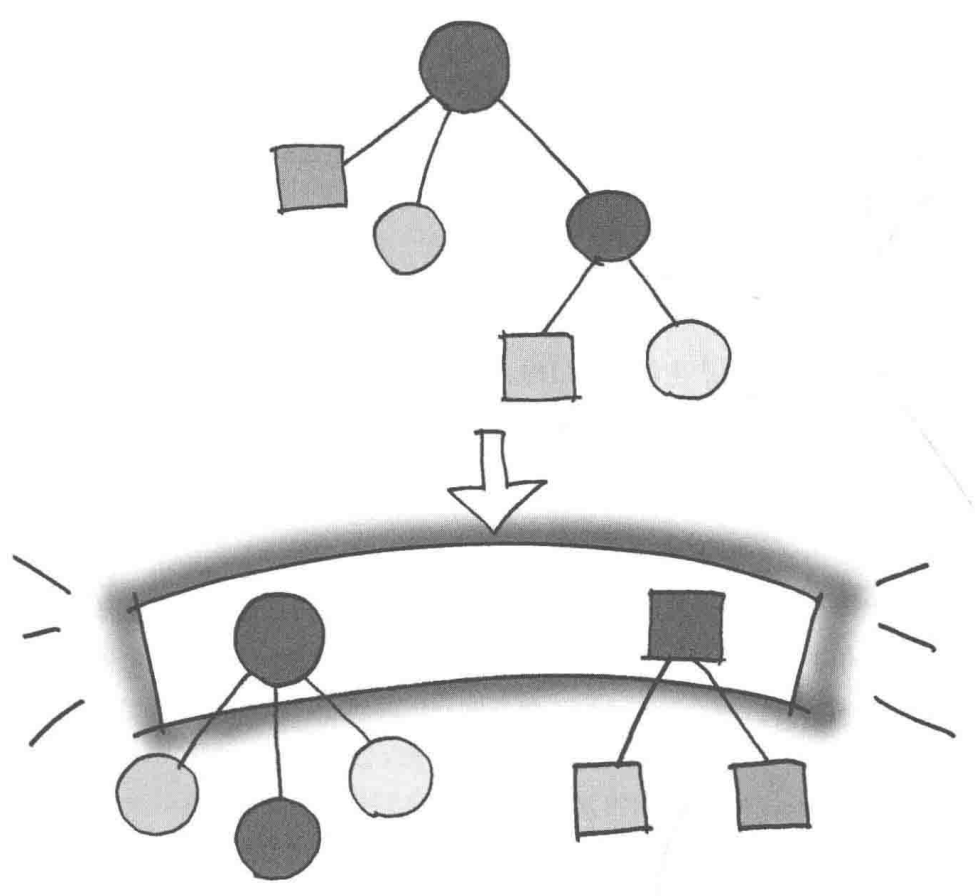
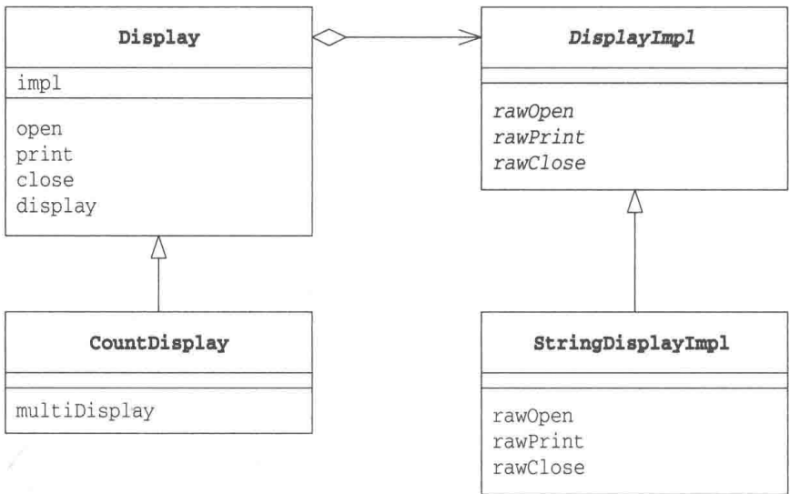
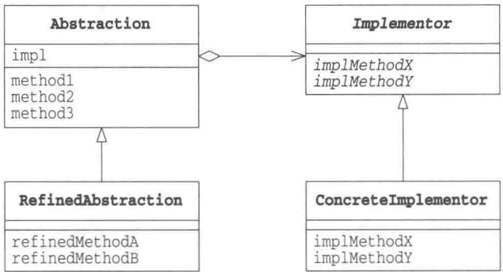
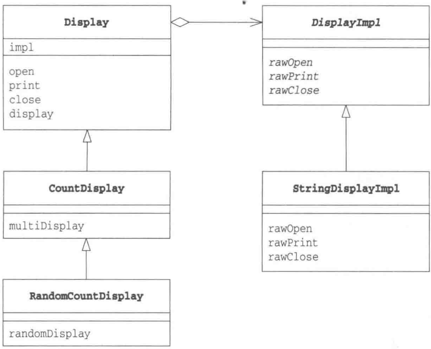
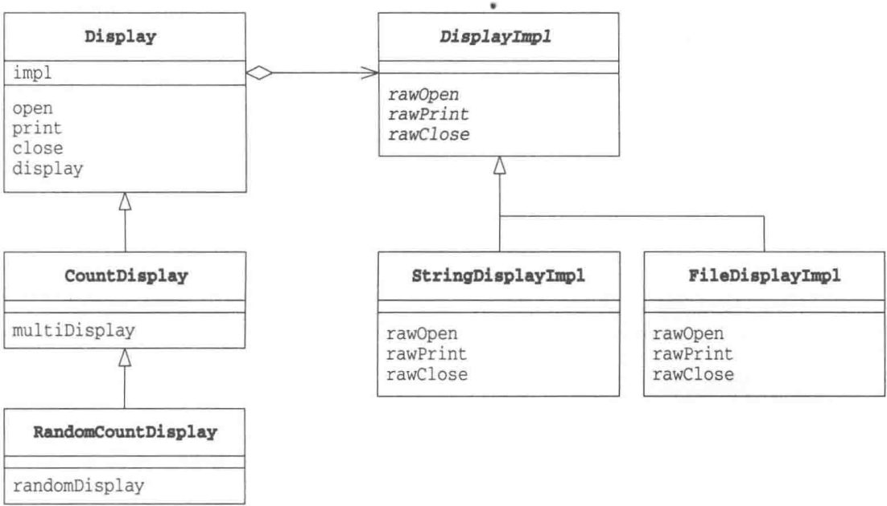
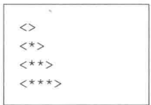
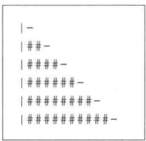
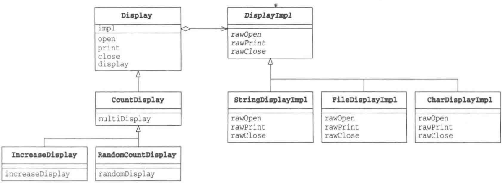

# 第9章 Bridge模式——将类的功能层次结构与实现层次结构分离

> 来源：《图解设计模式》PDF 第 126–135 页，MinerU OCR 转写，如有疑问以原书为准

<!-- PDF p126 -->



<!-- PDF p127 · 书页 94 -->

## 9.1 Bridge 模式

在本章中，我们将要学习 Bridge 模式。

Bridge 的意思是 “桥梁”。就像在现实世界中，桥梁的功能是将河流的两侧连接起来一样，Bridge 模式的作用也是将两样东西连接起来，它们分别是类的功能层次结构和类的实现层次结构。

Bridge 模式的作用是在 “类的功能层次结构” 和 “类的实现层次结构” 之间搭建桥梁。话虽如此，当大家读到这里的时候，脑海中还是很难想象出大概的模样吧。

在开始阅读 Bridge 模式的示例代码之前，我们需要先来理解一下这两种层次结构。这是因为如果不能理解河流两边的土地，也就无法理解桥梁存在的意义了。

- 类的功能层次结构

- 类的实现层次结构

### 类的层次结构的两个作用

### ◆希望增加新功能时

假设现在有一个类 Something。当我们想在 Something 中增加新功能时（想增加一个具体方法时），会编写一个 Something 类的子类（派生类），即 SomethingGood 类。这样就构成了一个小小的类层次结构。

```text
# “功能层次”：子类在父类基础上增加新功能（缩进表示继承关系）
Something
    SomethingGood
```

这就是为了增加新功能而产生的层次结构。

- 父类具有基本功能

- 在子类中增加新的功能

以上这种层次结构被称为“类的功能层次结构”。

如果我们要继续在 SomethingGood 类的基础上增加新的功能，该怎么办呢？这时，我们可以同样地编写一个 SomethingGood 类的子类，即 SomethingBetter 类。这样，类的层次结构就加深了。

```text
Something
    SomethingGood
    SomethingBetter
```

当要增加新的功能时，我们可以从各个层次的类中找出最符合自己需求的类，然后以它为父类编写子类，并在子类中增加新的功能。这就是“类的功能层次结构”。

注意 通常来说，类的层次结构关系不应当过深。

### ◆希望增加新的实现时

在 Template Method 模式（第 3 章）中，我们学习了抽象类的作用。抽象类声明了一些抽象方法，定义了接口（API），然后子类负责去实现这些抽象方法。父类的任务是通过声明抽象方法的方式定义接口（API），而子类的任务是实现抽象方法。正是由于父类和子类的这种任务分担，我们才可以编写出具有高可替换性的类。

<!-- PDF p128 · 书页 95 -->

这里其实也存在层次结构。例如，当子类ConcreteClass实现了父类AbstractClass类的抽象方法时，它们之间就构成了一个小小的层次结构。

```text
# “实现层次”：父类声明抽象方法，子类负责实现
AbstractClass
    ConcreteClass
```

但是，这里的类的层次结构并非用于增加功能，也就是说，这种层次结构并非用于方便我们增加新的方法。它的真正作用是帮助我们实现下面这样的任务分担。

- 父类通过声明抽象方法来定义接口（API）

- 子类通过实现具体方法来实现接口（API）

这种层次结构被称为“类的实现层次结构”。

当我们以其他方式实现 AbstractClass 时，例如要实现一个 AnotherConcreteClass 时，类的层次结构会稍微发生一些变化。

```text
AbstractClass
    ConcreteClass
    AnotherConcreteClass
```

为了一种新的实现方式，我们继承了 AbstractClass 的子类，并实现了其中的抽象方法。这就是类的实现层次结构。

### ◆类的层次结构的混杂与分离

通过前面的学习，大家应该理解了类的功能层次结构与类的实现层次结构。那么，当我们想要编写子类时，就需要像这样先确认自己的意图:“我是要增加功能呢？还是要增加实现呢？”当类的层次结构只有一层时，功能层次结构与实现层次结构是混杂在一个层次结构中的。这样很容易使类的层次结构变得复杂，也难以透彻地理解类的层次结构。因为自己难以确定究竟应该在类的哪一个层次结构中去增加子类。

因此，我们需要将“类的功能层次结构”与“类的实现层次结构”分离为两个独立的类层次结构。当然，如果只是简单地将它们分开，两者之间必然会缺少联系。所以我们还需要在它们之间搭建一座桥梁。本章中要学习的 Bridge 模式的作用就是搭建这座桥梁。

哎呀，引言说得太多了。下面我们赶紧看看 Bridge 模式的示例程序吧。请在阅读示例程序时着重注意上面学习的“类的两个层次结构”。

## 9.2 示例程序

下面我们来看一段使用了 Bridge 模式的示例程序。这段示例程序的功能是 “显示一些东西”。乍一听好像很抽象，不过随着我们逐渐地理解这段示例程序，也就能慢慢明白它的具体作用了。

<!-- PDF p129 · 书页 96 -->

表9-1 类的一览表

| 在桥的哪一侧 | 名字 | 说明 |
| --- | --- | --- |
| 类的功能层次结构 | Display | 负责“显示”的类 |
| 类的功能层次结构 | CountDisplay | 增加了“只显示规定次数”这一功能的类 |
| 类的实现层次结构 | DisplayImpl | 负责“显示”的类 |
| 类的实现层次结构 | StringDisplayImpl | “用字符串显示”的类 |
|  | Main | 测试程序行为的类 |

图9-1 示例程序的类图



### 类的功能层次结构:Display 类

Display 类（代码清单 9-1）的功能是抽象的，负责 “显示一些东西”。该类位于 “类的功能层次结构” 的最上层。

在 impl 字段中保存的是实现了 Display 类的具体功能的实例（impl 是 implementation（实现）的缩写）。

该实例通过 Display 类的构造函数被传递给 Display 类，然后保存在 impl 字段中，以供后面的处理使用（impl 字段即是类的两个层次结构的“桥梁”）。

open、print、close 这 3 个方法是 Display 类提供的接口 (API)，它们表示 “显示的步骤”。

- open 是显示前的处理

- print 是显示处理

- close 是显示后的处理

请注意这 3 个方法的实现，这 3 个方法都调用了 impl 字段的实现方法。这样，Display 的接口（API）就被转换成为了 DisplayImpl 的接口（API）。

display 方法调用 open、print、close 这 3 个 Display 类的接口 (API) 进行了 “显示” 处理。

<!-- PDF p130 · 书页 97 -->

代码清单 9-1 Display 类 (Display.java)

```java
/**
 * 【Bridge 模式】：把“功能层次”和“实现层次”分开，用委托连起来（这个委托就是“桥”）
 * - 功能层次：Display → CountDisplay（加功能）
 * - 实现层次：DisplayImpl → StringDisplayImpl（具体怎么显示）
 * 两边可以各自独立扩展
 */
// 功能层次的最顶层：提供“显示”功能，具体怎么显示交给 impl
public class Display {
    private DisplayImpl impl;  // 桥：指向实现层次
    public Display(DisplayImpl impl) {
        this.impl = impl;
    }
    public void open() {
        impl.rawOpen();    // 委托
    }
    public void print() {
        impl.rawPrint();
    }
    public void close() {
        impl.rawClose();
    }
    // 显示一次：开 → 打印 → 关
    public final void display() {
        open();
        print();
        close();
    }
}
```

### 类的功能层次结构: CountDisplay 类

接下来，我们继续看“类的功能层次结构”。

CountDisplay 类(代码清单 9-2)在 Display 类的基础上增加了一个新功能。Display 类只具有“显示”的功能，CountDisplay 类则具有“只显示规定的次数”的功能，这就是 multiDisplay 方法。

CountDisplay 类继承了 Display 类的 open、print、close 方法，并使用它们来增加这个新功能。

这就是“类的功能层次结构”。

代码清单 9-2 CountDisplay 类 (CountDisplay.java)

```java
// 功能层次：在 Display 基础上增加“重复显示 N 次”的功能
public class CountDisplay extends Display {
    public CountDisplay(DisplayImpl impl) {
        super(impl);
    }
    public void multiDisplay(int times) {          // 循环显示 times 次
        open();
        for (int i = 0; i < times; i++) {
            print();
        }
        close();
    }
}
```

### 类的实现层次结构:DisplayImpl 类

现在，我们来看桥的另外一侧——“类的实现层次结构”。

DisplayImpl 类（代码清单 9-3）位于“类的实现层次结构”的最上层。

<!-- PDF p131 · 书页 98 -->

DisplayImpl 类是抽象类，它声明了 rawOpen、rawPrint、rawClose 这 3 个抽象方法，它们分别与 Display 类的 open、print、close 方法相对应，进行显示前、显示、显示后处理。

代码清单 9-3 DisplayImpl 类 (DisplayImpl.java)

```java
// 实现层次的最顶层：只声明最底层的显示操作
public abstract class DisplayImpl {
    public abstract void rawOpen();
    public abstract void rawPrint();
    public abstract void rawClose();
}
```

### 类的实现层次结构:StringDisplayImpl 类

下面我们来看看真正的“实现”。StringDisplayImpl 类（代码清单 9-4）是显示字符串的类。不过，它不是直接地显示字符串，而是继承了 DisplayImpl 类，作为其子类来使用 rawOpen、rawPrint、rawClose 方法进行显示。

代码清单 9-4 StringDisplayImpl 类 (StringDisplayImpl.java)

```java
// 实现层次：用 +---+ 框住字符串来显示
public class StringDisplayImpl extends DisplayImpl {
    private String string;                          // 要显示的字符串
    private int width;                         // 以字节单位计算出的字符串的宽度
    public StringDisplayImpl(String string) {   // 构造函数接收要显示的字符串 string
        this.string = string;                     // 将它保存在字段中
        this.width = string.getBytes().length; // 把字符串的宽度也保存在字段中, 以供使用①
    }
    public void rawOpen() {
        printLine();
    }
    public void rawPrint() {
        System.out.println("|" + string + "|"); // 前后加上 "|"并显示
    }
    public void rawClose() {
        printLine();
    }
    private void printLine() {
        System.out.print("+");                  // 显示用来表示方框的角的 "+" 
        for (int i = 0; i < width; i++) {       // 显示width个 "-" 
            System.out.print("-");               // 将其用作方框的边框
        }
        System.out.println("+");                   // 显示用来表示方框的角的 "+" 
    }
}
```

DisplayImpl 和 StringDisplayImpl 这两个类相当于 “类的实现层次结构”。

### Main类

Main 类（代码清单 9-5）将上述 4 个类组合起来显示字符串。虽然变量 d1 中保存的是 Display 类的实例，而变量 d2 和 d3 中保存的是 CountDisplay 类的实例，但它们内部都保存着 StringDisplayImpl 类的实例。

① 为了简单起见，我们以内存中的一个字节对应界面上的一列为前提。

<!-- PDF p132 · 书页 99 -->

运行结果请参见图9-2。由于d1、d2、d3都属于Display类的实例，因此我们可以调用它们的display方法。此外，我们还可以调用d3的multiDisplay方法。

代码清单 9-5 Main 类 (Main.java)

```java
// 使用：功能类 + 实现类 自由组合
// （原文每行少了一个右括号，应为 new StringDisplayImpl("...")) ）
public class Main {
    public static void main(String[] args) {
        Display d1 = new Display(new StringDisplayImpl("Hello, China.");
        Display d2 = new CountDisplay(new StringDisplayImpl("Hello, World.");
        CountDisplay d3 = new CountDisplay(new StringDisplayImpl("Hello, Universe.");
        d1.display();
        d2.display();
        d3.display();
        d3.multiDisplay(5);   // 只有 CountDisplay 类型才能调用
    }
}
```

图9-2 运行结果

```text
+-------------------+          ←显示 d1.display() 的结果
|Hello, China.|
+-------------------+
+-------------------+          ←显示 d2.display() 的结果
|Hello, World.|
+-------------------+
+-------------------+          ←显示 d3.display() 的结果
|Hello, Universe.|
+-------------------+
+-------------------+          ←显示 d3.multiDisplay(5) 的结果
|Hello, Universe.|
|Hello, Universe.|
|Hello, Universe.|
|Hello, Universe.|
|Hello, Universe.|
+-------------------+
```

## 9.3 Bridge 模式中的登场角色

在 Bridge 模式中有以下登场角色。

### ◆ Abstraction（抽象化）

该角色位于“类的功能层次结构”的最上层。它使用 Implementor 角色的方法定义了基本的功能。该角色中保存了 Implementor 角色的实例。在示例程序中，由 Display 类扮演此角色。

### ◆ RefinedAbstraction（改善后的抽象化）

在 Abstraction 角色的基础上增加了新功能的角色。在示例程序中，由 CountDisplay 类扮演此角色。

### ◆ Implementor（实现者）

该角色位于“类的实现层次结构”的最上层。它定义了用于实现Abstraction角色的接口（API）的方法。在示例程序中，由DisplayImpl类扮演此角色。

<!-- PDF p133 · 书页 100 -->

### ◆ ConcreteImplementor（具体实现者）

该角色负责实现在 Implementor 角色中定义的接口（API）。在示例程序中，由 StringDisplayImpl 类扮演此角色。

Bridge 模式的类图如图 9-3 所示。左侧的两个类构成了 “类的功能层次结构”，右侧两个类构成了 “类的实现层次结构”。类的两个层次结构之间的桥梁是 impl 字段。

图9-3 Bridge模式的类图



## 9.4 拓展思路的要点

### 分开后更容易扩展

Bridge 模式的特征是将 “类的功能层次结构” 与 “类的实现层次结构” 分离开了。将类的这两个层次结构分离开有利于独立地对它们进行扩展（具体的扩展示例请参见习题）。

当想要增加功能时，只需要在“类的功能层次结构”一侧增加类即可，不必对“类的实现层次结构”做任何修改。而且，增加后的功能可以被“所有的实现”使用。

例如，我们可以将“类的功能层次结构”应用于软件所运行的操作系统上。如果我们将某个程序中依赖于操作系统的部分划分为 Windows 版、Macintosh 版、Unix 版，那么我们就可以用 Bridge 模式中的“类的实现层次结构”来表现这些依赖于操作系统的部分。也就是说，我们需要编写一个定义这些操作系统的共同接口（API）的 Implementor 角色，然后编写 Windows 版、Macintosh 版、Unix 版的 3 个 ConcreteImplementor 角色。这样一来，无论在“类的功能层次结构”中增加多少个功能，它们都可以工作于这 3 个操作系统上。

### 继承是强关联，委托是弱关联

虽然使用 “继承” 很容易扩展类，但是类之间也形成了一种强关联关系。例如，在下面的代码中，SomethingGood 类是 Something 的子类，但只要不修改代码，就无法改变这种关系，因此可以说它们之间形成了一种强关联关系。

<!-- PDF p134 · 书页 101 -->

如果想要很轻松地改变类之间的关系，使用继承就不适合了，因为每次改变类之间关系时都需要修改程序。这时，我们可以使用“委托”来代替“继承”关系。

示例程序的 Display 类中使用了 “委托”。Display 类的 impl 字段保存了实现的实例。这样，类的任务就发生了转移。

- 调用 open 方法会调用 impl.rawOpen() 方法

- 调用 print 方法会调用 impl.rawPrint() 方法

- 调用close方法会调用impl.rawClose()方法

也就是说，当其他类要求 Display 类 “工作” 的时候，Display 类并非自己工作，而是将工作 “交给 impl”。这就是 “委托”。

继承是强关联关系，但委托是弱关联关系。这是因为只有 Display 类的实例生成时，才与作为参数被传入的类构成关联。例如，在示例程序中，当 Main 类生成 Display 类和 CountDisplay 类的实例时，才将 StringDisplayImpl 的实例作为参数传递给 Display 类和 CountDisplay 类。

如果我们不传递 StringDisplayImpl 类的实例，而是将其他 ConcreteImplementor 角色的实例传递给 Display 类和 CountDisplay 类，就能很容易地改变实现。这时，发生变化的代码只有 Main 类，Display 类和 DisplayImpl 类则不需要做任何修改。

继承是强关联关系，委托是弱关联关系。在设计类的时候，我们必须充分理解这一点。在 Template Method 模式（第 3 章）中，我们也讨论了继承和委托的关系，大家可以再回顾一下相关部分的内容。

## 9.5 相关的设计模式

### ◆ Template Method 模式（第 3 章）

在 Template Method 模式中使用了 “类的实现层次结构”。父类调用抽象方法，而子类实现抽象方法。

### ◆ Abstract Factory 模式（第 8 章）

为了能够根据需求设计出良好的 ConcreteImplementor 角色，有时我们会使用 Abstract Factory 模式。

### ◆ Adapter 模式（第 2 章）

使用 Bridge 模式可以达到类的功能层次结构与类的实现层次结构分离的目的，并在此基础上使这些层次结构结合起来。

而使用 Adapter 模式则可以结合那些功能上相似但是接口（API）不同的类。

## 9.6 本章所学知识

在本章中，我们学习了用于在类的两个层次结构之间搭建桥梁的 Bridge 模式。通过分离这两种类的层次结构，可以更加清晰地扩展类。此外，在本章中我们还学习了委托，它可以弱化类之间的关联关系。

<!-- PDF p135 · 书页 102 -->

下面让我们做一下习题，看看自己是否理解了本章中所学习到的知识。

## 9.7 练习题

答案请参见附录 A (P.309)

### 习题9-1

请在本章的示例程序中增加一个类，实现“显示字符串若干（随机）次”的功能。请注意此时应当扩展（继承）哪个类。

提示 用于显示的方法是 void randomDisplay(int times)，它的作用是将字符串随机显示 0 \~ times 次。

#### 答案（附录 A）

这里应该在 “类的功能层次” 中增加类。

直接让 RandomCountDisplay 类（代码清单 A9-1）继承 Display 类也可以，不过这里我们让它继承 CountDisplay 类。

java.util.Random 是一个随机数生成器，nextInt(n) 方法会随机生成和返回一个大于 0 小于 n 的随机数。

Main 类（代码清单 A9-2）调用了 RandomCountDisplay 的 randomDisplay 方法。程序运行后，会随机显示 0 至 9 次 "Hello, China."。

<!-- PDF p343 · 书页 310 -->

```text
+----------+
+----------+
```

代码清单 A9-1 RandomCountDisplay 类 (RandomCountDisplay.java)

```java
// 习题 1：在“功能层次”增加“随机次数显示” → 只需继承 CountDisplay，实现层次不用动
import java.util.Random;
public class RandomCountDisplay extends CountDisplay {
    private Random random = new Random();
    public RandomCountDisplay(DisplayImpl impl) {
        super(impl);
    }
    // 显示 0 ~ times-1 之间的随机次数
    public void randomDisplay(int times) {
        multiDisplay(random.nextInt(times));
    }
}
```

代码清单 A9-2 Main 类 (Main.java)

```java
// 习题 1：测试，随机显示 0~9 次
public class Main {
    public static void main(String[] args) {
        RandomCountDisplay d = new RandomCountDisplay(new StringDisplayImpl("Hello, China.");
        d.randomDisplay(10);
    }
}
```

图 A9-1 程序运行结果示例 1（重复运行了 4 次。每次运行结果可能都不同）

```text
+-------------------+
|Hello, China.|  
|Hello, China.|  
|Hello, China.|  
|Hello, China.|  
+------------------+
```

图A9-2 程序运行结果示例2（重复运行了8次）

```text
+-------------------+
|Hello, China.|
|Hello, China.|
|Hello, China.|
|Hello, China.|
|Hello, China.|
|Hello, China.|
|Hello, China.|
|Hello, China.|
+------------------+
```

图A9-2 程序运行结果示例3（重复运行了0次）

类图请参见图A9-4。

<!-- PDF p344 · 书页 311 -->

图 A9-4 增加 RandomCountDisplay类后的类图



### 习题9-2

请在本章的示例程序中增加一个类，实现“显示文本文件的内容”的功能。请注意此时应当扩展（继承）哪个类。

#### 答案（附录 A）

这里应该在“类的实现层次”中添加类，我们编写了一个DisplayImpl类的子类——FileDisplayImpl类。

在代码清单 A9-3 中的 FileDisplayImpl 类中，只是负责显示太过简单了，所以我们用其添加了一些装饰。

代码清单 A9-4 中的 Main 类调用 CountDisplay 类和 FileDisplayImpl 类来显示 3 次 star.txt 文件中的内容（代码清单 A9-5）。

如果使用上一道习题中的 RandomCountDisplay 类和 FileDisplayImpl 类，则可以显示随机次 star.txt 文件中的内容。

代码清单 A9-3 FileDisplayImpl 类 (FileDisplayImpl.java)

```java
/**
 * 习题 2：在“实现层次”增加“显示文件内容” → 只需继承 DisplayImpl，功能层次不用动
 * mark / reset：在文件开头做标记，每次打印前回到标记处，从而能重复显示
 */
import java.io.*;
public class FileDisplayImpl extends DisplayImpl {
    private String filename;
    private BufferedReader reader;
    private final int MAX_READAHEAD_LIMIT = 4096; // 循环显示的极限(缓存大小限制)
    public FileDisplayImpl(String filename) {
        this.filename = filename;
    }
    // 打开文件，并在开头做标记
    public void rawOpen() {
        try {
            reader = new BufferedReader(new FileReader(filename));
            reader.mark(MAX_READAHEAD_LIMIT);
        } catch (IOException e) {
            e.printStackTrace();
        }
    }
}
System.out.println("====================" + filename + " ====================="); // 装饰框
}
// 回到开头，逐行打印
public void rawPrint() {
    try {
        String line;
        reader.reset(); // 回到 mark 的位置
        while ((line = reader.readLine()) != null) {
            System.out.println("> " + line);
        }
    } catch (IOException e) {
        e.printStackTrace();
    }
}
// 打印结尾，关闭文件
public void rawClose() {
    System.out.println("===================="); // 装饰框
    try {
        reader.close();
    } catch (IOException e) {
        e.printStackTrace();
    }
}
}
```

<!-- PDF p345 · 书页 312 -->

代码清单 A9-4 Main 类 (Main.java)

```java
// 习题 2：已有的 CountDisplay + 新的 FileDisplayImpl，把文件显示 3 次
public class Main {
    public static void main(String[] args) {
        CountDisplay d = new CountDisplay(new FileDisplayImpl("star.txt"));
        d.multiDisplay(3);
    }
}
```

代码清单 A9-5 要显示的文件（Star.txt）

```text
Twinkle, twinkle, little star,
How I wonder what you are.
```

图A9-5 运行结果

```text
======================== star.txt ======================>
> Twinkle, twinkle, little star,
> How I wonder what you are.
> Twinkle, twinkle, little star,
> How I wonder what you are.
> Twinkle, twinkle, little star,
> How I wonder what you are.
========================
```

类图请参见图 A9-6。

<!-- PDF p346 · 书页 313 -->

图 A9-6 增加 FileDisplayImpl类后的类图



### 习题9-3

请在本章的示例程序中增加类，以实现图9-4和图9-5的输出效果。

图9-4 输出结果例1



图9-5 输出结果例2



输出结果是将“起始字符 → 显示装饰字符若干次 → 结束字符和换行”作为一行，然后循环输出若干行。请注意，每一行的装饰字符的个数都要比前一行多。

请思考我们是应当在“类的功能层次结构”中增加类呢？还是应当在“类的实现层次结构”中增加类呢？

需要一种新的显示方式，那么应当是在“类的功能层次结构”中增加类吧？不过，又好像只要增加一个新的显示字符串的方法就可以了，那么还是在“类的实现层次结构”中增加类会更好吧？究竟应该如何在 Bridge 模式中增加这个类呢？

#### 答案（附录 A）

习题让我们将一个类同时加入到类的功能层次结构中和类的实现层次结构中。但是，如果我们将要增加的类从功能上和实现上分为两个类，将“功能类”加入到类的功能层次结构中，将“实现类”加入类的实现层次结构中，Bridge模式就非常适用于这种场景了。而且，采用这样的实现方法，“功能类”还可以被其他类（CountDisplay类和RandomCountDisplay类）使用，“实现类”也可以在其他类（StringDisplayImpl类和FileDisplayImpl类）上正常工作。

我们将习题中的类从实现和功能上分为以下两个类。

- IncreaseDisplay 类（代码清单 A9-6）:表示逐渐增加显示次数的“功能上”的类

- CharDisplayImpl 类（代码清单 A9-7）:表示以字符显示的“实现上”的类

代码清单 A9-6 IncreaseDisplay 类 (IncreaseDisplay.java)

```java
// 习题 3（功能层次）：逐级递增地显示，每级比上一级多 step 次
public class IncreaseDisplay extends CountDisplay {
    private int step; // 递增步长
    public IncreaseDisplay(DisplayImpl impl, int step) {
        super(impl);
        this.step = step;
    }
    // level 级：依次显示 0、step、2×step …… 次
    public void increaseDisplay(int level) {
        int count = 0;
        for (int i = 0; i < level; i++) {
            multiDisplay(count);
            count += step;
        }
    }
}
```

<!-- PDF p347 · 书页 314 -->

代码清单 A9-7 CharDisplayImpl 类 (CharDisplayImpl.java)

```java
// 习题 3（实现层次）：用“开头字符 + 若干中间字符 + 结尾字符”显示，如 <***>
public class CharDisplayImpl extends DisplayImpl {
    private char head; // 开头
    private char body; // 中间（重复）
    private char foot; // 结尾
    public CharDisplayImpl(char head, char body, char foot) {
        this.head = head;
        this.body = body;
        this.foot = foot;
    }
    public void rawOpen() {
        System.out.print(head);
    }
    public void rawPrint() {
        System.out.print(body);
    }
    public void rawClose() {
        System.out.println(foot);  // 结尾后换行
    }
}
```

代码清单 A9-8 Main 类 (Main.java)

```java
// 习题 3：两个新类组合使用（d1 每级 +1，d2 每级 +2）
public class Main {
    public static void main(String[] args) {
        IncreaseDisplay d1 = new IncreaseDisplay(new CharDisplayImpl('<', '*', '>', 1);
        IncreaseDisplay d2 = new IncreaseDisplay(new CharDisplayImpl('|', '#', '-') , 2);
        d1.increaseDisplay(4);
        d2.increaseDisplay(6);
    }
}
```

图A9-7 运行结果

```text
<>
<*>>
<**>
<***>
|- 
| # - 
| # # # - 
| # # # # # - 
| # # # # # # - 
| # # # # # # # -
```

类图请参见图 A9-8。类图中包含了示例程序中的所有类和练习题中的所有类。大家可以看出图中左侧是类的功能层次结构，右侧是类的实现层次结构，中间是通过委托连接它们二者的桥梁吗？

<!-- PDF p348 · 书页 315 -->

图A9-8 增加了IncreaseDisplay类和CharDisplayImpl类的类图


