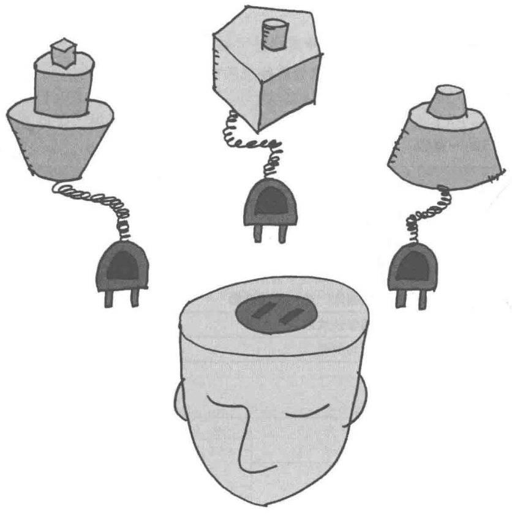
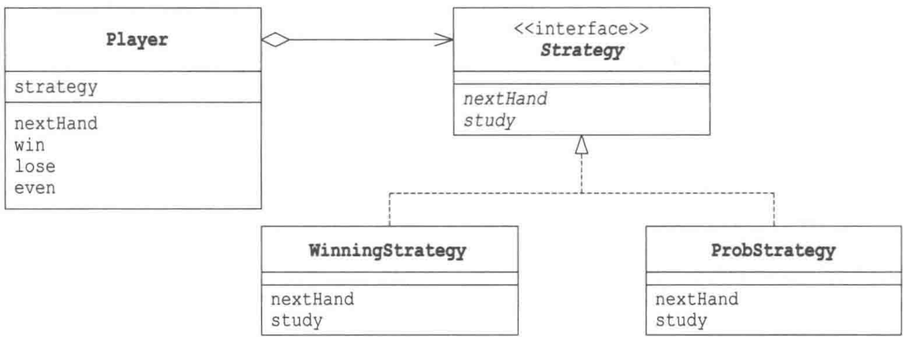
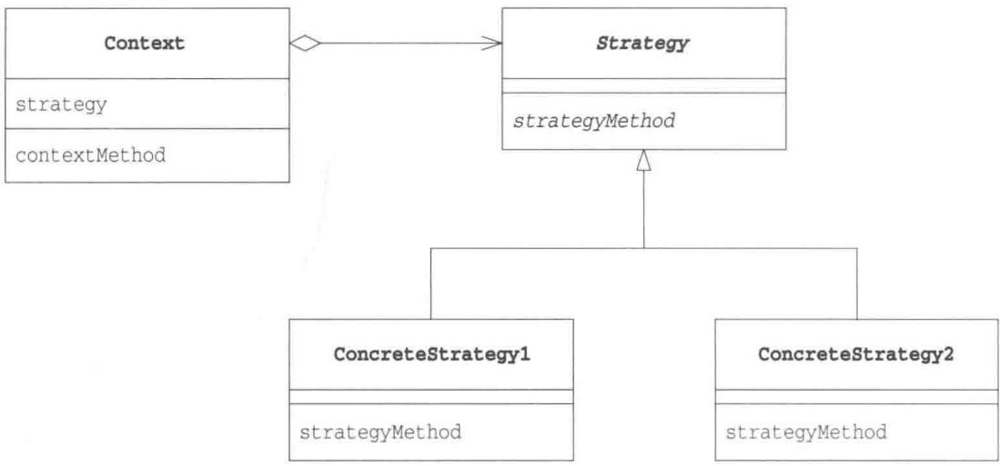

# 第10章 Strategy模式——整体地替换算法

> 来源：《图解设计模式》PDF 第 136–148 页，MinerU OCR 转写，如有疑问以原书为准

<!-- PDF p136 -->



<!-- PDF p137 · 书页 104 -->

## 10.1 Strategy 模式

在本章中，我们将要学习Strategy模式。

Strategy 的意思是 “策略”，指的是与敌军对垒时行军作战的方法。在编程中，我们可以将它理解为 “算法”。

无论什么程序，其目的都是解决问题。而为了解决问题，我们又需要编写特定的算法。使用Strategy模式可以整体地替换算法的实现部分。能够整体地替换算法，能让我们轻松地以不同的算法去解决同一个问题，这种模式就是Strategy模式。

## 10.2 示例程序

下面我们来看一段使用了 Strategy 模式的示例程序。这段示例程序的功能是让电脑玩 “猜拳” 游戏。

我们考虑了两种猜拳的策略。第一种策略是“如果这局猜拳获胜，那么下一局也出一样的手势”（WinningStrategy），这是一种稍微有些笨的策略；另外一种策略是“根据上一局的手势从概率上计算出下一局的手势”（ProbStrategy）。

表10-1 类和接口的一览表

| 名字 | 说明 |
| --- | --- |
| Hand | 表示猜拳游戏中的“手势”的类 |
| Strategy | 表示猜拳游戏中的策略的类 |
| WinningStrategy | 表示“如果这局猜拳获胜,那么下一局也出一样的手势”这一策略的类 |
| ProbStrategy | 表示“根据上一局的手势从概率上计算出下一局的手势从之前的猜拳结果计算下一局出各种拳的概率”这一策略的类 |
| Player | 表示进行猜拳游戏的选手的类 |
| Main | 测试程序行为的类 |

图10-1 示例程序的类图



<!-- PDF p138 · 书页 105 -->

### Hand类

Hand 类（代码清单 10-1）是表示猜拳游戏中的“手势”的类。在该类的内部，用 int 表示所出的手势，其中 0 表示石头，1 表示剪刀，2 表示布，并将值保存在 handValue 字段中。

我们只需要 3 个 Hand 类的实例。在程序的开始，创建这 3 个实例，并将它们保存在 hand 数组中。

Hand 类的实例可以通过使用类方法 getHand 来获取。只要将表示手势的值作为参数传递给 getHand 方法，它就会将手势的值所对应的 Hand 类的实例返回给我们。这也是一种 Singleton 模式（第 5 章）。

isStrongerThan 方法和 isWeakerThan 方法用于判断猜拳结果。例如，如果有手势 hand1 和手势 hand2，那么可以像下面这样判断猜拳结果。

```java
// Hand 提供的比较方法：hand1 是否赢 / 输给 hand2
hand1.isStrongerThan(hand2);
hand1.isWeakerThan(hand2);
```

在该类的内部，实际负责判断猜拳结果的是 fight 方法，其判断依据是手势的值。

代码清单 10-1 中的 (this.handvalue + 1) % 3 == h.handvalue 表达式可能会有些难以理解，所以这里稍微说明一下。如果 this 的手势值加 1 后是 h 的手势值（例如，如果 this 的手势是石头，而 h 是剪刀，或是 this 的手势是剪刀，而 h 是布，或是 this 的手势是布，而 h 是石头），那么判断 this 获胜。之所以使用 “%” 运算符进行取余数计算，是希望布 (2) 加 1 后，变成石头 (0)。

在上面的语句中，出现了 this.handvalue，这是为了让读者能够注意到它与 h.handvalue 的区别。在程序中，即使写作 (handvalue + 1) % 3 == h.handvalue，意思也是完全一样的。

虽然 Hand 类会被其他类（Player 类、WinningStrategy 类、ProbStrategy 类）使用，但它并非 Strategy 模式中的角色。

代码清单 10-1 Hand 类 (Hand.java)

```java
/**
 * 【Strategy 模式】示例：猜拳游戏
 * Hand：手势类（石头 / 剪刀 / 布），3 个实例提前创建好（类似单例的“多例”）
 * 胜负规则：(自己的值 + 1) % 3 == 对方的值 → 自己赢
 *   例：石头(0)+1 = 剪刀(1) → 石头赢剪刀
 */
public class Hand {
    public static final int HANDVALUE_GUU = 0; // 表示石头的值
    public static final int HANDVALUE_CHO = 1; // 表示剪刀的值
    public static final int HANDVALUE_PAA = 2; // 表示布的值
    public static final Hand[] hand = { // 表示猜拳中3种手势的实例
        new Hand(HANDVALUE_GUU),
        new Hand(HANDVALUE_CHO),
        new Hand(HANDVALUE_PAA),
    };
    private static final String[] name = { // 表示猜拳中手势所对应的字符串
        "石头", "剪刀", "布",
    };
    private int handvalue; // 猜拳中出的手势的值
    private Hand(int handvalue) {
        this.handvalue = handvalue;
    }
    public static Hand getHand(int handvalue) { // 根据手势的值获取其对应的实例
        return hand[handvalue];
    }
    public boolean isStrongerThan(Hand h) { // 如果this胜了h则返回true
return fight(h) == 1;
}
public boolean isWeakerThan(Hand h) {          // 如果 this 输给了 h 则返回 true
    return fight(h) == -1;
}

private int fight(Hand h) {                  // 计分: 平 0, 胜 1, 负 -1
    if (this == h) {
        return 0;
    } else if ((this.handvalue + 1) % 3 == h.handvalue) {
        return 1;
    } else {
        return -1;
    }
}
public String toString() {                  // 转换为手势值所对应的字符串
    return name[handvalue];
}
}
```

<!-- PDF p139 · 书页 106 -->

### Strategy 接口

Strategy 接口（代码清单 10-2）是定义了猜拳策略的抽象方法的接口。

nextHand 方法的作用是 “获取下一局要出的手势”。调用该方法后，实现了 Strategy 接口的类会绞尽脑汁想出下一局出什么手势。

study 方法的作用是学习 “上一局的手势是否获胜了”。如果在上一局中调用 nextHand 方法获胜了，就接着调用 study(true)；如果输了，就接着调用 study(false)。这样，Strategy 接口的实现类就会改变自己的内部状态，从而为下一次 nextHand 被调用时究竟是返回 “石头” “剪刀” 还是 “布” 提供判断依据。

代码清单 10-2 Strategy 接口 (Strategy.java)

```java
// 策略接口：猜拳的“出拳策略”
public interface Strategy {
    public abstract Hand nextHand();         // 决定下一局出什么
    public abstract void study(boolean win); // 根据上一局输赢来“学习”
}
```

### WinningStrategy 类

WinningStrategy类(代码清单10-3)是Strategy接口的实现类之一,它实现了nextHand和study两个方法。

该类的猜拳策略有些笨，如果上一局的手势获胜了，则下一局的手势就与上局相同（上一局出石头，下一局继续出石头；上一局出布，下一局继续出布）。如果上一局的手势输了，则下一局就随机出手势。

由于在 WinningStrategy 类中需要使用随机值，因此我们在 random 字段中保存了 java.util.Random 的实例。也可以说，random 字段是该类的一个随机数生成器。

在 won 字段中保存了上一局猜拳的输赢结果。如果上一局猜拳获胜了，则 won 值为 true；如果输了，则 won 值为 false。

在 prevHand 字段中保存的是上一局出的手势。

<!-- PDF p140 · 书页 107 -->

代码清单 10-3 WinningStrategy 类（WinningStrategy.java）

```java
// 策略 1：赢了就继续出同样的手势，输了就随机出
import java.util.Random;
public class WinningStrategy implements Strategy {
    private Random random;
    private boolean won = false; // 上一局是否赢了
    private Hand prevHand;       // 上一局出的手势
    public WinningStrategy(int seed) {
        random = new Random(seed); // seed：随机种子，相同种子产生相同的随机序列
    }
    public Hand nextHand() {
        if (!won) {                // 没赢 → 换一个随机手势
            prevHand = Hand.getHand(random.nextInt(3));
        }
        return prevHand;           // 赢了 → 继续出上次的
    }
    public void study(boolean win) {
        won = win;
    }
}
```

### ProbStrategy类

ProbStrategy 类（代码清单 10-4）是另外一个具体策略，这个策略就需要“动点脑筋”了。虽然它与 WinningStrategy 类一样，也是随机出手势，但是每种手势出现的概率会根据以前的猜拳结果而改变。

history字段是一个表，被用于根据过去的胜负来进行概率计算。它是一个二维数组，每个数组下标的意思如下。

history[上一局出的手势][这一局所出的手势]

这个表达式的值越大，表示过去的胜率越高。下面稍微详细讲解下。

假设我们上一局出的是石头。

history[0][0] 两局分别出石头、石头时胜了的次数

history[0][1] 两局分别出石头、剪刀时胜了的次数

history[0][2] 两局分别出石头、布时胜了的次数

那么，我们就可以根据 history[0][0]、history[0][1]、history[0][2] 这 3 个表达式的值从概率上计算出下一局出什么。简而言之，就是先计算 3 个表达式的值的和 ( getSum 方法)，然后再从 0 与这个和之间取一个随机数，并据此决定下一局应该出什么 ( nextHand 方法 )。

例如，如果

history[0][0]是3

history[0][1] 是 5

history[0][2]是7

那么，下一局出什么就会以石头、剪刀和布的比率为 3:5:7 来决定。然后在0至15（不含15，15是 3 + 5 + 7 的和）之间取一个随机数。

<!-- PDF p141 · 书页 108 -->

如果该随机数在0至3（不含3）之间，那么出石头如果该随机数在3至8（不含8）之间，那么出剪刀如果该随机数在8至15（不含15）之间，那么出布

study 方法会根据 nextHand 方法返回的手势的胜负结果来更新 history 字段中的值。

注意 此策略的大前提是对方只有一种猜拳模式。

```java
/**
 * 策略 2：根据历史记录，按概率出拳
 * history[上一局出的][这一局出的] = 这种出法赢过的次数（越大越可能再出）
 * 例：history[0][1] 表示“上局出石头、这局出剪刀”的权重
 */
import java.util.Random;
public class ProbStrategy implements Strategy {
    private Random random;
    private int prevHandValue = 0;     // 上上局的手势
    private int currentHandValue = 0;  // 上一局的手势
    private int[][] history = {        // 初始权重都是 1
        { 1, 1, 1, },
        { 1, 1, 1, },
        { 1, 1, 1, },
    };
    public ProbStrategy(int seed) {
        random = new Random(seed);
    }
    // 按权重随机：例如权重 [3,5,7]，就在 0~14 里随机，落在哪段就出哪个
    public Hand nextHand() {
        int bet = random.nextInt(getSum(currentHandValue));
        int handvalue = 0;
        if (bet < history[currentHandValue][0]) {
            handvalue = 0;   // 石头
        } else if (bet < history[currentHandValue][0] + history[currentHandValue][1]) {
            handvalue = 1;   // 剪刀
        } else {
            handvalue = 2;   // 布
        }
        prevHandValue = currentHandValue;
        currentHandValue = handvalue;
        return Hand.getHand(handvalue);
    }
    // 某一行权重的总和
    private int getSum(int hv) {
        int sum = 0;
        for (int i = 0; i < 3; i++) {
            sum += history[hv][i];
        }
        return sum;
    }
    // 学习：赢了 → 这种出法权重 +1；输了 → 另外两种出法权重各 +1
    public void study(boolean win) {
        if (win) {
            history[prevHandValue][currentHandValue]++;
        } else {
            history[prevHandValue][(currentHandValue + 1) % 3]++;
            history[prevHandValue][(currentHandValue + 2) % 3]++;
        }
    }
}
```

<!-- PDF p142 · 书页 109 -->

### Player类

Player 类（代码清单 10-5）是表示进行猜拳游戏的选手的类。在生成 Player 类的实例时，需要向其传递“姓名”和“策略”。nextHand 方法是用来获取下一局手势的方法，不过实际上决定下一局手势的是各个策略。Player 类的 nextHand 方法的返回值其实就是策略的 nextHand 方法的返回值。nextHand 方法将自己的工作委托给了 Strategy，这就形成了一种委托关系。

在决定下一局要出的手势时，需要知道之前各局的胜(win)、负(lose)、平(even)等结果，因此 Player 类会通过 strategy 字段调用 study 方法，然后 study 方法会改变策略的内部状态。wincount、losecount 和 gamecount 用于记录选手的猜拳结果。

```java
// 玩家：自己不决定出什么，全交给持有的 Strategy（委托）
// 换一个策略对象，玩家的打法就变了
public class Player {
    private String name;
    private Strategy strategy;
    private int wincount;
    private int losecount;
    private int gamecount;
    public Player(String name, Strategy strategy) {          // 赋予姓名和策略
        this.name = name;
        this.strategy = strategy;
    }
    public Hand nextHand() {                               // 策略决定下一局要出的手势
        return strategy.nextHand();
    }
    public void win() {                  // 胜
        strategy.study(true);
        wincount++;
        gamecount++;
    }
    public void lose() {                  // 负
        strategy.study(false);
        losecount++;
        gamecount++;
    }
    public void even() {                  // 平
        gamecount++;
    }
    public String toString() {
        return "[" + name + ":" + gamecount + " games, " + wincount + " win, " +
losecount + " lose" + " Civil";
    }
}
```

### Main类

Main类（代码清单10-6）负责使用以上类让电脑进行猜拳游戏。这里Main类让以下两位选手进行10000局比赛，然后显示比赛结果。

- 姓名:"Taro"、策略:WinningStrategy

- 姓名:"Hana"、策略: ProbStrategy此外，"Winner:" + player1与"Winner:" + player1.toString()的意思是一样的。

<!-- PDF p143 · 书页 110 -->

代码清单 10-6 Main 类 (Main.java)

```java
// 使用：两个玩家用不同策略对战 10000 局
public class Main {
    public static void main(String[] args) {
        // 参数：两个随机种子
        if (args.length != 2) {
            System.out.println("Usage: java Main randomseed1 randomseed2");
            System.out.println("Example: java Main 314 15");
            System.exit(0);
        }
        int seed1 = Integer.parseInt(args[0]);
        int seed2 = Integer.parseInt(args[1]);
        Player player1 = new Player("Taro", new WinningStrategy(seed1)); // 策略 1
        Player player2 = new Player("Hana", new ProbStrategy(seed2));    // 策略 2
        for (int i = 0; i < 10000; i++) {
            Hand nextHand1 = player1.nextHand();
            Hand nextHand2 = player2.nextHand();
            if (nextHand1.isStrongerThan(nextHand2)) {        // 玩家 1 赢
                System.out.println("Winner:" + player1);
                player1.win();
                player2.lose();
            } else if (nextHand2.isStrongerThan(nextHand1)) { // 玩家 2 赢
                System.out.println("Winner:" + player2);
                player1.lose();
                player2.win();
            } else {                                          // 平局
                System.out.println("Even...");
                player1.even();
                player2.even();
            }
        }
        System.out.println("Total result:");
        System.out.println(player1.toString());
        System.out.println(player2.toString());
    }
}
```

<!-- PDF p144 · 书页 111 -->

图10-2 运行结果

```text
java Main 314 15
Even...
Winner:[Hana:1 games, 0 win, 0 lose]
Winner:[Taro:2 games, 0 win, 1 lose]
Even...
Winner:[Hana:4 games, 1 win, 1 lose]
Winner:[Taro:5 games, 1 win, 2 lose]
Even...
Even...
Winner:[Taro:8 games, 2 win, 2 lose]
Winner:[Taro:9 games, 3 win, 2 lose]
Winner:[Taro:10 games, 4 win, 2 lose]
Even...
(中间省略)
Even...
Winner:[Taro:9992 games, 3164 win, 3488 lose]
Winner:[Hana:9993 games, 3488 win, 3165 lose]
Winner:[Taro:9994 games, 3165 win, 3489 lose]
Winner:[Taro:9995 games, 3166 win, 3489 lose]
Winner:[Hana:9996 games, 3489 win, 3167 lose]
Even...
Even...
Even...
Total result:
[Taro:10000 games, 3167 win, 3490 lose]
[Hana:10000 games, 3490 win, 3167 lose]
```

## 10.3 Strategy 模式中的登场角色

在 Strategy 模式中有以下登场角色。

### ◆ Strategy（策略）

Strategy 角色负责决定实现策略所必需的接口（API）。在示例程序中，由 Strategy 接口扮演此角色。

### ◆ ConcreteStrategy（具体的策略）

ConcreteStrategy 角色负责实现 Strategy 角色的接口（API），即负责实现具体的策略（战略、方向、方法和算法）。在示例程序中，由 WinningStrategy 类和 ProbStrategy 类扮演此角色。

### ◆ Context (上下文)

负责使用 Strategy 角色。Context 角色保存了 ConcreteStrategy 角色的实例，并使用 ConcreteStrategy 角色去实现需求（总之，还是要调用 Strategy 角色的接口（API））。在示例程序中，由 Player 类扮演此角色。

<!-- PDF p145 · 书页 112 -->

图10-3 Strategy模式的类图



## 10.4 拓展思路的要点

### 为什么需要特意编写 Strategy 角色

通常在编程时算法会被写在具体方法中。Strategy 模式却特意将算法与其他部分分离开来，只是定义了与算法相关的接口（API），然后在程序中以委托的方式来使用算法。

这样看起来程序好像变复杂了，其实不然。例如，当我们想要通过改善算法来提高算法的处理速度时，如果使用了Strategy模式，就不必修改Strategy角色的接口（API）了，仅仅修改ConcreteStrategy角色即可。而且，使用委托这种弱关联关系可以很方便地整体替换算法。例如，如果想比较原来的算法与改进后的算法的处理速度有多大区别，简单地替换下算法即可进行测试。

使用 Strategy 模式编写象棋程序时，可以方便地根据棋手的选择切换 AI 例程的水平。

### 程序运行中也可以切换策略

如果使用 Strategy 模式，在程序运行中也可以切换 ConcreteStrategy 角色。例如，在内存容量少的运行环境中可以使用 SlowButLessMemoryStrategy（速度慢但省内存的策略），而在内存容量多的运行环境中则可以使用 FastButMoreMemoryStrategy（速度快但耗内存的策略）。

此外，还可以用某种算法去“验算”另外一种算法。例如，假设要在某个表格计算软件的开发版本中进行复杂的计算。这时，我们可以准备两种算法，即“高速但计算上可能有 Bug 的算法”和“低速但计算准确的算法”，然后让后者去验算前者的计算结果。

<!-- PDF p146 · 书页 113 -->

## 10.5 相关的设计模式

### ◆ Flyweight 模式（第 20 章）

有时会使用 Flyweight 模式让多个地方可以共用 ConcreteStrategy 角色。

### ◆ Abstract Factory 模式（第 8 章）

使用 Strategy 模式可以整体地替换算法。

使用 Abstract Factory 模式则可以整体地替换具体工厂、零件和产品。

### ◆ State 模式（第 19 章）

使用 Strategy 模式和 State 模式都可以替换被委托对象，而且它们的类之间的关系也很相似。但是两种模式的目的不同。

在 Strategy 模式中，ConcreteStrategy 角色是表示算法的类。在 Strategy 模式中，可以替换被委托对象的类。当然如果没有必要，也可以不替换。

而在 State 模式中，ConcreteState 角色是表示 “状态” 的类。在 State 模式中，每次状态变化时，被委托对象的类都必定会被替换。

## 10.6 本章所学知识

在本章中，我们学习了可以方便地替换算法的 Strategy 模式。借助于委托，算法的替换，特别是动态替换成为了可能。

## 10.7 练习题

答案请参见附录A（P.315）

### 习题10-1

请编写一个随机出手势的 RandomStrategy 类。

#### 答案（附录 A）

如代码清单 A10-1 所示。由于我们让其随意出手势，因此 study 方法是空方法。

代码清单 A10-1 RandomStrategy 类 (RandomStrategy.java)

```java
// 习题 1：新增策略“完全随机出拳”—— 只需新写一个类，其他代码不改
import java.util.Random;
public class RandomStrategy implements Strategy {
    private Random random;
    public RandomStrategy(int seed) {
        random = new Random(seed);
    }
    public void study(boolean win) {
        // 不学习，什么都不做
    }
    public Hand nextHand() {
        return Hand.getHand(random.nextInt(3));
    }
}
```

代码清单 A10-2 Main 类 (Main.java)

```java
// 习题 1：测试，ProbStrategy 对战 RandomStrategy（只改了创建策略的那两行）
public class Main {
    public static void main(String[] args) {
        if (args.length != 2) {
            System.out.println("Usage: java Main randomseed1 randomseed2");
            System.out.println("Example: java Main 314 15");
            System.exit(0);
        }
        int seed1 = Integer.parseInt(args[0]);
        int seed2 = Integer.parseInt(args[1]);
        Player player1 = new Player("Taro", new ProbStrategy(seed1));
        Player player2 = new Player("Hana", new RandomStrategy(seed2));
        for (int i = 0; i < 10000; i++) {
            Hand nextHand1 = player1.nextHand();
            Hand nextHand2 = player2.nextHand();
if (nextHand1.isStrongerThan(nextHand2)) {
    System.out.println("Winner:" + player1);
    player1.win();
    player2.lose();
} else if (nextHand2.isStrongerThan(nextHand1)) {
    System.out.println("Winner:" + player2);
    player1.lose();
    player2.win();
} else {
    System.out.println("Even...");
    player1.even();
    player2.even();
}
}
System.out.println("Total result:");
System.out.println(player1.toString());
System.out.println(player2.toString());
```

<!-- PDF p349 · 书页 316 -->

### 习题10-2

Java 在本章的示例程序中，Hand 类（代码清单 10-1）的 fight 方法负责判断平局。在进行判断时，它使用的表达式不是 this.handValue == h.value，而是 this == h，请问为什么可以这样写？

#### 答案（附录 A）

这是因为本来 Hand 类的实例就只有 3 个（石头、剪刀、布）。如果两个实例中的 handvalue 字段的值相等，那么也就意味着它们是相同的实例。

### 习题10-3

Java 某位开发人员在编写 WinningStrategy 类（代码清单 10-3）时，won 字段的定义不是 private boolean won = false;，而是写成了如下这样。

但是，从运行结果来看，却与加上“= false”时是完全一样的。请问这是为什么呢？

<!-- PDF p147 · 书页 114 -->

#### 答案（附录 A）

在 Java 中，没有被显式地初始化的字段会被自动初始化。boolean 类型的字段会被初始化为 false；数值类型的字段会被初始化为 0；引用类型的字段会被初始化为 null。

注意 虽然字段会被自动初始化，但局部变量不会被自动初始化。

### 习题10-4

下面的代码清单 10-7 至代码清单 10-10 定义了用于排序的类和接口。程序的运行结果如图 10-4 所示。这里使用的排序算法是选择排序 (selection sort)。请编写一个表示其他算法（任何算法都行）的类，并让它实现 Sorter 接口。

代码清单 10-7 Sorter 接口 (Sorter.java)

```java
// 习题 2：排序也可以用 Strategy 模式 —— 排序算法就是可替换的“策略”
import java.lang.Comparable; // 可比较的对象（有 compareTo 方法）
public interface Sorter {
    public abstract void sort(Comparable[] data);
}
```

代码清单 10-8 SelectionSorter 类 (SelectionSorter.java)

```java
// 策略 1：选择排序 —— 每轮从剩下的元素里找最小的，换到前面
public class SelectionSorter implements Sorter {
    public void sort(Comparable[] data) {
        for (int i = 0; i < data.length - 1; i++) {
            int min = i;                                     // 假设当前位置最小
            for (int j = i + 1; j < data.length; j++) {
                if (data[min].compareTo(data[j]) > 0) {      // 找到更小的
                    min = j;
                }
            }
            // 交换 data[min] 和 data[i]
            Comparable passingplace = data[min];
            data[min] = data[i];
            data[i] = passingplace;
        }
    }
}
```

代码清单 10-9 SortAndPrint 类 (SortAndPrint.java)

```java
// 使用策略的类：排序前后各打印一次，排序算法由外部传入
public class SortAndPrint {
    Comparable[] data;
    Sorter sorter;    // 持有一个排序策略
    public SortAndPrint(Comparable[] data, Sorter sorter) {
        this.data = data;
        this.sorter = sorter;
    }
    public void execute() {
        print();          // 排序前
        sorter.sort(data);
        print();          // 排序后
    }
    public void print() {
        for (int i = 0; i < data.length; i++) {
            System.out.print(data[i] + ", ");
        }
        System.out.println("");
    }
}
```

<!-- PDF p148 · 书页 115 -->

代码清单 10-10 Main 类 (Main.java)

```java
// 测试：用选择排序
public class Main {
    public static void main(String[] args) {
        String[] data = {
            "Dummy", "Bowman", "Carroll", "Elfland", "Alice",
        };
        SortAndPrint sap = new SortAndPrint(data, new SelectionSorter());
        sap.execute();
    }
}
```

图10-4 运行结果

```text
Dumpty, Bowman, Carroll, Elfland, Alice,      ←排序前
Alice, Bowman, Carroll, Dumpty, Elfland,   ←排序后
```

#### 答案（附录 A）

QuickSorter 类（代码清单 A10-3）使用了快速排序算法。

代码清单 A10-3 QuickSorter 类 (QuickSorter.java)

```java
// 策略 2：快速排序 —— 选中间值，比它小的放左边、大的放右边，再分别递归
public class QuickSorter implements Sorter {
    Comparable[] data;
    public void sort(Comparable[] data) {
        this.data = data;
        qsort(0, data.length - 1);
    }
    // 对 data[pre..post] 排序
    private void qsort(int pre, int post) {
        int saved_pre = pre;
        int saved_post = post;
        Comparable mid = data[(pre + post) / 2];      // 基准值
        do {
            while (data[pre].compareTo(mid) < 0) {    // 左边找到 ≥ 基准的
                pre++;
            }
            while (mid.compareTo(data[post]) < 0) {   // 右边找到 ≤ 基准的
                post--;
}
    if (pre <= post) {                                // 交换这两个
        Comparable tmp = data[pre];
        data[pre] = data[post];
        data[post] = tmp;
        pre++;
        post--;
    }
} while (pre <= post);
// 递归处理左右两部分
if (saved_pre < post) {
    qsort(saved_pre, post);
}
if (pre < saved_post) {
    qsort(pre, saved_post);
}
}
}
```

<!-- PDF p350 · 书页 317 -->

代码清单 A10-4 Main 类 (Main.java)

```java
// 测试：换成快速排序，只改了一个参数
public class Main {
    public static void main(String[] args) {
        String[] data = {
            "Dumpty", "Bowman", "Carroll", "Elfland", "Alice",
        };
        SortAndPrint sap = new SortAndPrint(data, new QuickSorter());
        sap.execute();
    }
}
```
