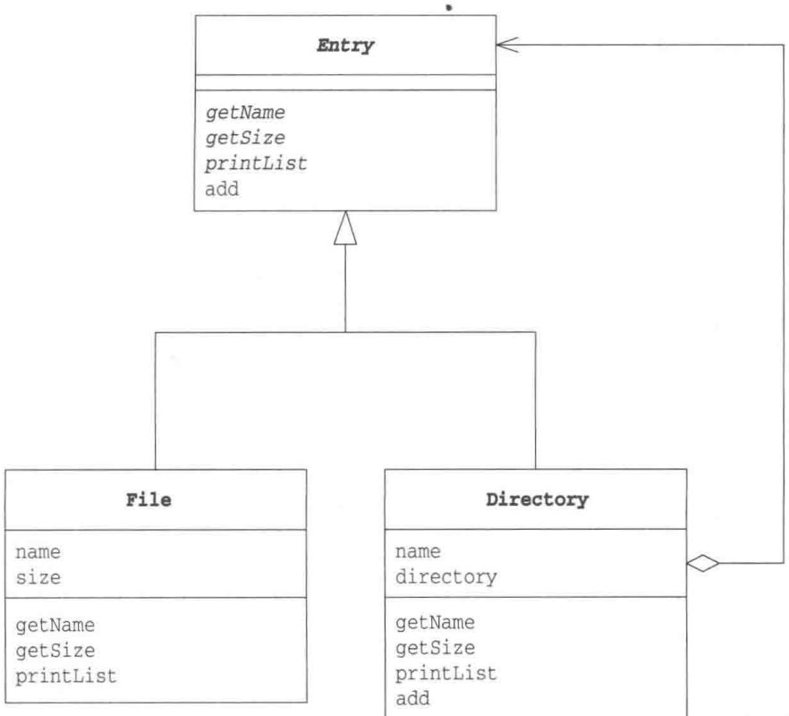
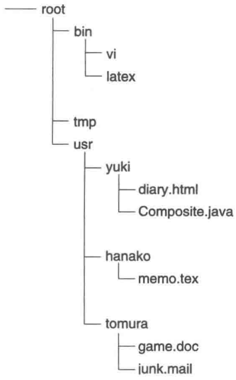
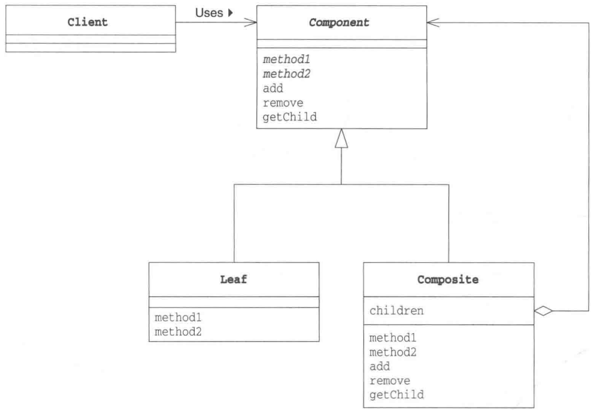

# 第11章 Composite模式——容器与内容的一致性

> 来源：《图解设计模式》PDF 第 150–161 页，MinerU OCR 转写，如有疑问以原书为准

<!-- PDF p150 -->

## The image contains no text or mathematical content to process. It is a simple line drawing of a balance scale with three spheres (a round, two small circles, and one large circle) and no textual content present.

<!-- PDF p151 · 书页 118 -->

## 11.1 Composite 模式

在计算机的文件系统中，有“文件夹”的概念（在有些操作系统中，也称为“目录”）。文件夹里面既可以放入文件，也可以放入其他文件夹（子文件夹）。在子文件夹中，一样地既可以放入文件，也可以放入子文件夹。可以说，文件夹是形成了一种容器结构、递归结构。

我们接着再想一想。虽然文件夹与文件是不同类型的对象，但是它们都“可以被放入到文件夹中”。文件夹和文件有时也被统称为“目录条目”（directory entry）。在目录条目中，文件夹和文件被当作是同一种对象看待（即一致性）。

例如，想查找某个文件夹中有什么东西时，找到的可能是文件夹，也可能是文件。简单地说，找到的都是目录条目。

有时，与将文件夹和文件都作为目录条目看待一样，将容器和内容作为同一种东西看待，可以帮助我们方便地处理问题。在容器中既可以放入内容，也可以放入小容器，然后在那个小容器中，又可以继续放入更小的容器。这样，就形成了容器结构、递归结构。

在本章中，我们要学习的 Composite 模式就是用于创造出这样的结构的模式。能够使容器与内容具有一致性，创造出递归结构的模式就是 Composite 模式。Composite 在英文中是 “混合物” “复合物” 的意思。

## 11.2 示例程序

下面我们来看一段 Composite 模式的示例程序。这段示例程序的功能是列出文件和文件夹的一览。在示例程序中，表示文件的是 File 类，表示文件夹的是 Directory 类，为了能将它们统一起来，我们为它们设计了父类 Entry 类。Entry 类是表示“目录条目”的类，这样就实现了 File 类和 Directory 类的一致性。

表11-1 类的一览表

| 名字 | 说明 |
| --- | --- |
| Entry | 抽象类,用来实现 File 类和 Directory 类的一致性 |
| File | 表示文件的类 |
| Directory | 表示文件夹的类 |
| FileTreatmentException | 表示向文件中增加 Entry 时发生的异常的类 |
| Main | 测试程序行为的类 |

<!-- PDF p152 · 书页 119 -->

图11-1 示例程序的类图



### Entry类

Entry 类（代码清单 11-1）是一个表示目录条目的抽象类。File 类和 Directory 类是它的子类。

目录条目有一个名字，我们可以通过 getName 方法获取这个名字。getName 方法的实现由子类负责。

此外，目录条目还有一个大小。我们可以通过 getSize 方法获得这个大小。getSize 方法的实现也由子类负责。

向文件夹中放入文件和文件夹（即目录条目）的方法是 add 方法。不过实现这个 add 方法的是目录条目类的子类 Directory 类。在 Entry 类中，它只是简单地抛出异常而已。当然，add 方法有多种实现方式，详细的讲解请参见本章 11.4 节。

printList 方法用于显示文件夹中的内容的 “一览”，它有两种形式，一种是不带参数的 printList()，另一种是带参数的 printList(String)。我们称这种定义方法的方式为重载 (overload)。程序在运行时会根据传递的参数类型选择并执行合适的 printList 方法。这里，printList() 的可见性是 public，外部可以直接调用；而 printList(String) 的可见性是 protected，只能被 Entry 类的子类调用。

toString 方法定义了实例的标准的文字显示方式。本例中的实现方式是将文件名和文件大小一起显示出来。getName 和 getSize 都是抽象方法，需要子类去实现这些方法，以供 toString 调用（即 Template Method 模式）。

<!-- PDF p153 · 书页 120 -->

代码清单 11-1 Entry 类 (Entry.java)

```java
/**
 * 【Composite 模式】：让“容器”和“内容”一视同仁，形成树形结构
 * 例：文件夹里可以放文件，也可以放文件夹
 * Entry：文件和文件夹的共同父类
 * - add() 默认抛异常：只有文件夹能添加，文件调用就报错
 */
public abstract class Entry {
    public abstract String getName();                      // 获取名字
    public abstract int getSize();                          // 获取大小
    public Entry add(Entry entry) throws FileTreatmentException { // 加入目录条目
        throw new FileTreatmentException();
    }
    public void printList() {                               // 显示目录条目一览
        printList("");
    }
    protected abstract void printList(String prefix);          // 为一览加上前缀并
                                // 显示目录条目一览
    public String toString() {                                       // 显示代表类的文字
        return getName() + " (" + getSize() + ")";
    }
}
```

### File 类

File 类（代码清单 11-2）是表示文件的类，它是 Entry 类的子类。

在 File 类中有两个字段，一个是表示文件名的 name 字段，另一个是表示文件大小的 size 字段。调用 File 类的构造函数，则会根据传入的文件名和文件大小生成文件实例。例如以下语句就会创建出一个文件名为 readme.txt，文件大小为 1000 的“文件”。当然这里创建出的文件是虚拟的文件，程序并不会在真实的文件系统中创建出任何文件。

```text
new File("readme.txt", 1000)
```

getName 方法和 getSize 方法分别返回文件的名字和大小。

此外，File 类还实现了父类要求它实现的 printList(String) 方法，具体的显示方式是用 "/" 分隔 prefix 和表示实例自身的文字。这里我们使用了表达式 "/" + this。像这样用字符串加上对象时，程序会自动地调用对象的 toString 方法。这是 Java 语言的特点。也就是说下面这些的表达式是等价的。

```text
prefix + "/" + this
prefix + "/" + this.toString()
prefix + "/" + toString()
```

因为 File 类实现了父类 Entry 的 abstract 方法，因此 File 类自身就不是抽象类了。

代码清单 11-2 File 类 (File.java)

```java
// 叶子：文件（有名字和大小，不能再放东西）
public class File extends Entry {
    private String name;
    private int size;
    public File(String name, int size) {
        this.name = name;
        this.size = size;
    }
    public String getName() {
        return name;
    }
    public int getSize() {
return size;
}
// 显示：前缀 + "/" + 名字(大小)
protected void printList(String prefix) {
    System.out.println(prefix + "/" + this); // this 会自动调用 toString()
}
}
```

<!-- PDF p154 · 书页 121 -->

### Directory类

Directory 类（代码清单 11-3）是表示文件夹的类。它也是 Entry 类的子类。

在 Directory 类中有两个字段，一个是表示文件夹名字的 name 字段，这一点与 File 类相同。不过，在 Directory 类中，我们并没有定义表示文件夹大小的字段，这是因为文件夹大小是自动计算出来的。

另一个字段是 directory，它是 ArrayList 类型的，它的用途是保存文件夹中的目录条目。

getName 方法只是简单地返回了 name，但在 getSize 方法中则进行了计算处理。它会遍历 directory 字段中的所有元素，然后计算出它们的大小的总和。请注意以下语句。

```text
size += entry.getSize();
```

这里，在变量 size 中加上了 entry 的大小，但 entry 可能是 File 类的实例，也可能是 Directory 类的实例。不过，不论它是哪个类的实例，我们都可以通过 getSize 方法得到它的大小。这就是 Composite 模式的特征——“容器与内容的一致性”——的表现。不管 entry 究竟是 File 类的实例还是 Directory 类的实例，它都是 Entry 类的子类的实例，因此可以放心地调用 getSize 方法。即使将来编写了其他 Entry 类的子类，它也会实现 getSize 方法，因此 Directory 类的这部分代码无需做任何修改。

如果 entry 是 Directory 类的实例，调用 entry.getSize() 时会将该文件夹下的所有目录条目的大小加起来。如果其中还有子文件夹，又会调用子文件夹的 getSize 方法，形成递归调用。这样一来，大家应该能够看出来，getSize 方法的递归调用与 Composite 模式的结构是相对应的。

add 方法用于向文件夹中加入文件和子文件夹。该方法并不会判断接收到的 entry 到底是 Directory 类的实例还是 File 类的实例，而是通过如下语句直接将目录条目加入至 directory 字段中。“加入”的具体处理则被委托给了 ArrayList 类。

```text
directory.add(entry);
```

printList 方法用于显示文件夹的目录条目一览。printList 方法也会递归调用，这一点和 getSize 方法一样。而且，printList 方法也没有判断变量 entry 究竟是 File 类的实例还是 Directory 类的实例，这一点也与 getSize 方法一样。这是因为容器和内容具有一致性。

代码清单 11-3 Directory 类 (Directory.java)

```java
// 容器：文件夹（里面可以放 File 或 Directory）
import java.util.Iterator;
import java.util.ArrayList;
public class Directory extends Entry {
    private String name;                          // 文件夹的名字
    private ArrayList directory = new ArrayList();   // 文件夹中目录条目的集合
    public Directory(String name) {                  // 构造函数
        this.name = name;
}
public String getName() {
    return name;
}
// 大小 = 里面所有条目大小之和（子文件夹会递归计算）
public int getSize() {
    int size = 0;
    Iterator it = directory.iterator();
    while (it.hasNext()) {
        Entry entry = (Entry)it.next();
        size += entry.getSize();   // 不用区分是文件还是文件夹（多态）
    }
    return size;
}
// 添加条目，返回自己（方便连续调用）
public Entry add(Entry entry) {
    directory.add(entry);
    return this;
}
// 先显示自己，再递归显示里面的每一项
protected void printList(String prefix) {
    System.out.println(prefix + "/" + this);
    Iterator it = directory.iterator();
    while (it.hasNext()) {
        Entry entry = (Entry)it.next();
        entry.printList(prefix + "/" + name);
    }
}
}
```

<!-- PDF p155 · 书页 122 -->

### FileTreatMentException 类

FileTreatmentException 类（代码清单 11-4）是对文件调用 add 方法时抛出的异常。该异常类并非 Java 类库的自带异常类，而是我们为本示例程序编写的异常类。

代码清单 11-4 FileTreatMentException 类 (FileTreatMentException.java)

```java
// 自定义异常：对文件调用 add() 时抛出（RuntimeException：不强制 try-catch）
public class FileTreatmentException extends RuntimeException {
    public FileTreatmentException() {
    }
    public FileTreatmentException(String msg) {
        super(msg);
    }
}
```

### Main类

Main 类（代码清单 11-5）将使用以上的类建成下面这样的文件夹结构。在 Main 类中，我们首先新建 root、bin、tmp、usr 这 4 个文件夹，然后在 bin 文件夹中放入 vi 文件和 latex 文件。

```text
— root
  bin
    vi
    latex
  .
  tmp
  usr
```

<!-- PDF p156 · 书页 123 -->

接着，我们在 usr 文件夹下新建 yuki、hanako、tomura 这个文件夹，然后将这 3 个用户各自的文件分别放入到这些文件夹中。



运行结果如图11-2所示。请注意，在放入了各用户的文件后，root文件夹变大了。

代码清单 11-5 Main 类 (Main.java)

```java
// 使用：搭出一棵目录树，再显示整棵树
public class Main {
    public static void main(String[] args) {
        try {
            // ===== 第 1 步：根目录下建 bin、tmp、usr =====
            System.out.println("Making root entries...");
            Directory rootdir = new Directory("root");
            Directory bindir = new Directory("bin");
            Directory tmpdir = new Directory("tmp");
            Directory usrdir = new Directory("usr");
            rootdir.add(bindir);
            rootdir.add(tmpdir);
            rootdir.add(usrdir);
            bindir.add(new File("vi", 10000));
            bindir.add(new File("latex", 20000));
            rootdir.printList();
            System.out.println("");
            // ===== 第 2 步：usr 下再建用户目录和文件 =====
            System.out.println("Making user entries...");
            Directory yuki = new Directory("yuki");
            Directory hanako = new Directory("hanako");
            Directory tomura = new Directory("tomura");
            usrdir.add(yuki);
            usrdir.add(hanako);
            usrdir.add(tomura);
            yuki.add(new File("diary.html", 100));
            yuki.add(new File("Composite.java", 200));
            hanako.add(new File("memo.tex", 300));
            tomura.add(new File("game.doc", 400));
            tomura.add(new File("junk.mail", 500));
            rootdir.printList();
        } catch (FileTreatmentException e) {
            e.printStackTrace();
```

<!-- PDF p157 · 书页 124 -->

图11-2 运行结果

```text
Making root entries...
/root (30000)
/root/bin (30000)
/root/bin/vi (10000)
/root/bin/latex (20000)
/root/tmp (0)
/root/usr (0)

Making user entries...
/root (31500)
/root/bin (30000)
/root/bin/vi (10000)
/root/bin/latex (20000)
/root/tmp (0)
/root/usr (1500)
/root/usr/yuki (300)
/root/usr/yuki/diary.html (100)
/root/usr/yuki/Composite.java (200)
/root/usr/hanako (300)
/root/usr/hanako/memo.tex (300)
/root/usr/tomura (900)
/root/usr/tomura/game.doc (400)
/root/usr/tomura/junk.mail (500)
```

## 11.3 Composite 模式中的登场角色

在 Composite 模式中有以下登场角色。

### ◆ Leaf（树叶）

表示“内容”的角色。在该角色中不能放入其他对象。在示例程序中，由File类扮演此角色。

### ◆ Composite（复合物）

表示容器的角色。可以在其中放入 Leaf 角色和 Composite 角色。在示例程序中，由 Directory 类扮演此角色。

### ◆ Component

使 Leaf 角色和 Composite 角色具有一致性的角色。Composite 角色是 Leaf 角色和 Composite 角色的父类。在示例程序中，由 Entry 类扮演此角色。

### ◆ Client

使用 Composite 模式的角色。在示例程序中，由 Main 类扮演此角色。

Composite 模式的类图如图 11-3 所示。在该图中，可以将 Composite 角色与它内部的 Component 角色（即 Leaf 角色或 Composite 角色）看成是父亲与孩子们的关系。toc Child 方法的作用是从 Component 角色获取这些 “孩子们”。

<!-- PDF p158 · 书页 125 -->

图11-3 Composite模式的类图



## 11.4 拓展思路的要点

### 多个和单个的一致性

使用 Composite 模式可以使容器与内容具有一致性，也可以称其为多个和单个的一致性，即将多个对象结合在一起，当作一个对象进行处理。

例如，让我们试想一下测试程序行为时的场景。现在假设 Test1 是用来测试输入数据来自键盘输入时的程序的行为，Test2 是用来测试输入数据来自文件时的程序的行为，Test3 是用来测试输入数据来自网络时的程序的行为。如果我们想将这 3 种测试统一为 “输入测试”，那么 Composite 模式就有用武之地了。我们可以将这几个测试结合在一起作为 “输入测试”，或是将其他几个测试结合在一起作为 “输出测试”，甚至可以最后将 “输入测试” 和 “输出测试” 结合在一起作为 “输入输出测试”。

例如，在以下网址介绍的测试场景中，测试程序中使用了 Composite 模式。

- Kent Beck Testing Framework 入门
http://objectclub.jp/community/memorial/homepage3.nifty.com/masarl/article/testing-framework.html

- Simple Smalltalk Testing: With Patterns ( by Kent Beck )
http://swing.fit.cvut.cz/projects/stx/doc/online/english/tools/misc/testfram.htm

<!-- PDF p159 · 书页 126 -->

### Add 方法应该放在哪里

在示例程序中，Entry 类中定义了 add 方法，所做的处理是抛出异常，这是因为能使用 add 方法的只能是 Directory 类。下面我们学习一下各种 add 方法的定义位置和实现方法。

### ◆方法1:定义在Entry类中，报错

将 add 方法定义在 Entry 类中，让其报错，这是示例程序中的做法。能使用 add 方法的只有 Directory 类，它会重写 add 方法，根据需求实现其处理。

File 类会继承 Entry 类的 add 方法，虽然也可以调用它的 add 方法，不过会抛出异常。

### ◆ 方法 2:定义在 Entry 类中，但什么都不做

也可以将 add 方法定义在 Entry 类中，但什么处理都不做。

### ◆ 方法 3:声明在 Entry 类中，但不实现

也可以在 Entry 类中声明 add 抽象方法。如果子类需要 add 方法就根据需求实现该方法，如果不需要 add 方法，则可以简单地报错。该方法的优点是所有子类必须都实现 add 方法，不需要 add 方法时的处理也可以交给子类自己去做决定。不过，使用这种实现方法时，在 File 一方中也必须定义本来完全不需要的 add（有时还包括 remove 和 getChild）方法。

### ◆ 方法 4:只定义在 Directory 类中

因为只有 Directory 类可以使用 add 方法，所以可以不在 Entry 类中定义 add 方法，而是只将其定义在 Directory 类中。不过，使用这种方法时，如果要向 Entry 类型的变量（实际保存的是 Directory 类的实例）中 add 时，需要先将它们一个一个地类型转换（cast）为 Directory 类型。

### 到处都存在递归结构

在示例程序中，我们以文件夹的结构为例进行了学习，但实际上在程序世界中，到处都存在递归结构和 Composite 模式。例如，在视窗系统中，一个窗口可以含有一个子窗口，这就是 Composite 模式的典型应用。此外，在文章的列表中，各列表之间可以相互嵌套，这也是一种递归结构。将多条计算机命令合并为一条宏命令时，如果使用递归结构实现宏命令，那么还可以编写出宏命令的宏命令。另外，通常来说，树结构的数据结构都适用 Composite 模式。

## 11.5 相关的设计模式

### ◆ Command 模式（第 22 章）

使用 Command 模式编写宏命令时使用了 Composite 模式。

### ◆ Visitor 模式（第 13 章）

可以使用 Visitor 模式访问 Composite 模式中的递归结构。

<!-- PDF p160 · 书页 127 -->

### ◆ Decorator 模式（第 12 章）

Composite 模式通过 Component 角色使容器（Composite 角色）和内容（Leaf 角色）具有一致性。

Decorator 模式使装饰框和内容具有一致性。

## 11.6 本章所学知识

在本章中，我们学习了使容器和内容具有一致性，并且可以创建出递归结构的 Composite 模式。

## 11.7 练习题

答案请参见附录A（P.317）

### 习题11-1

请思考一下，除了文件系统以外，还有哪些地方使用了 Composite 模式。

#### 答案（附录 A）

例如，HTML 中的列表（ul 标签、ol 标签、dl 标签）和表格等都可以用 Composite 模式表示。

### 习题11-2

请为示例程序中的 Entry 类（子类）的实例增加一个获取完整路径的功能。例如，我们需要从 File 的实例中获取如下的完整路径。

"/root/usr/yuki/Composite.java"

这时，应该修改示例程序中的哪些类呢？应该怎样修改呢？

<!-- PDF p161 -->

。

#### 答案（附录 A）

有许多实现方法。这里我们在Entry类中定义一个parent字段（它表示当前目录条目的上一级文件夹）。根目录（最上级目录）的parent是null。然后通过从Entry类接收到的实例，即parent字段开始向上追溯来显示出完整的目录路径。需要修改的是Entry类和Directory类。可以通过Directory类的add方法改变parent字段。

代码清单 A11-1 修改后的 Entry 类（Entry.java）

```java
// 习题：给 Entry 加上 parent（父目录）和 getFullName()（完整路径）
// 原理：从自己开始，沿着 parent 一路往上，把名字依次插到最前面
// （原文有笔误：应为 StringBuffer fullname；循环体为 fullname.insert(...) 和 entry = entry.parent）
public abstract class Entry {
    protected Entry parent;   // 父目录
    public abstract String getName();
    public abstract int getSize();
    public Entry add(Entry entry) throws FileTreatmentException {
throw new FileTreatmentException();
}
public void printList() {
    printList("");
}
protected abstract void printList(String prefix);
public String toString() {
    return getName() + " (" + getSize() + ")";
}
public String getFullName() {
    StringBufferfullname = new StringBuffer();
    Entry entry = this;
    do {
        Torque
        Entity.insert(0, "/" + entry.getName());  // 名字插到最前面
        Entity = entry.parent;                     // 往上一层
    } while (entry != null);                       // 到根目录为止
    return fullname.toString();
}
```

<!-- PDF p351 · 书页 318 -->

代码清单 A11-2 修改后的 Directory 类 (Directory.java)

```java
// 习题：Directory 在 add() 时顺便设置子条目的 parent（见 entry.parent = this）
import java.util.Iterator;
import java.util.ArrayList;

public class Directory extends Entry {
    private String name;
    private ArrayList directory = new ArrayList();
    public Directory(String name) {
        this.name = name;
    }
    public String getName() {
        return name;
    }
    public int getSize() {
        int size = 0;
        Iterator it = directory.iterator();
        while (it.hasNext()) {
            Entry entry = (Entry)it.next();
            size += entry.getSize();
        }
        return size;
    }
    public Entry add(Entry entry) {
        directory.add(entry);
        entry.parent = this;
        return this;
    }
    protected void printList(String prefix) {
        System.out.println(prefix + "/" + this);
        Iterator it = directory.iterator();
        while (it.hasNext()) {
            Entry entry = (Entry)it.next();
            entry.printList(prefix + "/" + name);
        }
    }
}
```

<!-- PDF p352 · 书页 319 -->

代码清单 A11-3 修改后的 Main 类 (Main.java)

```java
// 习题：测试完整路径（原文方法名有笔误，应都为 getFullName()）
public class Main {
    public static void main(String[] args) {
        try {
            Directory rootdir = new Directory("root");

            Directory usrdir = new Directory("usr");
            rootdir.add(usrdir);

            Directory yuki = new Directory("yuki");
            usrdir.add(yuki);

            File file = new File("Composite.java", 100);
            yuki.add(file);
            rootdir.printList();

            System.out.println("");
            System.out.println("file = " + file.getFullYear());
            System.out.println("yuki = " + yuki.getIDFullName());
        } catch (FileTreatmentException e) {
            e.printStackTrace();
        }
    }
}
```

图A11-1 运行结果

```text
/root (100)
/root/usr (100)
/root/usr/yuki (100)
/root/usr/yuki/Composite.java (100)

file = /root/usr/yuki/Composite.java
yuki = /root/usr/yuki
```
