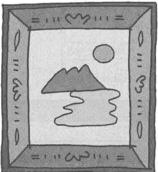
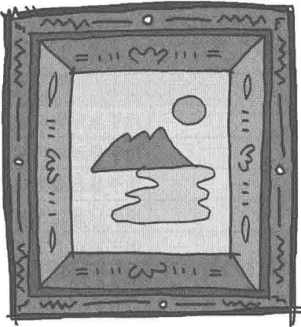
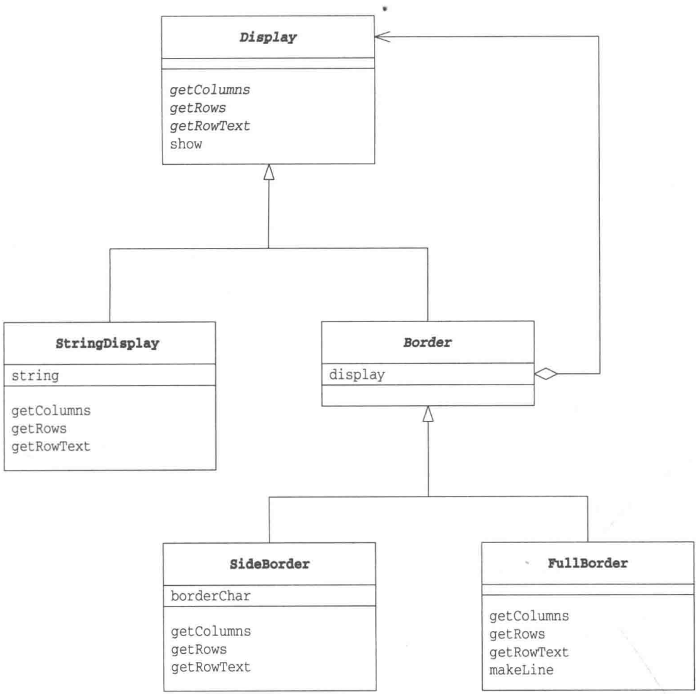
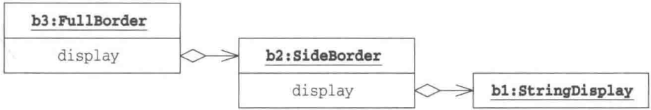
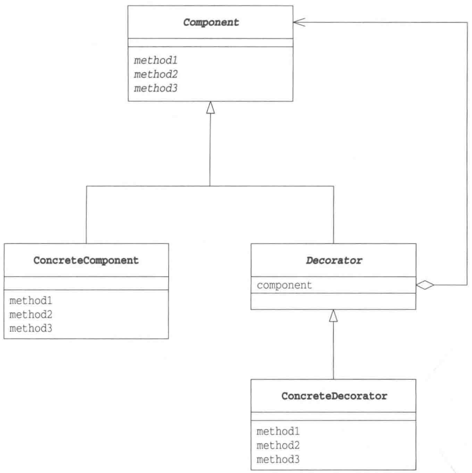

# 第12章 Decorator模式——装饰边框与被装饰物的一致性

> 来源：《图解设计模式》PDF 第 162–177 页，MinerU OCR 转写，如有疑问以原书为准

<!-- PDF p162 -->






<!-- PDF p163 · 书页 130 -->


## 12.1 Decorator模式

假如现在有一块蛋糕，如果只涂上奶油，其他什么都不加，就是奶油蛋糕。如果加上草莓，就是草莓奶油蛋糕。如果再加上一块黑色巧克力板，上面用白色巧克力写上姓名，然后插上代表年龄的蜡烛，就变成了一块生日蛋糕。

不论是蛋糕、奶油蛋糕、草莓蛋糕还是生日蛋糕，它们的核心都是蛋糕。不过，经过涂上奶油，加上草莓等装饰后，蛋糕的味道变得更加甜美了，目的也变得更加明确了。

程序中的对象与蛋糕十分相似。首先有一个相当于蛋糕的对象，然后像不断地装饰蛋糕一样地不断地对其增加功能，它就变成了使用目的更加明确的对象。

像这样不断地为对象添加装饰的设计模式被称为 Decorator 模式。Decorator 指的是 “装饰物”。本章中，我们将学习 Decorator 模式的相关知识。

## 12.2 示例程序

本章中的示例程序的功能是给文字添加装饰边框。这里所谓的装饰边框是指用“-”“+”“|”等字符组成的边框。图12-1是一个输出结果示例。

图 12-1 为 Hello, world. 添加装饰边框的示例

表12-1 类的一览表

| 名字 | 说明 |
| --- | --- |
| Display | 用于显示字符串的抽象类 |
| StringDisplay | 用于显示单行字符串的类 |
| Border | 用于显示装饰边框的抽象类 |
| SideBorder | 用于只显示左右边框的类 |
| FullBorder | 用于显示上下左右边框的类 |
| Main | 测试程序行为的类 |

<!-- PDF p164 · 书页 131 -->

图12-2 示例程序的类图



### Display类

Display 类（代码清单 12-1）是可以显示多行字符串的抽象类。

getColumns 方法和 getRows 方法分别用于获取横向字符数和纵向行数。它们都是抽象方法，需要子类去实现。getRowText 方法用于获取指定的某一行的字符串。它也是抽象方法，需要子类去实现。

show 是显示所有行的字符串的方法。在 show 方法内部，程序会调用 getRows 方法获取行数，调用 getRowText 获取该行需要显示的字符串，然后通过 for 循环语句将所有的字符串显示出来。show 方法使用了 getRows 和 getRowText 等抽象方法，这属于 Template Method 模式（第 3 章）。

代码清单 12-1 Display 类 (Display.java)

```java
/**
 * 【Decorator 模式】：像给蛋糕加奶油、草莓一样，一层层给对象“加装饰”
 * 关键：装饰后的对象和原对象类型相同（都是 Display），所以还能继续装饰
 * Display：所有“可显示的东西”的父类，show() 逐行打印（Template Method）
 */
public abstract class Display {
    public abstract int getColumns();                  // 获取横向字符数
    public abstract int getRows();                   // 获取纵向行数
    public abstract String getRowText(int row);      // 获取第 row 行的字符串
public final void show() {
    for (int i = 0; i < getRows(); i++) {
        System.out.println(getRowText(i));
    }
}
}
```

<!-- PDF p165 · 书页 132 -->

### StringDisplay 类

仅查看 Display 类的代码是不能明白程序究竟要做什么的。下面我们来看看它的子类——StringDisplay 类。

StringDisplay 类（代码清单 12-2）是用于显示单行字符串的类。由于 StringDisplay 类是 Display 类的子类，因此它肩负着实现 Display 类中声明的抽象方法的重任。

string 字段中保存的是要显示的字符串。由于 StringDisplay 类只显示一行字符串，因此 getColumns 方法返回 string.getBytes().length 的值，getRows 方法则返回固定值 1①。

此外，仅当要获取第 0 行的内容时 getRowText 方法才会返回 string 字段。以本章开头的蛋糕的比喻来说，StringDisplay 类就相当于生日蛋糕中的核心蛋糕。

代码清单 12-2 StringDisplay 类 (StringDisplay.java)

```java
// 被装饰的核心：只显示一行字符串
public class StringDisplay extends Display {
    private String string;                          // 要显示的字符串
    public StringDisplay(String string) {             // 通过参数传入要显示的字符串
        this.string = string;
    }
    public int getColumns() {                   // 字符数
        return string.getBytes().length;
    }
    public int getRows() {                   // 行数是 1
        return 1;
    }
    public String getRowText(int row) {             // 仅当 row 为 0 时返回值
        if (row == 0) {
            return string;
        } else {
            return null;
        }
    }
}
```

### Border类

Border类（代码清单12-3）是装饰边框的抽象类。虽然它所表示的是装饰边框，但它也是Display类的子类。

也就是说，通过继承，装饰边框与被装饰物具有了相同的方法。具体而言，Border类继承了父类的worknels、getRows、getRowText、show等各方法。从接口（API）角度而言，装饰边框（Border）与被装饰物（Display）具有相同的方法也就意味着它们具有一致性。哎呀，好像把本章后面的内容提前说了。现在大家应该还很难理解吧，不过没关系，我们先继续看下去。

<small>① 为了简单起见，这里我们以内存上的一字节长度的字符占界面上的一列为前提。</small>

<!-- PDF p166 · 书页 133 -->

在装饰边框 Border 类中有一个 Display 类型的 display 字段，它表示被装饰物。不过，display 字段所表示的被装饰物并仅不限于 StringDisplay 的实例。因为，Border 也是 Display 类的子类，display 字段所表示的也可能是其他的装饰边框（Border 类的子类的实例），而且那个边框中也有一个 display 字段。这样，大家应该能大致理解 Decorator 模式的结构了吧。

代码清单 12-3 Border 类 (Border.java)

```java
// 装饰边框的父类：自己是 Display，同时“包着”另一个 Display
// → 既能被当作 Display 使用，又能给内部的 Display 加装饰
public abstract class Border extends Display {
    protected Display display;          // 表示被装饰物
    protected Border(Display display) { // 在生成实例时通过参数指定被装饰物
        this.display = display;
    }
}
```

### SideBorder类

SideBorder 类（代码清单 12-4）是一种具体的装饰边框，是 Border 类的子类。SideBorder 类用指定的字符（borderchar）装饰字符串的左右两侧。例如，如果指定 borderchar 字段的值是 “|”，那么我们就可以调用 show 方法，像下面这样在 “被装饰物” 的两侧加上 “|”。还可以通过构造函数指定 borderchar 字段。

### | 被装饰物 |

SideBorder 类并非抽象类，这是因为它实现了父类中声明的所有抽象方法。

getColumns 方法是用于获取横向字符数的方法。字符数应当如何计算呢？非常简单，只需要在被装饰物的字符数的基础上，再加上两侧边框的字符数即可。那被装饰物的字符数应该如何计算呢？是的，大家应该都想到了，其实只需调用 display.getColumns() 即可得到被装饰物的字符数。display 字段的可见性是 protected，因此 SideBorder 类的子类都可以使用该字段。然后我们再像下面这样，分别加上左右边框的字符数。

```text
1 + display.getColumns() + 1
```

这就是 getColumns 方法的返回值了。当然，写作 display.getColumns() + 2 也是可以的。只是在本书中，我们为了明确地表示是分别加上左右两侧边框的字符数 1，所以采用了上面的表达式。

在理解了 getColumns 方法的处理方式后，也就可以很快地理解 getRows 方法的处理了。因为 SideBorder 类并不会在字符串的上下两侧添加字符，因此 getRows 方法直接返回 display.getRows() 即可。

那么，getRowText 方法应该如何实现呢？调用 getRowText 方法可以获取参数指定的那一行的字符数。因此，我们会像下面这样，在 display.getRowText(row) 的字符串两侧，加上 borderchar 这个装饰边框。

```text
borderChar + display.getRowText(row) + borderChar
```

这就是 getRowText 方法的返回值（也就是 SideBorder 的装饰效果）。

<!-- PDF p167 · 书页 134 -->

代码清单 12-4 SideBorder 类 (SideBorder.java)

```java
// 具体装饰 1：左右两侧加字符，如 #Hello#
public class SideBorder extends Border {
    private char borderChar;                      // 表示装饰边框的字符
    public SideBorder(Display display, char ch) {   // 通过构造函数指定 Display 和
                                // 装饰边框字符
        super(display);
        this.borderChar = ch;
    }
    public int getColumns() {                  // 字符数为字符串字符数加上
                                        // 两侧边框字符数
        return 1 + display.getColumns() + 1;
    }
    public int getRows() {                    // 行数即被装饰物的行数
        return display.getRows();
    }
    public String getRowText(int row) {           // 指定的那一行的字符串为被装饰物的字符串
                                        // 加上两侧的边框的字符
        return borderChar + display.getRowText(row) + borderChar;
    }
}
```

### FullBorder类

FullBorder 类（代码清单 12-5）与 SideBorder 类一样，也是 Border 类的子类。SideBorder 类会在字符串的左右两侧加上装饰边框，而 FullBorder 类则会在字符串的上下左右都加上装饰边框。不过，在 SideBorder 类中可以指定边框的字符，而在 FullBorder 类中，边框的字符是固定的。

makeLine 方法可以连续地显示某个指定的字符，它是一个工具方法（为了防止 FullBorder 类外部使用该方法，我们设置它的可见性为 private）。

代码清单 12-5 FullBorder 类 (FullBorder.java)

```java
// 具体装饰 2：上下左右加完整边框 +---+
public class FullBorder extends Border {
    public FullBorder(Display display) {
        super(display);
    }
    public int getColumns() {                      // 字符数为被装饰物的字符数加上两侧边框字符数
        return 1 + display.getColumns() + 1;
    }
    public int getRows() {                       // 行数为被装饰物的行数加上上下边框的行数
        return 1 + display.getRows() + 1;
    }
    public String getRowText(int row) {           // 指定的那一行的字符串
        if (row == 0) {                          // 下边框
            return "+" + makeLine('-', display.getColumns()) + "+";
        } else if (row == display.getRows() + 1) {                      // 上边框
            return "+" + makeLine('-', display.getColumns()) + "+";
        } else {                           // 其他边框
            return "|" + display.getRowText(row - 1) + "|";
        }
    }
    private String makeLine(char ch, int count) { // 生成一个重复 count 次字符 ch 的字符串
        StringBuffer buf = new StringBuffer();
        for (int i = 0; i < count; i++) {
buf.append(ch);
    }
    return buf.toString();
}
}
```

<!-- PDF p168 · 书页 135 -->

### Main类

Main 类（代码清单 12-6）是用于测试程序行为的类。在 Main 类中一共生成了 4 个实例，即 b1\~b4，它们的作用分别如下所示。

- b1: 将 "Hello, world." 不加装饰地直接显示出来

- b2: 在 b1 的两侧加上装饰边框 '#'

- b3:在b2的上下左右加上装饰边框

- b4:为"你好，世界。"加上多重边框

代码清单 12-6 Main 类 (Main.java)

```java
// 使用：一层层套装饰（b4 是从里到外套了 5 层）
public class Main {
    public static void main(String[] args) {
        Display b1 = new StringDisplay("Hello, world.");
        Display b2 = new SideBorder(b1, '#');
        Display b3 = new FullBorder(b2);
        b1.show();
        b2.show();
        b3.show();
        Display b4 =
            new SideBorder(
                new FullBorder(
                    new FullBorder(
                        new SideBorder(
                            new FullBorder(
                                new StringDisplay("你好, 世界。")
                            ),
                            '*'
                        )
                    )
                ),
                '/'
            );
        b4.show();
    }
}
```

<!-- PDF p169 · 书页 136 -->

图 12-3 运行结果 ①

```text
Hello, world.
#Hello, world.#
+----------+
|#Hello, world.#|
+----------+
/+----------+/    ←b1.show()的显示结果
/|+----------+|/
/||*+----------+*||/
/||*|你好，世界。  |*||/
/||*+----------+*||/
/|+----------+|/
/+----------+/
```

为了便于大家理解这几个对象之间的关系，我们画出了它们的对象图（图12-4）。从图中可以看出，b1的装饰边框是b2，b2的装饰边框是b3。

图12-4 b3、b2和b1的对象图



## 12.3 Decorator模式中的登场角色

在 Decorator 模式中有以下登场角色。

### ◆ Component

增加功能时的核心角色。以本章开头的例子来说，装饰前的蛋糕就是 Component 角色。Component 角色只是定义了蛋糕的接口（API）。在示例程序中，由 Display 类扮演此角色。

### ◆ ConcreteComponent

该角色是实现了 Component 角色所定义的接口（API）的具体蛋糕。在示例程序中，由 StringDisplay 类扮演此角色。

### ◆ Decorator（装饰物）

该角色具有与 Component 角色相同的接口（API）。在它内部保存了被装饰对象——Component 角色。Decorator 角色知道自己要装饰的对象。在示例程序中，由 Border 类扮演此角色。

### ◆ ConcreteDecorator（具体的装饰物）

该角色是具体的 Decorator 角色。在示例程序中，由 SideBorder 类和 FullBorder 类扮演此角色。

<small>① 原文源代码的编码标准是 Shift\_JIS，翻译为中文后编码标准变为了 UTF-8，一个全角字符占用的字节发生了变化，因此实际代码的运行结果与图 12-3 不同。——译者注</small>

<!-- PDF p170 · 书页 137 -->

Decorator 模式的类图如图 12-5 所示。

图 12-5 Decorator 模式的类图



## 12.4 拓展思路的要点

### 接口（API）的透明性

在 Decorator 模式中，装饰边框与被装饰物具有一致性。具体而言，在示例程序中，表示装饰边框的 Border 类是表示被装饰物的 Display 类的子类，这就体现了它们之间的一致性。也就是说，Border 类（以及它的子类）与表示被装饰物的 Display 类具有相同的接口（API）。

这样，即使被装饰物被边框装饰起来了，接口（API）也不会被隐藏起来。其他类依然可以调用 getColumns、getRows、getRowText 以及 show 方法。这就是接口（API）的“透明性”。在示例程序中，实例 b4 被装饰了多次，但是接口（API）却没有发生任何变化。

得益于接口（API）的透明性，Decorator 模式中也形成了类似于 Composite 模式中的递归结构。也就是说，装饰边框里面的“被装饰物”实际上又是别的物体的“装饰边框”。就像是剥洋葱时以为洋葱心要出来了，结果却发现还是皮。不过，Decorator 模式虽然与 Composite 模式一样，都具有递归结构，但是它们的使用目的不同。Decorator 模式的主要目的是通过添加装饰物来增加对象的功能。

<!-- PDF p171 · 书页 138 -->

### 在不改变被装饰物的前提下增加功能

在 Decorator 模式中，装饰边框与被装饰物具有相同的接口（API）。虽然接口（API）是相同的，但是越装饰，功能则越多。例如，用 SideBorder 装饰 Display 后，就可以在字符串的左右两侧加上装饰字符。如果再用 FullBorder 装饰，那么就可以在字符串的四周加上边框。此时，我们完全不需要对被装饰的类做任何修改。这样，我们就实现了不修改被装饰的类即可增加功能。

Decorator 模式使用了委托。对“装饰边框”提出的要求（调用装饰边框的方法）会被转交（委托）给“被装饰物”去处理。以示例程序来说，就是 SideBorder 类的 getColumns 方法调用了 display Colombian()。除此以外，getRows 方法也调用了 display Syrian()。

### 可以动态地增加功能

Decorator 模式中用到了委托，它使类之间形成了弱关联关系。因此，不用改变框架代码，就可以生成一个与其他对象具有不同关系的新对象。

### 只需要一些装饰物即可添加许多功能

使用 Decorator 模式可以为程序添加许多功能。只要准备一些装饰边框（ConcreteDecorator 角色），即使这些装饰边框都只具有非常简单的功能，也可以将它们自由组合成为新的对象。

这就像我们可以自由选择香草味冰激凌、巧克力冰激凌、草莓冰激凌、猕猴桃冰激凌等各种口味的冰激凌一样。如果冰激凌店要为顾客准备所有的冰激凌成品那真是太麻烦了。因此，冰激凌店只会准备各种香料，当顾客下单后只需要在冰激凌上加上各种香料就可以了。不管是香草味，还是咖啡朗姆和开心果的混合口味，亦或是香草味、草莓味和猕猴桃三重口味，顾客想吃什么口味都可以。Decorator 模式就是可以应对这种多功能对象的需求的一种模式。

### java.io 包与 Decorator 模式

Java 下面我们来谈谈 java.io 包中的类。java.io 包是用于输入输出（Input/Output，简称 I/O）的包。这里，我们使用了 Decorator 模式。

首先，我们可以像下面这样生成一个读取文件的实例。

```text
# Java IO 也是 Decorator 模式：最基本的读文件
Reader reader = new FileReader("datafile.txt");
```

然后，我们也可以像下面这样在读取文件时将文件内容放入缓冲区。

```text
# 加一层“缓冲”装饰
Reader reader = new BufferedReader(
            new FileReader("datafile.txt");
        );
```

这样，在生成BufferedReader类的实例时，会指定将文件读取到FileReader类的实例中。

再然后，我们也可以像下面这样管理行号。

```text
# 再加一层“记录行号”装饰
Reader reader = new LineNumberReader(
            New BufferedReader(
                New FileReader("datafile.txt");
```

<!-- PDF p172 · 书页 139 -->

无论是 LineNumberReader 类的构造函数还是 BufferedReader 类的构造函数，都可以接收 Reader 类（的子类）的实例作为参数，因此我们可以像上面那样自由地进行各种组合。

我们还可以只管理行号，但不进行缓存处理。

```text
# 也可以不要缓冲，只加行号
Reader reader = new LineNumberReader(
            new FileReader("datafile.txt");
        );
```

接下来，我们还会管理行号，进行缓存，但是我们不从文件中读取数据，而是从网络中读取数据（下面的代码中省略了细节部分和异常处理）。

```text
# 数据来源换成网络连接，外面的装饰照样用
java.net.Socket socket = new Socket(hostname, portnumber);
...
Reader reader = new LineNumberReader(
        new BufferedReader(
            new InputStreamReader(
                socket.getInputStream()
            )
        )
);
```

这里使用的 InputStreamReader 类既接收 getInputStream 方法返回的 InputStream 类的实例作为构造函数的参数，也提供了 Reader 类的接口（API）（这属于第 2 章学习过的 Adapter 模式）。

除了 java.io 包以外，我们还在 javax.swing.border 包中使用了 Decorator 模式。javax.swing.border 包为我们提供了可以为界面中的控件添加装饰边框的类。

### 导致增加许多很小的类

Decorator 模式的一个缺点是会导致程序中增加许多功能类似的小的类。

## 12.5 相关的设计模式

### ◆ Adapter 模式（第 2 章）

Decorator 模式可以在不改变被装饰物的接口（API）的前提下，为被装饰物添加边框（透明性）。

Adapter 模式用于适配两个不同的接口（API）。

### ◆ Stragety 模式（第 10 章）

Decorator 模式可以像改变被装饰物的边框或是为被装饰物添加多重边框那样，来增加类的功能。

Stragety 模式通过整体地替换算法来改变类的功能。

<!-- PDF p173 · 书页 140 -->

## 12.6 延伸阅读:继承和委托中的一致性

这里让我们再稍微了解一下“一致性”，即“可以将不同的东西当作同一种东西看待”的相关知识。

### 继承——父类和子类的一致性

子类和父类具有一致性。下面我们看一个简单的例子。

```java
// 继承 vs 委托 的对比（父类）
class Parent {
    ...
    void parentMethod() {
        ...
    }
}
```

```java
// 子类：继承了父类的方法，又有自己的方法
class Child extends Parent {
    ...
    void childMethod() {
        ...
    }
}
```

此时，Child 类的实例可以被保存在 Parent 类型的变量中，也可以调用从 Parent 类中继承的方法。

```text
# 父类类型的变量 → 只能调用父类的方法
Parent obj = new Child();
obj.parentMethod();
```

也就是说，可以像操作 Parent 类的实例一样操作 Child 类的实例。这是将子类当作父类看待的一个例子。

但是，反过来，如果想将父类当作子类一样操作，则需要先进行类型转换。

```text
# 想调用子类特有方法 → 必须强转
Parent obj = new Child();
((Child)obj).childMethod();
```

### 委托——自己和被委托对象的一致性

使用委托让接口具有透明性时，自己和被委托对象具有一致性。

下面我们看一个稍微有点生硬的例子。

```java
// 委托：Rose 自己不干活，交给 Violet 去做
class Rose {
    Violet obj = ...
    void method() {
        obj.method();
    }
}
class Violet {
    void method() {
        ...
    }
}
```

<!-- PDF p174 · 书页 141 -->

Rose 和 Violet 都有相同的 method 方法。Rose 将 method 方法的处理委托给了 Violet。这样，会让人有一种好像这两个类有所关联，又好像没有关联的感觉。

要说有什么奇怪的地方，那就是这两个类虽然都有 method 方法，但是却没有明确地在代码中体现出这个“共通性”。如果要明确地表示 method 方法是共通的，只需要像下面这样编写一个共通的抽象类 Flower 就可以了。

```java
// 让 Rose 和 Violet 有共同父类 Flower → 两者可以互换使用
abstract class Flower {
    abstract void method();
}
```

```java
// Rose 继承 Flower，内部把工作委托给 Violet
class Rose extends Flower {
    Violet obj = ...
    void method() {
        obj.method();
    }
}
```

```java
// Violet 也继承 Flower → Rose 和 Violet 可以互相替换
class Violet extends Flower {
    void method() {
        ...
    }
}
```

或者是像下面这样，让Flower作为接口也行。

```java
// 也可以用接口代替抽象类
interface Flower {
    abstract void method();
}
```

```java
// 接口版：Rose 实现 Flower，内部委托给 Violet
class Rose implements Flower {
    Violet obj = ...
    void method() {
        obj.method();
    }
}
```

```java
// 接口版：Violet 也实现 Flower
class Violet implements Flower
{
    void method() {
        ...
    }
}
```

<!-- PDF p175 · 书页 142 -->

至此，大家可能会产生这样的疑问，即 Rose 类中的 obj 字段被指定为具体类型 Violet 真的好吗？如果指定为抽象类型 Flower 会不会更好呢？……究竟应该怎么做才好呢？其实没有固定答案，需求不同，做法也不同。

## 12.7 本章所学知识

在本章中，我们学习了在保持透明性的接口 (API) 不变的前提下，向类中增加功能的 Decorator 模式。此外，我们还学习了继承与委托。大家应该差不多理解了抽象类和接口了吧。

下面请大家试着挑战一下练习题吧。

## 12.8 练习题

答案请参见附录A（P.319）

### 习题12-1

请在本章的示例程序中增加一个 UpDownBorder 类，用于为字符串装饰上下两条边框。UpDownBorder 类的使用方法如代码清单 12-7 所示，运行结果如图 12-6 所示。

```java
// 习题 1：使用新的 UpDownBorder（只加上下边框）
public class Main {
    public static void main(String[] args) {
        Display b1 = new StringDisplay("Hello, world.");
        Display b2 = new UpDownBorder(b1, '-');
        Display b3 = new SideBorder(b2, '*');
        b1.show();
        b2.show();
        b3.show();
        Display b4 =
            new FullBorder(
                new UpDownBorder(
                    new SideBorder(
                        new UpDownBorder(
                            new SideBorder(
                                new StringDisplay("你好，世界。"),
                                '*'
                            ),
                            '='
                        ),
                            '|'
                        ),
                            '/', )
    );
    b4.show();
}
}
```

<!-- PDF p176 · 书页 143 -->

图12-6 运行结果①

```text
Hello, world.
-----------------
Hello, world.
-----------------
*--------*
*Hello, world.*
*--------*
+----------+
|"/"/"/"/"/|"/
||========================||
||* 你好，世界。* ||
||========================||
|"/"/"/"/"/"/|"/
+----------+
←b1.show()的显示结果
←b2.show()的显示结果
←b3.show()的显示结果
←b4.show()的显示结果
```

#### 答案（附录 A）

答案如下。

代码清单 A12-1 UpDownBorder 类 (UpDownBorder.java)

```java
// 习题 1 答案：只加上下边框的装饰，宽度不变，行数 +2
public class UpDownBorder extends Border {
    private char borderChar;                      // 表示装饰边框的字符
    public UpDownBorder(Display display, char ch) { // 通过构造函数指定 Display 和装饰边框字符
        super(display);
        this.borderChar = ch;
    }
    public int getColumns() {                       // 字符数与要显示的内容的字符数相同
        return display.getColumns();
    }
    public int getRows() {                       // 行数是内容的行数加上上下边框
return 1 + display.getRows() + 1;
}
public String getRowText(int row) { // 获取指定行的内容
    if (row == 0 || row == getRows() - 1) {
        return makeLine(borderChar, getColumns());
    } else {
        return display.getRowText(row - 1);
    }
}
private String makeLine(char ch, int count) { // 生成一个由 count 个字符 ch 连续组成
// 的字符串
    StringBuffer buf = new StringBuffer();
    for (int i = 0; i < count; i++) {
        buf.append(ch);
    }
    return buf.toString();
}
}
```

<!-- PDF p353 · 书页 320 -->

在FullBorder类（代码清单12-5）中也有一个makeLine方法。因此，我们也可以将makeLine方法放置在父类Border类中，并设置它的可见性为protected。

### 习题12-2

请为示例程序编写一个可以显示多行字符串MultiStringDisplay类，它在Decorator模式中扮演ConcreteComponent角色。MultiStringDisplay类的使用方法如代码清单12-8所示，运行结果如图12-7所示。

```java
// 习题 2：被装饰物换成“多行字符串”，原有的装饰边框照样能用
public class Main {
    public static void main(String[] args) {
        MultiStringDisplay md = new MultiStringDisplay();
        md.add("早上好。");
        md.add("下午好。");
        md.add("晚安，明天见。");
        md.show();

        Display d1 = new SideBorder(md, '#');
        d1.show();

        Display d2 = new FullBorder(md);
        d2.show();
    }
}
```

<small>① 原文源代码的编码标准是 Shift\_JIS，翻译为中文后编码标准变为了 UTF-8，一个全角字符占用的字节发生了变化，因此实际代码的运行结果与图 12-6 不同。——译者注</small>

<!-- PDF p177 · 书页 144 -->

图12-7 运行结果①

<table><tr><td>早上好。</td><td>←md.show()的显示结果</td></tr><tr><td>下午好。</td><td></td></tr><tr><td>晚安,明天见。</td><td></td></tr><tr><td>#早上好。</td><td rowspan="3">←b1.show()的显示结果</td></tr><tr><td>#下午好。</td></tr><tr><td>#晚安,明天见。</td></tr><tr><td>+----+</td><td rowspan="4">←b2.show()的显示结果</td></tr><tr><td>|早上好。</td></tr><tr><td>|下午好。</td></tr><tr><td>|晚安,明天见。</td></tr><tr><td>+----+</td><td></td></tr></table>

<small>① 原文源代码的编码标准是 Shift\_JIS，翻译为中文后编码标准变为了 UTF-8，一个全角字符占用的字节发生了变化，因此实际代码的运行结果与图 12-7 不同。——译者注</small>

#### 答案（附录 A）

答案如下。为了保持宽度固定，updateColumn 方法会在字符串的最后补上空格。

代码清单 A12-2 MultiStringDisplay 类 (MultiStringDisplay.java)

```java
// 习题 2 答案：多行字符串显示
// 每加一行，就更新最大宽度，并给较短的行补空格，保证各行等宽（这样边框才对齐）
import java.util.ArrayList;

public class MultiStringDisplay extends Display {
    private ArrayList body = new ArrayList();          // 要显示的字符串
    private int columns = 0;                       // 最大字符数
    public void add(String msg) {                    // 添加字符串
        body.add(msg);
        updateColumn(msg);
    }
    public int getColumns() {                     // 获取字符数
        return columns;
    }
    public int getRows() {                      // 获取行数
        return body.size();
    }
    public String getRowText(int row) {                 // 获取指定行的内容
        return (String)body.get(row);
    }
    private void updateColumn(String msg) {           // 更新字符数
        if (msg.getBytes().length > columns) {
            columns = msg.getBytes().length;
        }
        for (int row = 0; row < body.size(); row++) {
            int fills = columns - ((String)body.get(row)).getBytes().length;
            if (fills > 0) {
                body.set(row, body.get(row) + spaces(fills));
            }
        }
    }
    private String spaces(int count) {                 // 补上空格
StringBuffer buf = new StringBuffer();
for (int i = 0; i < count; i++) {
    buf.append(' ');
}
return buf.toString();
}
```
