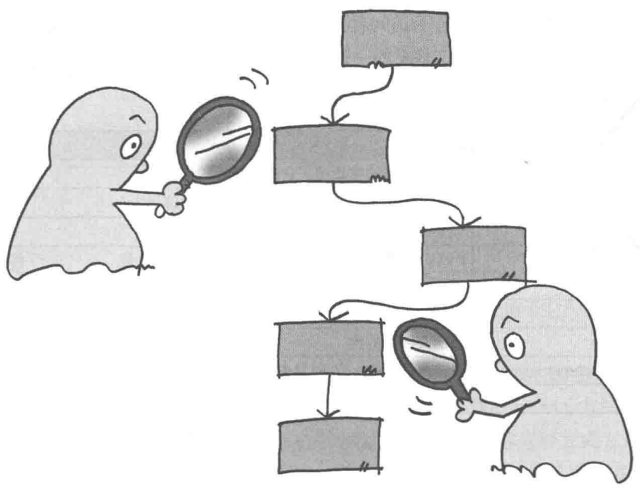
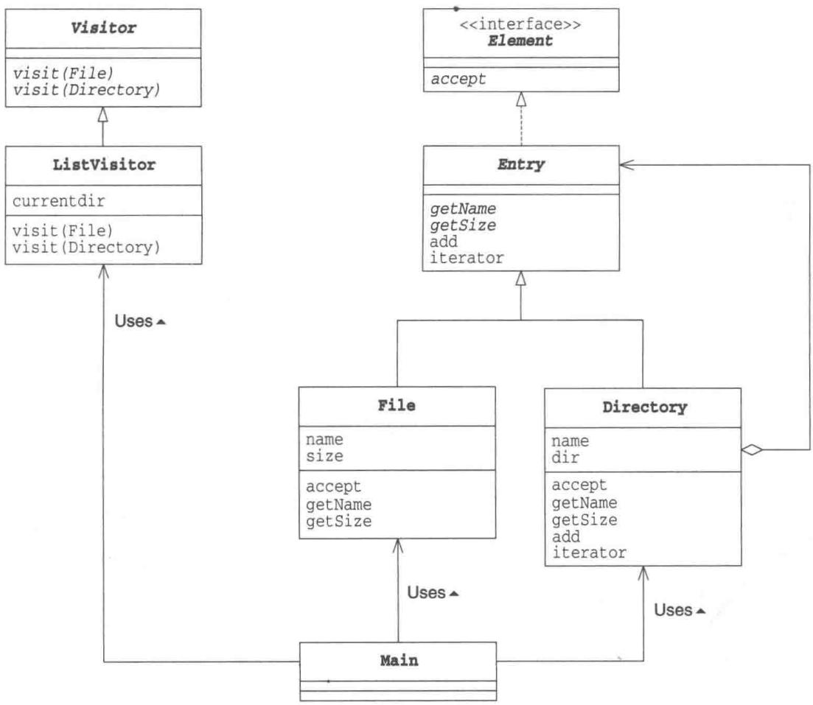
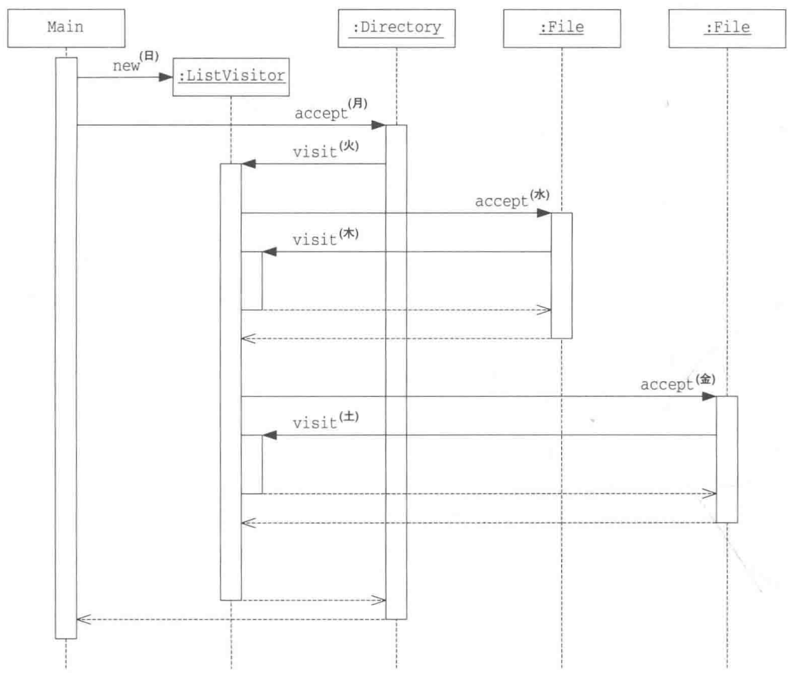
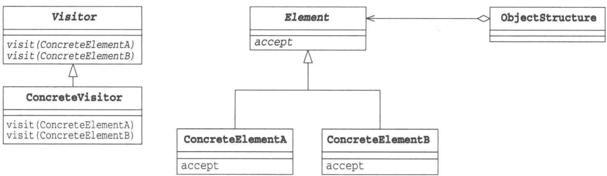

# 第13章 Visitor模式——访问数据结构并处理数据

> 来源：《图解设计模式》PDF 第 178–193 页，MinerU OCR 转写，如有疑问以原书为准

<!-- PDF p178 -->



<!-- PDF p179 · 书页 146 -->

## 13.1 Visitor 模式

大家知道圣诞节的故事吗？即将生产的玛利亚在丈夫约瑟夫的陪伴下来到伯利恒，这里有很多住宿的地方，他们依次敲门……

本章中我们将要学习 Visitor 模式。Visitor 是 “访问者” 的意思。

在数据结构中保存着许多元素，我们会对这些元素进行“处理”。这时，“处理”代码放在哪里比较好呢？通常的做法是将它们放在表示数据结构的类中。但是，如果“处理”有许多种呢？这种情况下，每当增加一种处理，我们就不得不去修改表示数据结构的类。

在 Visitor 模式中，数据结构与处理被分离开来。我们编写一个表示 “访问者” 的类来访问数据结构中的元素，并把对各元素的处理交给访问者类。这样，当需要增加新的处理时，我们只需要编写新的访问者，然后让数据结构可以接受访问者的访问即可。

## 13.2 示例程序

下面我们来看看 Visitor 模式的示例程序。在示例程序中，我们使用 Composite 模式（第 11 章）中用到的那个文件和文件夹的例子作为访问者要访问的数据结构。访问者会访问由文件和文件夹构成的数据结构，然后显示出文件和文件夹的一览。

表13-1 类和接口的一览表

| 名字 | 说明 |
| --- | --- |
| Visitor | 表示访问者的抽象类,它访问文件和文件夹 |
| Element | 表示数据结构的接口,它接受访问者的访问 |
| ListVisitor | Visitor 类的子类,显示文件和文件夹一览 |
| Entry | File 类和 Directory 类的父类,它是抽象类(实现了 Element 接口) |
| File | 表示文件的类 |
| Directory | 表示文件夹的类 |
| FileTreatmentException | 表示向文件中 add 时发生的异常的类 |
| Main | 测试程序行为的类 |

<!-- PDF p180 · 书页 147 -->

图13-1 示例程序的类图



### Visitor类

Visitor 类（代码清单 13-1）是表示访问者的抽象类。访问者依赖于它所访问的数据结构（即 File 类和 Directory 类）。

Visitor 类中定义了两个方法，名字都叫 visit。不过它们接收的参数不同，一个接收 File 类型的参数，另一个接收 Directory 类型的参数。从外部调用 visit 方法时，程序会根据接收的参数的类型自动选择和执行相应的 visit 方法。通常，我们称这种方式为方法的重载。

visit(File) 是用于访问 File 类的方法，visit(Directory) 则是用于访问 Directory 类的方法。在 Visitor 模式中，各个类之间的相互调用非常复杂，单看 Visitor 类是无法整体理解该模式的。这里，我们在理解了 Visitor 类中定义的两个 visit 方法后，就接着看下一个类吧。

代码清单 13-1 Visitor 类 (Visitor.java)

```java
/**
 * 【Visitor 模式】：把“数据结构”和“对数据的处理”分开
 * 数据结构（文件、文件夹）保持不变；想加新处理（列出、查找、统计大小……）就新写一个 Visitor
 * Visitor：访问者，对每种元素各有一个 visit 方法
 */
public abstract class Visitor {
    public abstract void visit(File file);           // 访问文件时做什么
    public abstract void visit(Directory directory); // 访问文件夹时做什么
}
```

<!-- PDF p181 · 书页 148 -->

### Element 接口

Visitor 类是表示访问者的类，而 Element 接口（代码清单 13-2）则是接受访问者的访问的接口。如果将 Visitor 比喻为玛利亚，Element 接口就相当于住宿的地方（实现了 Element 接口的类的实例才是实际住宿的地方）。

Element 接口中声明了 accept 方法（accept 在英文中是“接受”的意思）。该方法的参数是访问者 Visitor 类。

代码清单 13-2 Element 接口 (Element.java)

```java
// 元素接口：表示“可以接受访问者访问”的数据
public interface Element {
    public abstract void accept(Visitor v);
}
```

### Entry类

虽然 Entry 类（代码清单 13-3）在本质上与 Composite 模式（第 11 章）中的 Entry 类是一样的，不过本章中的 Entry 类实现（implements）了 Element 接口。这是为了让 Entry 类适用于 Visitor 模式。实际上实现 Element 接口中声明的抽象方法 accept 的是 Entry 类的子类——File 类和 Directory 类。

add 方法仅对 Directory 类有效，因此在 Entry 类中，我们让它简单地报错。同样地，用于获取 Iterator 的 iterator 方法也仅对 Directory 类有效，我们也让它简单地报错。

代码清单 13-3 Entry 类 (Entry.java)

```java
// 文件和文件夹的共同父类（和 Composite 模式一样，只是去掉了 printList，显示工作交给 Visitor）
import java.util.Iterator;

public abstract class Entry implements Element {
    public abstract String getName();                      // 获取名字
    public abstract int getSize();                     // 获取大小
    public Entry add(Entry entry) throws FileTreatmentException { // 增加目录条目
        throw new FileTreatmentException();
    }
    public Iterator iterator() throws FileTreatmentException {   // 生成 Iterator
        throw new FileTreatmentException();
    }
    public String toString() {                               // 显示字符串
        return getName() + " (" + getSize() + ")";
    }
}
```

### File 类

File 类（代码清单 13-4）也与 Composite 模式中的 File 类一样。当然，在 Visitor 模式中要注意理解它是如何实现 accept 接口的。accept 方法的参数是 Visitor 类，然后 accept 方法的内部处理是 “v.visit(this)；”，即调用了 Visitor 类的 visit 方法。visit 方法被重载了，此处调用的是 visit(File)。这是因为这里的 this 是 File 类的实例。

通过调用 visit 方法，可以告诉 Visitor “正在访问的对象是 File 类的实例 this”（大家在阅读代码后可能仍然难以透彻地理解 visit 方法和 accept 方法之间的关系，稍后我们会结合

<!-- PDF p182 · 书页 149 -->

代码清单 13-5 Directory 类 (Directory.java)

本章中的时序图（图13-3）来详细学习）。

代码清单 13-4 File 类 (File.java)

```java
// 文件：accept 时把自己交给访问者
public class File extends Entry {
    private String name;
    private int size;
    public File(String name, int size) {
        this.name = name;
        this.size = size;
    }
    public String getName() {
        return name;
    }
    public int getSize() {
        return size;
    }
    public void accept(Visitor v) {
        v.visit(this); // this 是 File 类型 → 调用 visit(File)
    }
}
```

### Directory类

Directory 类（代码清单 13-5）是表示文件夹的类。与 Composite 模式中的 Directory 类相比，本章中的 Directory 类中增加了下面两个方法。

第一个方法是 iterator 方法。iterator 方法会返回 Iterator，我们可以使用它遍历文件夹中的所有目录条目（文件和文件夹）。

第二个方法当然就是 accept 方法了。与 File 类中的 accept 方法调用了 visit(File) 方法一样，Directory 类中的 accept 方法调用了 visit(Directory) 方法。这样就可以告诉访问者 “当前正在访问的是 Directory 类的实例”。

```java
// 文件夹：同样在 accept 里调用 v.visit(this)，this 是 Directory → 调用 visit(Directory)
// iterator() 让访问者能遍历文件夹里的内容
import java.util.Iterator;
import java.util.ArrayList;

public class Directory extends Entry {
    private String name;                      // 文件夹名字
    private ArrayList dir = new ArrayList(); // 目录条目集合
    public Directory(String name) {           // 构造函数
        this.name = name;
    }
    public String getName() {                // 获取名字
        return name;
    }
    public int getSize() {                  // 获取大小
        int size = 0;
        Iterator it = dir.iterator();
        while (it.hasNext()) {
            Entry entry = (Entry)it.next();
            size += entry.getSize();
        }
        return size;
    }
public Entry add(Entry entry) {
    dir.add(entry);
    return this;
}
public Iterator iterator() {
    return dir.iterator();
}
public void accept(Visitor v) {
    v.visit(this);
}
```

<!-- PDF p183 · 书页 150 -->

### ListVisitor类

ListVisitor 类 (代码清单 13-6) 是 Visitor 类的子类, 它的作用是访问数据结构并显示元素一览。因为 ListVisitor 类是 Visitor 类的子类, 所以它实现了 visit(File) 方法和 visit(Directory) 方法。

currentdir 字段中保存的是现在正在访问的文件夹名字。visit(File) 方法在访问者访问文件时会被 File 类的 accept 方法调用，参数 file 是所访问的 File 类的实例。也就是说，visit(File) 方法是用来实现“对 File 类的实例要进行的处理”的。在本例中，我们实现的处理是先显示当前文件夹的名字(currentdir)，然后显示间隔符号 "/"，最后显示文件名。

visit(Directory) 方法在访问者访问文件夹时会被 Directory 类的 accept 方法调用，参数 directory 是所访问的 Directory 类的实例。

在 visit(Directory) 方法中实现了 “对 Directory 类的实例要进行的处理”。

本例中我们是如何实现的呢？与 visit(File) 方法一样，我们先显示当前文件夹的名字，接着调用 iterator 方法获取文件夹的 Iterator，然后通过 Iterator 遍历文件夹中的所有目录条目并调用它们各自的 accept 方法。由于文件夹中可能存在着许多目录条目，逐一访问会非常困难。

accept 方法调用 visit 方法，visit 方法又会调用 accept 方法，这样就形成了非常复杂的递归调用。通常的递归调用是某个方法调用自身，在 Visitor 模式中，则是 accept 方法与 visit 方法之间相互递归调用。

代码清单 13-6 ListVisitor 类 ( ListVisitor.java )

```java
// 具体访问者：显示文件和文件夹一览（功能等同 Composite 模式的 printList）
import java.util.Iterator;
public class ListVisitor extends Visitor {
    private String currentdir = ""; // 当前访问的文件夹的名字
    public void visit(File file) { // 在访问文件时被调用
        System.out.println(currentdir + "/" + file);
    }
    public void visit(Directory directory) { // 在访问文件夹时被调用
        System.out.println(currentdir + "/" + directory);
        // 进入子文件夹前，记下当前路径
        String savedir = currentdir;
        currentdir = currentdir + "/" + directory.getName();
        // 让文件夹里的每一项都“接受”这个访问者 → 递归
        Iterator it = directory.iterator();
        while (it.hasNext()) {
            Entry entry = (Entry)it.next();
            entry.accept(this);
        }
        currentdir = savedir;   // 退出时恢复路径
    }
}
```

代码清单 13-8 Main 类 (Main.java)

<!-- PDF p184 · 书页 151 -->

### FileTreatmentException 类

FileTreatmentException 类(代码清单 13-7)与 Composite 模式中的 FileTreatmentException 类完全相同。

代码清单 13-7 FileTreatmentException 类 (FileTreatmentException.java)

```java
// 对文件调用 add / iterator 时抛出的异常
public class FileTreatmentException extends RuntimeException {
    public FileTreatmentException() {
    }
    public FileTreatmentException(String msg) {
        super(msg);
    }
}
```

### Main类

Main 类（代码清单 13-8）与 Composite 模式中的 Main 类基本相同。不同之处仅仅在于，本章中的 Main 类使用了访问者 ListVisitor 类的实例来显示 Directory 中的内容。

在 Composite 模式中，我们调用 printList 方法来显示文件夹中的内容。该方法已经在 Directory 类（即表示数据结构的类）中被实现了。与之相对，在 Visitor 模式中是在访问者中显示文件夹中的内容。这是因为显示文件夹中的内容也属于对数据结构中的各元素进行的处理。

```java
// 使用：和 Composite 示例一样搭目录树，但显示改为 rootdir.accept(new ListVisitor())
public class Main {
    public static void main(String[] args) {
        try {
            System.out.println("Making root entries...");
            Directory rootdir = new Directory("root");
            Directory bindir = new Directory("bin");
            Directory tmpdir = new Directory("tmp");
            Directory usrdir = new Directory("usr");
            rootdir.add(bindir);
            rootdir.add(tmpdir);
            rootdir.add(usrdir);
            bindir.add(new File("vi", 10000));
            bindir.add(new File("latex", 20000));
            rootdir.accept(new ListVisitor());

            System.out.println("");
            System.out.println("Making user entries...");
            Directory yuki = new Directory("yuki");
            Directory hanako = new Directory("hanako");
            Directory tomura = new Directory("tomura");
            usrdir.add(yuki);
            usrdir.add(hanako);
            usrdir.add(tomura);
            yuki.add(new File("diary.html", 100));
            yuki.add(new File("Composite.java", 200));
            hanako.add(new File("memo.tex", 300));
            tomura.add(new File("game.doc", 400));
            tomura.add(new File("junk.mail", 500));
            rootdir.accept(new ListVisitor());
        } catch (FileTreatmentException e) {
e.printStackTrace();
        }
    }
}
```

<!-- PDF p185 · 书页 152 -->

图13-2 运行结果

```text
Making root entries...
/root (30000)
/root/bin (30000)
/root/bin/vi (10000)
/root/bin/latex (20000)
/root/tmp (0)
/root/usr (0)

Making user entries...
/root (31500)
/root/bin (30000)
/root/bin/vi (10000)
/root/bin/latex (20000)
/root/tmp (0)
/root/usr (1500)
/root/usr/yuki (300)
/root/usr/yuki/diary.html (100)
/root/usr/yuki/Composite.java (200)
/root/usr/hanako (300)
/root/usr/hanako/memo.tex (300)
/root/usr/tomura (900)
/root/usr/tomura/game.doc (400)
/root/usr/tomura/junk.mail (500)
```

### Visitor与Element之间的相互调用

读到这里，大家应该理解了 Visitor 模式是如何工作的吧。笔者在初次接触 Visitor 模式时，完全无法理解这个模式。在笔者的头脑中，accept 方法和 visit 方法的调用关系是一片混乱的。因此，这里我们再结合时序图（图 13-3）来学习一下示例程序的处理流程（关于时序图的知识请参见 p.xiii）。

为了方便理解，我们在图 13-3 中展示了当一个文件夹下有两个文件时，示例程序的处理流程。

① 首先，Main 类生成 ListVisitor 的实例。在示例程序中，Main 类还生成了其他的 Directory 类和 File 类的实例，但在本图中我们省略了。

② 接着，Main 类调用 Directory 类的 accept 方法。这时传递的参数是 ListVisitor 的实例，但我们在本图中省略了。

③ Directory 类的实例调用接收到的参数 ListVisitor 的 visit(Directory) 方法。

④ 接下来，ListVisitor 类的实例会访问文件夹，并调用找到的第一个文件的 accept 方法。传递的参数是自身(this)。

⑤ File 的实例调用接收到的参数 ListVisitor 的 visit(File) 方法。请注意，这时 ListVisitor 的 visit(Directory). 还在执行中（并非多线程执行，而是表示 visit(Directory) 还存在于调用堆栈 (callstack) 中的意思。在时序图中，表示生命周期的长方形的右侧发生了重叠就说明了这一点）。

<!-- PDF p186 · 书页 153 -->

⑥ 从 visit(File) 返回到 accept，接着又从 accept 也返回出来，然后调用另外一个 File 的实例（同一文件夹下的第二个文件）的 accept 方法。传递的参数是 ListVisitor 的实例 this。

⑦ 与前面一样，File 的实例调用 visit(File) 方法。所有的处理完成后，逐步返回，最后回到 Main 类中的调用 accept 方法的地方。

图13-3 示例程序的时序图（当一个文件夹下有两个文件时）



在阅读时序图时，请大家注意以下几点。

- 对于 Directory 类的实例和 File 类的实例，我们调用了它们的 accept 方法

- 对于每一个 Directory 类的实例和 File 类的实例，我们只调用了一次它们的 accept 方法

- 对于 ListVisitor 的实例，我们调用了它的 visit(Directory) 和 visit(File) 方法

- 处理visit(Directory)和visit(File)的是同一个ListVisitor的实例

通过上面的学习大家应该明白了吧。在 Visitor 模式中，visit 方法将 “处理” 都集中在 ListVisitor 里面了。

<!-- PDF p187 · 书页 154 -->

## 13.3 Visitor模式中的登场角色

在 Visitor 模式中有以下登场角色。

### ◆ Visitor（访问者）

Visitor 角色负责对数据结构中每个具体的元素（ConcreteElement 角色）声明一个用于访问 XXXXX 的 visit(XXXXX) 方法。visit(XXXXX) 是用于处理 XXXXX 的方法，负责实现该方法的是 ConcreteVisitor 角色。在示例程序中，由 Visitor 类扮演此角色。

### ◆ ConcreteVisitor（具体的访问者）

ConcreteVisitor 角色负责实现 Visitor 角色所定义的接口 (API)。它要实现所有的 visit(XXXXX) 方法，即实现如何处理每个 ConcreteElement 角色。在示例程序中，由 ListVisitor 类扮演此角色。如同在 ListVisitor 中，currentdir 字段的值不断发生变化一样，随着 visit(XXXXX) 处理的进行，ConcreteVisitor 角色的内部状态也会不断地发生变化。

### ◆ Element（元素）

Element 角色表示 Visitor 角色的访问对象。它声明了接受访问者的 accept 方法。accept 方法接收到的参数是 Visitor 角色。在示例程序中，由 Element 接口扮演此角色。

### ◆ ConcreteElement

ConcreteElement 角色负责实现 Element 角色所定义的接口 (API)。在示例程序中，由 File 类和 Directory 类扮演此角色。

### ◆ ObjectStructure（对象结构）

ObjectStructur 角色负责处理 Element 角色的集合。ConcreteVisitor 角色为每个 Element 角色都准备了处理方法。在示例程序中，由 Directory 类扮演此角色（一人分饰两角）。为了让 ConcreteVisitor 角色可以遍历处理每个 Element 角色，在示例程序中，我们在 Directory 类中实现了 iterator 方法。

图13-4 Visitor模式的类图



<!-- PDF p188 · 书页 155 -->

<small>http://www.cs.utexas.edu/users/downing/papers/OCP.1996.pdf</small>

## 13.4 拓展思路的要点

### 双重分发

我们来整理一下 Visitor 模式中方法的调用关系吧。

accept（接受）方法的调用方式如下。

```text
# 双重分派（第 1 步）：元素接受访问者
element.accept 触达 (visitor);
```

而 visit（访问）方法的调用方式如下。

```text
# 双重分派（第 2 步）：访问者访问元素 → 实际执行的处理由“元素类型 × 访问者类型”共同决定
visitor.visit(element);
```

对比一下这两个方法会发现，它们是相反的关系。element 接受 visitor，而 visitor 又访问 element。

在 Visitor 模式中，ConcreteElement 和 ConcreteVisitor 这两个角色共同决定了实际进行的处理。这种消息分发的方式一般被称为双重分发（double dispatch）。

### 为什么要弄得这么复杂

当看到上面的处理流程后，大家可能会感觉到“Visitor 模式不是把简单问题复杂化了吗？”“如果需要循环处理，在数据结构的类中直接编写循环语句不就解决了吗？为什么要搞出 accept 方法和 visit 方法之间那样复杂的调用关系呢？”

Visitor 模式的目的是将处理从数据结构中分离出来。数据结构很重要，它能将元素集合和关联在一起。但是，需要注意的是，保存数据结构与以数据结构为基础进行处理是两种不同的东西。

在示例程序中，我们创建了 ListVisitor 类作为显示文件夹内容的 ConcreteVisitor 角色。此外，在练习题中，我们还要编写进行其他处理的 ConcreteVisitor 角色。通常，ConcreteVisitor 角色的开发可以独立于 File 类和 Directory 类。也就是说，Visitor 模式提高了 File 类和 Directory 类作为组件的独立性。如果将进行处理的方法定义在 File 类和 Directory 类中，当每次要扩展功能，增加新的“处理”时，就不得不去修改 File 类（代码清单 13-4）和 Directory 类（代码清单 13-5）。

### 开闭原则——对扩展开放，对修改关闭

既然谈到了功能扩展和修改，那就顺带谈一谈开闭原则（The Open-Closed Principle，OCP）。该原则是勃兰特·梅耶提出的，而后 RobertC. Martin 在 C++ Report（1996 年 1 月）中的 Engineering NoteBook 专栏中对其进行了总结 ① 。

该原则主张类应当是下面这样的。

- 对扩展（extension）是开放（open）的

<small>① The Open-Closed Principle.</small>

<!-- PDF p189 · 书页 156 -->

- 对修改（modification）是关闭（close）的

在设计类时，若无特殊理由，必须要考虑到将来可能会扩展类。绝不能毫无理由地禁止扩展类。这就是“对扩展是开放的”的意思。

但是，如果在每次扩展类时都需要修改现有的类就太麻烦了。所以我们需要在不用修改现有类的前提下能够扩展类，这就是“对修改是关闭的”的意思。

我们提倡扩展，但是如果需要修改现有代码，那就不行了。在不修改现有代码的前提下进行扩展，这就是开闭原则。

至此大家已经学习了多种设计模式。那么在看到这条设计原则后，大家应该都会点头表示赞同吧。

功能需求总是在不断变化，而且这些功能需求大都是“希望扩展某个功能”。因此，如果不能比较容易地扩展类，开发过程将会变得非常困难。另一方面，如果要修改已经编写和测试完成的类，又可能会导致软件产品的质量降低。

对扩展开放、对修改关闭的类具有高可复用性，可作为组件复用。设计模式和面向对象的目的正是为我们提供一种结构，可以帮助我们设计出这样的类。

### 易于增加 ConcreteVisitor 角色

使用 Visitor 模式可以很容易地增加 ConcreteVisitor 角色。因为具体的处理被交给 ConcreteVisitor 角色负责，因此完全不用修改 ConcreteElement 角色。

### 难以增加 ConcreteElement 角色

虽然使用 Visitor 模式可以很容易地增加 ConcreteVisitor 角色，不过它却很难应对 ConcreteElement 角色的增加。

例如，假设现在我们要在示例程序中增加 Entry 类的子类 Device 类。也就是说，Device 类是 File 类和 Directory 类的兄弟类。这时，我们需要在 Visitor 类中声明一个 visit (Device) 方法，并在所有的 Visitor 类的子类中都实现这个方法。

### Visitor 工作所需的条件

“在 Visitor 模式中，对数据结构中的元素进行处理的任务被分离出来，交给 Visitor 类负责。这样，就实现了数据结构与处理的分离”这个主题，我们在本章的学习过程中已经提到过很多次了。但是要达到这个目的是有条件的，那就是 Element 角色必须向 Visitor 角色公开足够多的信息。

例如，在示例程序中，visit(Directory) 方法需要调用每个目录条目的 accept 方法。为此，Directory 类必须提供用于获取每个目录条目的 iterator 方法。

访问者只有从数据结构中获取了足够多的信息后才能工作。如果无法获取到这些信息，它就无法工作。这样做的缺点是，如果公开了不应当被公开的信息，将来对数据结构的改良就会变得非常困难。

<!-- PDF p190 · 书页 157 -->

## 13.5 相关的设计模式

### ◆ Iterator 模式（第 1 章）

Iterator 模式和 Visitor 模式都是在某种数据结构上进行处理。

Iterator 模式用于逐个遍历保存在数据结构中的元素。

Visitor 模式用于对保存在数据结构中的元素进行某种特定的处理。

### ◆ Composite 模式（第 11 章）

有时访问者所访问的数据结构会使用 Composite 模式。

### ◆ Interpreter 模式（第 23 章）

在 Interpreter 模式中，有时会使用 Visitor 模式。例如，在生成了语法树后，可能会使用 Visitor 模式访问语法树的各个节点进行处理。

## 13.6 本章所学知识

在本章中，我们学习了访问数据结构并对数据结构中的元素进行处理的 Visitor 模式。

## 13.7 练习题

答案请参见附录 A (P.321)

### 习题13-1

请在本章的示例程序中增加一个 FileFindVisitor 类，用于将带有指定后缀名的文件汇集起来。FileFindVisitor 类的使用方法如代码清单 13-9 所示，运行结果如图 13-5 所示。在本例中，它将所有后缀名为 .html 的文件都汇集起来了。

代码清单 13-9 Main 类 (Main.java)

```java
// 习题 1：查找所有 .html 文件（Main 上半部分）
import java.util.Iterator;

public class Main {
    public static void main(String[] args) {
        try {
            Directory rootdir = new Directory("root");
            Directory bindir = new Directory("bin");
            Directory tmpdir = new Directory("tmp");
            Directory usrdir = new Directory("usr");
            rootdir.add(bindir);
            rootdir.add(tmpdir);
            rootdir.add(usrdir);
            bindir.add(new File("vi", 10000));
            bindir.add(new File("latex", 20000));

            Directory yuki = new Directory("yuki");
            Directory hanako = new Directory("hanako");
            Directory tomura = new Directory("tomura");
HTML files are:
diary.html (100)
index.html (350)
```

<!-- PDF p191 · 书页 158 -->

```java
// 习题 1：Main 下半部分 —— 用 FileFindVisitor 访问整棵树，再取出找到的文件
usrdir.add(yuki);
usrdir.add(hanako);
usrdir.add(tomura);
yuki.add(new File("diary.html", 100));
yuki.add(new File("Composite.java", 200));
hanako.add(new File("memo.tex", 300));
hanako.add(new File("index.html", 350));
tomura.add(new File("game.doc", 400));
tomura.add(new File("junk.mail", 500));

FileFindVisitor ffv = new FileFindVisitor(".html");
rootdir.accept(ffv);

System.out.println("HTML files are:");
Iterator it = ffv.getFoundFiles();
while (it.hasNext()) {
    File file = (File)it.next();
    System.out.println(file.toString());
}
} catch (FileTreatmentException e) {
    e.printStackTrace();
}
}
}
```

图13-5 运行结果

#### 答案（附录 A）

代码请参见代码清单 A13-1。不需要修改 File.java（代码清单 13-4）和 Directory.java（代码清单 13-5）。

代码清单 A13-1 FileFindVisitor 类 (FileFindVisitor.java)

```java
// 习题 1 答案：查找指定后缀文件的访问者
// （原文 filepath 为笔误，应为 filetype；getFoundFiles 少了右大括号）
import java.util.Iterator;
import java.util.ArrayList;
public class FileFindVisitor extends Visitor {
    private String filetype;                  // 要找的后缀
    private ArrayList found = new ArrayList(); // 找到的文件
    public FileFindVisitor(String filetype) {      // 指定.后面的文件后缀名, 如 ".txt"
        this.filetype = filetype;
    }
    public Iterator getFoundFiles() {              // 获取已经找到的文件
        return found.iterator();
    public void visit(File file) {                 // 在访问文件时被调用
        if (file.getName().endsWith(filepath)) {   // 后缀匹配就记下来
            found.add(file);
        }
    }
    public void visit(Directory directory) {       // 在访问文件夹时被调用
        Iterator it = directory.iterator();
        while (it.hasNext()) {
            Entry entry = (Entry)it.next();
            entry.accept(this);                    // 递归访问子项
        }
    }
}
```

### 习题13-2

在示例程序中，Directory 类（代码清单 13-5）的 getSize 方法的作用是获取文件夹大小。请编写一个获取大小的 SizeVisitor 类，用它替换掉 Directory 类的 getSize 方法。

#### 答案（附录 A）

代码请参见代码清单 A13-2 和代码清单 A13-3。运行结果与修改 Directory 类前相同。

代码清单 A13-2 Directory 类 (Directory.java)

```java
// 习题 2：Directory.getSize() 改为用 SizeVisitor 计算（统计逻辑从数据结构中移出）
import java.util.Iterator;
import java.util.ArrayList;

public class Directory extends Entry {
private String name;                          // 文件夹名字
private ArrayList dir = new ArrayList(); // 目录条目的集合
public Directory(String name) {            // 构造函数
    this.name = name;
}
public String getName() {                    // 获取名字
    return name;
}
public int getSize() {                   // 获取大小
    SizeVisitor v = new SizeVisitor();
    accept(v);
    return v.getSize();
}
public Entry add(Entry entry) {           // 添加目录条目
    dir.add(entry);
    return this;
}
public Iterator iterator() {
    return dir.iterator();
}
public void accept(Visitor v) {
    v.visit(this);
}
```

<!-- PDF p355 · 书页 322 -->

代码清单 A13-3 SizeVisitor 类 (SizeVisitor.java)

```java
// 习题 2 答案：统计大小的访问者
import java.util.Iterator;
public class SizeVisitor extends Visitor {
    private int size = 0;   // 累计大小
    public int getSize() {
        return size;
    }
    public void visit(File file) {
        size += file.getSize();       // 文件：加上自身大小
    }
    public void visit(Directory directory) {
        Iterator it = directory.iterator();
        while (it.hasNext()) {
            Entry entry = (Entry)it.next();
            entry.accept(this);       // 文件夹：递归访问每一项
        }
    }
}
```

### 习题13-3

请基于 java.util.ArrayList 类编写一个具有 Element 接口的 ElementArrayList 类，使得 Directory 类和 File 类可以被 add 至 ElementArrayList 中，而且它还可以接受 (accept) ListVisitor 的实例访问它。ElementArrayList 类的使用方法如代码清单 13-10 所示，运行结果如图 13-6 所示。

代码清单 13-10 Main 类 (Main.java)

```java
// 习题 3：让 ArrayList 也能接受访问者，一次访问列表里的所有元素
import java.util.Iterator;

public class Main {
    public static void main(String[] args) {
        try {
            Directory root1 = new Directory("root1");
            root1.add(new File("diary.html", 10));
            root1.add(new File("index.html", 20));

            Directory root2 = new Directory("root2");
root2.add(new File("diary.html", 1000));
root2.add(new File("index.html", 2000));

ElementArrayList list = new ElementArrayList();
list.add(root1);
list.add(root2);
list.add(new File("etc.html", 1234));

list.accept(new ListVisitor());
} catch (FileTreatmentException e) {
    e.printStackTrace();
}
}
}
```

<!-- PDF p192 · 书页 159 -->

图13-6 运行结果

```text
/root1 (30)
/root1/diary.html (10)
/root1/index.html (20)
/root2 (3000)
/root2/diary.html (1000)
/root2/index.html (2000)
/etc.html (1234)
```

#### 答案（附录 A）

我们定义了一个实现了 Element 接口并继承了 java.util.ArrayList 类的 ElementArrayList 类（代码清单 A13-4）。这里没有必要定义 add 方法，因为它是继承于 ArrayList 类。

代码清单 A13-4 ElementArrayList 类 (ElementArrayList.java)

```java
// 习题 3 答案：ElementArrayList —— 既是 ArrayList，又是 Element
// accept 时把访问者依次交给列表里的每个元素
import java.util.ArrayList;
import java.util.Iterator;
class ElementArrayList extends ArrayList implements Element {
public void accept(Visitor v) {
    Iterator it = iterator();
    while (it.hasNext()) {
        Element e = (Element)it.next();
        e.accept(v);
    }
}
}
```

<!-- PDF p356 · 书页 323 -->

### 习题13-4

Java 使用 final 关键字定义的类是无法被继承的。例如，java.lang.String 类是 final 类，因此我们无法像下面这样定义 MyString 类。

```java
// String 是 final 类，不能被继承
× 编译错误
class MyString extends String {
    ...
}
```

这么看，String 类似乎违背了开闭原则，但实际上这是有正当理由的。请问是什么理由呢？

<!-- PDF p193 -->

The image contains no discernible text or characters in the provided image. Therefore, there is no OCR result to output.

#### 答案（附录 A）

是效率原因。

String 类是 Java 语言中用于处理字符串的基本类，扮演着非常重要的角色。因此，Java 编译器以 “不能继承 String 类” 为前提对 String 类的处理速度和内存消耗量都进行了优化。
