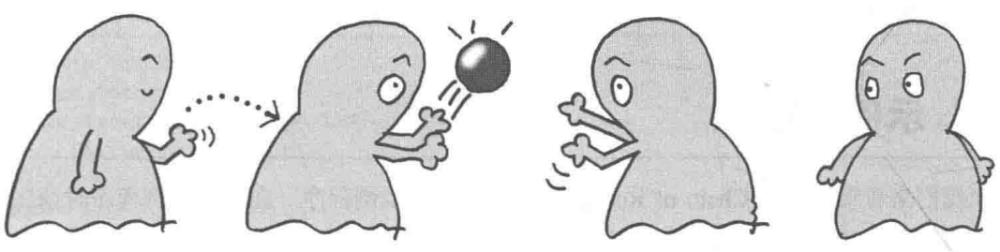
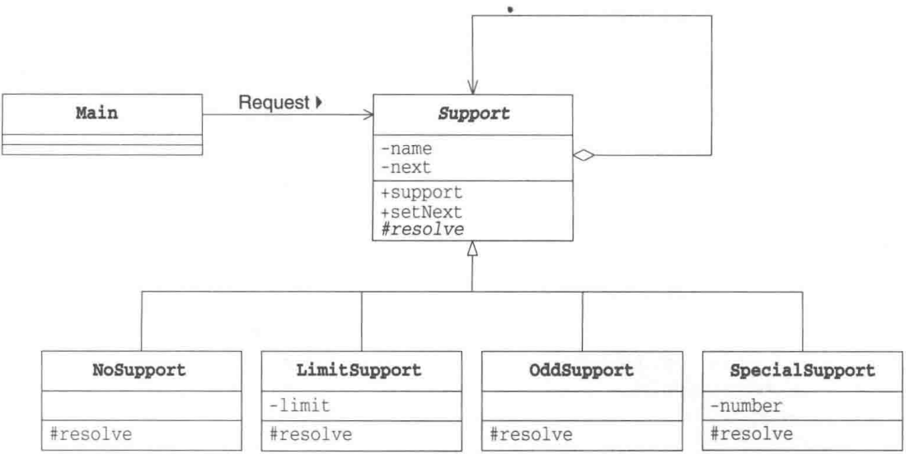
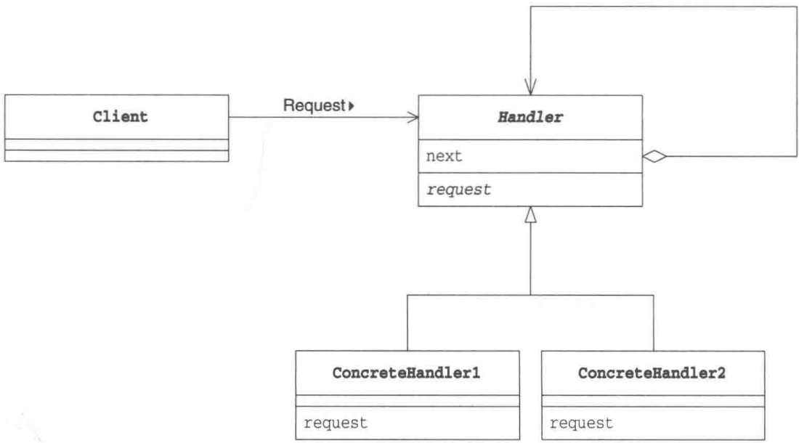
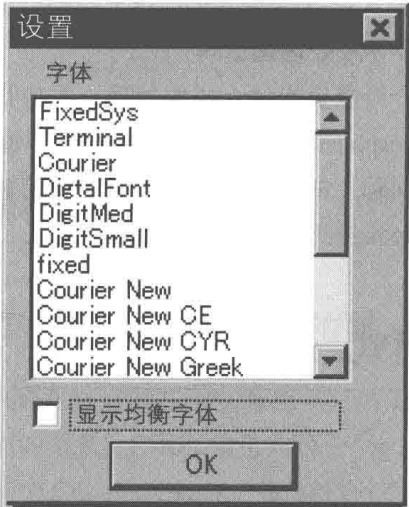
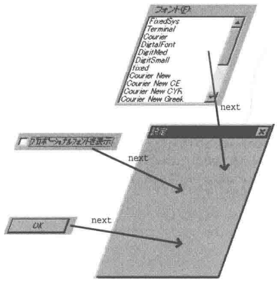

# 第14章 Chain of Responsibility模式——推卸责任

> 来源：《图解设计模式》PDF 第 194–203 页，MinerU OCR 转写，如有疑问以原书为准

<!-- PDF p194 -->



<!-- PDF p195 · 书页 162 -->

## 14.1 Chain of Responsibility 模式

我们首先看看什么是推卸责任。假设现在我们要去公司领取资料。首先我们向公司前台打听要去哪里领取资料，她告诉我们应该去“营业窗口”。然后等我们到了“营业窗口”后，又被告知应该去“售后部门”。等我们好不容易赶到了“售后部门”，又被告知应该去“资料中心”，因此最后我们又不得不赶往“资料中心”。像这样，在找到合适的办事人之前，我们被不断地踢给一个又一个人，这就是“推卸责任”。

“推卸责任”听起来有些贬义的意思，但是有时候也确实存在需要“推卸责任”的情况。例如，当外部请求程序进行某个处理，但程序暂时无法直接决定由哪个对象负责处理时，就需要推卸责任。这种情况下，我们可以考虑将多个对象组成一条职责链，然后按照它们在职责链上的顺序一个一个地找出到底应该谁来负责处理。

这种模式被称为 Chain of Responsibility 模式。Responsibility 有 “责任” 的意思，在汉语中，该模式称为 “职责链”。总之，我们可以将它想象为推卸责任的结构，这有利于大家记住这种模式。

使用 Chain of Responsibility 模式可以弱化 “请求方” 和 “处理方” 之间的关联关系，让双方各自都成为可独立复用的组件。此外，程序还可以应对其他需求，如根据情况不同，负责处理的对象也会发生变化的这种需求。

当一个人被要求做什么事情时，如果他可以做就自己做，如果不能做就将“要求”转给另外一个人。下一个人如果可以自己处理，就自己做；如果也不能自己处理，就再转给另外一个人……这就是 Chain of Responsibility 模式。

## 14.2 示例程序

下面我们来看看使用了 Chain of Responsibility 模式的示例程序。在阅读示例程序时请注意谁必须负责处理所发生的问题。在示例程序中出现的类请参见表 14-1。

表14-1 类的一览表

| 名字 | 说明 |
| --- | --- |
| Trouble | 表示发生的问题的类。它带有问题编号(number) |
| Support | 用来解决问题的抽象类 |
| NoSupport | 用来解决问题的具体类(永远“不处理问题”) |
| LimitSupport | 用来解决问题的具体类(仅解决编号小于指定编号的问题) |
| OddSupport | 用来解决问题的具体类(仅解决奇数编号的问题) |
| SpecialSupport | 用来解决问题的具体类(仅解决指定编号的问题) |
| Main | 制作 Support 的职责链,制造问题并测试程序行为 |

<!-- PDF p196 · 书页 163 -->

图14-1 示例程序的类图



### Trouble类

Trouble 类（代码清单 14-1）是表示发生的问题的类。number 是问题编号。通过 getNumber 方法可以获取问题编号。

代码清单 14-1 Trouble 类 (Trouble.java)

```java
/**
 * 【Chain of Responsibility 模式】：把多个处理者连成一条链，问题沿着链往后“推卸”，直到有人能处理
 * 比喻：客服转接 —— 一线解决不了转二线，二线不行转专家
 * Trouble：要处理的问题，只有一个编号
 */
public class Trouble {
    private int number;                 // 问题编号
    public Trouble(int number) {      // 生成问题
        this.number = number;
    }
    public int getNumber() {          // 获取问题编号
        return number;
    }
    public String toString() {       // 代表问题的字符串
        return "[Trouble " + number + "]";
    }
}
```

### Support 类

Support 类（代码清单 14-2）是用来解决问题的抽象类，它是职责链上的对象。

next 字段中指定了要推卸给的对象。可以通过 setNext 方法设定该对象。

resolve 方法是需要子类去实现的抽象方法。如果 resolve 返回 true，则表示问题已经被处理，如果返回 false 则表示问题还没有被处理（即需要被推卸给下一个对象）。Resolve 有 “解决” 的意思。

support 方法会调用 resolve 方法，如果 resolve 方法返回 false，则 support 方法会将问题转交给下一个对象。如果已经到达职责链中的最后一个对象，则表示没有人处理问题，将会显示出处理失败的相关信息。在本例中我们只是简单地输出处理失败的相关信息，但根据需求不同，有时候也需要抛出异常。

<!-- PDF p197 · 书页 164 -->

顺便告诉大家，support 方法调用了抽象方法 resolve，因此它属于 Template Method 模式（第 3 章）。

代码清单 14-2 support 类 (support.java)

```java
// 处理者父类：记住“下一个是谁”，support() 定好“自己处理 → 不行就交给下一个 → 都不行就失败”的流程
// setNext 返回 next：可以链式调用 a.setNext(b).setNext(c)
public abstract class Support {
    private String name;                          // 解决问题的实例的名字
    private Support next;                         // 要推卸给的对象
    public Support(String name) {                   // 生成解决问题的实例
        this.name = name;
    }
    public Support setNext(Support next) {       // 设置要推卸给的对象
        this.next = next;
        return next;
    }
    public final void support(Trouble trouble) {   // 解决问题的步骤
        if (resolve(trouble)) {
            done(trouble);
        } else if (next != null) {
            next.support(trouble);
        } else {
            fail(trouble);
        }
    }
    public String toString() {               // 显示字符串
        return "[" + name + "]";
    }
    protected abstract boolean resolve(Trouble trouble); // 解决问题的方法
    protected void done(Trouble trouble) {   // 解决
        System.out.println(trouble + " is resolved by " + this + ".");
    }
    protected void fail(Trouble trouble) {   // 未解决
        System.out.println(trouble + " cannot be resolved.");
    }
}
```

### NoSupport 类

NoSupport 类（代码清单 14-3）是 Support 类的子类。NoSupport 类的 resolve 方法总是返回 false。即它是一个永远“不解决问题”的类。

代码清单 14-3 NoSupport 类 (NoSupport.java)

```java
// 处理者 1：什么都不处理，全部往后推
public class NoSupport extends Support {
    public NoSupport(String name) {
        super(name);
    }
    protected boolean resolve (Trouble trouble) {      // 解决问题的方法
        return false;                     // 自己什么也不处理
    }
}
```

### LimitSupport 类

LimitSupport 类（代码清单 14-4）解决编号小于 limit 值的问题。resolve 方法在判断编号小于 limit 值后，只是简单地返回 true，但实际上这里应该是解决问题的代码。

<!-- PDF p198 · 书页 165 -->

代码清单 14-4 LimitSupport 类 (LimitSupport.java)

```java
// 处理者 2：只处理编号小于 limit 的问题
public class LimitSupport extends Support {
    private int limit;                          // 可以解决编号小于limit的问题
    public LimitSupport(String name, int limit) {   // 构造函数
        super(name);
        this.limit = limit;
    }
    protected boolean resolve(Trouble trouble) {   // 解决问题的方法
        if (trouble.getNumber() < limit) {
            return true;
        } else {
            return false;
        }
    }
}
```

### OddSupport类

OddSupport 类（代码清单 14-5）解决奇数编号的问题。

代码清单 14-5 OddSupport 类 (OddSupport.java)

```java
// 处理者 3：只处理奇数编号的问题
public class OddSupport extends Support {
    public OddSupport(String name) {                  // 构造函数
        super(name);
    }
    protected boolean resolve(Trouble trouble) {   // 解决问题的方法
        if (trouble.getNumber() % 2 == 1) {
            return true;
        } else {
            return false;
        }
    }
}
```

### SpecialSupport类

SpecialSupport 类（代码清单 14-6）只解决指定编号的问题。

代码清单 14-6 SpecialSupport 类 (SpecialSupport.java)

```java
// 处理者 4：只处理某个特定编号的问题
public class SpecialSupport extends Support {
    private int number;                     // 只能解决指定编号的问题
    public SpecialSupport(String name, int number) {      // 构造函数
        super(name);
        this.number = number;
    }
    protected boolean resolve(Trouble trouble) {       // 解决问题的方法
        if (trouble.getNumber() == number) {
            return true;
        } else {
            return false;
        }
    }
}
```

<!-- PDF p199 · 书页 166 -->

### Main类

Main 类(代码清单 14-7)首先生成了 Alice 至 Fred 等 6 个解决问题的实例。虽然此处定义的变量都是 Support 类型的，但是实际上所保存的变量却是 NoSupport、LimitSupprot、SpecialSupport、OddSupport 等各个类的实例。

接下来，Main 类调用 setNext 方法将 Alice 至 Fred 这 6 个实例串联在职责链上。之后，Main 类逐个生成问题，并将它们传递给 alice，然后显示最终谁解决了该问题。请注意，这里的问题编号从 0 开始，增长步长为 33。这里的 33 并没有什么特别的意思，我们只是随便使用一个增长步长使程序更有趣而已。

```java
// 使用：Alice → Bob → Charlie → Diana → Elmo → Fred 组成一条链
// 所有问题都从链头 Alice 开始，编号 0、33、66 …… 直到 495
public class Main {
    public static void main(String[] args) {
        Support alice = new NoSupport("Alice");
        Support bob = new LimitSupport("Bob", 100);
        Support charlie = new SpecialSupport("Charlie", 429);
        Support diana = new LimitSupport("Diana", 200);
        Support elmo = new OddSupport("Elmo");
        Support fred = new LimitSupport("Fred", 300);
        // 形成职责链
        alice.setNext(bob).setNext(charlie).setNext(diana).setNext(elmo).setNext(fred);
        // 制造各种问题
        for (int i = 0; i < 500; i += 33) {
            alice.support(new Trouble(i));
        }
    }
}
```

图14-2 运行结果

```text
[Trouble 0] is resolved by [Bob].
[Trouble 33] is resolved by [Bob].
[Trouble 66] is resolved by [Bob].
[Trouble 99] is resolved by [Bob].
[Trouble 132] is resolved by [Diana].
[Trouble 165] is resolved by [Diana].
[Trouble 198] is resolved by [Diana].
[Trouble 231] is resolved by [Elmo].
[Trouble 264] is resolved by [Fred].
[Trouble 297] is resolved by [Elmo].
[Trouble 330] cannot be resolved.
[Trouble 363] is resolved by [Elmo].
[Trouble 396] cannot be resolved.
[Trouble 429] is resolved by [Charlie].
[Trouble 462] cannot be resolved.
[Trouble 495] is resolved by [Elmo].
```

让我们看看最终运行结果（图 14-2）。最开始 Bob 非常努力地解决了几个问题，当他无法解决的时候会将问题交给 Diana 负责。在运行结果中，完全没有出现 Alice 的身影，这是因为 Alice 会把所有的问题推给别人。当问题编号超过 300 后，不论是哪个 LimitSupport 类的实例都无法解决了。不过，只要编号为奇数，OddSupport 类的实例 Elmo 就可以帮我们解决问题。而SpecialSupport 类的实例 Charlie 只负责解决编号为 429 的问题，因此在运行结果中它只出现了一次。

<!-- PDF p200 · 书页 167 -->

图 14-3 展示了解决编号为 363 号问题时的时序图。在该时序图中，我们重点关注了 support 方法的调用情况。实际上，每个 Support 在调用下一个 Support 的 support 方法之前，都会先调用自身的 resolve 方法。

图14-3 解决 [Trouble 363]时的示例程序的时序图

![图14-3 解决 [Trouble 363]时的示例程序的时序图](images/p200-b06.png)

## 14.3 Chain of Responsibility 模式中的登场角色

在 Chain of Responsibility 模式中有以下登场角色。

### ◆ Handler（处理者）

Handler 角色定义了处理请求的接口（API）。Handler 角色知道“下一个处理者”是谁，如果自己无法处理请求，它会将请求转给“下一个处理者”。当然，“下一个处理者”也是 Handler 角色。在示例程序中，由 Support 类扮演此角色。负责处理请求的是 support 方法。

### ◆ ConcreteHandler（具体的处理者）

ConcreteVisitor 角色是处理请求的具体角色。在示例程序中，由 NoSupport、LimitSupport、OddSupport、SpecialSupport 等各个类扮演此角色。

### ◆ Client（请求者）

Client 角色是向第一个 ConcreteHandler 角色发送请求的角色。在示例程序中，由 Main 类扮演此角色。

Chain of Responsibility 模式的类图如图 14-4 所示。

<!-- PDF p201 · 书页 168 -->

图 14-4 Chain of Responsibility 模式的类图



## 14.4 拓展思路的要点

### 弱化了发出请求的人和处理请求的人之间的关系

Chain of Responsibility 模式的最大优点就在于它弱化了发出请求的人（Client 角色）和处理请求的人（ConcreteHandler 角色）之间的关系。Client 角色向第一个 ConcreteHandler 角色发出请求，然后请求会在职责链中传播，直到某个 ConcreteHandler 角色处理该请求。

如果不使用该模式，就必须有某个伟大的角色知道“谁应该处理什么请求”，这有点类似中央集权制。而让“发出请求的人”知道“谁应该处理该请求”并不明智，因为如果发出请求的人不得不知道处理请求的人各自的责任分担情况，就会降低其作为可复用的组件的独立性。

补充说明 为了简单起见，在示例程序中，我们让扮演 Client 角色的 Main 类负责串联起 ConcreteHandler 的职责链。

### 可以动态地改变职责链

在示例程序中，问题的解决是按照从 Alice 到 Fred 的固定顺序进行处理的。但是，我们还需要考虑负责处理的各个 ConcreteHandler 角色之间的关系可能会发生变化的情况。如果使用 Chain of Responsibility 模式，通过委托推卸责任，就可以根据情况变化动态地重组职责链。

如果不使用 Chain of Responsibility 模式，而是在程序中固定写明 “某个请求需要谁处理” 这样的对应关系，那么很难在程序运行中去改变请求的处理者。

在视窗系统中，用户有时需要可以自由地在视窗中添加控件（按钮和文本输入框等）。这时，Chain of Responsibility 模式就有了用武之地。

<!-- PDF p202 · 书页 169 -->

### 专注于自己的工作

“推卸”这个词虽然有贬义，但是反过来想，这样才可以使每个对象更专注于自己的工作，即每个 ConcreteHandler 角色都专注于自己所负责的处理。当自己无法处理时，ConcreteHandler 角色就会干脆地对下一个处理者说一句“嘿，交给你了”，然后将请求转出去。这样，每个 ConcreteHandler 角色就能只处理它应该负责的请求了。

如果我们不使用 Chain of Responsibility 模式又会怎样呢？这时，我们需要编写一个“决定谁应该负责什么样的处理”的方法。亦或是让每个 ConcreteHandler 角色自己负责“任务分配”工作，即“如果自己不能处理，就转交给那个人。如果他也不能处理，那就根据系统情况将请求再转交给另外一个人”。

### 推卸请求会导致处理延迟吗

使用 Chain of Responsibility 模式可以推卸请求，直至找到合适的处理请求的对象，这样确实提高了程序的灵活性，但是难道不会导致处理延迟吗？

确实如此，与“事先确定哪个对象负责什么样的处理，当接收到请求时，立即让相应的对象去处理请求”相比，使用 Chain of Responsibility 模式确实导致处理请求发生了延迟。

不过，这是一个需要权衡的问题。如果请求和处理者之间的关系是确定的，而且需要非常快的处理速度时，不使用 Chain of Responsibility 模式会更好。

## 14.5 相关的设计模式

### ◆ Composite 模式（第 11 章）

Handler角色经常会使用Composite模式。

### ◆ Command 模式（第 23 章）

有时会使用Command模式向Handler角色发送请求。

## 14.6 本章所学知识

在本章中，我们学习了将处理请求的实例串联在职责链上，然后当接收到请求后，按顺序去确认每个实例是否可以处理请求，如果不能处理，就推卸请求的 Chain of Responsibility 模式。

在视窗系统中经常会使用到 Chain of Responsibility 模式。在后面的习题中我们会看到具体的例子。

## 14.7 练习题

答案请参见附录A（P.323）

### 习题14-1

在视窗系统中经常会使用到 Chain of Responsibility 模式。

<!-- PDF p203 · 书页 170 -->

在视窗系统的窗口中，有按钮和文本输入框、勾选框等组件（也称为部件或控件）。当点击鼠标时，鼠标点击事件的处理是如何传播的呢？Chain of Responsibility 模式中的 next（要推卸给的对象）是哪个组件呢？

#### 答案（附录 A）

next 字段中保存的多是控件父窗口。当控件自身无法处理接收到的请求时，会将请求转交给它的父窗口。

### 习题14-2

我们再看看另外一个在视窗系统的窗口中使用 Chain of Responsibility 模式的问题。

例如，我们看看图 14-5 中的小对话框。当焦点移动至 “字体” 列表框上时，按下键盘上的 ↑↓ 键可以选择相应的字体。但是，当焦点移动至 “显示均衡字体” 勾选框上时，如果按下 ↑键，焦点会移动至 “字体” 列表框，之后，即使按下 ↓键，焦点也不会返回到勾选框上。请运用 Chain of Responsibility 模式的思考方法来说明这个问题。

图14-5 选择字体的小对话框



#### 答案（附录 A）

图 A14-1 展示了图 14-5 中的对话框的责任链。箭头指向要推卸给的对象，即 next。

“键盘方向键被按下”的事件（请求）会被发送给当前焦点所处的列表框或是勾选框。如果当时焦点在列表框中，列表框会自己处理↑↓键被按下的事件，不会将请求推卸给 next 所对应的父对话框；但如果当时焦点在勾选框中，它则不会自己处理↑↓键被按下的事件，而是将请求推卸给 next 所对应的父对话框。当父对话框接收到↑↓键被按下的事件时，会将焦点移动至列表框中。这样就解释了习题 14-2 中描述的现象。

图A14-1 对话框、列表、勾选框之间的关系图



<!-- PDF p357 · 书页 324 -->

### 习题14-3

Java 在示例程序中的 Support 类（代码清单 14-2）中，support 方法的可见性是 public 的，而 resolve 方法的可见性是 protected 的。请问设计者为什么要这样区别开来呢？

#### 答案（附录 A）

这表示设计者希望 Support 类接收到 “解决问题” 的请求后，不要使用 resolve 方法，而是使用 support 方法。

如果将 resolve 方法的可见性设为 public，那么与 Support 类无关的其他类就都可以调用 resolve 方法了。这样可能会导致外部对 resolve 方法的使用方法与 Support 类所期待的使用方法不符。

此外，如果将 resolve 方法的可见性设为 public，可能会发生当 resolve 方法的名字和签名发生改变时，必须修改散落在程序中各个地方的代码的问题。

注意 在 Java 中，如果方法的可见性是 protected，不仅该类的子类可以看到该方法，同一个包中的其他类也可以看到该方法。因此，像在示例中这样所有代码放在一个包中时，可见性设置为 public 和 protected 是没有区别的。不过假如将来将它们分别放在不同的包中，protected 就可以发挥出它的威力了。

### 习题14-4

请将示例程序中的 Support 类（代码清单 14-2）修改为不使用递归调用，而是循环。

#### 答案（附录 A）

使用循环来实现的代码请参见代码清单 A14-1。

代码清单 A14-1 修改后的 Support 类 (Support.java)

```java
// 习题：support() 从“递归调用下一个”改成“循环遍历链表”，效果相同，但链很长时不会栈溢出
public abstract class Support {
    private String name;                          // 解决问题的实例的名字
    private Support next;                          // 要推卸给的对象
    public Support(String name) {            // 生成解决问题的实例
        this.name = name;
    }
    public Support setNext(Support next) {   // 设置要推卸给的对象
        this.next = next;
        return next;
    }
    public final void support(Trouble trouble) {
        for (Support obj = this; true; obj = obj.next) {
            if (obj.resolve(trouble)) {
                obj.done(trouble);
                break;
            } else if (obj.next == null) {
                obj.fail(trouble);
                break;
            }
        }
    }
    public String toString() {                 // 显示字符串
        return "[" + name + "]";
    }
    protected abstract boolean resolve(Trouble trouble); // 解决问题的方法
    protected void done(Trouble trouble) {   // 解决
        System.out.println(trouble + " is resolved by " + this + ".");
    }
    protected void fail(Trouble trouble) {   // 未解决
        System.out.println(trouble + " cannot be resolved.");
    }
}
```
