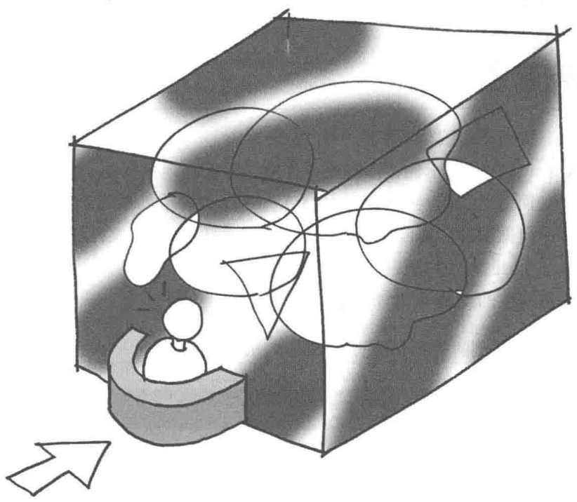
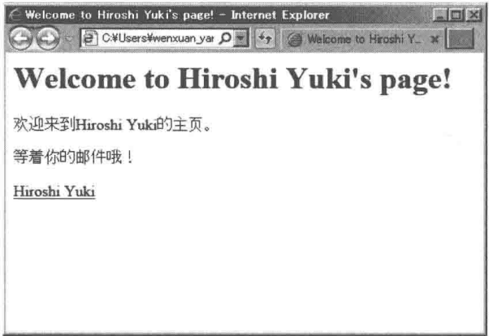
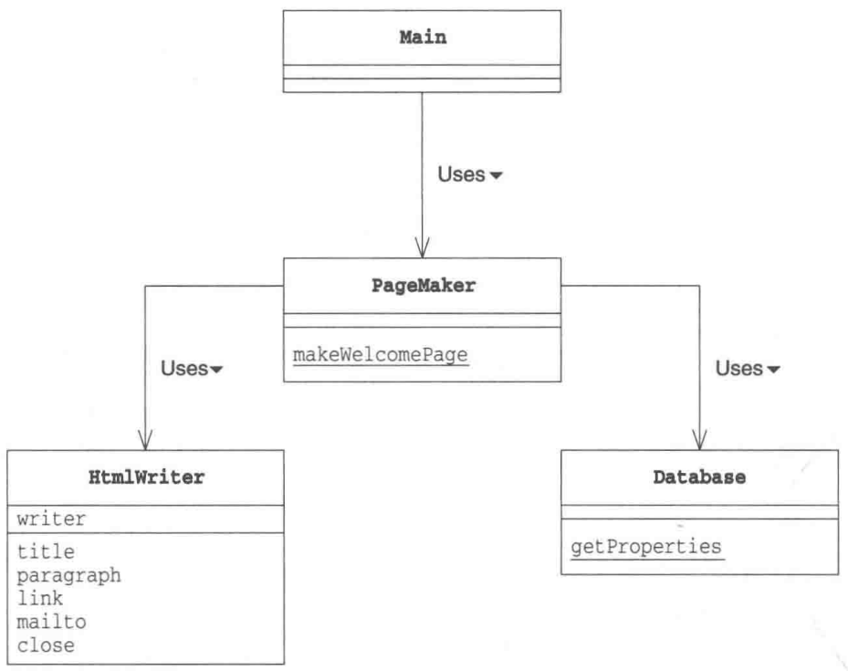
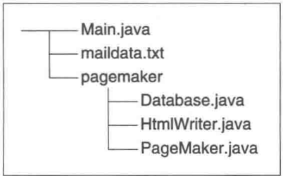
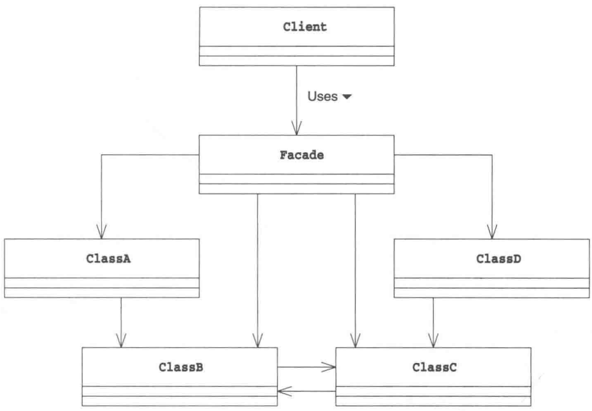
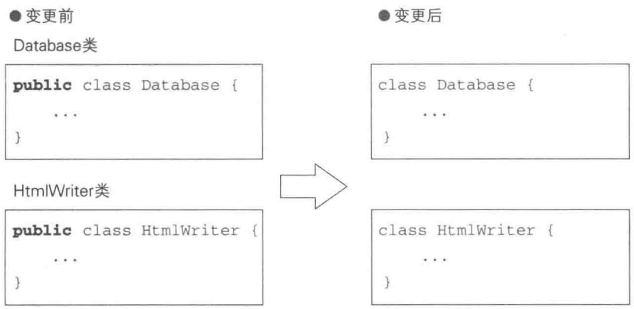
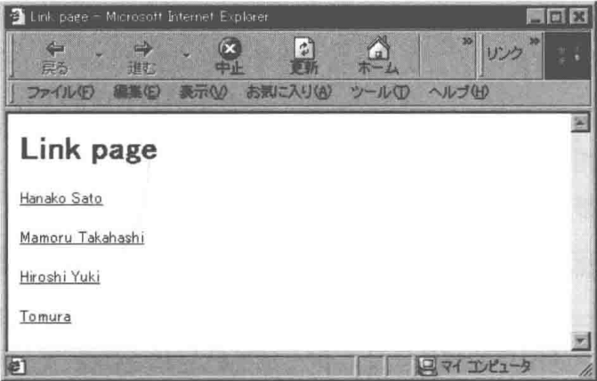

# 第15章 Facade模式——简单窗口

> 来源：《图解设计模式》PDF 第 204–213 页，MinerU OCR 转写，如有疑问以原书为准

<!-- PDF p204 -->



<!-- PDF p205 · 书页 172 -->

## 15.1 Facade 模式

程序这东西总是会变得越来越大。随着时间的推移，程序中的类会越来越多，而且它们之间相互关联，这会导致程序结构也变得越来越复杂。我们在使用这些类之前，必须先弄清楚它们之间的关系，注意正确的调用顺序。

特别是在调用大型程序进行处理时，我们需要格外注意那些数量庞大的类之间错综复杂的关系。不过与其这么做，不如为这个大型程序准备一个“窗口”。这样，我们就不必单独地关注每个类了，只需简单地对“窗口”提出请求即可。

这个 “窗口” 就是我们在本章中将要学习的 Facade 模式。Facade 是一个源自法语 Façade 的单词，它的意思是 “建筑物的正面”。

使用 Facade 模式可以为互相关联在一起的错综复杂的类整理出高层接口（API）。其中的 Facade 角色可以让系统对外只有一个简单的接口（API）。而且，Facade 角色还会考虑到系统内部各个类之间的责任关系和依赖关系，按照正确的顺序调用各个类。

本章中，我们将学习可以为系统提供一个简单窗口的 Facade 模式。

## 15.2 示例程序

在示例程序中，我们将要编写简单的 Web 页面。

本来，编写 Facade 模式的示例程序需要 “许多错综复杂地关联在一起的类”。不过在本书中，为了使示例程序更加简短，我们只考虑一个由 3 个简单的类构成的系统。也就是一个用于从邮件地址中获取用户名字的数据库类（Database），一个用于编写 HTML 文件的类（HtmlWriter），以及一个扮演 Facade 角色并提供高层接口（API）的类（PageMaker）。

使用示例程序编写出的 Web 页面如图 15-1 所示。

图 15-1 在浏览器中查看到的使用示例程序编写出的 Web 页面



各个类的一览如表15-1所示，UML类图如图15-2所示。

各个文件在文件夹中的结构如图15-3所示。

<!-- PDF p206 · 书页 173 -->

表 15-1 类的一览表

| 包 | 名字 | 说明 |
| --- | --- | --- |
| pagemaker | Database | 从邮件地址中获取用户名的类 |
| pagemaker | HtmlWriter | 编写HTML文件的类 |
| pagemaker | PageMaker | 根据邮件地址编写该用户的Web页面 |
| 无名 | Main | 测试程序行为的类 |

图15-2 示例程序的类图



图15-3 源文件在文件夹中的结构



### Database类

Database类（代码清单15-1）可获取指定数据库 ① 名（如maildata）所对应的Properties的实例。我们无法生成该类的任何实例，只能通过它的getProperties静态方法获取Properties的实例。代码清单15-2是数据库的一个示例。

<small>① 这里的数据库指的是一个记录了几条数据的文本，并非编程中常用的关系数据库。——译者注</small>

<!-- PDF p207 · 书页 174 -->

代码清单 15-1 Database 类 (Database.java)

```java
/**
 * 【Facade 模式】：为一堆复杂的类提供一个简单的“窗口”
 * 比喻：酒店前台 —— 你只需要找前台，不用分别找清洁、餐饮、维修
 * 本例：生成用户欢迎页面，内部要用到 Database（查用户名）和 HtmlWriter（写 HTML）
 * Database：根据数据库名读取 “邮箱=用户名” 的数据文件
 */
package pagemaker;

import java.io.FileInputStream;
import java.io.IOException;
import java.util.Properties;

public class Database {
    private Database() {      // 防止外部 new 出 Database 的实例，所以声明为 private
    }
    public static Properties getProperties(String dbname) { // 根据数据库名获取 Properties
        String filename = dbname + ".txt";
        Properties prop = new Properties();
        try {
            prop.load(new FileInputStream(filename));
        } catch (IOException e) {
            System.out.println("Warning: " + filename + " is not found.");
        }
        return prop;
    }
}
```

代码清单 15-2 数据文件（maildata.txt）

```text
hyuki@hyuki.com=Hiroshi Yuki
hanako@hyuki.com=Hanako Sato
tomura@hyuki.com=Tomura
mamoru@hyuki.com=Mamoru Takahashi
```

### HtmlWriter 类

HtmlWriter 类（代码清单 15-3）用于编写简单的 Web 页面。我们在生成 HtmlWriter 类的实例时赋予其 Writer，然后使用该 Writer 输出 HTML。

title 方法用于输出标题; paragraph 方法用于输出段落; link 方法用于输出超链接; mailto 方法用于输出邮件地址链接; close 方法用于结束 HTML 的输出。

该类中隐藏着一个限制条件，那就是必须首先调用 title 方法。窗口类 PageMaker 使用 HtmlWriter 类时必须严格遵守这个限制条件。

代码清单 15-3 HtmlWriter 类 (HtmlWriter.java)

```java
// 负责写 HTML 片段的类：标题、段落、链接、邮件链接
// 注意调用顺序有要求：必须先 title()，最后 close() —— 这正是需要 Facade 来封装的复杂之处
// （原文 package pajemaker 为笔误，应为 pagemaker）
package pajemaker;

import java.io.Writer;
import java.io.IOException;

public class HtmlWriter {
    private Writer writer;
    public HtmlWriter(Writer writer) {  // 构造函数
        this.writer = writer;
    }
    public void title(String title) throws IOException {      // 输出标题
        writer.write("<html>");
        writer.write("<head>");
        writer.write("<title>" + title + "</title>");
        writer.write("</head>");
        writer.write("<body>\n");
writer.write("<h1>" + title + "</h1>\n");
}
public void paragraph(String msg) throws IOException { // 输出段落
    writer.write("<p>" + msg + "</p>\n");
}
public void link(String href, String caption) throws IOException { // 输出超链接
    paragraph("<a href=\"" + href + "\">" + caption + "</a>");
}
public void mailto(String mailaddr, String username) throws IOException {// 输出邮件地址
    link("mailto:" + mailaddr, username);
}
public void close() throws IOException { // 结束输出 HTML
    writer.write("</body>");
    writer.write("</html>\n");
    writer.close();
}
}
```

<!-- PDF p208 · 书页 175 -->

### PageMaker类

PageMaker 类（代码清单 15-4）使用 Database 类和 HtmlWriter 类来生成指定用户的 Web 页面。

在该类中定义的方法只有一个，那就是 public 的 makeWelcomePage 方法。该方法会根据指定的邮件地址和文件名生成相应的 Web 页面。

PageMaker 类一手包办了调用 HtmlWriter 类的方法这一工作。对外部，它只提供了 makeWelcomePage 接口。这就是一个简单窗口。

代码清单 15-4 PageMaker 类 (PageMaker.java)

```java
// Facade（窗口）：调用方只需调用 makeWelcomePage(邮箱, 文件名) 这一个方法
// 内部按正确顺序组合 Database 和 HtmlWriter 完成工作
package pagemaker;

import java.io.FileWriter;
import java.io.IOException;
import java.util.Properties;

public class PageMaker {
    private PageMaker() {   // 防止外部 new 出 PageMaker 的实例，所以声明为 private 方法
}
    public static void makeWelcomePage(String mailaddr, String filename) {
        try {
            Properties mailprop = Database.getProperties("maildata");
            String username = mailprop.getProperty(mailaddr);
            HtmlWriter writer = new HtmlWriter(new FileWriter(filename));
            writer.title("Welcome to " + username + "'s page!");
            writer.paragraph(username + " 欢迎来到 " + username + " 的主页。");
            writer.paragraph(" 等着你的邮件哦！ ");
            writer.mailto(mailaddr, username);
            writer.close();
            System.out.println(filename + " is created for " + mailaddr + " (" +
username + ")");
        } catch (IOException e) {
            e.printStackTrace();
        }
    }
}
```

<!-- PDF p209 · 书页 176 -->

### Main 类

Main 类（代码清单 15-5）使用了 pagemaker 包中的 PageMaker 类，具体内容只有下面这一行。

```text
PageMaker.makeWelcomePage("hyuki@hyuki.com", "welcome.html");
```

它会获取 hyuki@hyuki.com 的名字，然后编写出一个名为 welcome.html 的 Web 页面。

代码清单 15-5 Main 类 (Main.java)

```java
// 使用：只和 PageMaker 打交道，完全不知道 Database、HtmlWriter 的存在
import pagemaker.PageMaker;

public class Main {
    public static void main(String[] args) {
        PageMaker.makeWelcomePage("hyuki@hyuki.com", "welcome.html");
    }
}
```

图15-4 编译和运行结果

```text
javac Main.java
java Main
welcome.html is created for hyuki@hyuki.com (Hiroshi Yuki)
(之后，在浏览器中查看到的使用示例程序编写出的Web页面如图15-5所示。)
```

图15-5 在浏览器中查看到的welcome.html的样子

```text
Welcome to Hiroshi Yuki's page!
欢迎来到Hiroshi Yuki的主页。
等着你的邮件哦！
Hiroshi Yuki
```

## 15.3 Facade 模式中的登场角色

在 Facade 模式中有以下登场角色。

### ◆ Facade（窗口）

Facade 角色是代表构成系统的许多其他角色的“简单窗口”。Facade 角色向系统外部提供高层接口（API）。在示例程序中，由 PageMaker 类扮演此角色。

### ◆ 构成系统的许多其他角色

这些角色各自完成自己的工作，它们并不知道 Facade 角色。Facade 角色调用其他角色进行工作，但是其他角色不会调用 Facade 角色。在示例程序中，由 Database 类和 HtmlWriter 类扮演此角色。

<!-- PDF p210 · 书页 177 -->

### ◆ Client（请求者）

Client 角色负责调用 Facade 角色（在 GoF 书（请参见附录 E[GoF]）中，Client 角色并不包含在 Facade 模式中）。在示例程序中，由 Main 类扮演此角色。

图15-6 Facade模式的类图



## 15.4 拓展思路的要点

### Facade角色到底做什么工作

Facade 模式可以让复杂的东西看起来简单。那么，这里说到的“复杂的东西”到底是什么呢？其实就是在后台工作的这些类之间的关系和它们的使用方法。使用 Facade 模式可以让我们不必在意这些复杂的东西。

这里的重点是接口（API）变少了。程序中如果有很多类和方法，我们在决定到底应该使用哪个类或是方法时就很容易迷茫。有时，类和方法的调用顺序也很容易弄错，必须格外注意。因此，如果有一个能够使接口（API）变少的 Facade 角色是一件多么美好的事情啊。

接口（API）变少了还意味着程序与外部的关联关系弱化了，这样更容易使我们的包（类的集合）作为组件被复用。

在设计类时，我们还需要考虑将哪些方法的可见性设为 public。如果公开的方法过多，会导致类的内部的修改变得困难。字段也是一样的，如果不小心将某个字段公开出去了，那么其他类可能会读取或是修改这个字段，导致难以修改该类。

与设计类一样，在设计包时，需要考虑类的可见性。如果让外部（包的外部）看到了类，包内部代码的修改就会变得困难（关于这一点，请大家参考本章的习题15-1）。

<!-- PDF p211 · 书页 178 -->

### 递归地使用 Facade 模式

既然上面我们从设计类谈到了设计包的问题，下面就让我们把思考范围再扩大一些。

假设现在有几个持有 Facade 角色的类的集合。那么，我们可以通过整合这几个集合来引入新的 Facade 角色。也就是说，我们可以递归地使用 Facade 模式。

在超大系统中，往往都含有非常多的类和包。如果我们在每个关键的地方都使用 Facade 模式，那么系统的维护就会变得轻松很多。

### 开发人员不愿意创建 Facade 角色的原因——心理原因

下面我们来讨论一个有意思的话题。通常，熟悉系统内部复杂处理的开发人员可能不太愿意创建 Facade 角色。也就是说，他们在下意识地回避创建 Facade 角色。

这是为什么呢？这可能是因为对熟练的开发人员而言，系统中的所有信息全部都记忆在脑中，他们对类之间的所有相互依赖关系都一清二楚。当然，也可能是出于他们对自己技术的骄傲，或是不懂装懂。

当某个程序员得意地说出“啊，在调用那个类之前需要先调用这个类。在调用那个方法之前需要先在这个类中注册一下”的时候，就意味着我们需要引入 Facade 角色了。

对于那些能够明确地用语言描述出来的知识，我们不应该将它们隐藏在自己脑袋中，而是应该用代码将它们表现出来。

## 15.5 相关的设计模式

### ◆ Abstract Factory 模式（第 8 章）

可以将 Abstract Factory 模式看作生成复杂实例时的 Facade 模式。因为它提供了“要想生成这个实例只需要调用这个方法就 OK 了”的简单接口。

### ◆ Singleton 模式（第 5 章）

有时会使用 Singleton 模式创建 Facade 角色。

### ◆ Mediator 模式（第 16 章）

在 Facade 模式中，Facade 角色单方面地使用其他角色来提供高层接口（API）。

而在 Mediator 模式中，Mediator 角色作为 Colleague 角色间的仲裁者负责调停。可以说，Facade 模式是单向的，而 Mediator 角色是双向的。

## 15.6 本章所学知识

在本章中，我们学习了为复杂系统创建简单窗口的 Facade 模式。

<!-- PDF p212 · 书页 179 -->

## 15.7 练习题

答案请参见附录 A (P.325)

### 习题15-1

Java 为了能够方便地对程序进行扩展和改善，作为设计者，我们想让 pagemaker 包外部的程序只能使用 PageMaker 类，而不能使用 Database 类和 HtmlWriter 类。那么我们应该如何修改示例程序呢？

#### 答案（附录 A）

在 Database 类（代码清单 15-1）和 HtmlWriter 类（代码清单 15-2）的定义中，像下面这样将 public 去掉后，就无法从 pagemaker 包外部使用 Database 类和 HtmlWriter 类的名字了（即使不删除它们中的方法所带有的 public 修饰符也无所谓）。



### 习题15-2

Java 请在 PageMaker 类中增加一个 makeLinkPage 方法，使其可以根据 maildata.txt（代码清单 15-2）中的用户的邮件地址制作出邮件地址超链接集合。makeLinkPage 的调用方法如代码清单 15-6 所示。制作完成的超链接集合如图 15-8 所示（界面效果如图 15-9 所示）。

代码清单 15-6 Main 类 (Main.java)

```java
// 习题：给窗口增加一个“生成所有用户的链接页面”的方法
import pagemaker.PageMaker;

public class Main {
    public static void main(String[] args) {
        PageMaker.makeLinkPage("linkpage.html");
    }
}
```

图15-7 编译和运行结果

```text
javac Main.java
java Main
linkpage.html is created.
(这之后，在浏览器中查看到的 linkage.html 如图 15-9 所示)
```

图15-8 制作完成的linkpage.html

```text
<html><head><title>Link page</title></head><body>
<h1>Link page</h1>
<p><a href="mailto:hanako@hyuki.com">Hanako Sato</a></p>
<p><a href="mailto:mamoru@hyuki.com">Mamoru Takahashi</a></p>
<p><a href="mailto:hyuki@hyuki.com">Hiroshi Yuki</a></p>
<p><a href="mailto:tomura@hyuki.com">Tomura</a></p>
</body></html>
```

<!-- PDF p213 · 书页 180 -->

图15-9 在浏览器中查看linkpage.html



#### 答案（附录 A）

答案如下面的代码清单15-1所示。

代码清单 A15-1 修改后的 PageMaker 类 (PageMaker.java)

```java
// 习题答案：PageMaker 新增 makeLinkPage —— 遍历数据库里所有邮箱，逐个输出 mailto 链接
package pagemaker;

import java.io.FileWriter;
import java.io.IOException;
import java.util.Properties;
import java.util.Enumeration;

public class PageMaker {
    private PageMaker() {   // 不允许生成 PageMaker 类的实例，因此将构造函数设为 private
    }
    public static void makeWelcomePage(String mailaddr, String filename) {
        try {
            Properties mailprop = Database.getProperties("maildata");
            String username = mailprop.getProperty(mailaddr);
            HtmlWriter writer = new HtmlWriter(new FileWriter(filename));
            writer.title("Welcome to " + username + "'s page!");
            writer.paragraph(" 欢迎来到 " + username + " 的主页。");
            writer.paragraph(" 等着你的邮件哦！ ");
            writer.mailto(mailaddr, username);
            writer.close();
            System.out.println(filename + " is created for " + mailaddr + " (" +
username + ")");
        } catch (IOException e) {
            e.printStackTrace();
        }
    }
}
}
public static void makeLinkPage(String filename) {
    try {
        HtmlWriter writer = new HtmlWriter(new FileWriter(filename));
        writer.title("Link page");
        Properties mailprop = Database.getProperties("maildata");
        Enumeration en = mailprop.propertyNames();
        while (en.hasMoreElements()) {
            String mailaddr = (String)en.nextElement();
            String username = mailprop.getProperty(mailaddr, "(unknown)");
            writer.mailto(mailaddr, username);
        }
        writer.close();
        System.out.println(filename + " is created.");
    } catch (IOException e) {
        e.printStackTrace();
    }
}
```
