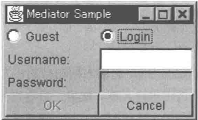
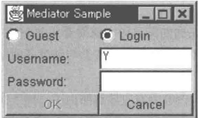
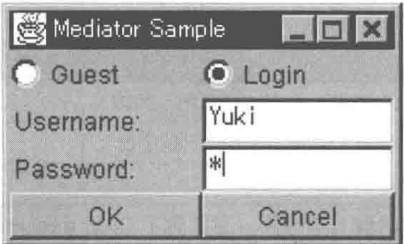
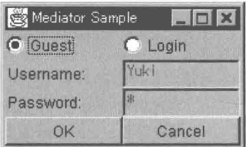
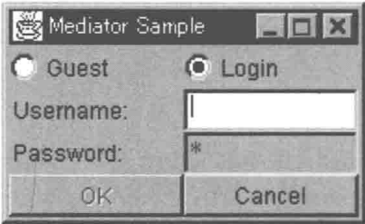
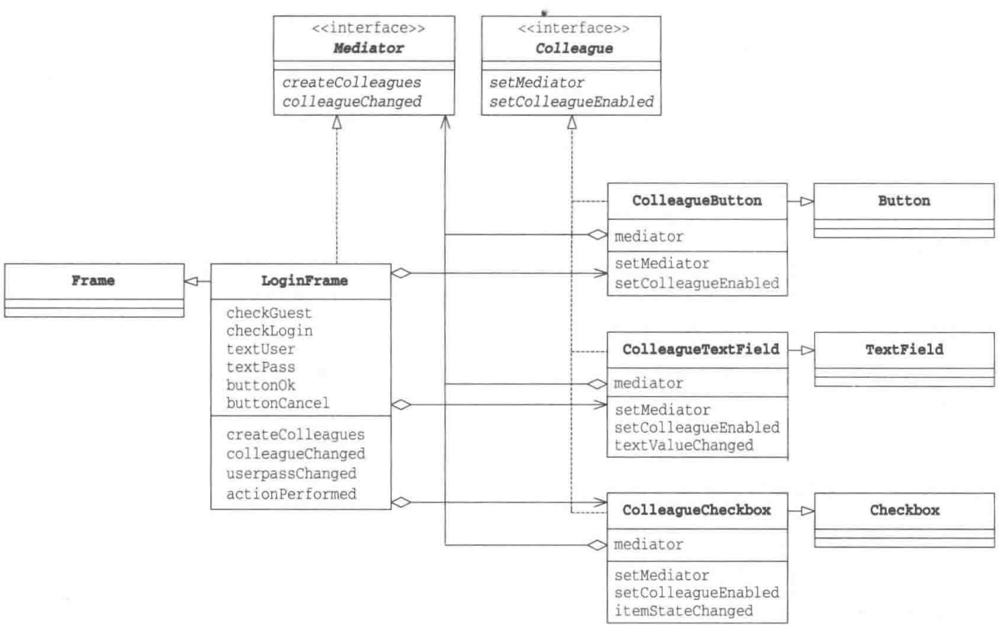
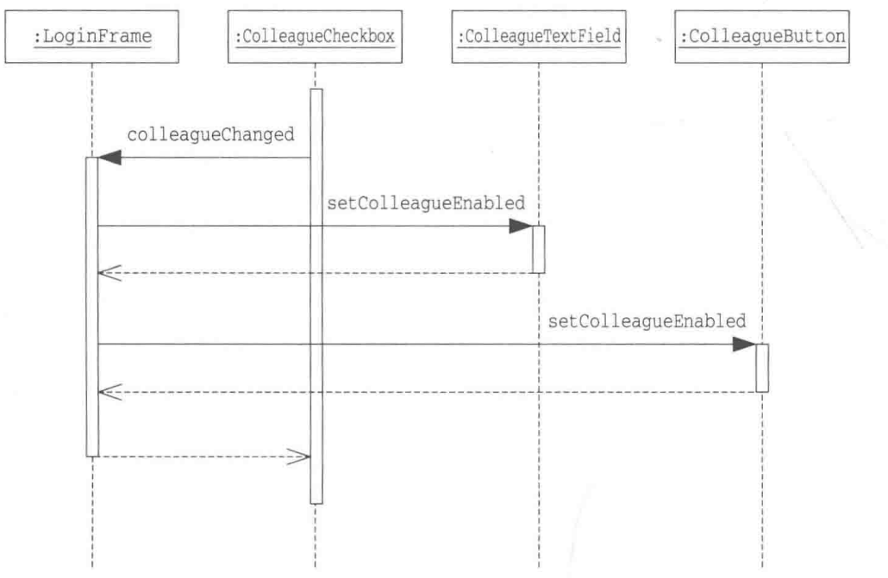
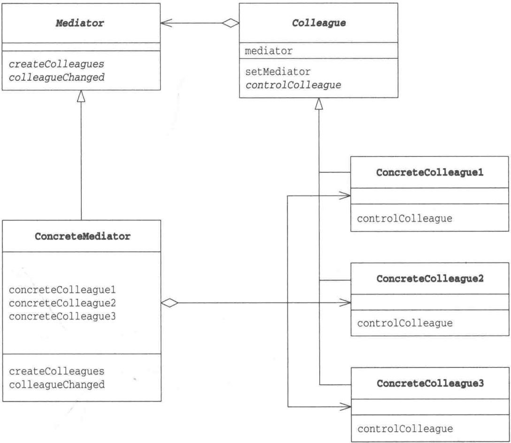

# 第16章 Mediator模式——只有一个仲裁者

> 来源：《图解设计模式》PDF 第 214–227 页，MinerU OCR 转写，如有疑问以原书为准

<!-- PDF p214 -->


<!-- PDF p215 · 书页 182 -->

## 16.1 Mediator 模式

请大家想象一下一个乱糟糟的开发小组的工作状态。小组中的10个成员虽然一起协同工作，但是意见难以统一，总是互相指挥，导致工作始进度始终滞后。不仅如此，他们还都十分在意编码细节，经常为此争执不下。这时，我们就需要一个中立的仲裁者站出来说:“各位，请大家将情况报告给我，我来负责仲裁。我会从团队整体出发进行考虑，然后下达指示。但我不会评价大家的工作细节。”这样，当出现争执时大家就会找仲裁者进行商量，仲裁者会负责统一大家的意见。

最后，整个团队的交流过程就变为了组员向仲裁者报告，仲裁者向组员下达指示。组员之间不再相互询问和相互指示。

在本章中，我们将要学习 Mediator 模式。

Mediator 的意思是 “仲裁者” “中介者”。一方面，当发生麻烦事情的时候，通知仲裁者；当发生涉及全体组员的事情时，也通知仲裁者。当仲裁者下达指示时，组员会立即执行。团队组员之间不再互相沟通并私自做出决定，而是发生任何事情都向仲裁者报告。另一方面，仲裁者站在整个团队的角度上对组员上报的事情做出决定。这就是 Mediator 模式。

在 Mediator 模式中，“仲裁者”被称为 Mediator，各组员被称为 Colleague。Colleague 这个单词很容易拼错，大家可能也不太明白这个英文单词的意思，但在 GoF 书（请参见附录 E[GoF]）中就是这么记述的，因此本书中沿用该术语。

## 16.2 示例程序

下面我们来看一段使用了 Mediator 模式的示例程序。这段示例程序是一个 GUI 应用程序，它展示了一个登录对话框，用户在其中输入正确的用户名和密码后可以登录。示例程序的运行结果如图 16-1 所示。

图16-1 登录对话框

<table><tr><td colspan="2">Mediator Sample</td></tr><tr><td>Guest</td><td>Login</td></tr><tr><td>Username:</td><td>Yuki</td></tr><tr><td>Password:</td><td>**********</td></tr><tr><td>OK</td><td>Cancel</td></tr></table>

对话框的使用方法如下。

- 可以选择作为游客访问（Guest）或是作为用户登录（Login）

- 作为用户登录时，需要输入正确的用户名（Username）和密码（Password）

- 点击 OK 按钮可以登录，点击 Cancel 按钮可以取消登录

（在示例程序中我们不会真正登录，而是在按下按钮后就退出程序）

看起来这似乎是一段很简单的程序。不过真的如此吗？仅看上面的介绍大家可能会认为程序很简单，不过当我们考虑一下下面这些程序行为时，就会发现并非如此。

<!-- PDF p216 · 书页 183 -->

- 如果选择作为游客访问，那么禁用用户名输入框和密码输入框，使用户无法输入

- 如果选择作为用户登录，那么启用用户名输入框和密码输入框，使用户可以输入

- 如果在用户名输入框中一个字符都没有输入，那么禁用密码输入框，使用户无法输入密码

- 如果在用户名输入框中输入了至少一个字符,那么启用密码输入框,使用户可以输入密码(当然,如果选择作为游客访问,那么密码框依然是禁用状态)

- 只有当用户名输入框和密码输入框中都至少输入一个字符后，OK按钮才处于启用状态，可以被按下。用户名输入框或密码输入框中一个字符都没有被输入的时候，禁用OK按钮，使其不可被按下（当然，如果选择作为游客访问，那么OK按钮总是处于启用状态）

- Cancel 按钮总是处于启用状态，任何时候都可以按下该按钮

图 16-2 如果选择作为用户登录，那么用户名输入框处于启用状态，密码输入框处于禁用状态



图 16-3 如果在用户名输入框中输入了字符，那么密码输入框处于启用状态，OK 按钮处于禁用状态



图16-4 如果又输入了密码，那么OK按钮处于可按下状态



图16-5 如果选择作为游客访问，那么禁用用户名输入框和密码输入框



<!-- PDF p217 · 书页 184 -->

图 16-6 即使输入了密码，但只要删除了用户名，OK 按钮和密码输入框就会变为禁用状态



哎呀，上面列举的这些操作情况好复杂，用语言都很难表达清楚。不过大家在实际操作一下这个对话框后，应该能够很容易地理解设计者的意图。那么，我们应该如何编写程序呢？

对话框中的单选按钮（radiobutton，用于选择作为游客访问还是作为用户登录）、文本输入框（用于输入用户名和密码）、按钮（OK 和 Cancel）都是单独的类。如果将上面的逻辑处理分散在各个类中，那么编码的工作量会变得非常大。

这是因为所有的对象都互相关联、互相制约。

“如果选择作为用户登录，那么启用用户名输入框和密码输入框，但是如果在用户名输入框中一个字符都没有被输入，就必须禁用密码输入框。然后，只有当用户名输入框和密码输入框中都输入有文字后，才能启用OK按钮”……这段代码应该写在哪里才好呢？写在单选按钮的类里面吗？不过如果这样写代码，负责控制显示的代码就会散落在各个类里面了，导致不论是编写代码还是调试代码，都会变得非常麻烦。而且，一旦需求发生了变化，例如要“增加一个用于输入邮件地址的输入框”……想想都让人害怕。

像上面这样要调整多个对象之间的关系时，就需要用到 Mediator 模式了。即不让各个对象之间互相通信，而是增加一个仲裁者角色，让他们各自与仲裁者通信。然后，将控制显示的逻辑处理交给仲裁者负责。

前面讲得很多，该模式的大致内容大家应该都明白了。接下来，请注意结合上面这些内容来阅读示例程序。

示例程序的类和接口的一览表请参见图 16-1，类图和时序图请分别参见图 16-7 和图 16-8。

表 16-1 类和接口的一览表

| 名字 | 说明 |
| --- | --- |
| Mediator | 定义“仲裁者”的接口(API)的接口 |
| Colleague | 定义“组员”的接口(API)的接口 |
| ColleagueButton | 表示按钮的类。它实现了 Colleague 接口 |
| ColleagueTextField | 表示文本输入框的类。它实现了 Colleague 接口 |
| ColleagueCheckbox | 表示勾选框(此处是单选按钮)的类。它实现了 Colleague 接口 |
| LoginFrame | 表示登录对话框的类。它实现了 Mediator 接口 |
| Main | 测试程序行为的类 |

<!-- PDF p218 · 书页 185 -->

图16-7 示例程序的类图



图16-8 示例程序的时序图



### Mediator接口

Mediator 接口（代码清单 16-1）是表示仲裁者的接口。具体的仲裁者（后文中即将学习的 LoginFrame 类）会实现这个接口。

createColleagues 方法用于生成 Mediator 要管理的组员。在示例程序中, createColleagues会生成对话框中的按钮和文本输入框等控件。

<!-- PDF p219 · 书页 186 -->

colleagueChanged 方法会被各个 Colleague 组员调用。它的作用是让组员可以向仲裁者进行报告。在本例中，当单选按钮和文本输入框的状态发生变化时，该方法会被调用。

代码清单 16-1 Mediator 接口（Mediator.java）

```java
/**
 * 【Mediator 模式】：组员之间不直接沟通，都通过“仲裁者”协调
 * 比喻：机场塔台 —— 飞机都只和塔台通话
 * 本例：登录对话框，控件（组员）状态变化 → 通知对话框（仲裁者）→ 对话框决定哪些控件可用
 */
// 仲裁者接口
public interface Mediator {
    public abstract void createColleagues();  // 创建所有组员
    public abstract void colleagueChanged();  // 某个组员状态变了（组员调用）
}
```

### Colleague 接口

Colleague 接口（代码清单 16-2）是表示向仲裁者进行报告的组员的接口。具体的组员（ColleagueButton、ColleagueTextField、ColleagueCheckbox）会实现这个接口。

LoginFrame 类实现了 Mediator 接口，它首先会调用 setMediator 方法。该方法的作用是告知组员 “我是仲裁者，有事请报告我”。向该方法中传递的参数是仲裁者的实例，之后在需要向仲裁者报告时（即调用 colleagueChanged 方法时）会用到该实例。

setColleagueEnabled 方法的作用是告知组员仲裁者所下达的指示。参数 enabled 如果为 true，就表示自己需要变为“启用状态”；如果是 false，则表示自己需要变为“禁用状态”。这个方法表明，究竟是变为“启用状态”还是变为“禁用状态”，并非由组员自己决定，而是由仲裁者来决定。

此外需要说明的是，关于Mediator接口和Colleague接口中究竟需要定义哪些方法这一点，是根据需求不同而不同的。在示例程序中，我们在Mediator中定义了colleagueChanged方法，在Colleague接口中定义了setColleagueEnabled方法。如果需要让Mediator角色和Colleague角色之间进行更加详细的通信，还需要定义更多的方法。也就是说，即使两段程序都使用了Mediator模式，但它们实际定义的方法可能会不同。

代码清单 16-2 Colleague 接口（Colleague.java）

```java
// 组员接口
public interface Colleague {
    public abstract void setMediator(Mediator mediator);       // 告诉组员仲裁者是谁
    public abstract void setColleagueEnabled(boolean enabled); // 仲裁者下达“启用 / 禁用”指示
}
```

### ColleagueButton 类

ColleagueButton 类 (代码清单 16-3) 是 java.awt.Button 的子类, 它实现了 Colleague 接口, 与 LoginFrame (Mediator 接口) 共同工作。

mediator 字段中保存了通过 setMediator 方法的参数传递进来的 Mediator 对象 (LoginFrame 类的实例)。setColleagueEnabled 方法会调用 Java 的 GUI 中定义的 setEnabled 方法，设置禁用或是启用控件。setEnabled(true) 后控件按钮可以被按下，setEnabled(false) 后按钮无法被按下。

<!-- PDF p220 · 书页 187 -->

代码清单 16-3 ColleagueButton 类 ( ColleagueButton.java )

```java
// 组员 1：按钮（只接收指示，不主动通知）
import java.awt.Button;

public class ColleagueButton extends Button implements Colleague {
    private Mediator mediator;
    public ColleagueButton(String caption) {
        super(caption);
    }
    public void setMediator(Mediator mediator) {          // 保存 Mediator
        this.mediator = mediator;
    }
    public void setColleagueEnabled(boolean enabled) {   // Mediator下达启用 / 禁用的指示
        setEnabled(enabled);
    }
}
```

### ColleagueTextField 类

ColleagueTextField 类 (代码清单 16-4) 是 java.awt.TextField 的子类, 它不仅实现了 Colleague 接口, 还实现了 java.awt.event.TextListener 接口。这是因为我们希望通过 textValueChanged 方法捕捉到文本内容发生变化这一事件, 并通知仲裁者。

在 Java 语言中，我们虽然无法继承 (extends) 多个类，但是我们可以实现 (implements) 多个接口。在 setColleagueEnabled 方法中，我们不仅调用了 setEnabled 方法，还调用了 setBackground 方法。这是因为我们希望在启用控件后，将它的背景色改为白色；禁用控件后，将它的背景色改为灰色。

textValueChanged 方法是在 TextListener 接口中定义的方法。当文本内容发生变化时，AWT 框架会调用该方法。在示例程序中，textValueChanged 方法调用了 colleagueChanged 方法，这是在向仲裁者表达 “对不起，文本内容有变化，请处理。” 的意思。

代码清单 16-4 ColleagueTextField 类 (ColleagueTextField.java)

```java
// 组员 2：文本框 —— 文字一变就通知仲裁者；被禁用时背景变灰
import java.awt.TextField;
import java.awt.Color;
import java.awt.event.TextListener;
import java.awt.event.TextEvent;

public class ColleagueTextField extends TextField implements TextListener, Colleague {
    private Mediator mediator;
    public ColleagueTextField(String text, int columns) { // 构造函数
        super(text, columns);
    }
    public void setMediator(Mediator mediator) {          // 保存 Mediator
        this.mediator = mediator;
    }
    public void setColleagueEnabled(boolean enabled) {       // Mediator 下达启用 / 禁用的指示
        setEnabled(enabled);
        setBackground(enabled ? Color.white : Color.lightGray);
    }
    public void textValueChanged(TextEvent e) {            // 当文字发生变化时通知 Mediator
        mediator.colleagueChanged();
    }
}
```

<!-- PDF p221 · 书页 188 -->

### ColleagueCheckbox 类

ColleagueCheckbox 类（代码清单 16-5）是 java.awt Checkbox 的子类。在示例程序中，我们将其作为单选按钮使用，而没有将其作为勾选框使用（使用 CheckboxGroup）。

该类实现了java.awt.event.ItemListener接口，这是因为我们希望通过itemSateChanged方法来捕获单选按钮的状态变化。

代码清单 16-5 ColleagueCheckbox 类 (ColleagueCheckbox.java)

```java
// 组员 3：单选框（Guest / Login）—— 选择一变就通知仲裁者
import java.awt.Checkbox;
import java.awt.CheckboxGroup;
import java.awt.event.ItemListener;
import java.awt.event.ItemEvent;

public class ColleagueCheckbox extends Checkbox implements ItemListener, Colleague {
    private Mediator mediator;
    public ColleagueCheckbox(String caption, CheckboxGroup group, boolean state) {
        // 构造函数
        super(caption, group, state);
    }
    public void setMediator(Mediator mediator) {      // 保存 Mediator
        this.mediator = mediator;
    }
    public void setColleagueEnabled(boolean enabled) { // Mediator下达启用 / 禁用指示
        setEnabled(enabled);
    }
    public void itemStateChanged(ItemEvent e) {       // 当状态发生变化时通知 Mediator
        mediator.colleagueChanged();
    }
}
```

### LoginFrame 类

现在，我们终于可以看看仲裁者的代码了。LoginFrame 类（代码清单 16-6）是 java.awt.Frame（用于编写 GUI 程序的类）的子类，它实现了 Mediator 接口。

关于 Java 的 AWT 框架的内容已经超出了本书的范围，这里我们只学习与本章内容相关的重点知识。

LoginFrame 类的构造函数进行了以下处理。

- 设置背景色

- 设置布局管理器（配置4（纵） × 2 （横）窗格）

- 调用 createColleagues 方法生成 Colleague

- 配置 Colleague

- 设置初始状态

- 显示

createColleagues 方法会生成登录对话框所需的 Colleague，并将它们保存在 LoginFrame 类的字段中。此外，它还会调用每个 Colleague 的 setMediator 方法，事先告知它们 “我是仲裁者，有什么问题的可以向我报告”。createColleagues 方法还设置了各个Colleague 的 Listener。这样，AWT 框架就可以调用合适的 Listener 了。

<!-- PDF p222 · 书页 189 -->

整个示例程序中最重要的方法当属 LoginFrame 类的 colleagueChanged 方法。该方法负责前面讲到过的“设置控件的启用/禁用的复杂逻辑处理”。请大家回忆一下之前学习过的 ColleagueButton、ColleagueCheckbox、ColleagueTextField 等各个类。这些类中虽然都有设置自身的启用/禁用状态的方法，但是并没有“具体什么情况下需要设置启用/禁用”的逻辑处理。它们都只是简单地调用仲裁者的 colleagueChanged 方法告知仲裁者“剩下的就拜托给你了”。也就是说，所有最终的决定都是由仲裁者的 colleagueChanged 方法下达的。

通过 getState 方法可以获取单选按钮的状态，通过 getText 方法可以获取文本输入框中的文字。那么剩下的工作就是在 colleagueChanged 方法中实现之前学习过的那段复杂的控制逻辑处理了。此外，这里我们提取了一个共同的方法 userpassChanged。该方法仅在 LoginFrame 类内部使用，其可见性为 private。

代码清单 16-6 LoginFrame 类 (LoginFrame.java)

```java
/**
 * 仲裁者：登录窗口
 * 所有“哪个控件该启用”的判断逻辑都集中在这里（colleagueChanged / userpassChanged）
 * 规则：
 * - 选 Guest：用户名、密码禁用，OK 可用
 * - 选 Login：用户名可用；填了用户名，密码才可用；两个都填了，OK 才可用
 */
import java.awt.Frame;
import java.awt.Label;
import java.awt.Color;
import java.awt.CheckboxGroup;
import java.awt.GridLayout;
import java.awt.event.ActionListener;
import java.awt.event.ActionEvent;

public class LoginFrame extends Frame implements ActionListener, Mediator {
    private ColleagueCheckbox checkGuest;
    private ColleagueCheckbox checkLogin;
    private ColleagueTextField textUser;
    private ColleagueTextField textPass;
    private ColleagueButton buttonOk;
    private ColleagueButton buttonCancel;

    // 构造函数
    // 生成并配置各个 Colleague 后，显示对话框
    public LoginFrame(String title) {
        super(title);
        setBackground(Color.lightGray);
        // 使用布局管理器生成 4×2 窗格
        setLayout(new GridLayout(4, 2));
        // 生成各个 Colleague
        createColleagues();
        // 配置
        add(checkGuest);
        add(checkLogin);
        add(new Label("Username:"));
        add(textUser);
        add(new Label("Password:"));
        add(textPass);
        add(buttonOk);
        add(buttonCancel);
        // 设置初始的启用 / 禁用状态
        colleagueChanged();
        // 显示
        pack();
        show();
    }
// 生成各个 Colleague
public void createColleagues() {
    // 生成
    CheckboxGroup g = new CheckboxGroup();
    checkGuest = new ColleagueCheckbox("Guest", g, true);
    checkLogin = new ColleagueCheckbox("Login", g, false);
    textUser = new ColleagueTextField("", 10);
    textPass = new ColleagueTextField("", 10);
    textPass.setEchoChar('*');
    buttonOk = new ColleagueButton("OK");
    buttonCancel = new ColleagueButton("Cancel");
    // 设置 Mediator
    checkGuest.setMediator(this);
    checkLogin.setMediator(this);
    textUser.setMediator(this);
    textPass.setMediator(this);
    buttonOk.setMediator(this);
    buttonCancel.setMediator(this);
    // 设置 Listener
    checkGuest.addItemListener(checkGuest);
    checkLogin.addItemListener(checkLogin);
    textUser.addTextListener(textUser);
    textPass.addTextListener(textPass);
    buttonOk.addActionListener(this);
    buttonCancel.addActionListener(this);
}

// 接收来自于 Colleague 的通知然后判断各 Colleague 的启用 / 禁用状态
public void colleagueChanged() {
    if (checkGuest.getState()) {            // Guest mode
        textUser.setColleagueEnabled(false);
        textPass.setColleagueEnabled(false);
        buttonOk.setColleagueEnabled(true);
    } else {                    // Login mode
        textUser.setColleagueEnabled(true);
        userpassChanged();
    }
}

// 当 textUser 或 textPass 文本输入框中的文字发生变化时
// 判断各 Colleague 的启用 / 禁用状态
private void userpassChanged() {
    if (textUser.getText().length() > 0) {
        textPass.setColleagueEnabled(true);
        if (textPass.getText().length() > 0) {
            buttonOk.setColleagueEnabled(true);
        } else {
            buttonOk.setColleagueEnabled(false);
        }
    } else {
        textPass.setColleagueEnabled(false);
        buttonOk.setColleagueEnabled(false);
    }
}
public void actionPerformed(ActionEvent e) {
    System.out.println(e.toString());
    System.exit(0);
}
```

<!-- PDF p224 · 书页 191 -->

### Main 类

Main 类（代码清单 16-7）生成了 LoginFrame 类的实例。虽然 Main 类的 main 方法结束了，但是 LoginFrame 类的实例还一直被保存在 AWT 框架中。

代码清单 16-7 Main 类 (Main.java)

```java
// 启动：创建登录窗口
public class Main {
    static public void main(String args[]) {
        new LoginFrame("Mediator Sample");
    }
}
```

## 16.3 Mediator 模式中的登场角色

在 Mediator 模式中有以下登场角色。

### ◆ Mediator（仲裁者、中介者）

Mediator 角色负责定义与 Colleague 角色进行通信和做出决定的接口（API）。在示例程序中，由 Mediator 接口扮演此角色。

### ◆ ConcreteMediator（具体的仲裁者、中介者）

ConcreteMediator 角色负责实现 Mediator 角色的接口（API），负责实际做出决定。在示例程序中，由 LoginFrame 类扮演此角色。

### ◆ Colleague（同事）

Colleague 角色负责定义与 Mediator 角色进行通信的接口 (API)。在示例程序中，由 Colleague 接口扮演此角色。

### ◆ ConcreteColleague（具体的同事）

ConcreteColleague 角色负责实现 Colleague 角色的接口 (API)。在示例程序中，由 ColleagueButton 类、ColleagueTextField 类和 ColleagueCheckbox 类扮演此角色。

<!-- PDF p225 · 书页 192 -->

图16-9 Mediator模式的类图



## 16.4 拓展思路的要点

### 当发生分散灾难时

示例程序中的 LoginFrame 类的 colleagueChanged 方法（代码清单 16-6）稍微有些复杂。如果发生需求变更，该方法中很容易发生 Bug。不过这并不是什么问题。因为即使 colleagueChanged 方法中发生了 Bug，由于其他地方并没有控制控件的启用 / 禁用状态的逻辑处理，因此只要调试该方法就能很容易地找出 Bug 的原因。

请试想一下，如果这段逻辑分散在 ColleagueButton 类、ColleagueTextField 类和 ColleagueCheckbox 类中，那么无论是编写代码还是调试代码和修改代码，都会非常困难。

通常情况下，面向对象编程可以帮助我们分散处理，避免处理过于集中，也就是说可以“分而治之”。但是在本章中的示例程序中，把处理分散在各个类中是不明智的。如果只是将应当分散的处理分散在各个类中，但是没有将应当集中的处理集中起来，那么这些分散的类最终只会导致灾难。

<!-- PDF p226 · 书页 193 -->

### 通信线路的增加

假设现在有 A 和 B 这 2 个实例，它们之间互相通信（相互之间调用方法），那么通信线路有两条，即 A → B 和 A ← B。如果是有 A、B 和 C 这 3 个实例，那么就会有 6 条通信线路，即 A → B、A ← B、B → C、B ← C、C → A 和 C ← A。如果有 4 个实例，会有 12 条通信线路；5 个实例就会有 20 条通信线路，而 6 个实例则会有 30 条通信线路。如果存在很多这样的互相通信的实例，那么程序结构会变得非常复杂。

可能会有读者认为，如果实例很少就不需要 Mediator 模式了。但是需要考虑到的是，即使最初实例很少，很可能随着需求变更实例数量会慢慢变多，迟早会暴露出问题。

### 哪些角色可以复用

ConcreteColleague 角色可以复用，但 ConcreteMediator 角色很难复用。

例如，假设我们现在需要制作另外一个对话框。这时，我们可将扮演 ConcreteColleague 角色的 ColleagueButton 类、ColleagueTextField 类和 ColleagueCheckbox 类用于新的对话框中。这是因为在 ConcreteColleague 角色中并没有任何依赖于特定对话框的代码。

在示例程序中，依赖于特定应用程序的部分都被封装在扮演 ConcreteMediator 角色的 LoginFrame 类中。依赖于特定应用程序就意味着难以复用。因此，LoginFrame 类很难在其他对话框中被复用。

## 16.5 相关的设计模式

### ◆ Facade 模式（第 15 章）

在 Mediator 模式中，Mediator 角色与 Colleague 角色进行交互。

而在 Facade 模式中，Facade 角色单方面地使用其他角色来对外提供高层接口（API）。因此，可以说 Mediator 模式是双向的，而 Facade 模式是单向的。

### ◆ Observer 模式（第 17 章）

有时会使用 Observer 模式来实现 Mediator 角色与 Colleague 角色之间的通信。

## 16.6 本章所学知识

在本章中，我们学习了以值得信赖的仲裁者作为主角的 Mediator 模式。Mediator 模式不让互相关联的对象之间进行任何直接通信，而是让它们向仲裁者进行报告。特别是在 GUI 应用程序中，该模式具有非常好的效果。

<!-- PDF p227 · 书页 194 -->

## 16.7 练习题

答案请参见附录 A（P.326）

### 习题16-1

请修改示例程序，实现“仅当用户名与密码的长度都大于4个字符（包含4个字符）的时候，OK按钮才有效”的需求。请仔细思考究竟需要修改哪个类。

#### 答案（附录 A）

对 LoginFrame 类（代码清单 16-6）中的 userpassChanged 方法做如下修改即可，无需对其他类做任何修改。

```text
# 习题：规则改为“用户名和密码都至少 4 个字符才能点 OK”—— 只需改仲裁者里这一行
if (textPass.getText().length() > 0) {
↓
if (textUser.getText().length() >= 4 && textPass.getText().length() >= 4) {
```

图 A16-1 当密码输入框中只输入了三个字符时，无法按下 OK 按钮

<table><tr><td colspan="2">Mediator Sample</td></tr><tr><td>Guest</td><td>Login</td></tr><tr><td>Username:</td><td>Yuki</td></tr><tr><td>Password:</td><td>***|</td></tr><tr><td>OK</td><td>Cancel</td></tr></table>

图 A16-2 当密码输入框中输入了四个字符后，可以按下 OK 按钮

<table><tr><td colspan="2">Mediator Sample</td></tr><tr><td>Guest</td><td>Login</td></tr><tr><td>Username:</td><td>Yuki</td></tr><tr><td>Password:</td><td>*****</td></tr><tr><td>OK</td><td>Cancel</td></tr></table>

<!-- PDF p360 · 书页 327 -->

```java
// 习题答案：只改了 userpassChanged() 里的判断条件，各个组员类完全不用动
// （原文 BurgUser、thenUser、thenPass、thenOk 为笔误，应为 textUser、textPass、buttonOk）
import java.awt.Frame;
import java.awt.Label;
import java.awt.Color;
import java.awt.CheckboxGroup;
import java.awt.GridLayout;
import java.awt.event.ActionListener;
import java.awt.event.ActionEvent;

public class LoginFrame extends Frame implements ActionListener, Mediator {
    private ColleagueCheckbox checkGuest;
    private ColleagueCheckbox checkLogin;
    private ColleagueTextField textUser;
    private ColleagueTextField textPass;
    private ColleagueButton buttonOk;
    private ColleagueButton buttonCancel;

    // 构造函数
    // 生成并配置各个 Colleague 后，显示对话框
    public LoginFrame(String title) {
        super(title);
        setBackground(Color.lightGray);
        // 使用布局管理器生成 4×2 窗格
        setLayout(new GridLayout(4, 2));
        // 生成各个 Colleague
        createColleagues();
        // 配置
        add(checkGuest);
        add(checkLogin);
        add(new Label("Username:"));
        add(textUser);
        add(new Label("Password:"));
        add(textPass);
        add(buttonOk);
        add(buttonCancel);
        // 设置初始的启用 / 禁用状态
        colleagueChanged();
        // 显示
        pack();
        show();
    }

    // 生成各个 Colleague
    public void createColleagues() {
        // 生成
        CheckboxGroup g = new CheckboxGroup();
        checkGuest = new ColleagueCheckbox("Guest", g, true);
        checkLogin = new ColleagueCheckbox("Login", g, false);
        BurgUser = new ColleagueTextField("", 10);
        textPass = new ColleagueTextField("", 10);
        textPass.setEchoChar('*');
        buttonOk = new ColleagueButton("OK");
        buttonCancel = new ColleagueButton("Cancel");
        // 设置 Mediator
        checkGuest.setMediator(this);
        checkLogin.setMediator(this);
        BurgUser.setMediator(this);
        textPass.setMediator(this);
        buttonOk.setMediator(this);
buttonCancel.setMediator(this);
// 设置 Listener
checkGuest.addItemListener(checkGuest);
checkLogin.addItemListener(checkLogin);
textUser.addTextListener(textUser);
textPass.addTextListener(textPass);
buttonOk.addActionListener(this);
buttonCancel.addActionListener(this);
}

// 接收来自于 Colleage 的通知并判断各 Colleage 的启用 / 禁用状态
public void colleagueChanged() {
    if (checkGuest.getState()) { // Guest mode
        thenUser.setColleagueEnabled(false);
        thenPass.setColleagueEnabled(false);
        thenOk.setColleagueEnabled(true);
    } else { // Login mode
        thenUser.setColleagueEnabled(true);
        userpassChanged();
    }
}
// 当 textUser 或是 textPass 文本输入框中的文字发生变化时
// 判断各 Colleage 的启用 / 禁用状态
private void userpassChanged() {
    if (textUser.getText().length() > 0) {
        thenPass.setColleagueEnabled(true);
        if (textUser.getText().length() >= 4 && textPass.getText().length() >= 4) {
            buttonOk.setColleagueEnabled(true);
        } else {
            buttonOk.setColleagueEnabled(false);
        }
    } else {
        thenPass.setColleagueEnabled(false);
        buttonOk.setColleagueEnabled(false);
    }
}
public void actionPerformed(ActionEvent e) {
    System.out.println(e.toString());
    System.exit(0);
}
}
```

<!-- PDF p361 · 书页 328 -->

### 习题16-2

Java 请仔细阅读示例程序中的 ColleagueButton 类(代码清单 16-3)、ColleagueTextField 类(代码清单 16-4)和 ColleagueCheckbox 类(代码清单 16-5)，在它们内部都定义了 mediator 字段。而且，它们的 setMediator 方法的实现也是完全一样的。那么请问，为了简化程序，我们可以在 Colleague 接口中定义 mediator 字段和实现 setMediator 方法吗？

#### 答案（附录 A）

无法实现。

因为在接口中是无法定义实例字段（实例变量），也无法实现具体方法（非抽象方法）的。

如果只是将 Colleague 从接口变为类，那么也无法实现习题中的需求。而如果不仅将 Colleague 从接口变为类，还让 ColleagueButton 类继承它，那么 ColleagueButton 类会无法继承 Button 类，因为在 Java 中，只能继承于一个父类。
