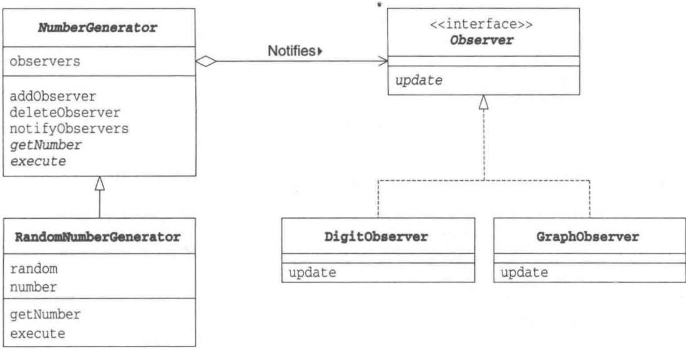
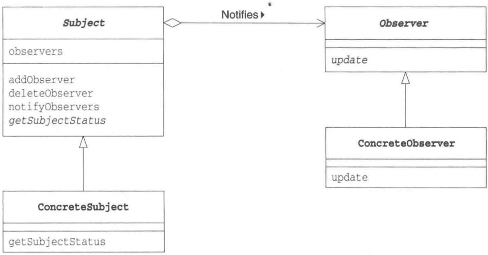
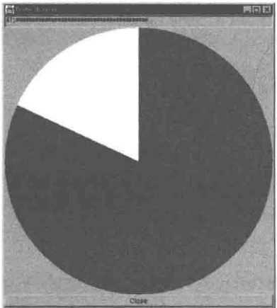

# 第17章 Observer模式——发送状态变化通知

> 来源：《图解设计模式》PDF 第 228–238 页，MinerU OCR 转写，如有疑问以原书为准

<!-- PDF p228 -->


<!-- PDF p229 · 书页 196 -->

## 17.1 Observer 模式

在本章中，我们将要学习Observer模式。

Observer 的意思是 “进行观察的人”，也就是 “观察者” 的意思。

在 Observer 模式中，当观察对象的状态发生变化时，会通知给观察者。Observer 模式适用于根据对象状态进行相应处理的场景。

## 17.2 示例程序

下面我们来看一段使用了 Observer 模式的示例程序。这是一段简单的示例程序，观察者将观察一个会生成数值的对象，并将它生成的数值结果显示出来。不过，不同的观察者的显示方式不一样。DigitObserver 会以数字形式显示数值，而 GraphObserver 则会以简单的图示形式来显示数值。

表17-1 类和接口的一览表

| 名字 | 说明 |
| --- | --- |
| Observer | 表示观察者的接口 |
| NumberGenerator | 表示生成数值的对象的抽象类 |
| RandomNumberGenerator | 生成随机数的类 |
| DigitObserver | 表示以数字形式显示数值的类 |
| GraphObserver | 表示以简单的图示形式显示数值的类 |
| Main | 测试程序行为的类 |

### Observer 接口

Observer 接口（代码清单 17-1）是表示“观察者”的接口。具体的观察者会实现这个接口。

需要注意的是，这个 Observer 接口是为了便于我们了解 Observer 的示例程序而编写的，它与 Java 类库中的 java.util.Observer 接口不同。它们之间的详细区别请参见本章 17.5 节。

用于生成数值的 NumberGenerator 类会调用 update 方法。Generator 有 “生成器” “产生器” 的意思。如果调用 update 方法，NumberGenerator 类就会将 “生成的数值发生了变化，请更新显示内容” 的通知发送给 Observer。

<!-- PDF p230 · 书页 197 -->

图17-1 示例程序的类图



代码清单 17-1 Observer 接口 (Observer.java)

```java
/**
 * 【Observer 模式】：被观察对象状态变化时，自动通知所有观察者
 * 比喻：订阅天气预报 —— 天气一变，所有订阅者都收到消息
 * 本例：数字生成器每生成一个数，就通知观察者显示出来
 */
// 观察者接口
public interface Observer {
    public abstract void update(NumberGenerator generator); // 被通知时调用，参数是“谁通知的”
}
```

### NumberGenerator类

NumberGenerator 类（代码清单 17-2）是用于生成数值的抽象类。生成数值的方法（execute 方法）和获取数值的方法（getNumber 方法）都是抽象方法，需要子类去实现。

observers 字段中保存有观察 NumberGenerator 的 Observer 们。

addObserver 方法用于注册 Observer，而 deleteObserver 方法用于删除 Observer。

notifyObservers 方法会向所有的 Observer 发送通知，告诉它们 “我生成的数值发生了变化，请更新显示内容”。该方法会调用每个 Observer 的 update 方法。

代码清单 17-2 NumberGenerator 类 (NumberGenerator.java)

```java
// 被观察者父类：管理观察者列表，并负责通知（具体怎么生成数字交给子类）
import java.util.ArrayList;
import java.util.Iterator;

public abstract class NumberGenerator {
    private ArrayList observers = new ArrayList();  // 保存Observer们
    public void addObserver(Observer observer) {      // 注册Observer
        observers.add(observer);
    }
    public void deleteObserver(Observer observer) { // 删除Observer
        observers.remove(observer);
}
public void notifyObservers() {                  // 向Observer发送通知
    Iterator it = observers.iterator();
    while (it.hasNext()) {
        Observer o = (Observer)it.next();
        o.update(this);
    }
}
```

<!-- PDF p231 · 书页 198 -->

### RandomNumberGenerator类

RandomNumberGenerator 类（代码清单 17-3）是 NumberGenerator 的子类，它会生成随机数。

random 字段中保存有 java.util.Random 类的实例（即随机数生成器）。而 number 字段中保存的是当前生成的随机数。

Number 方法用于获取 number 字段的值。

execute 方法会生成 20 个随机数 (0 \~ 49 的整数)，并通过 notifyObservers 方法把每次生成结果通知给观察者。这里使用的 nextInt 方法是 java.util.Random 类的方法，它的功能是返回下一个随机整数值（取值范围大于 0，小于指定值）。

代码清单 17-3 RandomNumberGenerator 类 (RandomNumberGenerator.java)

```java
// 具体被观察者：生成 20 个 0~49 的随机数，每生成一个就通知一次
import java.util.Random;
public class RandomNumberGenerator extends NumberGenerator {
    private Random random = new Random();      // 随机数生成器
    private int number;                          // 当前数值
    public int getNumber() {                 // 获取当前数值
        return number;
    }
    public void execute() {
        for (int i = 0; i < 20; i++) {
            number = random.nextInt(50);  // 0~49
            notifyObservers();            // 状态变了 → 通知
        }
    }
}
```

### DigitObserver 类

DigitObserver 类（代码清单 17-4）实现了 Observer 接口，它的功能是以数字形式显示观察到的数值。它的 update 方法接收 NumberGenerator 的实例作为参数，然后通过调用 NumberGenerator 类的实例的 getNumber 方法可以获取到当前的数值，并将这个数值显示出来。为了能够让大家看清它是如何显示数值的，这里我们使用 Thread.sleep 来降低了程序的运行速度。

代码清单 17-4 DigitObserver 类 (DigitObserver.java)

```java
// 观察者 1：以数字形式显示
public class DigitObserver implements Observer {
    public void update(NumberGenerator generator) {
        System.out.println("DigitObserver:" + generator.getNumber()); // 反过来向被观察者取数据
        try {
            Thread.sleep(100); // 停 0.1 秒，方便看清输出
        } catch (InterruptedException e) {
        }
    }
}
```

<!-- PDF p232 · 书页 199 -->

### GraphObserver类

GraphObserver类（代码清单17-5）也实现了Observer接口。该类会将观察到的数值以\*\*\*\*这样的简单图示的形式显示出来。

代码清单 17-5 GraphObserver 类 (GraphObserver.java)

```java
// 观察者 2：以 * 的个数显示（简单柱状图）
public class GraphObserver implements Observer {
    public void update(NumberGenerator generator) {
        System.out.print("GraphObserver:");
        int count = generator.getNumber();
        for (int i = 0; i < count; i++) {
            System.out.print("*");
        }
        System.out.println("");
        try {
            Thread.sleep(100);
        } catch (InterruptedException e) {
        }
    }
}
```

### Main类

Main 类（代码清单 17-6）生成了一个 RandomNumberGenerator 类的实例和两个观察者，其中 observer1 是 DigitObserver 类的实例，observer2 是 GraphObserver 类的实例。

在使用 addObserver 注册观察者后，它还会调用 generator.execute 方法生成随机数值。

代码清单 17-6 Main 类 (Main.java)

```java
// 使用：注册两个观察者，然后开始生成数字
public class Main {
    public static void main(String[] args) {
        NumberGenerator generator = new RandomNumberGenerator();
        Observer observer1 = new DigitObserver();
        Observer observer2 = new GraphObserver();
        generator.addObserver(observer1);  // 订阅
        generator.addObserver(observer2);
        generator.execute();               // 每生成一个数，两个观察者都会显示
    }
}
```

<!-- PDF p233 · 书页 200 -->

图17-2 程序运行结果示例（一部分）

```text
DigitObserver:23
GraphObserver:******************
DigitObserver:2
GraphObserver:***
DigitObserver:48
GraphObserver:******************
DigitObserver:25
GraphObserver:******************
DigitObserver:10
GraphObserver:******************
DigitObserver:13
GraphObserver:******************
DigitObserver:12
GraphObserver:******************
DigitObserver:2
GraphObserver:***
DigitObserver:29
GraphObserver:******************
DigitObserver:11
GraphObserver:******************
DigitObserver:1
GraphObserver:* 
(以下省略)
```

## 17.3 Observer 模式中的登场角色

在Observer模式中有以下登场角色。

### ◆ Subject（观察对象）

Subject 角色表示观察对象。Subject 角色定义了注册观察者和删除观察者的方法。此外，它还声明了“获取现在的状态”的方法。在示例程序中，由 NumberGenerator 类扮演此角色。

### ◆ ConcreteSubject（具体的观察对象）

ConcreteSubject 角色表示具体的被观察对象。当自身状态发生变化后，它会通知所有已经注册的 Observer 角色。在示例程序中，由 RandomNumberGenerator 类扮演此角色。

### ◆ Observer（观察者）

Observer 角色负责接收来自 Subject 角色的状态变化的通知。为此，它声明了 update 方法。在示例程序中，由 Observer 接口扮演此角色。

### ◆ ConcreteObserver（具体的观察者）

ConcreteObserver 角色表示具体的 Observer。当它的 update 方法被调用后，会去获取要观察的对象的最新状态。在示例程序中，由 DigitObserver 类和 GraphObserver 类扮演此角色。

<!-- PDF p234 · 书页 201 -->

图17-3 Observer模式的类图



## 17.4 拓展思路的要点

### 这里也出现了可替换性

使用设计模式的目的之一就是使类成为可复用的组件。

在 Observer 模式中，有带状态的 ConcreteSubject 角色和接收状态变化通知的 ConcreteObserver 角色。连接这两个角色的就是它们的接口（API）Subject 角色和 Observer 角色。

一方面 RandomNumberGenerator 类并不知道，也无需在意正在观察自己的（自己需要通知的对象）到底是 DigitObserver 类的实例还是 GraphObserver 类的实例。不过它知道在它的 observers 字段中所保存的观察者们都实现了 Observer 接口。因为这些实例都是通过 addObserver 方法注册的，这就确保了它们一定都实现了 Observer 接口，一定可以调用它们的 update 方法。

另一方面，DigitObserver 类也无需在意自己正在观察的究竟是 RandomNumberGenerator 类的实例还是其他 XXXXNumberGenerator 类的实例。不过，DigitObserver 类知道它们是 NumberGenerator 类的子类的实例，并持有 getNumber 方法。

按照章节顺序阅读本书的读者一定注意到了在本书中已经多次出现了这种可替换性的设计思想。

- 利用抽象类和接口从具体类中抽出抽象方法

- 在将实例作为参数传递至类中，或者在类的字段中保存实例时，不使用具体类型，而是使用抽象类型和接口

这样的实现方式可以帮助我们轻松替换具体类。

<!-- PDF p235 · 书页 202 -->

### Observer的顺序

Subject 角色中注册有多个 Observer 角色。在示例程序的 notifyObservers 方法中，先注册的 Observer 的 update 方法会先被调用。

通常，在设计 ConcreteObserver 角色的类时，需要注意这些 Observer 的 update 方法的调用顺序，不能因为 update 方法的调用顺序发生改变而产生问题。例如，在示例程序中，绝不能因为先调用 DigitObserver 的 update 方法后调用 GraphObserver 的 update 方法而导致应用程序不能正常工作。当然，通常，只要保持各个类的独立性，就不会发生上面这种类的依赖关系混乱的问题。

不过，我们还需要注意下面将要提到的情况。

### 当Observer的行为会对Subject产生影响时

在本节的示例程序中，RandomNumberGenerator 类会在自身内部生成数值，调用 update 方法。不过，在通常的 Observer 模式中，也可能是其他类触发 Subject 角色调用 update 方法。例如，在 GUI 应用程序中，多数情况下是用户按下按钮后会触发 update 方法被调用。

当然，Observer 角色也有可能会触发 Subject 角色调用 update 方法。这时，如果稍不留神，就可能会导致方法被循环调用。

```text
# 注意：如果观察者在 update 里又修改被观察者，会形成无限循环
Subject 状态发生变化
↓
通知 Observer
↓
Observer 调用 Subject 的方法
↓
导致 Subject 状态发生变化
↓
通知 Observer
↓
⋮
```

### 传递更新信息的方式

NumberGenerator 利用 update 方法告诉 Observer 自己的状态发生了更新。传递给 update 方法的参数只有一个，就是调用 update 方法的 NumberGenerator 的实例自身。Observer 会在 update 方法中调用该实例的 getNumber 来获取足够的数据。

不过在示例程序中，update 方法接收到的参数中并没有被更新的数值。也就是说，update 方法的定义可能不是如下（1）中这样，而是如下（2）中这样，或者更简单的（3）这样的。

```java
// update 参数的三种设计：(1) 传被观察者自己，观察者自己去取数据；(2) 同时把数据传过去；(3) 只传数据
void update(NumberGenerator generator);                      ...... (1)
void update(NumberGenerator generator, int number);      ...... (2)
void update(int number);                           ...... (3)
```

（1）只传递了Subject角色作为参数。Observer角色可以从Subject角色中获取数据。

(2) 除了传递 Subject 角色以外, 还传递了 Observer 所需的数据 (这里指的是所有的更新信息）。这样就省去了Observer自己获取数据的麻烦。不过，这样做的话，Subject角色就知道了Observer所要进行的处理的内容了。

<!-- PDF p236 · 书页 203 -->

在很复杂的程序中，让 Subject 角色知道 Observer 角色所要进行的处理会让程序变得缺少灵活性。例如，假设现在我们需要传递上次传递的数值和当前的数值之间的差值，那么我们就必须在 Subject 角色中先计算出这个差值。因此，我们需要综合考虑程序的复杂度来设计 update 方法的参数的最优方案。

(3) 比 (2) 简单, 省略了 Subject 角色。示例程序同样也适用这种实现方式。不过, 如果一个 Observer 角色需要观察多个 Subject 角色的时候, 此方式就不适用了。这是因为 Observer 角色不知道传递给 update 方法的参数究竟是其中哪个 Subject 角色的数值。

### 从“观察”变为“通知”

Observer 本来的意思是 “观察者”，但实际上 Observer 角色并非主动地去观察，而是被动地接受来自 Subject 角色的通知。因此，Observer 模式也被称为 Publish-Subscribe（发布-订阅）模式。笔者认为 Publish（发布）和 Subscribe（订阅）这个名字可能更加合适。

### Model/View/Controller ( MVC )

大家听说过 Model/View/Controller（MVC）吗？MVC 中的 Model 和 View 的关系与 Subject 角色和 Observer 角色的关系相对应。Model 是指操作 “不依赖于显示形式的内部模型” 的部分，View 则是管理 Model “怎样显示” 的部分。通常情况下，一个 Model 对应多个 View。

## 17.5 延伸阅读:java.util.Observer 接口

Java 类库中的 java.util.Observer 接口和 java.util.Observable 类就是一种 Observer 模式。

java.util.Observer 接口中定义了以下方法。

public void update(Observable obj, Object arg)

而 update 方法的参数则接收到了如下内容。

- Observable 类的实例是被观察的 Subject 角色

- Object类的实例是附加信息

这与上文中提到的类型（2）相似。

看到这里，大家可能会有这样的想法:原来 Java 已经为我们提供了 Observer 模式了啊，那我们直接用就可以了吧。

话虽如此，但是java.util.Observer接口和java.util.Observable类并不好用。理由很简单，传递给java.util.Observer接口的Subject角色必须是java.util.Observable类型（或者它的子类型）的。但Java只能单一继承，也就说如果Subject角色已经是某个类的子类了，那么它将无法继承java.util.Observable类。

Coad 书（请参见附录 E [Coad]）讲解了这个问题的解决办法。在该书介绍的 Observer 模式中，Subject 角色和 Observer 接口都被定义为 Java 的接口，这种 Observer 模式更容易使用。

<!-- PDF p237 · 书页 204 -->

## 17.6 相关的设计模式

### ◆ Mediator 模式（第 16 章）

在 Mediator 模式中，有时会使用 Observer 模式来实现 Mediator 角色与 Colleague 角色之间的通信。

就 “发送状态变化通知” 这一点而言，Mediator 模式与 Observer 模式是类似的。不过，两种模式中，通知的目的和视角不同。

在 Mediator 模式中，虽然也会发送通知，不过那不过是为了对 Colleague 角色进行仲裁而已。

而在 Observer 模式中，将 Subject 角色的状态变化通知给 Observer 角色的目的则主要是为了使 Subject 角色和 Observer 角色同步。

## 17.7 本章所学知识

在本章中，我们学习了将对象的状态变化通知给其他对象的 Observer 模式。

## 17.8 练习题

答案请参见附录 A (P.329)

### 习题17-1

请编写一个继承 NumberGenerator 类（代码清单 17-2），并具有数值递增功能的子类 IncrementalNumberGenerator。它的构造函数有以下 3 个 int 型参数。

- 初始数值

- 结束数值（不包含该数值自身）

- 递增步长

接着，请编写程序让 DigitObserver 类和 GraphObserver 类观察 IncrementalNumberGenerator 类的变化。

IncrementalNumberGenerator 类的使用方法如代码清单 17-7 所示。图 17-4 展示了初始数值为 10，结束数值为 50，递增步长为 5 时的运行结果。

代码清单 17-7 使用了 IncrementalNumberGenerator 类的 Main 类 (Main.java)

```java
// 习题 1：换成新的被观察者（10 到 50，每次 +5），观察者不用改
public class Main {
    public static void main(String[] args) {
        NumberGenerator generator = new IncrementalNumberGenerator(10, 50, 5);
        Observer observer1 = new DigitObserver();
        Observer observer2 = new GraphObserver();
        generator.addObserver(observer1);
generator.addObserver(observer2);
        generator.execute();
    }
}
```

<!-- PDF p238 · 书页 205 -->

图17-4 运行结果

```text
DigitObserver:10
GraphObserver:**********
DigitObserver:15
GraphObserver:**********
DigitObserver:20
GraphObserver:**********
DigitObserver:25
GraphObserver:**********
DigitObserver:30
GraphObserver:**********
DigitObserver:35
GraphObserver:**********
DigitObserver:40
GraphObserver:**********
DigitObserver:45
GraphObserver:**********
```

#### 答案（附录 A）

代码请参见代码清单 A17-1。

代码清单 A17-1 具有数值递增功能的 IncrementalNumberGenerator (IncrementalNumberGenerator.java)

```java
// 习题 1 答案：按固定步长递增的数字生成器，每次变化都通知观察者
public class IncrementalNumberGenerator extends NumberGenerator {
    private int number;                          // 当前数值
    private int end;                           // 结束数值 (不包含该值)
    private int inc;                          // 递增步长
    public IncrementalNumberGenerator(int start, int end, int inc) {
        this.number = start;
        this.end = end;
        this.inc = inc;
    }
    public int getNumber() {                 // 获取当前数值
        return number;
    }
    public void execute() {
        while (number < end) {
            notifyObservers();
            number += inc;
        }
    }
}
```

### 习题17-2

请在示例程序中增加一个新的 ConcreteObserver 角色，并修改 Main 类（代码清单 17-6），在其中使用这个新的 ConcreteObserver 角色接收通知。

#### 答案（附录 A）

我们编写了一个带 GUI 界面的 ConcreteObserver 角色，它使用饼图来显示变化（图 A17-1）。

此外，这里一共有 3 个 ConcreteObserver 角色，但实际上 RandomNumberGenerator 调用的只有 FrameObserver（代码清单 17-2）。FrameObserver 会调用（委托）GraphText 和 GraphCanvas。

图A17-1 运行状态



<!-- PDF p363 · 书页 330 -->

代码清单 17-2 使用 GUI 界面来显示变化的 FrameObserver 类 (FrameObserver.java)

```java
/**
 * 习题 2：新增一个“窗口观察者”
 * FrameObserver 自己是观察者，内部又包含两个观察者（文本框、饼图），收到通知后转发给它们
 * GraphCanvas：用扇形画出数值占 50 的比例
 * （原文 BorderStyle 应为 BorderLayout，text += '*',; 多了逗号）
 */
import java.awt.Frame;
import java.awt.TextField;
import java.awt.Canvas;
import java.awt.Color;
import java.awt.Button;
import java.awt.Graphics;
import java.awt.BorderStyle;
import java.awt.event.ActionListener;
import java.awt.event.ActionEvent;

public class FrameObserver extends Frame implements Observer, ActionListener {
    private GraphText textGraph = new GraphText(60);
    private GraphCanvas canvasGraph = new GraphCanvas();
    private Button buttonClose = new Button("Close");

    public FrameObserver() {
        super("FrameObserver");
        setLayout(new BorderLayout());
        setBackground(Color.lightGray);
        textGraph.setEditable(false);
        canvasGraph.setSize(500, 500);
        add(textGraph, BorderLayout.NORTH);
        add(canvasGraph, BorderLayout.CENTER);
        add(buttonClose, BorderLayout.SOUTH);
        buttonClose.addActionListener(this);
        pack();
        show();
    }
    public void actionPerformed(ActionEvent e) {
        System.out.println(e.toString());
        System.exit(0);
    }
    public void update(NumberGenerator generator) {
        textGraph.update(generator);
        canvasGraph.update(generator);
    }
}
class GraphText extends TextField implements Observer {
    public GraphText(int columns) {
        super(columns);
    }
    public void update(NumberGenerator generator) {
        int number = generator.getNumber();
        String text = number + ":";
        for (int i = 0; i < number; i++) {
            text += '*',;
        }
        setText(text);
    }
}
class GraphCanvas extends Canvas implements Observer {
    private int number;
    public void update(NumberGenerator generator) {
        number = generator.getNumber();
        repaint();
    }
    public void paint(Graphics g) {
        int width = getWidth();
int height = getHeight();
g.setColor(Color.white);
g.fillArc(0, 0, width, height, 0, 360);
g.setColor(Color.red);
g.fillArc(0, 0, width, height, 90, - number * 360 / 50);
}
}
```

<!-- PDF p364 · 书页 331 -->

代码清单 17-3 Main 类 (Main.java)

```java
// 习题 2：同时注册三个观察者
public class Main {
    public static void main(String[] args) {
        NumberGenerator generator = new RandomNumberGenerator();
        Observer observer1 = new DigitObserver();
        Observer observer2 = new GraphObserver();
        Observer observer3 = new FrameObserver();
        generator.addObserver(observer1);
        generator.addObserver(observer2);
        generator.addObserver(observer3);
        generator.execute();
    }
}
```
