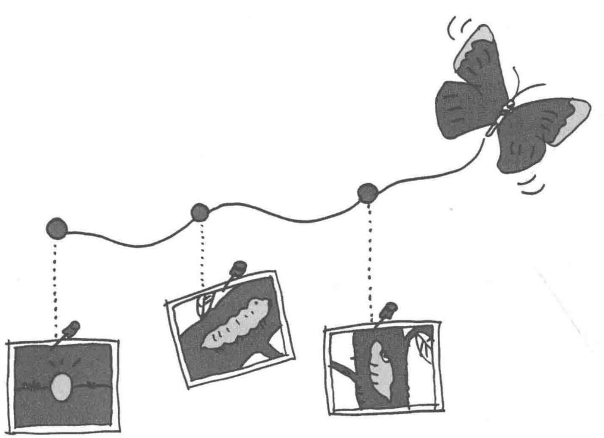
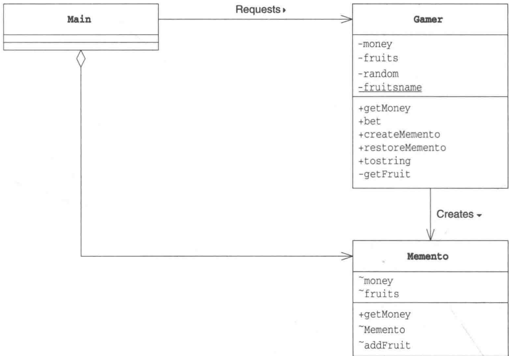
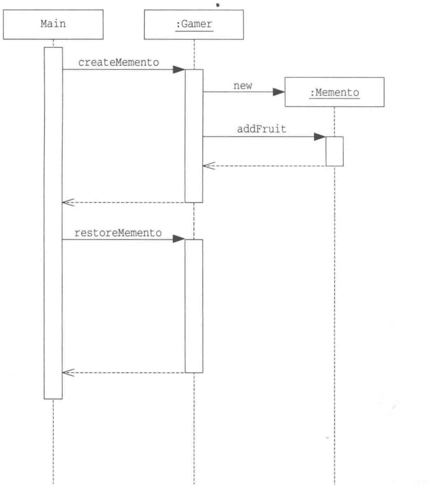
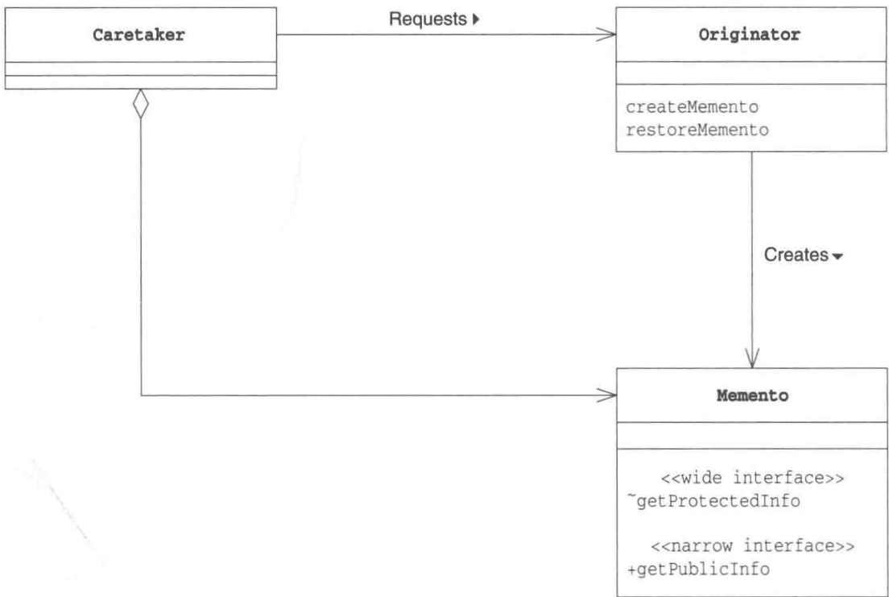

# 第18章 Memento模式——保存对象状态

> 来源：《图解设计模式》PDF 第 240–252 页，MinerU OCR 转写，如有疑问以原书为准

<!-- PDF p240 -->



<!-- PDF p241 · 书页 208 -->

## 18.1 Memento 模式

我们在使用文本编辑器编写文件时，如果不小心删除了某句话，可以通过撤销（undo）功能将文件恢复至之前的状态。有些文本编辑器甚至支持多次撤销，能够恢复至很久之前的版本。

使用面向对象编程的方式实现撤销功能时，需要事先保存实例的相关状态信息。然后，在撤销时，还需要根据所保存的信息将实例恢复至原来的状态。

要想恢复实例，需要一个可以自由访问实例内部结构的权限。但是，如果稍不注意，又可能会将依赖于实例内部结构的代码分散地编写在程序中的各个地方，导致程序变得难以维护。这种情况就叫作“破坏了封装性”。

通过引入表示实例状态的角色，可以在保存和恢复实例时有效地防止对象的封装性遭到破坏。这就是我们在本章中要学习的 Memento 模式。

使用Memento模式可以实现应用程序的以下功能。

- Undo（撤销）

- Redo（重做）

- History（历史记录）

- Snapshot（快照）

Memento 有 “纪念品” “遗物” “备忘录” 的意思。

当大家从抽屉中拿出让人怀念的照片时，肯定会感慨万千，感觉仿佛又回到了照片中的那个时候。Memento 模式就是一个这样的设计模式，它事先将某个时间点的实例的状态保存下来，之后在有必要时，再将实例恢复至当时的状态。

## 18.2 示例程序

下面我们来看一段使用了 Memento 模式的示例程序。这是一个收集水果和获取金钱数的掷骰子游戏，游戏规则很简单，具体如下。

- 游戏是自动进行的

- 游戏的主人公通过掷骰子来决定下一个状态

- 当骰子点数为1的时候，主人公的金钱会增加

- 当骰子点数为2的时候，主人公的金钱会减少

- 当骰子点数为6的时候，主人公会得到水果

- 主人公没有钱时游戏就会结束

在程序中，如果金钱增加，为了方便将来恢复状态，我们会生成 Memento 类的实例，将现在的状态保存起来。所保存的数据为当前持有的金钱和水果。如果不断掷出了会导致金钱减少的点数，为了防止金钱变为 0 而结束游戏，我们会使用 Memento 的实例将游戏恢复至之前的状态。

下面，我们将通过这个小游戏来学习Memento模式。

<!-- PDF p242 · 书页 209 -->

表 18-1 类的一览表

| 包 | 名字 | 说明 |
| --- | --- | --- |
| game | Memento | 表示Gamer状态的类 |
| game | Gamer | 表示游戏主人公的类。它会生成Memento的实例 |
| 无名 | Main | 进行游戏的类。它会事先保存Memento的实例,之后会根据需要恢复Gamer的状态 |

图18-1 示例程序的类图



### Memento 类

Memento 类（代码清单 18-1）是表示 Gamer（主人公）状态的类。

Memento 类和 Gamer 类都位于 game 包下。

Memento 类中有两个字段，即 money 和 fruits。money 表示主人公现在所持有的金钱数目，fruits 表示现在为止所获得的水果。之所以没有将 money 和 fruits 的可见性设为 private，是因为我们希望同在 game 包下的 Gamer 类可以访问这两个字段。

getMoney 方法的作用是获取主人公当前所持有的金钱数目。

Memento 类的构造函数的可见性并非 public，因此并不是任何其他类都可以生成 Memento 类的实例。只有在同一个包（本例中是 game 包）下的其他类才能调用 Memento 类的构造函数。具体来说，只有 game 包下的 Gamer 类才能生成 Memento 类的实例。

addFruit 方法用于添加所获得的水果。该方法的可见性也不是 public。这是因为只有同一个包下的其他类才能添加水果。因此，无法从 game 包外部改变 Memento 内部的状态。

此外，Memento 类中有 “narrow interface” 和 “wide interface” 这样的注释。关于这一点，稍后本章18.3一节会做详细说明。

<!-- PDF p243 · 书页 210 -->

代码清单 18-1 Memento 类 (Memento.java)

```java
/**
 * 【Memento 模式】：保存对象某一时刻的状态，之后可以恢复（类似游戏存档 / 撤销）
 * Memento：存档，记录金钱和水果
 * 两种接口：
 * - narrow interface（窄接口，public）：外部只能看金钱
 * - wide interface（宽接口，包内可见）：只有同包的 Gamer 能读写全部内容 → 保护存档不被外部篡改
 */
package game;
import java.util.*;

public class Memento {
    int money;                          // 所持金钱
    ArrayList fruits;                   // 获得的水果
    public int getMoney() {             // 获取当前所持金钱 (narrow interface)
        return money;
    }
    Memento(int money) {                 // 构造函数 (wide interface)
        this.money = money;
        this.fruits = new ArrayList();
    }
    void addFruit(String fruit) {         // 添加水果 (wide interface)
        fruits.add(fruit);
    }
    List getFruits() {                  // 获取当前所持所有水果 (wide interface)
        return (List)fruits.clone();
    }
}
```

### Gamer类

Gamer 类（代码清单 18-2）是表示游戏主人公的类。它有 3 个字段，即所持金钱（money）、获得的水果（fruits）以及一个随机数生成器（random）。而且还有一个名为 fruitsname 的静态字段。

进行游戏的主要方法是 bet 方法。在该方法中，只要主人公没有破产，就会一直掷骰子，并根据骰子结果改变所持有的金钱数目和水果个数。

createMemento 方法的作用是保存当前的状态（拍摄快照）。在 createMemento 方法中，会根据当前在时间点所持有的金钱和水果生成一个 Memento 类的实例，该实例代表了“当前 Gamer 的状态”，它会被返回给调用者。就如同给对象照了张照片一样，我们将对象现在的状态封存在 Memento 类的实例中。请注意我们只保存了“好吃”的水果。

restoreMemento 方法的功能与 createMemento 相反，它会根据接收到的 Memento 类的实例来将 Gamer 恢复为以前的状态，仿佛是在游戏中念了一通“复活咒语”一样。

代码清单18-2 Gamer类（Gamer.java）

```java
/**
 * 主人公 Gamer：掷骰子玩游戏
 * 1 点 → 钱 +100；2 点 → 钱减半；6 点 → 得到水果；其他 → 什么都不发生
 * createMemento()：生成存档（只保存“好吃的”水果）
 * restoreMemento()：从存档恢复
 */
package game;
import java.util.*;

public class Gamer {
    private int money;                     // 所持金钱
    private List fruits = new ArrayList();      // 获得的水果
    private Random random = new Random();       // 随机数生成器
    private static String[] fruitsname = {        // 表示水果种类的数组
        "苹果", "葡萄", "香蕉", "橘子",
    };
    public Gamer(int money) {                   // 构造函数
        this.money = money;
}
public int getMoney() {
    return money;
}
public void bet() {
    int dice = random.nextInt(6) + 1;
    if (dice == 1) {
        money += 100;
        System.out.println("所持金钱增加了。");
    } else if (dice == 2) {
        money /= 2;
        System.out.println("所持金钱减半了。");
    } else if (dice == 6) {
        String f = getFruit();
        System.out.println("获得了水果 (" + f + ")。");
        fruits.add(f);
    } else {
        System.out.println("什么都没有发生。");
    }
}
public Memento createMemento() {
    Memento m = new Memento(money);
    Iterator it = fruits.iterator();
    while (it.hasNext()) {
        String f = (String)it.next();
        if (f.startsWith("好吃的")) {
            m.addFruit(f);
        }
    }
    return m;
}
public void restoreMemento(Memento memento) {
    this.money = memento.money;
    this.fruits = memento.getFruits();
}
public String toString() {
    return "[money = " + money + ", fruits = " + fruits + "]";
}
private String getFruit() {
    String prefix = "";
    if (random.nextBoolean()) {
        prefix = "好吃的";
    }
    return prefix + fruitsname[random.nextInt(fruitsname.length)];
}
```

<!-- PDF p244 · 书页 211 -->

### Main类

Main 类（代码清单 18-3）生成了一个 Gamer 类的实例并进行游戏。它会重复调用 Gamer 的 bet 方法，并显示 Gamer 的所持金钱。

到目前为止，这只是普通的掷骰子游戏，接下来我们来引入 Memento 模式。在变量 memento 中保存了“某个时间点的 Gamer 的状态”。如果运气很好，金钱增加了，会调用 createMemento 方法保存现在的状态；如果运气不好，金钱不足了，就会调用 restoreMemento 方法将钱还给 memento。

<!-- PDF p245 · 书页 212 -->

图 18-2 展示了 Main 类调用 createMemento 方法和 restoreMemento 方法的情况。

代码清单 18-3 Main 类 (Main.java)

```java
// 使用：玩 100 轮；钱比存档多 → 存档；钱少于存档的一半 → 读档恢复
// Main 只能用窄接口 getMoney()，看不到也改不了存档里的水果
import game.Memento;
import game.Gamer;

public class Main {
    public static void main(String[] args) {
        Gamer gamer = new Gamer(100);                      // 最初的所持金钱数为 100
        Memento memento = gamer.createMemento();          // 保存最初的状态
        for (int i = 0; i < 100; i++) {
            System.out.println("====" + i);               // 显示掷骰子的次数
            System.out.println("当前状态:" + gamer);      // 显示主人公现在的状态

            gamer.bet();       // 进行游戏

            System.out.println("所持金钱为 " + gamer.getMoney() + " 元。");
            // 决定如何处理 Memento
            if (gamer.getMoney() > memento.getMoney()) {
                System.out.println("      (所持金钱增加了许多, 因此保存游戏当前的状态) ");
                memento = gamer.createMemento();
            } else if (gamer.getMoney() < memento.getMoney() / 2) {
                System.out.println("      (所持金钱减少了许多, 因此将游戏恢复至以前的状态) ");
                gamer.restoreMemento(memento);
            }

            // 等待一段时间
            try {
                Thread.sleep(1000);
            } catch (InterruptedException e) {
            }
            System.out.println("");
        }
    }
}
```

<!-- PDF p246 · 书页 213 -->

图18-2 示例程序的时序图



<!-- PDF p247 · 书页 214 -->

图18-3 运行结果示例（一部分）

```text
==== 0
当前状态：[money = 100, fruits = []]
什么都没有发生。
所持金钱为100元。

==== 1
当前状态：[money = 100, fruits = []]
什么都没有发生。
所持金钱为100元。

==== 2
当前状态：[money = 100, fruits = []]
获得了水果（好吃的葡萄）
所持金钱为100元。

==== 3
当前状态：[money = 100, fruits = [好吃的葡萄]]
什么都没有发生。
所持金钱为100元。

==== 4
当前状态：[money = 100, fruits = [好吃的葡萄]]
获得了水果（葡萄）。
所持金钱为100元。

==== 5
当前状态：[money = 100, fruits = [好吃的葡萄，葡萄]]
所持金钱增加了。
所持金钱为200元。
（所持金钱增加了许多，因此保存游戏当前的状态） ←生成Memento
（中间省略）

==== 13
当前状态：[money = 300, fruits = [好吃的葡萄，葡萄，好吃的橘子]]
所持金钱增加了。
所持金钱为400元。
（所持金钱增加了许多，因此保存游戏当前的状态） ←生成Memento
（中间省略）

==== 21
当前状态：[money = 200, fruits = [好吃的葡萄，葡萄，好吃的橘子]]
什么都没有发生。
所持金钱为200元。

==== 22
当前状态：[money = 200, fruits = [好吃的葡萄，葡萄，好吃的橘子]]
所持金钱减半了。
所持金钱为100元。
（所持金钱减少了许多，因此将游戏恢复至以前的状态） ←根据Memento恢复状态
==== 23
当前状态：[money = 400, fruits = [好吃的葡萄，好吃的橘子]]
什么都没有发生。
所持金钱为400元。

（以下省略）
```

<!-- PDF p248 · 书页 215 -->

## 18.3 Memento 模式中的登场角色

在Memento模式中有以下登场角色。

### ◆ Originator（生成者）

Originator 角色会在保存自己的最新状态时生成 Memento 角色。当把以前保存的 Memento 角色传递给 Originator 角色时，它会将自己恢复至生成该 Memento 角色时的状态。在示例程序中，由 Gamer 类扮演此角色。

### ◆ Memento（纪念品）

Memento 角色会将 Originator 角色的内部信息整合在一起。在 Memento 角色中虽然保存了 Originator 角色的信息，但它不会向外部公开这些信息。

Memento 角色有以下两种接口（API）。

- wide interface——宽接口（API）

Memento 角色提供的 “宽接口（API）” 是指所有用于获取恢复对象状态信息的方法的集合。由于宽接口（API）会暴露所有 Memento 角色的内部信息，因此能够使用宽接口（API）的只有 Originator 角色。

- narrowinterface——窄接口（API）

Memento 角色为外部的 Caretaker 角色提供了 “窄接口（API）”。可以通过窄接口（API）获取的 Memento 角色的内部信息非常有限，因此可以有效地防止信息泄露。

通过对外提供以上两种接口（API），可以有效地防止对象的封装性被破坏。

在示例程序中，由Memento类扮演此角色。

Originator 角色和 Memento 角色之间有着非常紧密的联系。

### ◆ Caretaker（负责人）

当 Caretaker 角色想要保存当前的 Originator 角色的状态时，会通知 Originator 角色。Originator 角色在接收到通知后会生成 Memento 角色的实例并将其返回给 Caretaker 角色。由于以后可能会用 Memento 实例来将 Originator 恢复至原来的状态，因此 Caretaker 角色会一直保存 Memento 实例。在示例程序中，由 Main 类扮演此角色。

不过，Caretaker 角色只能使用 Memento 角色两种接口（API）中的窄接口（API），也就是说它无法访问 Memento 角色内部的所有信息。它只是将 Originator 角色生成的 Memento 角色当作一个黑盒子保存起来。

虽然 Originator 角色和 Memento 角色之间是强关联关系，但 Caretaker 角色和 Memento 角色之间是弱关联关系。Memento 角色对 Caretaker 角色隐藏了自身的内部信息。

<!-- PDF p249 · 书页 216 -->

图18-4 Memento模式的类图



## 18.4 拓展思路的要点

### 两种接口（API）和可见性

为了能够实现 Memento 模式中的两套接口（API），我们利用了 Java 语言中的可见性。表 18-2 展示了 Java 语言提供的 4 种可见性。

表18-2 Java语言的可见性

| 可见性 | 说明 |
| --- | --- |
| public | 所有类都可以访问 |
| protected | 同一包中的类或是该类的子类可以访问 |
| 无 | 同一包中的类可以访问 |
| private | 只有该类自身可以访问 |

在 Memento 类的方法和字段中，有带 public 修饰符的，也有不带修饰符的。这表示设计者希望能够进行控制，从而使某些类可以访问这些方法和字段，而其他一些类则无法访问（表 18-3）。

表 18-3 在 Memento 类中使用到的可见性

| 可见性 | 字段方法构造函数 | 哪个类可以访问 |
| --- | --- | --- |
| 无 | money | Memento 类、Gamer 类 |
| 无 | fruits | Memento 类、Gamer 类 |

<!-- PDF p250 · 书页 217 -->

(续)

| 可见性 | 字段方法构造函数 | 哪个类可以访问 |
| --- | --- | --- |
| public | getMoney | Memento 类、Gamer 类、Main 类 |
| 无 | Memento | Memento 类、Gamer 类 |
| 无 | addFruit | Memento 类、Gamer 类 |

在 Memento 类中，只有 getMoney 方法是 public 的，它是一个窄接口（API），因此该方法也可以被扮演 Caretaker 角色的 Main 类调用。

这里做一下补充说明。明明该方法带有修饰符 public，但它却一个是窄接口（API），这不免让人感到有些奇怪。其实，这里所说的“窄”是指外部可以操作的类内部的内容很少。在 Memento 类的所有方法中，只有 getMoney 的可见性是 public 的。也就是说，扮演 Caretaker 角色的 Main 类可以获取的只有当前状态下的金钱数目而已。像这种“能够获取的信息非常少”的状态就是本章中“窄”的意思。

由于扮演 Caretaker 角色的 Main 类并不在 game 包下，所以它只能调用 public 的 getMoney 方法。因此，Main 类无法随意改变 Memento 类的状态。

还有一点需要注意的是，在 Main 类中 Memento 类的构造函数是无法访问的，这就意味着无法像下面这样生成 Memento 类的实例。

new Memento(100)

如果像这样编写了代码，在编译代码时编译器就会报错。如果 Main 类中需要用到 Memento 类的实例，可以通过调用 Gamer 类的 createMemento 方法告诉 Gamer 类 “我需要保存现在的状态，请生成一个 Memento 类的实例给我”。

如果我们在编程时需要实现“允许有些类访问这个方法，其他类则不能访问这个方法”这种需求，可以像上面这样使用可见性来控制访问权限。

### 需要多少个 Memento

在示例程序中，Main 类只保存了一个 Memento。如果在 Main 类中使用数组等集合，让它可以保存多个 Memento 类的实例，就可以实现保存各个时间点的对象的状态。

### Memento 的有效期限是多久

在示例程序中，我们是在内存中保存 Memento 的，这样并没有什么问题。但是正如我们在后面习题 18-4 中所提到的，如果要将 Memento 永远保存在文件中，就会出现有效期限的问题了。

这是因为，假设我们在某个时间点将 Memento 保存在文件中，之后又升级了应用程序版本，那么可能会出现原来保存的 Memento 与当前的应用程序不匹配的情况。

### 划分 Caretaker 角色和 Originator 角色的意义

读到这里，可能有读者会有这样的疑问:如果是要实现撤销功能，直接在 Originator 角色中实现不就好了吗？为什么要这么麻烦地引入 Memento 模式呢？

<!-- PDF p251 · 书页 218 -->

Caretaker 角色的职责是决定何时拍摄快照，何时撤销以及保存 Memento 角色。

另一方面，Originator 角色的职责则是生成 Memento 角色和使用接收到的 Memento 角色来恢复自己的状态。

以上就是 Caretaker 角色与 Originator 角色的职责分担。有了这样的职责分担，当我们需要对应以下需求变更时，就可以完全不用修改 Originator 角色。

- 变更为可以多次撤销

- 变更为不仅可以撤销，还可以将现在的状态保存在文件中

## 18.5 相关的设计模式

### ◆ Command 模式（第 22 章）

在使用 Command 模式处理命令时，可以使用 Memento 模式实现撤销功能。

### ◆ Protype 模式（第 6 章）

在 Memento 模式中，为了能够实现快照和撤销功能，保存了对象当前的状态。保存的信息只是在恢复状态时所需要的那部分信息。

而在 Protype 模式中，会生成一个与当前实例完全相同的另外一个实例。这两个实例的内容完全一样。

### ◆ State 模式（第 19 章）

在Memento模式中，是用“实例”表示状态。

而在State模式中，则是用“类”表示状态。

## 18.6 本章所学知识

在本章中，我们学习了记录和保存对象当前状态的 Memento 模式。此外，还讨论了在尽可能不公开对象内部状态的前提下保存对象状态的方法。

Caretaker 角色让 Originator 角色生成表示 “当前状态” 的 Memento 角色（类似纪念照），而 Caretaker 自己不知道也没有必要在意 Memento 角色的内部信息。为了将来能够恢复状态，Caretaker 角色会一直保存 Memento 角色。在必要时，它会从抽屉中取出 Memento 角色并将它交给 Originator 角色，让 Originator 角色恢复自身状态。这就是 Memento 模式。

此外，我们还学习了如何使用 public、protected、private 等修饰符来控制哪些信息可以被访问，哪些信息不能被访问。

## 18.7 练习题

答案请参见附录 A (P.331)

### 习题18-1

Caretaker 角色只能通过窄接口（API）来操作 Memento 角色。如果 Caretaker 角色可以随意地操作 Memento 角色，会发生什么问题呢？

<!-- PDF p252 · 书页 219 -->

#### 答案（附录 A）

这会导致 Caretaker 角色失去与 Originator 角色和 Memento 角色之间的独立性。

如果 Caretaker 角色可以随意地操作 Memento 角色，当要修改 Originator 角色内部的代码时，就必须要同样地修改 Caretaker 角色。

而如果 Caretaker 角色只能使用窄接口（API），只要不修改那个接口（API），就可以自由地修改 Originator 角色和 Memento 角色。

### 习题18-2

在示例程序中，游戏的状态仅由所持金钱和水果这两个项目来决定。如果在必须保存大量信息才能保存对象的状态时，为了能够保存 Memento 的实例，需要花费大量的内存空间或是磁盘空间。请思考一下有没有好的解决办法（本习题参考了 GoF 书（请参见附录 E[GoF]）。

#### 答案（附录 A）

如果计算一下与上次保存的 Memento 之间的差值，可能就可以以较少的内存空间保存数据。另外还有一种方法是将数据压缩后再保存，这样也可以减少所需的内存空间（我们将在习题 18-4 的答案中稍微接触一下数据压缩的例子）。

### 习题18-3

Java 假设在 Memento 类（代码清单 18-1）中加入了一个新的字段。

```text
int number;
```

现在我们需要加上如下可见性，应该怎么做呢？

- Memento 类可以获取和改变 number 的值

- Gamer类可以获取number的值，但不能改变它

- Main 类既不能获取也不能改变 number 的值

#### 答案（附录 A）

可以通过将 number 的可见性设置为 private，然后将获取 number 值的 getNumber 方法的可见性设置为默认（即不带 public、protected、private 修饰符）来实现习题中的需求。

```java
// 访问权限小知识：不写修饰符（包内可见）的方法，只有同一个包里的类能调用
public class Memento {
    ...
    private int number;
    ...

    int getNumber() {
        return number;
    }
}

Gamer 类可以通过 getNumber 方法获取 number 的值。
```

<!-- PDF p365 · 书页 332 -->

### 习题18-4

Java 使用序列化（Serialization）功能可以将 Memento 类的实例保存为文件。请修改示例程序以实现下列功能。

(1) 在应用程序启动时，如果发现不存在 game.dat 文件时，以所持金钱数目为 100 开始游戏

(2) 当所持金钱大量增加后，将 Memento 类的实例保存为文件 game.dat

(3) 在应用程序启动时, 如果发现 game.dat 已经存在, 则以文件中所保存的状态开始游戏

在修改示例程序时，可以参考以下提示信息。

(a) 要保存的 Memento 类需要实现 java.io.Serializable 接口

(b) 在保存对象状态时，需要调用 ObjectOutputStream 的 writeObject 方法

(c) 在恢复对象状态时，需要调用 ObjectInputStream 的 readObject 方法

(d) 详细信息请参考 Java 的 API 文档中的以下相关内容。

- java.io.ObjectOutputStream 类

- java.io.ObjectInputStream类

- java.io.ObjectOutput 接口

- java.io.ObjectInput 接口

#### 答案（附录 A）

代码请参见代码清单 A18-1、代码清单 A18-2。

代码清单 A18-1 对应序列化的 Memeto 类 (Memeto.java)

```java
// 习题：让存档能写到文件里 —— 实现 Serializable（可序列化）接口即可
package game;
import java.io.*;
import java.util.*;

public class Memento implements Serializable {
    int money;                          // 所持金钱
    ArrayList fruits;                   // 获得的水果
    public int getMoney() {             // 获取当前所持金钱 (narrow interface)
        return money;
    }
    Memento(int money) {                  // 构造函数 (wide interface)
        this.money = money;
        this.fruits = new ArrayList();
    }
    void addFruit(String fruit) {          // 添加水果 (wide interface)
        fruits.add(fruit);
    }
    List getFruits() {                   // 获取水果 (wide interface)
        return (List)fruits.clone();
    }
}
```

代码清单 A18-2 对应序列化的 Main 类 (Main.java)

```java
// 习题：启动时先尝试从文件读档（Main 上半部分）
public class Main {
    public static final String SAVEFILENAME = "game.dat";
    public static void main(String[] args) {
        Gamer gamer = new Gamer(100);                      // 最初的所持金钱数为 100
        Memento memento = loadMemento();                     // 从文件中读取起始状态
        if (memento != null) {
            System.out.println("读取上次保存存档开始游戏。");
            gamer.restoreMemento(memento);
        } else {
            System.out.println("新游戏。");
            memento = gamer.createMemento();
        }
        for (int i = 0; i < 100; i++) {
            System.out.println("====" + i);          // 显示次数
            System.out.println("当前状态:" + gamer);    // 显示当前主人公的状态
gamer.bet();    // 进行游戏

System.out.println("所持金钱为 " + gamer.getMoney() + " 元。");
```

<!-- PDF p366 · 书页 333 -->

```java
// 习题：存档时写文件；saveMemento / loadMemento 用对象流读写 Memento
// （原文 loadMemento 里 new ObjectOutputStream 为笔误，应为 ObjectInputStream）
// 决定如何处理 Memento
if (gamer.getMoney() > memento.getMoney()) {
    System.out.println("      (所持金钱增加了许多, 因此保存游戏当前的状态) ");
    memento = gamer.createMemento();
    saveMemento(memento);   // 保存至文件
} else if (gamer.getMoney() < memento.getMoney() / 2) {
    System.out.println("      (所持金钱减少了许多, 因此将游戏恢复至以前的状态 ");
    gamer.restoreMemento(memento);
}

// 等待一段时间
try {
    Thread.sleep(1000);
} catch (InterruptedException e) {
}
System.out.println("");
}
}
public static void saveMemento(Memento memento) {
    try {
        ObjectOutputStream out = new ObjectOutputStream(new FileOutputStream(SAVEFILENAME));
        out.writeObject(memento);
        out.close();
    } catch (IOException e) {
        e.printStackTrace();
    }
}
public static Memento loadMemento () {
    Memento memento = null;
    try {
        ObjectInput in = new ObjectOutputStream(new FileInputStream(SAVEFILENAME));
        memento = (Memento)in.readObject();
        in.close();
    } catch (FileNotFoundException e) {
        System.out.println(e.toString());
    } catch (IOException e) {
        e.printStackTrace();
    } catch (ClassNotFoundException e) {
        e.printStackTrace();
    }
    return memento;
}
```

如果对代码清单 A18-2 中的 Main 类做如下修改，即可压缩要保存的数据。在保存大量数据时这种方法非常有效。

```text
(1) 增加 import java.util.zip.*;
```

```text
# 进一步：给读写加上压缩 / 解压（又是 Decorator 模式：在流外面再包一层）
ObjectOutput out = new ObjectOutputStream(new FileOutputStream(SAVEFILENAME));
↓
ObjectOutput out = new ObjectOutputStream(new DeflaterOutputStream(new FileOutputStream(SAVEFILENAME)));
(3) 在输入中加入 InflaterOutputStream
ObjectInput in = new ObjectInputStream(new FileInputStream(SAVEFILENAME));
↓
ObjectInput in = new ObjectInputStream(new InflaterInputStream(new FileInputStream(SAVEFILENAME)));
```
