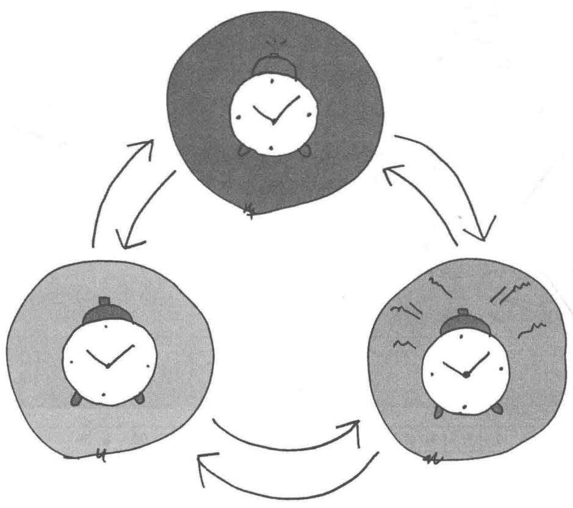
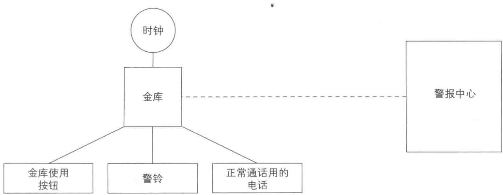
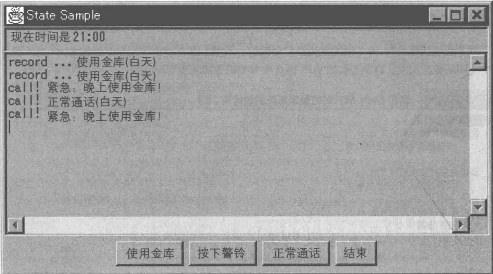
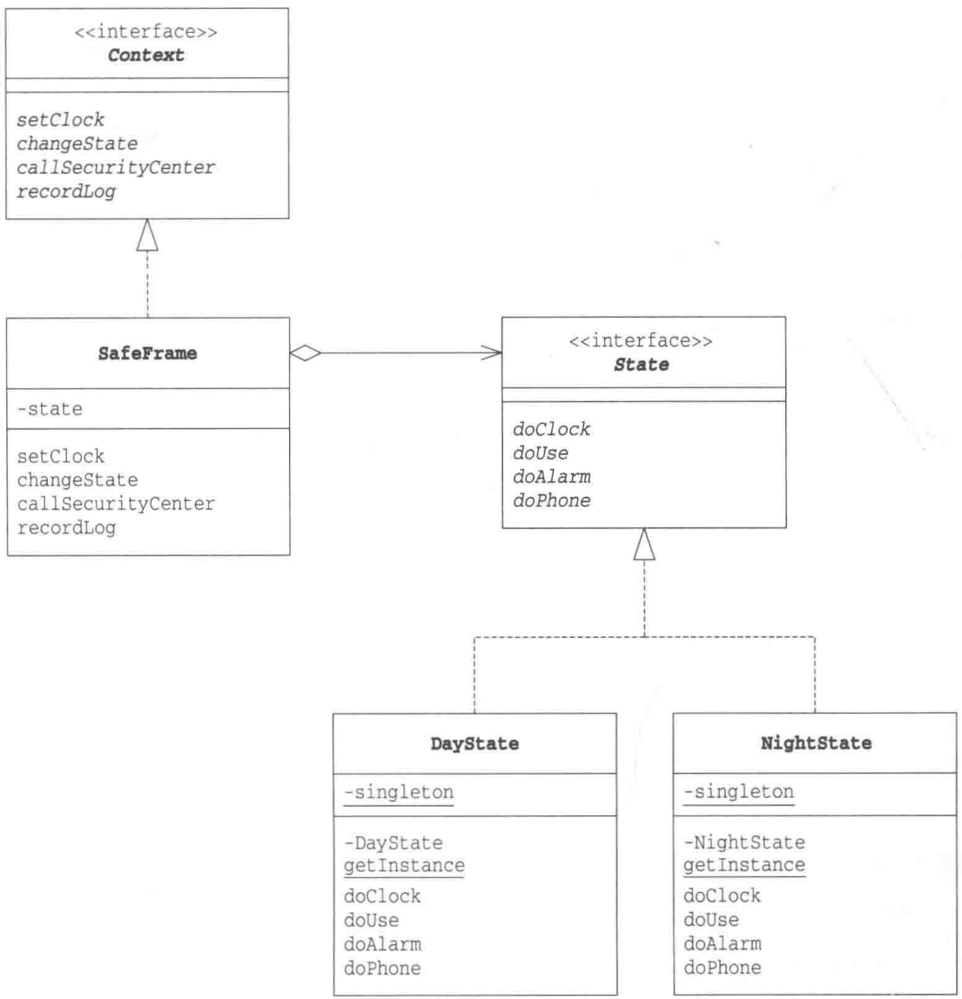
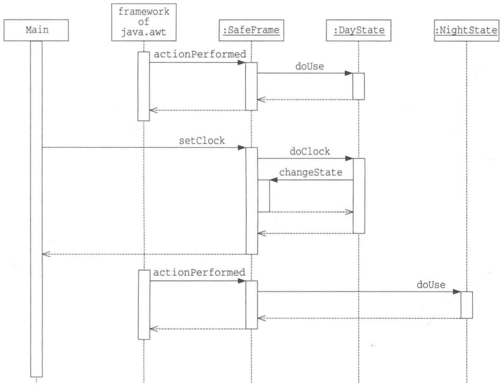
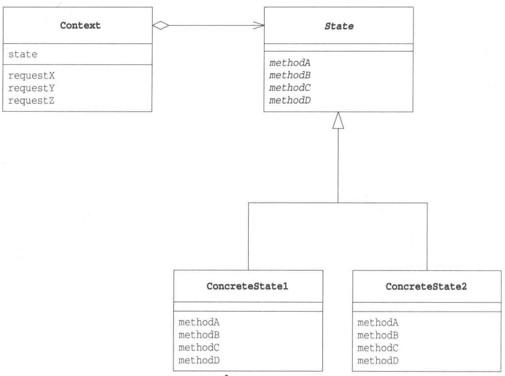

# 第19章 State模式——用类表示状态

> 来源：《图解设计模式》PDF 第 254–269 页，MinerU OCR 转写，如有疑问以原书为准

<!-- PDF p254 -->



<!-- PDF p255 · 书页 222 -->

## 19.1 State模式

在面向对象编程中，是用类表示对象的。也就是说，程序的设计者需要考虑用类来表示什么东西。类对应的东西可能存在于真实世界中，也可能不存在于真实世界中。对于后者，可能有人看到代码后会感到吃惊:这些东西居然也可以是类啊。

在本章中，我们将要学习 State 模式。

在 State 模式中，我们用类来表示状态。State 的意思就是 “状态”。在现实世界中，我们会考虑各种东西的 “状态”，但是几乎不会将状态当作 “东西” 看待。因此，可能大家很难理解 “用类来表示状态” 的意思。

在本章中，我们将要学习用类来表示状态的方法。以类来表示状态后，我们就能通过切换类来方便地改变对象的状态。当需要增加新的状态时，如何修改代码这个问题也会很明确。

## 19.2 示例程序

下面我们来看一段使用了State模式的示例程序。

### 金库警报系统

这里我们来看一个警戒状态每小时会改变一次的警报系统。虽说是警报系统，其实功能非常简单，请参见表 19-1。图 19-1 则展示了该系统的结构图。

下面我们来用程序实现这个金库警报系统。该系统并不会真正呼叫警报中心，只是在页面上显示呼叫状态。此外，如果以现实世界中的时间来测试程序就太慢了，所以我们假设程序中的1秒对应现实世界中的一个小时。图19-1展示了程序的实际运行结果。

表 19-1 金库警报系统

<div class="docvortex-algorithm" style="white-space: pre-wrap; font-family:monospace;">  
- 有一个金库  
- 金库与警报中心相连  
- 金库里有警铃和正常通话用的电话
- 金库里有时钟，监视着现在的时间

- 白天的时间范围是 9:00 ~ 16:59，晚上的时间范围是 17:00 ~ 23:59 和 0:00 ~ 8:59

- 金库只能在白天使用  
- 白天使用金库的话，会在警报中心留下记录
- 晚上使用金库的话，会向警报中心发送紧急事态通知

- 任何时候都可以使用警铃
- 使用警铃的话，会向警报中心发送紧急事态通知

- 任何时候都可以使用电话（但晚上只有留言电话）  
- 白天使用电话的话，会呼叫警报中心  
- 晚上用电话的话，会呼叫警报中心的留言电话
</div>

<!-- PDF p256 · 书页 223 -->

图19-1 金库警报系统的结构图



图19-2 示例程序的运行结果



### 不使用State模式的伪代码

在学习使用了 State 模式的示例程序前，请大家先思考一下自己会以什么样的编程方式来实现这个系统。

如果是我的话，在读完了前面的内容后，会像下面这样考虑。

“总的说来，就是每小时改变系统的行为。当发生使用金库、按下警铃和正常通话这3个事件的时候，会有某种通知到达警报中心。然后，通知的内容会根据时间发生变化……”

接着，脑海中会浮现出代码清单 19-1 中那样的伪代码。之后，只需要考虑如何用编程语言实现伪代码就可以了。

代码清单 19-1 不使用 State 模式时的警报系统的伪代码（1）

警报系统的类{

<!-- PDF p257 · 书页 224 -->

```java
// 不用 State 模式的伪代码：每个方法里都要用 if 判断“现在是白天还是晚上”
// 状态越多，if 分支越多，且散落在每个方法里
使用金库时被调用的方法() {
    if (白天) {
        向警报中心报告使用记录
    } else if (晚上) {
        向警报中心报告紧急事态
    }
}
警铃响起时被调用的方法() {
    向警报中心报告紧急事态
}
正常通话时被调用的方法() {
    if (白天) {
        呼叫警报中心
    } else if (晚上) {
        呼叫警报中心的留言电话
    }
}
}
```

### 使用了State模式的伪代码

并不能说代码清单 19-1 中的方法绝对是错的。不过，在本章中我们要学习的 State 模式则是从完全不同的角度出发，以类似代码清单 19-2 中的编码方式实现警报系统。

代码清单 19-2 使用 State 模式时的警报系统的伪代码（2）

```text
# 用 State 模式的伪代码：每种状态一个类，类里直接写这个状态下的行为，不再需要 if
表示白天的状态的类 {
    使用金库时被调用的方法 () {
        向警报中心报告使用记录
    }
    警铃响起时被调用的方法 () {
        向警报中心报告紧急事态
    }
    正常通话时被调用的方法 () {
        呼叫警报中心
    }
}
表示晚上的状态的类 {
    使用金库时被调用的方法 () {
        向警报中心报告紧急事态
    }
    警铃响起时被调用的方法 () {
        向警报中心报告紧急事态
    }
    正常通话时被调用的方法 () {
        呼叫警报中心的留言电话
    }
}
```

大家看明白以上两种伪代码之间的区别了吗？

在没有使用 State 模式的（1）中，我们会先在各个方法里面使用 if 语句判断现在是白天还是晚上，然后再进行相应的处理。

而在使用了 State 模式的（2）中，我们用类来表示白天和晚上。这样，在类的各个方法中就不需要用if语句判断现在是白天还是晚上了。

<!-- PDF p258 · 书页 225 -->

总结起来就是，（1）是用方法来判断状态，（2）是用类来表示状态。那么，大家能够想象出我们是如何从方法的深处挖出被埋的“状态”，将它传递给调用者的吗？

请大家在脑海中记住（1）和（2）的设计思路，然后我们一起来看看示例程序。

表19-2 类和接口的一览表

| 名字 | 说明 |
| --- | --- |
| State | 表示金库状态的接口 |
| DayState | 表示“白天”状态的类。它实现了State接口 |
| NightState | 表示“晚上”状态的类。它实现了State接口 |
| Context | 表示管理金库状态,并与警报中心联系的接口 |
| SafeFrame | 实现了Context接口。在它内部持有按钮和画面显示等UI信息 |
| Main | 测试程序行为的类 |

图19-3 示例程序的类图



<!-- PDF p259 · 书页 226 -->

### State接口

State 接口（代码清单 19-3）是表示金库状态的接口。在 State 接口中定义了以下事件对应的接口（API）。

- 设置时间

- 使用金库

- 按下警铃

- 正常通话

以上这些接口（API）分别对应我们之前在伪代码中编写的“使用金库时被调用的方法”等方法。这些方法的处理都会根据状态不同而不同。可以说，State 接口是一个依赖于状态的方法的集合。

这些方法接收的参数 Context 是管理状态的接口。关于 Context 接口的内容我们会在稍后进行学习。

代码清单 19-3 State 接口 (State.java)

```java
/**
 * 【State 模式】：用类来表示“状态”，切换状态 = 换一个状态对象
 * 本例：金库警报系统，白天和晚上对同一操作的反应不同
 * State 接口：列出所有“会因状态而不同”的操作
 */
public interface State {
    public abstract void doClock(Context context, int hour);      // 设置时间
    public abstract void doUse(Context context);                  // 使用金库
    public abstract void doAlarm(Context context);                   // 按下警铃
    public abstract void doPhone(Context context);                 // 正常通话
}
```

### DayState 类

DayState 类（代码清单 19-4）表示白天的状态。该类实现了 State 接口，因此它还实现了 State 接口中声明的所有方法。

对于每个表示状态的类，我们都只会生成一个实例。因为如果每次发生状态改变时都生成一个实例的话，太浪费内存和时间了。为此，此处我们使用了 Singleton 模式（第 5 章）。

doClock 是用于设置时间的方法。如果接收到的参数表示晚上的时间，就会切换到夜间状态，即发生状态变化（状态迁移）。在该类中，我们调用 Context 接口的 changeState 方法改变状态。表示晚上状态的类是 NightState 类，可以通过 NightState 类的 getInstance 方法获取它的实例（这里使用了 Singleton 模式。请注意我们并没有通过 new NightState() 来生成 NightState 类的实例。）。

doUse、doAlarm、doPhone 分别是使用金库、按下警铃、正常通话等事件对应的方法。它们的内部实现都是调用 Context 中的对应方法。请注意，在这些方法中，并没有任何“判断当前状态”的 if 语句。在编写这些方法时，开发人员都知道“现在是白天的状态”。在 State 模式中，每个状态都用相应的类来表示，因此无需使用 if 语句或是 switch 语句来判断状态。

代码清单 19-4 DayState 类 (DayState.java)

```java
// 白天状态（单例：状态对象没有自己的数据，全局一个就够）
// doClock：时间到了 9 点前或 17 点后 → 切换到晚上状态
public class DayState implements State {
    private static DayState singleton = new DayState();
    private DayState() {                                // 构造函数的可见性是 private
}
public static State getInstance() {                  // 获取唯一实例
return singleton;
}
public void doClock(Context context, int hour) {      // 设置时间
    if (hour < 9 || 17 <= hour) {
        context.changeState(NightState.getInstance());
    }
}
public void doUse(Context context) {                  // 使用金库
    context.recordLog("使用金库 (白天)");
}
public void doAlarm(Context context) {                 // 按下警铃
    context.callSecurityCenter("按下警铃 (白天)");
}
public void doPhone(Context context) {                // 正常通话
    context.callSecurityCenter("正常通话 (白天)");
}
public String toString() {                    // 显示表示类的文字
    return "[白天]";
}
```

<!-- PDF p260 · 书页 227 -->

### NightState 类

NightState 类（代码清单 19-5）表示晚上的状态。它与 DayState 类一样，也使用了 Singleton 模式。NightState 类的结构与 DayState 完全相同，此处不再赘述。

代码清单 19-5 NightState 类 (NightState.java)

```java
// 晚上状态：同样的操作，反应更“紧急”；9~17 点 → 切回白天状态
public class NightState implements State {
    private static NightState singleton = new NightState();
    private NightState() {                          // 构造函数的可见性是 private
}
    public static State getInstance() {                   // 获取唯一实例
        return singleton;
    }
    public void doClock(Context context, int hour) {      // 设置时间
        if (9 <= hour && hour < 17) {
            context.changeState(DayState.getInstance());
        }
    }
    public void doUse(Context context) {                   // 使用金库
        context.callSecurityCenter("紧急: 晚上使用金库! ");
}
public void doAlarm(Context context) {                   // 按下警铃
        context.callSecurityCenter("按下警铃 (晚上)");
}
public void doPhone(Context context) {                   // 正常通话
        context.recordLog("晚上的通话录音");
}
public String toString() {                          // 显示表示类的文字
    return "[晚上]";
}
```

<!-- PDF p261 · 书页 228 -->

### Context 接口

Context 接口（代码清单 19-6）是负责管理状态和联系警报中心的接口。我们将在学习“SafeFrame 类”时结合代码清单 19-7 学习它实际进行了哪些处理。

代码清单 19-6 Context接口 (Context.java)

```java
// Context：状态对象用来“反过来操作”系统的接口（切换状态、联系警报中心、记录日志）
public interface Context {
    public abstract void setClock(int hour);            // 设置时间
    public abstract void changeState(State state);        // 改变状态
    public abstract void callSecurityCenter(String msg);   // 联系警报中心
    public abstract void recordLog(String msg);          // 在警报中心留下记录
}
```

### SafeFrame类

SafeFrame 类（代码清单 19-7）是使用 GUI 实现警报系统界面的类（safe 有 “金库” 的意思）。它实现了 Context 接口。

SafeFrame 类中有表示文本输入框 (TextField)、多行文本输入框 (TextArea) 和按钮 (Button) 等各种控件的字段。不过，也有一个不是表示控件的字段——state 字段。它表示的是金库现在的状态，其初始值为 “白天” 状态。

SafeFrame 类的构造函数进行了以下处理。

- 设置背景色

- 设置布局管理器

- 设置控件

- 设置监听器（Listener）

监听器的设置非常重要，这里有必要稍微详细地了解一下。我们通过调用各个按钮的addActionListener方法来设置监听器。addActionListener方法接收的参数是“当按钮被按下时会被调用的实例”，该实例必须是实现了ActionListener接口的实例。本例中，我们传递的参数是this，即SafeFrame类的实例自身（从代码中可以看到，SafeFrame类的确实现了ActionListener接口）。“当按钮被按下后，监听器会被调用”这种程序结构类似于我们在第17章中学习过的Observer模式。

当按钮被按下后，actionPerformed方法会被调用。该方法是在ActionListener（java.awt.event.ActionListener）接口中定义的方法，因此我们不能随意改变该方法的名称。在该方法中，我们会先判断当前哪个按钮被按下了，然后进行相应的处理。

请注意，这里虽然出现了 if 语句，但是它是用来判断“按钮的种类”的，而并非用于判断“当前状态”。请不要将我们之前说过“使用 State 模式可以消除 if 语句”误认为是“程序中不会出现任何 if 语句”。

处理的内容对 State 模式非常重要。例如，当金库使用按钮被按下时，以下语句会被执行。

```text
state.doUse(this);
```

我们并没有先去判断当前时间是白天还是晚上，也没有判断金库的状态，而是直接调用了doUse 方法。这就是 State 模式的特点。如果不使用 State 模式，这里就无法直接调用 doUse 方法，而是需要“根据时间状态来进行相应的处理”。

<!-- PDF p262 · 书页 229 -->

在 setClock 方法中我们设置了当前时间。以下语句会将当前时间显示在标准输出中。

```text
System.out.println(clockstring);
```

以下语句则会将当前时间显示在 textClock 文本输入框（界面最上方）中。

```text
textClock.setText(clockstring);
```

接着，下面的语句会进行当前状态下相应的处理（这时可能会发生状态迁移）。

```text
state.doClock(this, hour);
```

changeState 方法会调用 DayState 类和 NightState 类。当发生状态迁移时，该方法会被调用。实际改变状态的是下面这条语句。

```text
this.state = state;
```

给代表状态的字段赋予表示当前状态的类的实例，就相当于进行了状态迁移。

callSecurityCenter 方法表示联系警报中心，recordLog 方法表示在警报中心留下记录。这里我们只是简单地在 textScreen 多行文本输入框中增加代表记录的文字信息。真实情况下，这里应当访问警报中心的网络进行一些处理。

代码清单 19-7 SafeFrame 类 (SafeFrame.java)

```java
/**
 * 金库窗口：实现 Context，持有“当前状态” state
 * 按钮被按下时不判断白天晚上，直接交给 state 处理（state.doUse(this) 等）
 * setClock 每小时被调用一次，由当前状态决定是否切换
 * （原文 java.awt.BorderStyle 为笔误，应为 BorderLayout）
 */
import java.awt.Frame;
import java.awt.Label;
import java.awt.Color;
import java.awt.Button;
import java.awt.TextField;
import java.awt.TextArea;
import java.awt.Panel;
import java.awt.BorderStyle;
import java.awt.event.ActionListener;
import java.awt.event.ActionEvent;

public class SafeFrame extends Frame implements ActionListener, Context {
    private TextField textClock = new TextField(60);          // 显示当前时间
    private TextArea textScreen = new TextArea(10, 60);      // 显示警报中心的记录
    private Button buttonUse = new Button("使用金库");         // 使用金库按钮
    private Button buttonAlarm = new Button("按下警铃");                 // 按下警铃按钮
    private Button buttonPhone = new Button("正常通话");       // 正常通话按钮
    private Button buttonExit = new Button("结束");               // 结束按钮

    private State state = DayState.getInstance();                // 当前的状态

    // 构造函数
    public SafeFrame(String title) {
        super(title);
        setBackground(Color.lightGray);
        setLayout(new BorderLayout());
        // 配置textClock
        add(textClock, BorderLayout.NORTH);
        textClock.setEditable(false);
        // 配置textScreen
add(textScreen, BorderLayout.CENTER);
textScreen.setEditable(false);
// 为界面添加按钮
Panel panel = new Panel();
panel.add(buttonUse);
panel.add(buttonAlarm);
panel.add(buttonPhone);
panel.add(buttonExit);
// 配置界面
add(panel, BorderLayout.SOUTH);
// 显示
pack();
show();
// 设置监听器
buttonUse.addActionListener(this);
buttonAlarm.addActionListener(this);
buttonPhone.addActionListener(this);
buttonExit.addActionListener(this);
}
// 按钮被按下后该方法会被调用
public void actionPerformed(ActionEvent e) {
    System.out.println(e.toString());
    if (e.getSource() == buttonUse) {          // 金库使用按钮
        state.doUse(this);
    } else if (e.getSource() == buttonAlarm) { // 按下警铃按钮
        state.doAlarm(this);
    } else if (e.getSource() == buttonPhone) { // 正常通话按钮
        state.doPhone(this);
    } else if (e.getSource() == buttonExit) { // 结束按钮
        System.exit(0);
    } else {
        System.out.println("?");
    }
}
// 设置时间
public void setClock(int hour) {
    String clockstring = " 现在时间是 ";
    if (hour < 10) {
        clockstring += "0" + hour + ":00";
    } else {
        clockstring += hour + ":00";
    }
    System.out.println(clockstring);
    textClock.setText(clockstring);
    state.doClock(this, hour);
}
// 改变状态
public void changeState(State state) {
    System.out.println(" 从 " + this.state + " 状态变为了 " + state + " 状态。");
    this.state = state;
}
// 联系警报中心
public void callSecurityCenter(String msg) {
    textScreen.append("call! " + msg + "\n");
}
// 在警报中心留下记录
public void recordLog(String msg) {
    textScreen.append("record ... " + msg + "\n");
}
```

<!-- PDF p264 · 书页 231 -->

我们在图 19-4 的时序图中展示了状态改变前后的 doUse 方法的调用流程。最初调用的是 DayState 类的 doUse 方法，当 changeState 后，· 变为了调用 NightState 类的 doUse 方法。

图19-4 示例程序的时序图



### Main类

Main 类（代码清单 19-8）生成了一个 SafeFrame 类的实例并每秒调用一次 setClock 方法，对该实例设置一次时间。这相当于在真实世界中经过了一小时。

代码清单 19-8 Main 类 (Main.java)

```java
// 启动：每秒推进 1 小时，循环模拟一天 24 小时
public class Main {
    public static void main(String[] args) {
        SafeFrame frame = new SafeFrame("State Sample");
        while (true) {
            for (int hour = 0; hour < 24; hour++) {
                frame.setClock(hour);      // 设置时间
                try {
                    Thread.sleep(1000);
                } catch (InterruptedException e) {
                }
            }
        }
    }
}
```

<!-- PDF p265 · 书页 232 -->

## 19.3 State 模式中的登场角色

在 State 模式中有以下登场角色。

### ◆ State（状态）

State 角色表示状态，定义了根据不同状态进行不同处理的接口（API）。该接口（API）是那些处理内容依赖于状态的方法的集合。在示例程序中，由 State 接口扮演此角色。

### ◆ ConcreteState（具体状态）

ConcreteState 角色表示各个具体的状态，它实现了 State 接口。在示例程序中，由 DayState 类和 NightState 类扮演此角色。

### ◆ Context（状况、前后关系、上下文）

Context 角色持有表示当前状态的 ConcreteState 角色。此外，它还定义了供外部调用者使用 State 模式的接口（API）。在示例程序中，由 Context 接口和 SafeFrame 类扮演此角色。

这里稍微做一下补充说明。在示例程序中，Context角色的作用被Context接口和SafeFrame类分担了。具体而言，Context接口定义了供外部调用者使用State模式的接口（API），而SafeFrame类则持有表示当前状态的ConcreteState角色。我们会在习题19-1中讨论一下为什么没有将Context实现为类。

图19-5 State模式的类图



<!-- PDF p266 · 书页 233 -->

## 19.4 拓展思路的要点

### 分而治之

在编程时，我们经常会使用分而治之的方针。它非常适用于大规模的复杂处理。当遇到庞大且复杂的问题，不能用一般的方法解决时，我们会先将该问题分解为多个小问题。如果还是不能解决这些小问题，我们会将它们继续划分为更小的问题，直至可以解决它们为止。分而治之，简单而言就是将一个复杂的大问题分解为多个小问题然后逐个解决。

在 State 模式中，我们用类来表示状态，并为每一种具体的状态都定义一个相应的类。这样，问题就被分解了。开发人员可以在编写一个 ConcreteState 角色的代码的同时，在头脑中（一定程度上）考虑其他的类。在本章的金库警报系统的示例程序中，只有“白天”和“晚上”两个状态，可能大家对此感受不深，但是当状态非常多的时候，State 模式的优势就会非常明显了。

请大家再回忆一下代码清单 19-1 中的伪代码（1）和（2）。在不使用 State 模式时，我们需要使用条件分支语句判断当前的状态，然后进行相应的处理。状态越多，条件分支就会越多。而且，我们必须在所有的事件处理方法中都编写这些条件分支语句。

State 模式用类表示系统的 “状态”，并以此将复杂的程序分解开来。

### 依赖于状态的处理

我们来思考一下 SafeFrame 类的 setClock 方法（代码清单 19-7）和 State 接口的 doClock 方法（代码清单 19-3）之间的关系。

Main 类会调用 SafeFrame 类的 setClock 方法，告诉 setClock 方法 “请设置时间”。在 setClock 方法中，会像下面这样将处理委托给 state 类。

state.doClock(this, hour);

也就是说，我们将设置时间的处理看作是“依赖于状态的处理”。

当然，不只是doClock方法。在State接口中声明的所有方法都是“依赖于状态的处理”，都是“状态不同处理也不同”。这虽然看似理所当然，不过却需要我们特别注意。

在 State 模式中，我们应该如何编程，以实现 “依赖于状态的处理” 呢？总结起来有如下两点。

- 定义接口，声明抽象方法

- 定义多个类，实现具体方法

这就是 State 模式中的 “依赖于状态的处理” 的实现方法。

这里故意将上面两点说得很笼统，但是，如果大家在读完这两点之后会点头表示赞同，那就意味着大家完全理解了 State 模式以及接口与类之间的关系。

### 应当是谁来管理状态迁移

用类来表示状态，将依赖于状态的处理分散在每个 ConcreteState 角色中，这是一种非常好的解决办法。

<!-- PDF p267 · 书页 234 -->

不过，在使用State模式时需要注意应当是谁来管理状态迁移。

在示例程序中，扮演 Context 角色的 SafeFrame 类实现了实际进行状态迁移的 changeState 方法。但是，实际调用该方法的却是扮演 ConcreteState 角色的 DayState 类和 NightState 类。也就是说，在示例程序中，我们将“状态迁移”看作是“依赖于状态的处理”。这种处理方式既有优点也有缺点。

优点是这种处理方式将“什么时候从一个状态迁移到其他状态”的信息集中在了一个类中。也就是说，当我们想知道“什么时候会从 DayState 类变化为其他状态”时，只需要阅读 DayState 类的代码就可以了。

缺点是“每个 ConcreteState 角色都需要知道其他 ConcreteState 角色”。例如，DayState 类的 doClock 方法就使用了 NightState 类。这样，如果以后发生需求变更，需要删除 NightState 类时，就必须要相应地修改 DayState 类的代码。将状态迁移交给 ConcreteState 角色后，每个 ConcreteState 角色都需要或多或少地知道其他 ConcreteState 角色。也就是说，将状态迁移交给 ConcreteState 角色后，各个类之间的依赖关系就会加强。

我们也可以不使用示例程序中的做法，而是将所有的状态迁移交给扮演 Context 角色的 SafeFrame 类来负责。有时，使用这种解决方法可以提高 ConcreteState 角色的独立性，程序的整体结构也会更加清晰。不过这样做的话，Context 角色就必须要知道“所有的 ConcreteState 角色”。在这种情况下，我们可以使用 Mediator 模式（第 16 章）。

当然，还可以不用 State 模式，而是用状态迁移表来设计程序。所谓状态迁移表是可以根据“输入和内部状态”得到“输出和下一个状态”的一览表（这超出了本书的范围，我们暂且不深入学习该方法）。当状态迁移遵循一定的规则时，使用状态迁移表非常有效。

此外，当状态数过多时，可以用程序来生成代码而不是手写代码。

### 不会自相矛盾

如果不使用 State 模式，我们需要使用多个变量的值的集合来表示系统的状态。这时，必须十分小心，注意不要让变量的值之间互相矛盾。

而在 State 模式中，是用类来表示状态的。这样，我们就只需要一个表示系统状态的变量即可。在示例程序中，SafeFrame 类的 state 字段就是这个变量，它决定了系统的状态。因此，不会存在自相矛盾的状态。

### 易于增加新的状态

在 State 模式中增加新的状态是非常简单的。以示例程序来说，编写一个 XXXState 类，让它实现 State 接口，然后实现一些所需的方法就可以了。当然，在修改状态迁移部分的代码时，还是需要仔细一点的。因为状态迁移的部分正是与其他 ConcreteState 角色相关联的部分。

但是，在 State 模式中增加其他 “依赖于状态的处理” 是很困难的。这是因为我们需要在 State 接口中增加新的方法，并在所有的 ConcreteState 角色中都实现这个方法。

虽说很困难，但是好在我们绝对不会忘记实现这个方法。假设我们现在在 State 接口中增加了一个 doYYY 方法，而忘记了在 DayState 类和 NightState 类中实现这个方法，那么编译器在编译代码时就会报错，告诉我们存在还没有实现的方法。

如果不使用 State 模式，那么增加新的状态时会怎样呢？这里，如果不使用 State 模式，就必须用 if 语句判断状态。这样就很难在编译代码时检测出“忘记实现方法”这种错误了（在运行时检测出问题并不难。我们只要事先在每个方法内部都加上一段“当检测到没有考虑到的状态时就报错”的代码即可）。

<!-- PDF p268 · 书页 235 -->

### 实例的多面性

请注意 SafeFrame 类中的以下两条语句（代码清单 19-7）。

- SafeFrame 类的构造函数中的

```text
- actionPerformed 方法中的 state.doUse(this);
```

这两条语句中都有 this。那么这个 this 到底是什么呢？当然，它们都是 SafeFrame 类的实例。由于在示例程序中只生成了一个 SafeFrame 的实例，因此这两个 this 其实是同一个对象。

不过，在 addActionListener 方法中和 doUse 方法中，对 this 的使用方式是不一样的。

向 addActionListener 方法传递 this 时，该实例会被当作 “实现了 ActionListener 接口的类的实例” 来使用。这是因为 addActionListener 方法的参数类型是 ActionListener 类型。在 addActionListener 方法中会用到的方法也都是在 ActionListener 接口中定义了的方法。至于这个参数是否是 SafeFrame 类的实例并不重要。

向 doUse 方法传递 this 时，该实例会被当作 “实现了 Context 接口的类的实例” 来使用。这是因为 doUse 方法的参数类型是 Context 类型。在 doUse 方法中会用到的方法也都是在 Context 接口中定义了的方法（大家只要再回顾一下 DayState 类和 NightState 类的 doUse 方法就会明白了）。

请大家一定要透彻理解此处的实例的多面性。

## 19.5 相关的设计模式

### ◆ Singleton 模式（第 5 章）

Singleton 模式常常会出现在 ConcreteState 角色中。在示例程序中，我们就使用了 Singleton 模式。这是因为在表示状态的类中并没有定义任何实例字段（即表示实例的状态的字段）。

### ◆ Flyweight 模式（第 20 章）

在表示状态的类中并没有定义任何实例字段。因此，有时我们可以使用 Flyweight 模式在多个 Context 角色之间共享 ConcreteState 角色。

## 19.6 本章所学知识

在本章中，我们学习了用一个一个的类来分别表示系统各种状态的 State 模式。这样，我们就可以通过切换表示状态的类的实例来实现状态迁移。

<!-- PDF p269 · 书页 236 -->

## 19.7 练习题

答案请参见附录 A (P.334)

### 习题19-1

Java 本来应当将 Context 定义为抽象类而非接口，然后让 Context 类持有 state 字段，这样更符合 State 模式的设计思想。但是在示例程序中我们并没有这么做，而是将 Context 角色定义为 Context 接口，让 SafeFrame 类持有 state 字段，请问这是为什么呢？

#### 答案（附录 A）

因为在 Java 中只能单一继承，所以如果将 Context 角色定义为类，那么由于 SafeFrame 类已经是 Frame 类的子类了，它将无法再继承 Context 类。

不过，如果另外编写一个 Context 类的子类，并将它的实例保存在 SafeFrame 类的字段中，那么通过将处理委托给这个实例是可以实现习题中的需求的。

### 习题19-2

如果要对示例程序中的“白天”和“晚上”的时间区间做如下变更，请问应该怎样修改程序呢？

|  | 白天 | 晚上 |
| --- | --- | --- |
| 现在 | 9:00~16:59 | 17:00~23:59以及0:00~8:59 |
| 变更为 | 8:00~20:59 | 21:00~23:59以及0:00~7:59 |

#### 答案（附录 A）

需要修改 DayState 类（代码清单 19-4）以及 NightState 类（代码清单 19-5）的 doClock 方法。

如果事先在 SafeFrame 类中定义一个 isDay 方法和一个 isNight 方法，让外部可以判断当前究竟是白天还是晚上，那么就可以将白天和晚上的具体时间范围限制在 SafeFrame 类内部。这样修改后，当时间范围发生变更时，只需要修改 SafeFrame 类即可。

### 习题19-3

请在示例程序中增加一个新的“午餐时间（12:00\~12:59）”状态。

- 在午餐时间使用金库的话，会向警报中心通知紧急情况

- 在午餐时间按下警铃的话，会向警报中心通知紧急情况

- 在午餐时间使用电话的话，会呼叫警报中心的留言电话

#### 答案（附录 A）

这里我们编写一个扮演 ConcreteState 角色的表示 “午餐时间” 的状态 NoonState 类（代码清单 A19-1）。此外，还需要修改 DayState 类（代码清单 19-4）以及 NightState 类（代码清单 19-5）的 doClock 方法（代码清单 A19-2、代码清单 A19-3）。

代码清单 A19-1 NoonState 类 ( NoonState.java )

```java
// 习题 1：新增“午餐时间”状态（12~13 点）—— 新写一个状态类
public class NoonState implements State {
    private static NoonState singleton = new NoonState();
    private NoonState() {                          // 构造函数的可见性是 private
}
    public static State getInstance() {                 // 获取唯一实例
        return singleton;
    }
    public void doClock(Context context, int hour) {      // 设置时间
        if (hour < 9 || 17 <= hour) {
            context.changeState(NightState.getInstance());
        } else if (9 <= hour && hour < 12 || 13 <= hour && hour < 17) {
            context.changeState(DayState.getInstance());
        }
    }
    public void doUse(Context context) {                 // 使用金库
        context.callSecurityCenter("紧急: 午餐时间使用金库! ");
}
public void doAlarm(Context context) {                  // 按下警铃
    context.callSecurityCenter("按下警铃(午餐时间)");
}
public void doPhone(Context context) {                  // 正常通话
    context.recordLog("午餐时间的通话录音");
}
public String toString() {                    // 显示表示类的文字
    return "[午餐时间]";
}
}
```

<!-- PDF p368 · 书页 335 -->

代码清单 A19-2 DayState 类 (DayState.java)

```java
// 习题 1：白天状态增加“12 点进入午餐时间”的切换
public class DayState implements State {
    private static DayState singleton = new DayState();
    private DayState() {                          // 构造函数的可见性是 private
}
public static State getInstance() {                   // 获取唯一实例
    return singleton;
}
public void doClock(Context context, int hour) {      // 设置时间
    if (hour < 9 || 17 <= hour) {
        context.changeState(NightState.getInstance());
    } else if (12 <= hour && hour < 13) {
        context.changeState(NoonState.getInstance());
    }
}
public void doUse(Context context) {                   // 使用金库
    context.recordLog("使用金库 (白天)");
}
public void doAlarm(Context context) {                   // 按下警铃
    context.callSecurityCenter("按下警铃 (白天)");
}
public void doPhone(Context context) {                   // 正常通话
    context.callSecurityCenter("正常通话 (白天)");
}
public String toString() {                    // 显示表示类的文字
    return "[白天]";
}
}
```

代码清单 A19-3 NightState 类 (NightState.java)

```java
// 习题 1：晚上状态也要处理“直接跳到午餐时间”的情况
public class NightState implements State {
    private static NightState singleton = new NightState();
    private NightState() {                          // 构造函数的可见性是 private
}
public static State getInstance() {                   // 获取唯一实例
    return singleton;
}
public void doClock(Context context, int hour) {   // 设置时间
    if (12 <= hour && hour < 13) {
        context.changeState(NoonState.getInstance());
    } else if (9 <= hour && hour < 17) {
        context.changeState(DayState.getInstance()) ;
    }
}
public void doUse(Context context) {                  // 使用金库
    context.callSecurityCenter("紧急: 晚上使用金库! ");
}
public void doAlarm(Context context) {                 // 按下警铃
    context.callSecurityCenter("按下警铃 (晚上) ");
}
public void doPhone(Context context) {                // 正常通话
    context.recordLog("晚上的通话录音 ");
}
public String toString() {                    // 显示表示类的文字
    return "[晚上]";
}
```

<!-- PDF p369 · 书页 336 -->

### 习题19-4

请在示例程序中增加一个新的“紧急情况”状态。不论是什么时间，只要处于“紧急情况”下，就向警报中心通知紧急情况。

- 按下警铃后，系统状态变为“紧急情况”状态

- 如果“紧急情况”下使用金库的话，会向警报中心通知紧急情况（与当时的时间无关）

- 如果“紧急情况”下按下警铃的话，会向警报中心通知紧急情况（与当时的时间无关）

- 如果“紧急情况”下使用电话的话，会呼叫警报中心的留言电话（与当时的时间无关）

不过，这份需求中也有一些问题，大家看出来了吗？

#### 答案（附录 A）

这里我们编写一个表示“紧急状态”的 UrgentState 类（代码清单 A19-5）。此外，我们还需要在 DayState 类以及 NightState 类的 doAlarm 方法中加入状态迁移的代码（请参见代码清单 A19-5、代码清单 A19-6）。

习题中的需求中有一个问题点，就是一旦进入了紧急状态就没有办法恢复至原来的状态。

代码清单 A19-4 UrgentState 类 (UrgentState.java)

```java
// 习题 2：新增“紧急状态”—— 按下警铃后进入，之后所有操作都通知警报中心，时间变化也不会退出
public class UrgentState implements State {
    private static UrgentState singleton = new UrgentState();
    private UrgentState() {                          // 构造函数的可见性是 private
}
    public static State getInstance() {                   // 获取唯一实例
        return singleton;
    }
    public void doClock(Context context, int hour) {   // 设置时间
        // 在设置时间处理中什么都不做
    }
    public void doUse(Context context) {                 // 使用金库
        context.callSecurityCenter("紧急:紧急时使用金库! ");
    }
    public void doAlarm(Context context) {                   // 按下警铃
        context.callSecurityCenter("按下警铃(紧急时)");
    }
    public void doPhone(Context context) {                 // 正常通话
        context.callSecurityCenter("正常通话(紧急时)");
}
    public String toString() {                          // 显示表示类的文字
        return "[紧急时]";
    }
}
```

代码清单 A19-5 DayState 类 (DayState.java)

```java
// 习题 2：白天按下警铃 → 切换到紧急状态
public class DayState implements State {
    private static DayState singleton = new DayState();
    private DayState() {                          // 构造函数的可见性是 private
}
public static State getInstance() {                 // 获取唯一实例
    return singleton;
}
public void doClock(Context context, int hour) {      // 设置时间
    if (hour < 9 || 17 <= hour) {
        context.changeState(NightState.getInstance());
    }
}
public void doUse(Context context) {                  // 使用金库
    context.recordLog("使用金库 (白天)");
}
public void doAlarm(Context context) {                 // 按下警铃
    context.callSecurityCenter("按下警铃 (白天)");
    context.changeState(UrgentState.getInstance());
}
public void doPhone(Context context) {                  // 正常通话
    context.callSecurityCenter("正常通话 (白天)");
}
public String toString() {                    // 显示表示类的文字
    return "[白天]";
}
```

<!-- PDF p370 · 书页 337 -->

代码清单 A19-6 NightState 类 (NightState.java)

```java
// 习题 2：晚上按下警铃 → 切换到紧急状态（原文 callSecurityCenter 那行少了分号）
public class NightState implements State {
    private static NightState singleton = new NightState();
    private NightState() {                          // 构造函数的可见性是 private
}
    public static State getInstance() {                 // 获取唯一实例
        return singleton;
    }
    public void doClock(Context context, int hour) {      // 设置时间
        if (9 <= hour && hour < 17) {
            context.changeState(DayState.getInstance());
        }
    }
    public void doUse(Context context) {                 // 使用金库
        context.callSecurityCenter("紧急: 晚上使用金库! ");
    }
    public void doAlarm(Context context) {                 // 按下警铃
        context.callSecurityCenter("按下警铃(晚上)")
            context.changeState(UrgentState.getInstance());
    }
    public void doPhone(Context context) {                 // 正常通话
        context.recordLog("晚上的通话录音");
    }
    public String toString() {                  // 显示表示类的文字
        return "[晚上]";
    }
}
```
