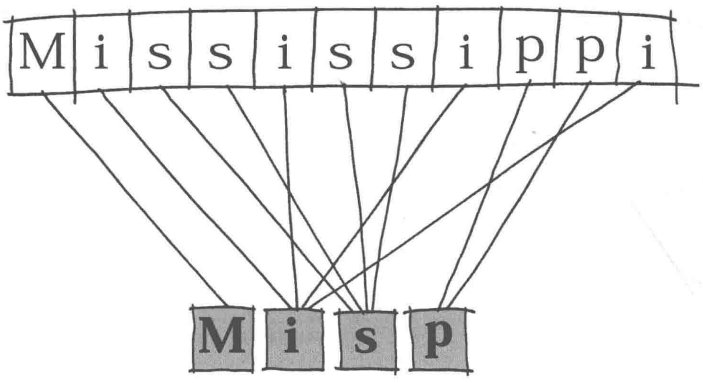
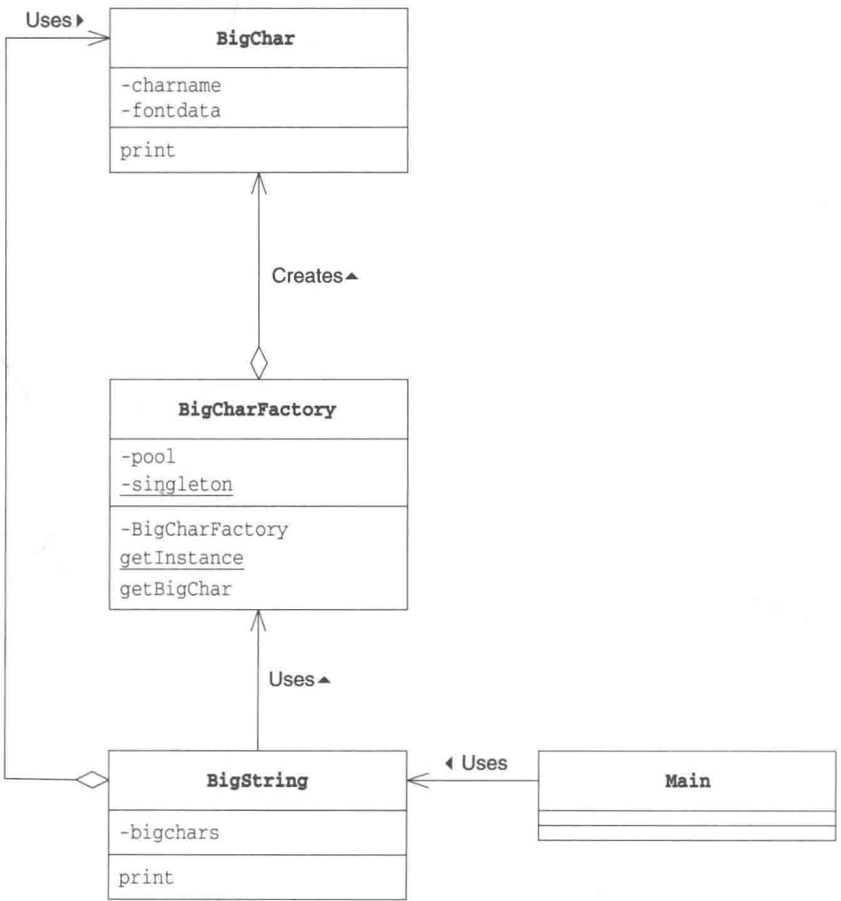
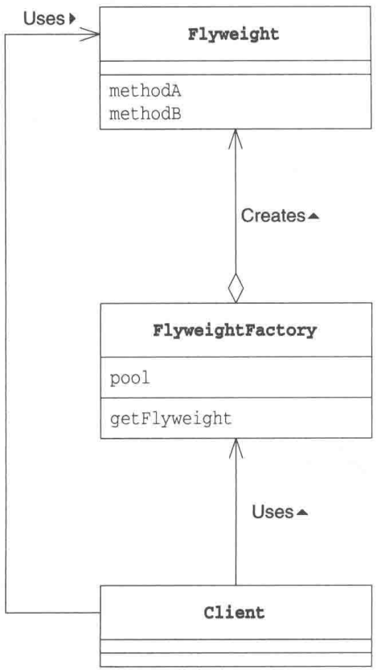

# 第20章 Flyweight模式——共享对象，避免浪费

> 来源：《图解设计模式》PDF 第 270–281 页，MinerU OCR 转写，如有疑问以原书为准

<!-- PDF p270 -->



<!-- PDF p271 · 书页 238 -->

## 20.1 Flyweight 模式

在本章中，我们将要学习 Flyweight 模式。

Flyweight 是 “轻量级” 的意思，指的是拳击比赛中选手体重最轻的等级。顾名思义，该设计模式的作用是为了让对象变 “轻”。

对象在计算机中是虚拟存在的东西，它的“重”和“轻”并非指实际重量，而是它们“所使用的内存大小”。使用内存多的对象就是“重”对象，使用内存少的对象就是“轻”对象。

在 Java 中，可以通过以下语句生成 Something 类的实例。

```text
new Something()
```

为了能够在计算机中保存该对象，需要分配给其足够的内存空间。当程序中需要大量对象时，如果都使用 new 关键字来分配内存，将会消耗大量内存空间。

关于 Flyweight 模式，一言以蔽之就是 “通过尽量共享实例来避免 new 出实例”。

当需要某个实例时，并不总是通过 new 关键字来生成实例，而是尽量共用已经存在的实例。这就是 Flyweight 模式的核心内容。下面让我们来一起学习 Flyweight 模式吧。

## 20.2 示例程序

首先来看一段使用了 Flyweight 模式的示例程序。在示例程序中，有一个将许多普通字符组合成为“大型字符”的类，它的实例就是重实例。为了进行测试，我们以文件形式保存了大型字符 '0' \~ '9' 和 '-' 的字体数据（代码清单 20-1 \~ 代码清单 20-11）。

<!-- PDF p272 · 书页 239 -->

表 20-1 展示了该示例程序中使用的类。

表20-1 类的一览表

| 名字 | 说明 |
| --- | --- |
| BigChar | 表示“大型字符”的类 |
| BigCharFactory | 表示生成和共用BigChar类的实例的类 |
| BigString | 表示多个BigChar组成的“大型字符串”的类 |
| Main | 测试程序行为的类 |

BigChar 是表示 “大型字符” 的类。它会从文件中读取大型字符的字体数据，并将它们保存在内存中，然后使用 print 方法输出大型字符。大型字符会消耗很多内存，因此我们需要考虑如何共享 BigChar 类的实例。

BigCharFactory 类会根据需要生成 BigChar 类的实例。不过如果它发现之前已经生成了某个大型字符的BigChar类的实例，则会直接利用该实例，而不会再生成新的实例。生成的实例全部被保存在pool字段中。此外，为了能够快速查找出之前是否已经生成了某个大型字符所对应的实例，我们使用了java.util.HashMap类。

<!-- PDF p273 · 书页 240 -->

BigString 类用于将多个 BigChar 组成 “大型字符串”。

Main 类是用于测试程序行为的类。

图20-1 示例程序的类图



### BigChar类

BigChar 类（代码清单 20-12）是表示 “大型字符” 的类。

它的构造函数会生成接收到的字符所对应的“大型字符”版本的实例，并将其保存在fontdata字段中。例如，如果构造函数接收到的字符是'3'，那么在fontdata字段中保存的就是下面这样的字符串（为了方便阅读，我们在“\n”后换行了）。

....#####  
....\n  
..##.......##...\n  
............##....\n  
............####......\n
............##....\n

<!-- PDF p274 · 书页 241 -->

```text
# 大型字符的数据文件示例：用 # 和 . 画出数字的形状
...##......##....\n
....#######.....\n
.............\n
```

我们将组成这些“大型字符”的数据（即字体数据）保存在文件中（代码清单20-1～代码清单20-11）。文件的命名规则是在该字体数据所代表的字符前加上"big"，文件后缀名是".txt"。例如，'3'对应的字体数据保存在"big3.txt"文件中。如果找不到某个字符对应的字体数据，就在该字符后面打上问号（"？”）作为其字体数据。

在该类中，没有出现关于 Flyweight 模式中 “共享” 的相关代码。关于控制共享的代码，请看代码清单 20-13 中的 BigCharFactory 类。

代码清单 20-12 BigChar 类 (BigChar.java)

```java
/**
 * 【Flyweight 模式】：相同的对象只创建一次，大家共享，节省内存
 * BigChar：一个“大型字符”，从文件 big数字.txt 读取它的点阵图形
 * 读文件很耗资源 → 相同字符只读一次
 * （原文 java.io FileReader 少了点、publicBIGChar 少了空格且大小写错误）
 */
import java.io.BufferedReader;
import java.io FileReader;
import java.io.IOException;

public class BigChar {
    // 字符名字
    private char charname;
    // 大型字符对应的字符串（由 '#' '.', '\n' 组成）
    private String fontdata;
    // 构造函数
    publicBIGChar(char charname) {
        this.charname = charname;
        try {
            BufferedReader reader = new BufferedReader(
                new FileReader("big" + charname + ".txt")
            );
            String line;
            StringBuffer buf = new StringBuffer();
            while ((line = reader.readLine()) != null) {
                buf.append(line);
                buf.append("\n");
            }
            reader.close();
            this.fontdata = buf.toString();
        } catch (IOException e) {
            this.fontdata = charname + "?";
        }
    }
    // 显示大型字符
    public void print() {
        System.out.print(fontdata);
    }
}
```

### BigCharFactory 类

BigCharFactory 类（代码清单 20-13）是生成 BigChar 类的实例的工厂（factory）。它实现了共享实例的功能。

pool 字段用于管理已经生成的 BigChar 类的实例。Pool 有泳池的意思。现在任何存放某些东西的地方都可以被叫作 Pool。泳池存储的是水，而 BigCharFactory 的 pool 中存储的则是已经生成的 BigChar 类的实例。

<!-- PDF p275 · 书页 242 -->

在BigCharFactory类中，我们使用java.util.HashMap类来管理“字符串 → 实例”之间的对应关系。使用java.util.HashMap类的put方法可以将某个字符串（键）与一个实例（值）关联起来。之后，就可以通过键来获取它相应的值。在示例程序中，我们将接收到的单个字符（例如'3')作为键与表示3的BigChar的类的实例对应起来。

我们使用了 Singleton 模式（第 5 章）来实现 BigCharFactory 类，这是因为我们只需要一个 BigCharFactory 类的实例就可以了。getInstance 方法用于获取 BigCharFactory 类的实例（注意不是 BigChar 类的实例哟）。

getBigChar 方法是 Flyweight 模式的核心方法。该方法会生成接收到的字符所对应的 BigChar 类的实例。不过，如果它发现字符所对应的实例已经存在，就不会再生成新的实例，而是将之前的那个实例返回给调用者。

请仔细理解这段逻辑。该方法首先会通过 pool.get() 方法查找，以调查是否存在接收到的字符（charname）所对应的 BigChar 类的实例。如果返回值为 null，表示目前为止还没有创建该实例，于是它会通过 new BigChar(charname)；来生成实例，并通过 pool.put 将该实例放入 HashMap 中。如果返回值不为 null，则会将之前生成的实例返回给调用者。

相信大家都看明白了，这里我们通过这种方式实现了共享BigChar类的实例。

为什么我们要使用 synchronized 关键字修饰 getBigChar 方法呢？我们会在习题 20-3 中来讨论这个问题。

代码清单 20-13 BigCharFactory 类 (BigCharFactory.java)

```java
// 享元工厂：用 pool（池子）缓存已创建的 BigChar；有就直接返回，没有才创建
// 工厂本身是单例；getBigChar 加 synchronized，防止多线程重复创建
import java.util.HashMap;

public class BigCharFactory {
    // 管理已经生成的BigChar 的实例
    private HashMap pool = new HashMap();
    // Singleton 模式
    private static BigCharFactory singleton = new BigCharFactory();
    // 构造函数
    private BigCharFactory() {
    }
    // 获取唯一的实例
    public static BigCharFactory getInstance() {
        return singleton;
    }
    // 生成(共享)BigChar 类的实例
    public synchronized BigChar getBigChar(char charname) {
        BigChar bc = (BigChar)pool.get("" + charname);
        if (bc == null) {
            bc = new BigChar(charname); // 生成BigChar 的实例
            pool.put("" + charname, bc);
        }
        return bc;
    }
}
```

### BigString 类

Six of the BigString (代码清单 20-14) 表示由 \*BigChar 组成的 “大型字符串” 的类。

bigchars 字段是 BigChar 类型的数组，它里面保存着 BigChar 类的实例。在构造函数的

<!-- PDF p276 · 书页 243 -->

```text
BigString类的实例的bigchars字段  
Bigchar类型的数组
```

for 语句中，我们并没有像下面这样使用 new 关键字来生成 BigChar 类的实例。

```java
// 不共享：每个字符都 new 一个
for (int i = 0; i < bigchars.length; i++) {
    bigchars[i] = new BigChar(string.charAt(i));←不共享实例
}
```

而是调用了 getBigChar 方法，具体如下。

```java
// 共享：从工厂取，相同字符拿到的是同一个对象
BigCharFactory factory = BigCharFactory.getInstance();
for (int i = 0; i < bigchars.length; i++) {
    bigchars[i] = factory.getBigChar(string.charAt(i)); ←共享实例
}
```

由于调用了BigCharFactory方法，所以对于相同的字符来说，可以实现BigChar类的实例共享。例如，当要生成字符串"1212123"对应的BigString类的实例时，bigchars字段如图20-2所示。

代码清单 20-14      BigString 类 (BigString.java)

```java
// 大型字符串：由多个 BigChar 组成，通过工厂获取（共享）
public class BigString {
    // "大型字符"的数组
    private BigChar[] bigchars;
    // 构造函数
    public BigString(String string) {
        bigchars = new BigChar[string.length()];
        BigCharFactory factory = BigCharFactory.getInstance();
        for (int i = 0; i < bigchars.length; i++) {
            bigchars[i] = factory.getBigChar(string.charAt(i));
        }
    }
    // 显示
    public void print() {
        for (int i = 0; i < bigchars.length; i++) {
            bigchars[i].print();
        }
    }
}
```

图20-2字符串"1212123"对应的BigString类的实例的样子

<!-- PDF p277 · 书页 244 -->

### Main类

Main 类（代码清单 20-15）比较简单。它根据接收到的参数生成并显示 BigString 类的实例，仅此而已。

```java
// 使用：命令行传入数字串，显示成大字（原文 BaString 为笔误，应为 BigString）
public class Main {
    public static void main(String[] args) {
        if (args.length == 0) {
            System.out.println("Usage: java Main digits");
            System.out.println("Example: java Main 1212123");
            System.exit(0);
        }

        BaString bs = new BaString(args[0]);
        bs.print();
    }
}
```

图20-3 Flyweight模式的类图



## 20.3 Flyweight 模式中的登场角色

在 Flyweight 模式中有以下登场角色。Flyweight 模式的类图请参见图 20-3。

<!-- PDF p278 · 书页 245 -->

### ◆ Flyweight（轻量级）

按照通常方式编写程序会导致程序变重，所以如果能够共享实例会比较好，而 Flyweight 角色表示的就是那些实例会被共享的类。在示例程序中，由 BigChar 类扮演此角色。

### ◆ FlyweightFactory（轻量级工厂）

FlyweightFactory 角色是生成 Flyweight 角色的工厂。在工厂中生成 Flyweight 角色可以实现共享实例。在示例程序中，由 BigCharFactory 类扮演此角色。

### ◆ Client（请求者）

Client 角色使用 FlyweightFactory 角色来生成 Flyweight 角色。在示例程序中，由 electromagnetic 类扮演此角色。

注意 本章中的角色划分方法与 GoF 书（请参见附录 E[GoF]）有些不同。在 GoF 书中，出现了 ConcreteFlyweight 角色和 UnsharedConcreteFlyweight 角色，其中的 ConcreteFlyweight 角色相当于本书中的 Flyweight 角色，而 UnsharedConcreteFlyweight 角色则没有出现在本章的示例程序中。

## 20.4 拓展思路的要点

### 对多个地方产生影响

Flyweight 模式的主题是 “共享”。那么，在共享实例时应当注意什么呢？

首先要想到的是“如果要改变被共享的对象，就会对多个地方产生影响”。也就是说，一个实例的改变会同时反映到所有使用该实例的地方。例如，假设我们改变了示例程序中BigChar类的'3'所对应的字体数据，那么BigString类中使用的所有'3'的字体（形状）都会发生改变。在编程时，像这样修改一个地方会对多个地方产生影响并非总是不好。有些情况下这是好事，有些情况下这是坏事。不管怎样，“修改一个地方会对多个地方产生影响”，这就是共享的特点。

因此，在决定 Flyweight 角色中的字段时，需要精挑细选。只将那些真正应该在多个地方共享的字段定义在 Flyweight 角色中即可。

关于这一点，让我们简单地举个例子。假设我们要在示例程序中增加一个功能，实现显示“带颜色的大型文字”。那么此时，颜色信息应当放在哪个类中呢？

首先，假设我们将颜色信息放在BigChar类中。由于BigChar类的实例是被共享的，因此颜色信息也被共享了。也就是说，BigString类中用到的所有BigChar类的实例都带有相同的颜色。

如果我们不把颜色信息放在BigChar类中，而是将它放在BigString类中。那么BigString类会负责管理“第三个字符的颜色是红色的”这样的颜色信息。这样一来，我们就可以实现以不同的颜色显示同一个BigChar类的实例。

那么两种解决方案到底哪个是正确的呢？关于这个问题，其实并没有绝对的答案。哪些信息应当共享，哪些信息不应当共享，这取决于类的使用目的。设计者在使用 Flyweight 模式共享信息时必须仔细思考应当共享哪些信息。

<!-- PDF p279 · 书页 246 -->

### Intrinsic与Extrinsic

前面讲到的“应当共享的信息和不应当共享的信息”是有专有名词的。

应当共享的信息被称作 Intrinsic 信息。Intrinsic 的意思是 “本质的” “固有的”。换言之，它指的是不论实例在哪里、不论在什么情况下都不会改变的信息，或是不依赖于实例状态的信息。在示例程序中，BigChar 的字体数据不论在 BigString 中的哪个地方都不会改变。因此，BigChar 的字体数据属于 Intrinsic 信息。

另一方面，不应当共享的信息被称作 Extrinsic 信息。Extrinsic 的意思是“外在的”“非本质的”。也就是说，它是当实例的位置、状况发生改变时会变化的信息，或是依赖于实例状态的信息。在示例程序中，BigChar 的实例在 BigString 中是第几个字符这种信息会根据 BigChar 在 BigString 中的位置变化而发生变化。因此，不应当在 BigChar 中保存这个信息，它属于 Extrinsic 信息。

因此，前面提到的是否共享“颜色”信息这个问题，我们也可以换种说法，即应当将“颜色”看作是 Intrinsic 信息还是 Extrinsic 信息。

表 20-2 Intrinsic 信息与 Extrinsic 信息

| Intrinsic 信息 | 不依赖于位置与状况,可以共享 |
| --- | --- |
| Extrinsic 信息 | 依赖于位置与状况,不能共享 |

### 不要让被共享的实例被垃圾回收器回收了

在BigCharFactory类中，我们使用java.util.HashMap来管理已经生成的BigChar的实例。像这样在Java中自己“管理”实例时，必须注意“不要让实例被垃圾回收器回收了”。

下面我们简单地学习一下 Java 中的垃圾回收器。在 Java 程序中可以通过 new 关键字分配内存空间。如果分配了过多内存，就会导致内存不足。这时，运行 Java 程序的虚拟机就会开始垃圾回收处理。它会查看自己的内存空间（堆空间）中是否存在没有被使用的实例，如果存在就释放该实例，这样就可以回收可用的内存空间。总之，它像垃圾回收车一样回收那些不再被使用的内存空间。

得益于垃圾回收器，Java 开发人员对于 new 出来的实例可以放任不管（在 C++ 中，使用 new 关键字分配内存空间后，必须显式地使用 delete 关键字释放内存空间。不过在 Java 中没有必要进行 delete 处理。当然，Java 也没有提供 delete 关键字）。

此处的关键是垃圾回收器会“释放没有被使用的实例”。垃圾回收器在进行垃圾回收的过程中，会判断实例是否是垃圾。如果其他对象引用了该实例，垃圾回收器就会认为“该实例正在被使用”，不会将其当作垃圾回收掉。

现在，让我们再回顾一下示例程序。在示例程序中，pool字段负责管理已经生成的BigChar的实例。因此，只要是pool字段管理的BigChar的实例，就不会被看作是垃圾，即使该BigChar的实例实际上已经不再被BigInt String类的实例所使用。也就是说，只要生成了一个BigChar的实例，它就会长期驻留在内存中。在示例程序中，字符串的显示处理很快就结束了，因此不会发生内存不足的问题。但是如果应用程序需要长期运行或是需要以有限的内存来运行，那么在设计程序时，开发人员就必须时刻警惕“不要让被共享的实例被垃圾回收器回收了”。

<!-- PDF p280 · 书页 247 -->

虽然我们不能显式地删除实例，但我们可以删除对实例的引用。要想让实例可以被垃圾回收器回收掉，只需要显式地将其置于管理对象外即可。例如，只要我们从 HashMap 中移除该实例的 Entry，就删除了对该实例的引用。

### 内存之外的其他资源

在示例程序中，我们了解到共享实例可以减少内存使用量。一般来说，共享实例可以减少所需资源的使用量。这里的资源指的是计算机中的资源，而内存是资源中的一种。

时间也是一种资源。使用 new 关键字生成实例会花费时间。通过 Flyweight 模式共享实例可以减少使用 new 关键字生成实例的次数。这样，就可以提高程序运行速度。

文件句柄（文件描述符）和窗口句柄等也都是一种资源。在操作系统中，可以同时使用的文件句柄和窗口句柄是有限制的。因此，如果不共享实例，应用程序在运行时很容易就会达到资源极限而导致崩溃。

## 20.5 相关的设计模式

### ◆ Proxy 模式（第 21 章）

如果生成实例的处理需要花费较长时间，那么使用 Flyweight 模式可以提高程序的处理速度。

而 Proxy 模式则是通过设置代理提高程序的处理速度。

### ◆ Composite 模式（第 11 章）

有时可以使用 Flyweight 模式共享 Composite 模式中的 Leaf 角色。

### ◆ Singleton 模式（第 5 章）

在 FlyweightFactory 角色中有时会使用 Singleton 模式。

此外，如果使用了 Singleton 模式，由于只会生成一个 Singleton 角色，因此所有使用该实例的地方都共享同一个实例。在 Singleton 角色的实例中只持有 intrinsic 信息。

## 20.6 本章所学知识

在本章中，我们学习了通过共享实例减少内存使用量的 Flyweight 模式。如果改变了被共享的实例，那么会对所有使用该实例的地方都产生影响。因此，需要注意区分应当共享的 Intrinsic 信息和不应当共享的 Extrinsic 信息。

## 20.7 练习题

答案请参见附录 A (P.338)

### 习题20-1

请为示例程序中的BigString类（代码清单20-14）增加如下构造函数。

<!-- PDF p281 · 书页 248 -->

```text
BigString(String string, boolean shared)
```

当 shared 为 true 时，程序中会共享 BigChar 类的实例；当 shared 为 false 时则不会共享实例。

#### 答案（附录 A）

如果不共享 BigChar，就不使用 BigCharFactory，直接 new BigChar 即可。在代码清单 A20-1 中，为了使程序更容易理解，我们编写了两个间接负责生成初始化的 private 的 initShared 方法和 initUnshared 方法。

代码清单 A20-1      BigString 类 (BigString.java)

```java
// 习题 1：BigString 增加参数 shared，可以选择共享或不共享
public class BigString {
    // 大型文字的数组
    private BigChar[] bigchars;
    // 构造函数
    public BigString(String string) {
        initShared(string);
    }
    // 构造函数
    public BigString(String string, boolean shared) {
        if (shared) {
            initShared(string);
        } else {
            initUnshared(string);
        }
    }
    // 共享方式初始化
    private void initShared(String string) {
        bigchars = new BigChar[string.length()];
        BigCharFactory factory = BigCharFactory.getInstance();
        for (int i = 0; i < bigchars.length; i++) {
            bigchars[i] = factory.getBigChar(string.charAt(i));
        }
    }
    // 非共享方式初始化
    private void initUnshared(String string) {
        bigchars = new BigChar[string.length()];
        for (int i = 0; i < bigchars.length; i++) {
            bigchars[i] = new BigChar(string.charAt(i));
        }
    }
    // 显示
    public void print() {
        for (int i = 0; i < bigchars.length; i++) {
            bigchars[i].print();
        }
    }
}
```

代码清单 A20-2 Main 类 (Main.java)

```java
// 习题 1：分别用两种方式显示
public class Main {
    public static void main(String[] args) {
        if (args.length == 0) {
            System.out.println("Usage: java Main digits");
            System.out.println("Example: java Main 1212123");
System.exit(0);
}
    BigString bs;
    bs = new BaString(args[0], false);      // 非共享
    bs.print();
    bs = new BaString(args[0], true);       // 共享
    bs.print();
}
}
```

<!-- PDF p372 · 书页 339 -->

### 习题20-2

请使用习题 20-1 中修改后的 BigString 类（代码清单 A20-1），来比较共享 BigChar 类的实例时和不共享 BigChar 类的实例时内存的使用量。

参考 可以通过以下方法大致知道程序当前的内存使用量。为了能获取比较准确的内存使用量，我们会先使用 gc 方法进行垃圾回收后再进行计算。

```java
// 计算当前内存用量：先触发垃圾回收，再用 总内存 - 空闲内存
Runtime.getRuntime().gc();
long used = Runtime.getRuntime().totalMemory() - Runtime.getRuntime().
freeMemory();
System.out.println(" 使用内存 = " + used);
```

#### 答案（附录 A）

在代码清单 A20-3 中的 Main 类中，为 1000 个 "1212123" 对应的 BigString 类的实例分配了内存空间，并比较了两种情况下的内存使用量。从对比结果中我们可以发现，在共享的情况下确实大幅减少了内存使用量。

此外，运行程序后我们还可以发现，在非共享的情况下，运行速度也变慢了。这是因为在非共享的情况下生成BigChar的实例时，需要每次都读取文件。

```java
// 习题 2：各创建 1000 个 BigString，比较共享和不共享时的内存占用
public class Main {
    private static BigString[] bsarray = new BigString[1000];
    public static void main(String[] args) {
        System.out.println("共享时:");
        testAllocation(true);
        System.out.println("非共享时:");
        testAllocation(false);
    }
    public static void testAllocation(boolean shared) {
        for (int i = 0; i < bsarray.length; i++) {
            bsarray[i] = new BigString("1212123", shared);
        }
        showMemory();
    }
    public static void showMemory() {
        Runtime.getRuntime().gc();
        long used = Runtime.getRuntime().totalMemory() - Runtime.getRuntime().freeMemory();
        System.out.println("使用内存 = " + used);
    }
}
```

图 A20-1 运行结果（结果根据环境不同而不同）

```text
共享时：
使用内存 = 162176
非共享时：
使用内存 = 2515032
```

### 习题20-3

在示例程序的BigCharFactory类（代码清单20-13）中，getBigChar方法是synchronized方法。如果不使用synchronized修饰符，会有什么问题呢？

#### 答案（附录 A）

当多个线程几乎同时调用该方法时，在判断是否已经生成实例时可能会出错，导致 new 出多个实例。

<!-- PDF p373 · 书页 340 -->

我们看看以下代码。

代码清单 A20-4 没有加上 synchronized 修饰符的情况（为了便于讲解，我们在最左边加上了数字）

```java
// 习题 3：如果 getBigChar 不加 synchronized，多线程下会出什么问题？
public BigChar getBigChar(char charname) {
    BigChar bc = (BigChar)pool.get("" + charname);
    if (bc == null) {
        bc = new BigChar(charname);
        pool.put("" + charname, bc);
    }
    return bc;
}
```

假设线程A和线程B同时调用getBigChar方法，且传递参数charname也相同，那么其结果可能会如图A20-2所示。

图 A20-2 不使用 synchronized 修饰符可能会导致 new 出多个实例

```text
# 答案：两个线程都判断为 null，各自 new 了一个 → 同一字符出现两个实例，共享失效
线程A 线程B
在2: 获取bc的值
在3: 判断bc是否为null
在4: new BigChar
在2: 获取bc的值(※B)
在3: 判断bc是否为null
在4: new BigChar
在5: pool.put
在7: return
在5: pool.put(※A)
在7: return
```

这种情况下，线程 A 和线程 B 都会 new BigChar。这是因为在（※A）之前先执行了（※B）的缘故。

为了防止这种现象发生，必须在获取 bc 值与 pool.put 之间，防止其他线程的中断处理。我们可以使用 synchronized 关键字来达到这个目的。
