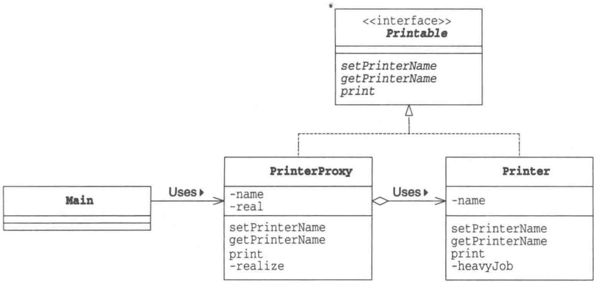
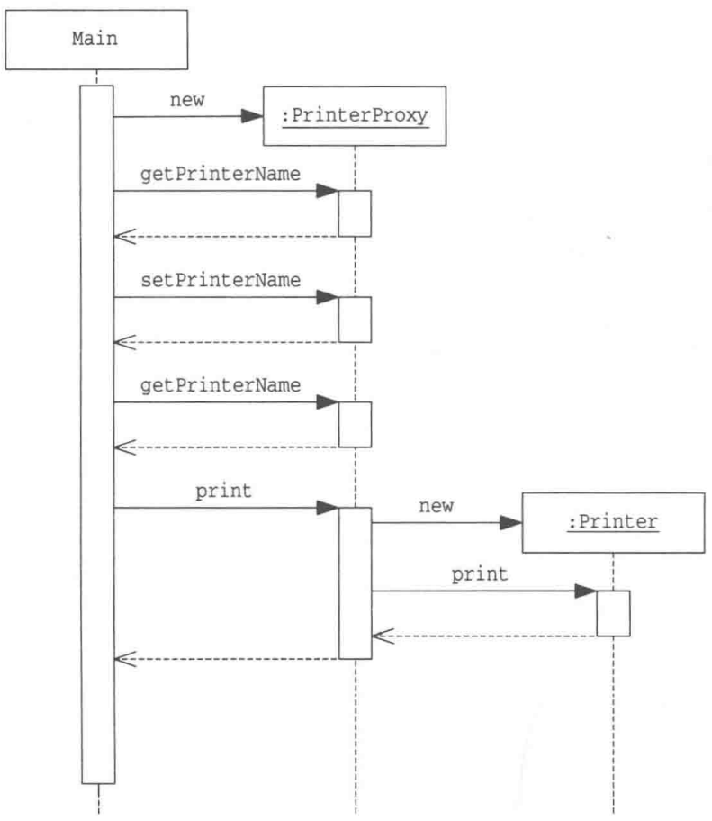
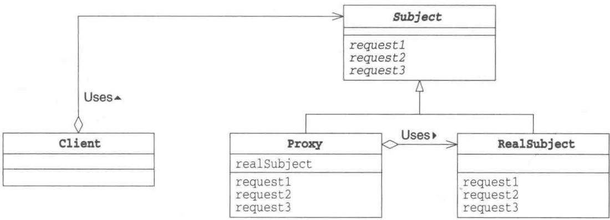

# 第21章 Proxy模式——只在必要时生成实例

> 来源：《图解设计模式》PDF 第 282–291 页，MinerU OCR 转写，如有疑问以原书为准

<!-- PDF p282 -->


<!-- PDF p283 · 书页 250 -->

## 21.1 Proxy 模式

在本章中，我们将要学习Proxy模式。

Proxy 是 “代理人” 的意思，它指的是代替别人进行工作的人。当不一定需要本人亲自进行工作时，就可以寻找代理人去完成工作。但代理人毕竟只是代理人，能代替本人做的事情终究是有限的。因此，当代理人遇到无法自己解决的事情时就会去找本人解决该问题。

在面向对象编程中，“本人”和“代理人”都是对象。如果“本人”对象太忙了，有些工作无法自己亲自完成，就将其交给“代理人”对象负责。

## 21.2 示例程序

下面我们来看一段使用了 Proxy 模式的示例程序。这段示例程序实现了一个“带名字的打印机”。说是打印机，其实只是将文字显示在界面上而已。在 Main 类中会生成 PrinterProxy 类的实例（即“代理人”）。首先我们会给实例赋予名字 Alice 并在界面中显示该名字。接着会将实例名字改为 Bob，然后显示该名字。在设置和获取名字时，都不会生成真正的 Printer 类的实例（即本人），而是由 PrinterProxy 类代理。最后，直到我们调用 print 方法，开始进入实际打印阶段后，PrinterProxy 类才会生成 Printer 类的实例。示例程序的类图请参见图 21-1，时序图请参见图 21-2。

为了让 PrinterProxy 类与 Printer 类具有一致性，我们定义了 Printable 接口。示例程序的前提是“生成 Printer 类的实例”这一处理需要花费很多时间。为了在程序中体现这一点，我们在 Printer 类的构造函数中调用了 heavyJob 方法，让它干一些“重活”（虽说是重活，也不过是让程序睡眠 5 秒钟）。

表21-1 类和接口的一览表

| 名字 | 说明 |
| --- | --- |
| Printer | 表示带名字的打印机的类(本人) |
| Printable | Printer 和 PrinterProxy 的共同接口 |
| PrinterProxy | 表示带名字的打印机的类(代理人) |
| Main | 测试程序行为的类 |

<!-- PDF p284 · 书页 251 -->

图21-1 示例程序的类图



图21-2 示例程序的时序图



### Printer类

Printer类（代码清单21-1）是表示“本人”的类。

在之前的学习中我们也了解到了，在它的构造函数中，我们让它做一些所谓的“重活”（heavyJob）。setPrinterName 方法用于设置打印机的名字；getPrinterName 用于获取打印机的名字。

<!-- PDF p285 · 书页 252 -->

print 方法则用于显示带一串打印机名字的文字。

heavyJob 是一个干 5 秒钟 “重活” 的方法，它每秒（1000 毫秒）以点号（.）显示一次干活的进度。

Proxy 模式的核心是 PrinterProxy 类。Printer 类自身并不难理解。

代码清单 21-1 Printer 类（Printer.java）

```java
/**
 * 【Proxy 模式】：用“代理人”先应付简单的事，真正需要时才让“本人”出场
 * 比喻：明星经纪人 —— 问名字、改名字经纪人就能处理，真要表演才叫明星来
 * Printer（本人）：创建很慢（heavyJob 模拟耗时 5 秒）
 */
public class Printer implements Printable {
    private String name;
    public Printer() {
        heavyJob("正在生成Printer的实例");
    }
    public Printer(String name) { // 构造函数
        this.name = name;
        heavyJob("正在生成Printer的实例(" + name + ")");
    }
    public void setPrinterName(String name) { // 设置名字
        this.name = name;
    }
    public String getPrinterName() { // 获取名字
        return name;
    }
    public void print(String string) { // 显示带打印机名字的文字
        System.out.println("=== " + name + " ===");
        System.out.println(string);
    }
    private void heavyJob(String msg) { // 重活
        System.out.print(msg);
        for (int i = 0; i < 5; i++) {
            try {
                Thread.sleep(1000);
            } catch (InterruptedException e) {
            }
            System.out.print(".");
        }
        System.out.println("结束。");
    }
}
```

### Printable 接口

Printable 接口（代码清单 21-2）用于使 PrinterProxy 类和 Printer 类具有一致性。setPrinterName 方法用于设置打印机的名字；getPrinterName 用于获取打印机的名字；print 用于显示文字（打印输出）。

代码清单 21-2 Printable 接口 (Printable.java)

```java
// 共同接口：代理人和本人都实现它，调用方分不出是谁
public interface Printable {
    public abstract void setPrinterName(String name);    // 设置名字
    public abstract String getPrinterName();            // 获取名字
    public abstract void print(String string);          // 显示文字(打印输出)
}
```

<!-- PDF p286 · 书页 253 -->

### PrinterProxy类

PrinterProxy 类（代码清单 21-3）是扮演“代理人”角色的类，它实现了 Printable 接口。

name 字段中保存了打印机的名字，而 real 字段中保存的是 “本人”。

在构造函数中设置打印机的名字（此时还没有生成“本人”）。

setPrinterName 方法用于设置新的打印机名字。如果 real 字段不为 null（也就是已经生成了“本人”），那么会设置“本人”的名字 ① 。但是当 real 字段为 null 时（即还没有生成“本人”），那么只会设置自己（PrinterProxy 的实例）的名字。

getPrinterName 会返回自己的 name 字段。

print 方法已经超出了代理人的工作范围，因此它会调用 realize 方法来生成本人。Realize 有 “实现”（使成为真的东西）的意思。在调用 realize 方法后，real 字段中会保存本人（Print 类的实例），因此可以调用 real.print 方法。这就是 “委托”。

不论 setPrinterName 方法和 getPrinterName 方法被调用多少次，都不会生成 Printer 类的实例。只有当真正需要本人时，才会生成 Printer 类的实例（PrinterProxy 类的调用者完全不知道是否生成了本人，也不用在意是否生成了本人）。

realize 方法很简单，当 real 字段为 null 时，它会使用 new Printer 来生成 Printer 类的实例；如果 real 字段不为 null（即已经生成了本人），则什么都不做。

这里希望大家记住的是，Printer 类并不知道 PrinterProxy 类的存在。即，Printer 类并不知道自己到底是通过 PrinterProxy 被调用的还是直接被调用的。

但反过来，PrinterProxy 类是知道 Printer 类的。这是因为 PrinterProxy 类的 real 字段是 Printer 类型的。在 PrinterProxy 类的代码中，显式地写出了 Printer 这个类名。因此，PrinterProxy 类是与 Printer 类紧密地关联在一起的组件（关于它们之间的解耦方法，请参见习题 21-1）。

相信细心的读者应该已经发现了 Printer 类的 setPrinterName 方法和 realize 方法都是 synchronized 方法。我们会在习题 21-2 中讨论这样设计的原因。

代码清单 21-3 PrinterProxy 类 (PrinterProxy.java)

```java
// 代理人：名字相关的操作自己处理，不创建 Printer（上半部分）
public class PrinterProxy implements Printable {
    private String name;                 // 名字
    private Printer real;                // “本人”
    public PrinterProxy() {
    }
    public PrinterProxy(String name) {   // 构造函数
        this.name = name;
    }
    public synchronized void setPrinterName(String name) {  // 设置名字
        if (real != null) {
            real.setPrinterName(name);  // 同时设置“本人”的名字
        }
        this.name = name;
    }
    public String getPrinterName() {   // 获取名字
```

① 在设置“本人”的名字后还会同时设置自己（PrinterProxy的实例）的名字。这一点可以从代码中看出来。——译者注

<!-- PDF p287 · 书页 254 -->

```java
// 代理人（下半部分）：只有 print 时才调用 realize() 真正创建 Printer（延迟创建）
return name;
}
public void print(String string) { // 显示
    realize();
    real.print(string);
}
private synchronized void realize() { // 生成“本人”
    if (real == null) {
        real = new Printer(name);
    }
}
}
```

### Main类

Main 类(代码清单 21-4)通过 PrinterProxy 类使用 Printer 类。Main 类首先会生成 PrinterProxy，然后调用 getPrinterName 方法获取打印机名并显示它。之后通过 setPrinterName 方法重新设置打印机名。最后，调用 print 方法输出 "Hello.world."。

示例程序的运行结果如图 21-3 所示。请注意，在设置名字和显示名字之间并没有生成 Printer 的实例（本人），直至调用 print 方法后，Printer 的实例才被生成。

代码清单 21-4 Main 类 (Main.java)

```java
// 使用：取名、改名都很快；直到 print 时才花 5 秒创建 Printer
public class Main {
    public static void main(String[] args) {
        Printable p = new PrinterProxy("Alice");
        System.out.println(" 现在的名字是 " + p.getPrinterName() + "。 ");
        p.setPrinterName("Bob");
        System.out.println(" 现在的名字是 " + p.getPrinterName() + "。 ");
        p.print("Hello, world.");
    }
}
```

图21-3 示例程序的运行结果

```text
现在的名字是 Alice。
现在的名字是 Bob。
Printer 的实例 (Bob) 生成中……结束。
===Bob ===
Hello, world.
```

## 21.3 Proxy 模式中的登场角色

在Proxy模式中有以下登场角色。

### ◆ Subject（主体）

Subject 角色定义了使 Proxy 角色和 RealSubject 角色之间具有一致性的接口。由于存在 Subject 角色，所以 Client 角色不必在意它所使用的究竟是 Proxy 角色还是 RealSubject 角色。在示例程序中，由 Printable 接口扮演此角色。

<!-- PDF p288 · 书页 255 -->

### ◆ Proxy（代理人）

Proxy 角色会尽量处理来自 Client 角色的请求。只有当自己不能处理时，它才会将工作交给 RealSubject 角色。Proxy 角色只有在必要时才会生成 RealSubject 角色。Proxy 角色实现了在 Subject 角色中定义的接口（API）。在示例程序中，由 PrinterProxy 类扮演此角色。

### ◆ RealSubject（实际的主体）

“本人”RealSubject角色会在“代理人”Proxy角色无法胜任工作时出场。它与Proxy角色一样，也实现了在Subject角色中定义的接口（API）。在示例程序中，由Printer类扮演此角色。

### ◆ Client（请求者）

使用 Proxy 模式的角色。在 GoF 书（请参见附录 E[GoF]）中，Client 角色并不包含在 Proxy 模式中。在示例程序中，由 Main 类扮演此角色。

图21-4 Proxy模式的类图



## 21.4 拓展思路的要点

### 使用代理人来提升处理速度

在 Proxy 模式中，Proxy 角色作为代理人尽力肩负着工作使命。例如，在示例程序中，通过使用 Proxy 角色，我们成功地将耗时处理（生成实例的处理）推迟至 print 方法被调用后才进行。

示例程序中的耗时处理的消耗时间并不算太长，大家可能感受不深。请大家试想一下，假如在一个大型系统的初始化过程中，存在大量的耗时处理。如果在启动系统时连那些暂时不会被使用的功能也初始化了，那么应用程序的启动时间将会非常漫长，这将会引发用户的不满。而如果我们只在需要使用某个功能时才将其初始化，则可以帮助我们改善用户体验。

GoF 书（请参见附录 E[GoF]）在讲解 Proxy 模式时，使用了一个可以在文本中嵌入图形对象（例如图片等）的文本编辑器作为例子。为了生成这些图形对象，需要读取图片文件，这很耗费时间。因此如果在打开文档时就生成有所的图形对象，就会导致文档打开时间过长。所以，最好是当用户浏览至文本中各个图形对象时，再去生成它们的实例。这时，Proxy 模式就有了用武之地。

<!-- PDF p289 · 书页 256 -->

### 有必要划分代理人和本人吗

当然，我们也可以不划分 PrinterProxy 类和 Printer 类，而是直接在 Printer 类中加入惰性求值功能（即只有必要时才生成实例的功能）。不过，通过划分 PrinterProxy 角色和 Printer 角色，可以使它们成为独立的组件，在进行修改时也不会互相之间产生影响（分而治之）。

只要改变了 PrinterProxy 类的实现方式，即可改变在 Printable 接口中定义的那些方法，即对于“哪些由代理人负责处理，哪些必须本人负责处理”进行更改。而且，不论怎么改变，都不必修改 Printer 类。如果不想使用惰性求值功能，只需要修改 Main 类，将它使用 new 关键字生成的实例从 PrinterProxy 类的实例变为 Printer 类的实例即可。由于 PrinterProxy 类和 Printer 类都实现了 Printable 接口，因此 Main 类可以放心地切换这两个类。

在示例程序中，PrinterProxy 类代表了 “Proxy 角色”。因此使用或是不使用 PrinterProxy 类就代表了使用或是不使用代理功能。

### 代理与委托

代理人只代理他能解决的问题。当遇到他不能解决的问题时，还是会“转交”给本人去解决。这里的“转交”就是在本书中多次提到过的“委托”。从PrinterProxy类的print方法中调用real.print方法正是这种“委托”的体现。

在现实世界中，应当是本人将事情委托给代理人负责，而在设计模式中则是反过来的。

### 透明性

PrinterProxy 类和 Printer 类都实现了 Printable 接口，因此 Main 类可以完全不必在意调用的究竟是 PrinterProxy 类还是 Printer 类。无论是直接使用 Printer 类还是通过 PrinterProxy 类间接地使用 Printer 类都可以。

在这种情况下，可以说 PrinterProxy 类是具有 “透明性” 的。就像在人和一幅画之间放置了一块透明的玻璃板后，我们依然可以透过它看到画一样，即使在 Main 类和 Printer 类之间加入一个 PrinterProxy 类，也不会有问题。

### HTTP 代理

提到代理，许多人应该都会想到 HTTP 代理。HTTP 代理是指位于 HTTP 服务器（Web 服务器）和 HTTP 客户端（Web 浏览器）之间，为 Web 页面提供高速缓存等功能的软件。我们也可以认为它是一种 Proxy 模式。

HTTP 代理有很多功能。作为示例，我们只讨论一下它的页面高速缓存功能。

通过 Web 浏览器访问 Web 页面时，并不会每次都去访问远程 Web 服务器来获取页面的内容，而是会先去获取 HTTP 代理缓存的页面。只有当需要最新页面内容或是页面的缓存期限过期时，才去访问远程 Web 服务器。

在这种情况下，Web 服务器扮演的是 Client 角色，HTTP 代理扮演的是 Proxy 角色，而 Web 服务器扮演的则是 RealSubject 角色。

<!-- PDF p290 · 书页 257 -->

### 各种Proxy模式

Proxy 模式有很多种变化形式。

### ◆ Virtual Proxy（虚拟代理）

Virtual Proxy 就是本章中学习的 Proxy 模式。只有当真正需要实例时，它才生成和初始化实例。

### ◆ Remote Proxy（远程代理）

Remote Proxy 可以让我们完全不必在意 RealSubject 角色是否在远程网络上，可以如同它在自己身边一样（透明性地）调用它的方法。Java 的 RMI（RemoteMethodInvocation:远程方法调用）就相当于 Remote Proxy。

### ◆ Access Proxy

Access Proxy 用于在调用 RealSubject 角色的功能时设置访问限制。例如，这种代理可以只允许指定的用户调用方法，而当其他用户调用方法时则报错。

## 21.5 相关的设计模式

### ◆ Adapter 模式（第 2 章）

Adapter 模式适配了两种具有不同接口（API）的对象，以使它们可以一同工作。而在 Proxy 模式中，Proxy 角色与 RealSubject 角色的接口（API）是相同的（透明性）。

### ◆ Decorator 模式（第 12 章）

Decorator 模式与 Proxy 模式在实现上很相似，不过它们的使用目的不同。

Decorator 模式的目的在于增加新的功能。而在 Proxy 模式中，与增加新功能相比，它更注重通过设置代理人的方式来减轻本人的工作负担。

## 21.6 本章所学知识

在本章中，我们学习了 Proxy 模式，即让代理人负责完成工作，除非那些工作必须由本人完成。

## 21.7 练习题

答案请参见附录 A (P.340)

### 习题21-1

Java 在示例程序中，PrinterProxy 类（代码清单 21-3）知道 Printer 类（代码清单 21-1）。即在 PrinterProxy 类中显式地写明了 Printer 类的类名。
请修改 PrinterProxy 类，让其不必知道 Printer 类。

提示 有许多不同的实现方法。这里请大家试着将 RealSubject 角色的类名作为字符串传递给PrinterProxy类的构造函数。

<!-- PDF p291 · 书页 258 -->

Java 在示例程序中，PrinterProxy 类（代码清单 21-3）的 setPrinterName 方法和 realize 方法都是 synchronized 方法。如果不使用 synchronized 方法会有什么问题呢？请举例说明。

#### 答案（附录 A）

代码请参见代码清单 A21-1、代码清单 A21-2。生成实例的部分被修改为如下代码。

```text
# 习题 1：用反射按类名创建“本人”，代理就不用写死 Printer 类名
real = (Printable)Class.forName(className).newInstance();
```

此外，real 的类型也从 Printer 类型变为了 Printable 类型。

这样，PrinterProxy 类可以从 Printer 类中分离出来作为独立的组件使用，而且只要是实现了 Printable 接口的类都可以扮演 Proxy 的角色。

<!-- PDF p374 · 书页 341 -->

注意 在编译代码时，必须像下面这样，不仅指定 Main.java，还需要指定 Printer.java（因为 Printer 类并没有被直接使用）。

```text
javac Main.java Printer.java
```

关于 Class 类和 forName 方法，请参见 Abstract Factory 模式（本书第 8 章）中的详细讲解。

代码清单 A21-1 PrinterProxy 类 (PrinterProxy.java)

```java
// 习题 1 答案：PrinterProxy 构造时传入“本人”的类名，realize() 里用反射创建
public class PrinterProxy implements Printable {
    private String name;          // 名字
    private Printable real;       // "本人"
    private String className;      // "本人" 的类名
    public PrinterProxy(String name, String className) {      // 构造函数
        this.name = name;
        this.className = className;
    }
    public synchronized void setPrinterName(String name) {  // 设置名字
        if (real != null) {
            real.setPrinterName(name);   // 同时设置 "本人" 的名字
        }
        this.name = name;
    }
    public String getPrinterName() {     // 获取名字
        return name;
    }
    public void print(String string) {  // 显示
        realize();
        real.print(string);
    }
    private synchronized void realize() {   // 生成 "本人"
        if (real == null) {
            try {
                real = (Printable)Class.forName(className).newInstance();
                real.setPrinterName(name);
            } catch (ClassNotFoundException e) {
                System.err.println("没有找到 " + className + " 类。");
            } catch (Exception e) {
                e.printStackTrace();
            }
        }
    }
}
```

代码清单 21-2 Main 类 (Main.java)

```java
// 习题 1：使用时传入类名 "Printer"
public class Main {
    public static void main(String[] args) {
        Printable p = new PrinterProxy("Alice", "Printer");
        System.out.println("现在的名字是" + p.getPrinterName() + "。");
        p.setPrinterName("Bob");
        System.out.println("现在的名字是" + p.getPrinterName() + "。");
        p.print("Hello, world.");
    }
}
```

<!-- PDF p375 · 书页 342 -->

图 A21-1 编译和运行结果

```text
javac Main.java Printer.java
java Main
现在的名字是 Alice。
现在的名字是 Bob。
Printer 的实例生成中……结束。
=== Bob ===
Hello, world.
```

请大家仔细对比一下示例程序的运行结果（图 21-3）与图 A21-1 中的运行结果。在图 A21-1 中，在 “Printer 的实例生成中” 处并没有显示名字（Bob）。这是因为实例是通过 newInstance 方法生成的，调用的是 Printer 类的不带参数的构造函数。

### 习题21-2

#### 答案（附录 A）

如果没有使用修饰符 synchronized，当多个线程分别调用 setPrinterName 方法和 realize 方法时，可能会导致 PrinterProxy 类的 name 与 Printer 类的 name 不同。

代码清单 A21-3 展示了不使用修饰符 synchronized 的程序。

代码清单 A21-3 不使用修饰符 synchronized 时（为了便于讲解，我们在最左边加上了字母和数字）

```java
// 习题 2：如果去掉 setPrinterName 和 realize 的 synchronized，会出什么问题？
public void setPrinterName(String name) { // 设置名字
    if (real != null) {
        real.setPrinterName(name);          // 同时设置“本人”的名字
    }
    this.name = name;
}
...
private void realize() {                  // 生成“本人”
    if (real == null) {
        real = new Printer(name);
    }
}
```

图 A21-2 不使用 synchronized 修饰符时导致名字不同

```text
# 答案：线程 B 已经用旧名字 Alice 创建了 Printer，线程 A 才把代理的名字改成 Bob → 两边名字不一致
name的值 real的值 线程A 线程B
"Alice" null 运行至1:
"Alice" null 在2:判断real是否为null
    切换至线程B
"Alice" null 运行至a:
"Alice" null 在b:判断real是否为null
"Alice" 非null 在c:生成名叫Alice的Printer的实例并将它赋值给real
    切换至线程A
"Bob" 非null 在5:将Bob赋值给name
※这时,PrinterProxy类的name变成了Bob,但Printer类的name却是Alice。
```

<!-- PDF p376 · 书页 343 -->

最开始时，PrinterProxy 类的 name 字段的值是 "Alice"，real 字段的值是 null（即还没有生成 Printer 类的实例）。

假设线程 A 在执行 setPrinterName("Bob") 的同时，线程 B（通过 print 方法）调用了 realize 方法。这时，如果发生了图 A21-2 所示的线程切换，会出现 PrinterProxy 类的 name 字段的值是 "Bob"，但 Printer 类的 name 却是 Alice 的问题。

通过将 setPrinterName 方法和 realize 方法定义为 synchronized 方法，可以避免发生这样的线程切换，防止分别进行判断 real 字段值的处理和设置 real 字段值的处理。可以说，synchronized 方法 “守护着” real 字段。
