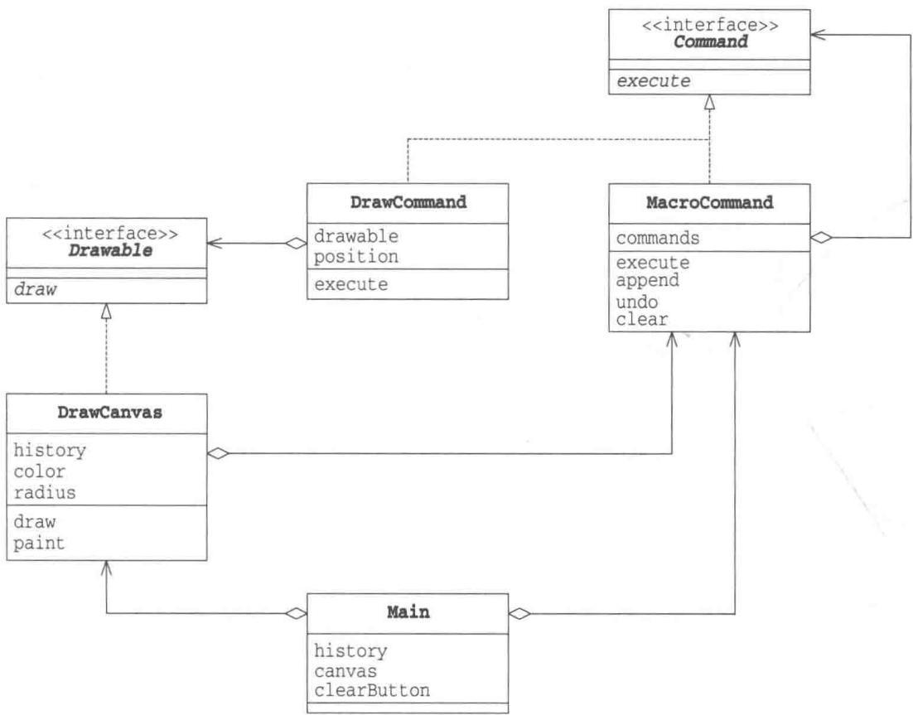
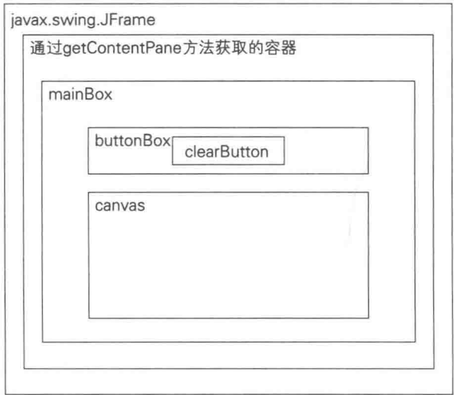
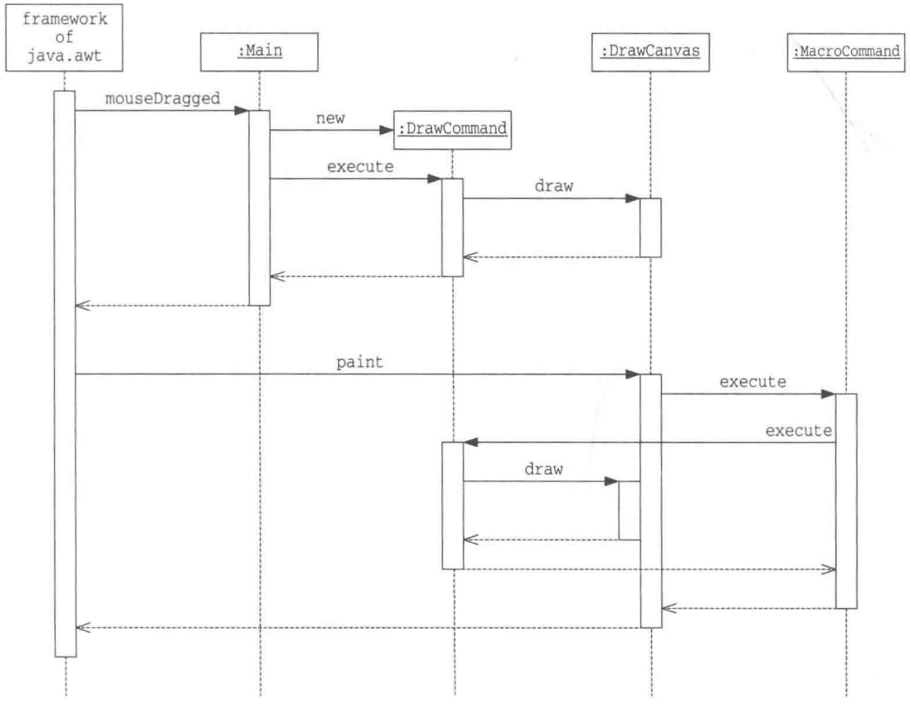
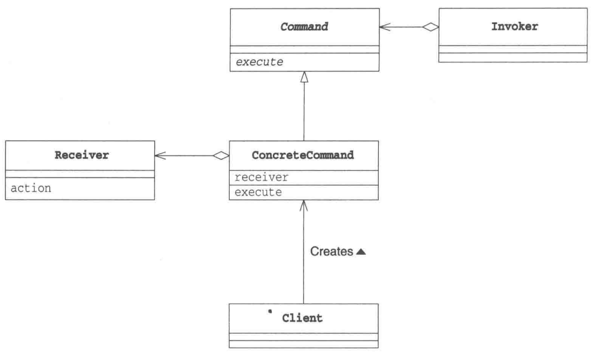
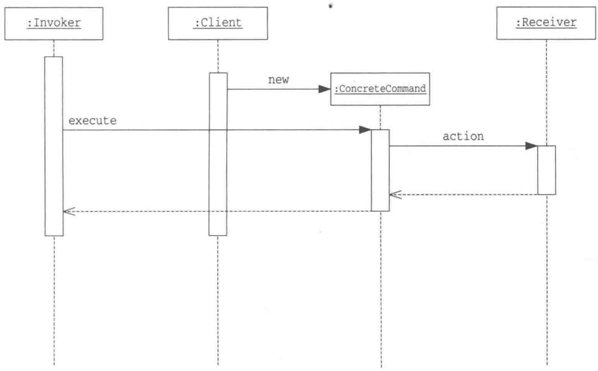
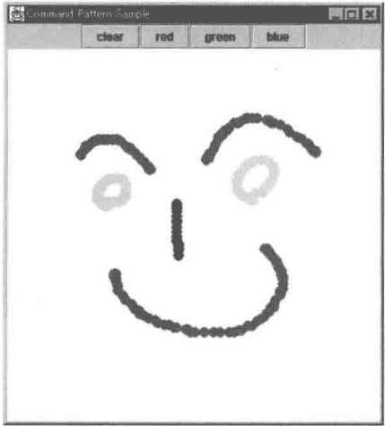
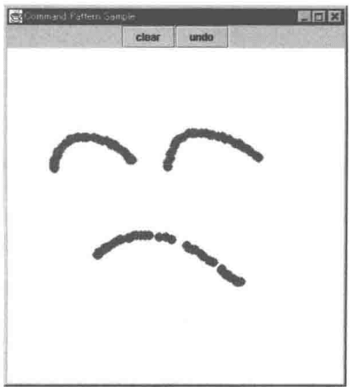
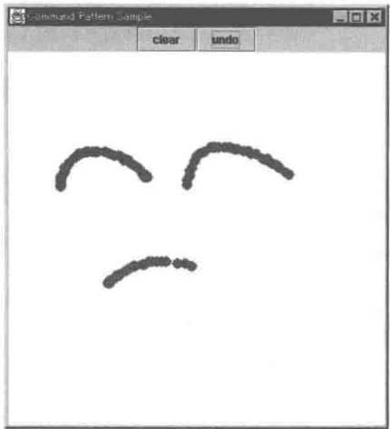
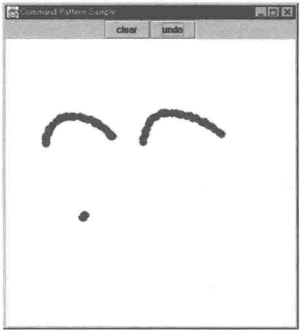

# 第22章 Command模式——命令也是类

> 来源：《图解设计模式》PDF 第 292–305 页，MinerU OCR 转写，如有疑问以原书为准

<!-- PDF p292 -->


<!-- PDF p293 · 书页 260 -->

## 22.1 Command 模式

一个类在进行工作时会调用自己或是其他类的方法，虽然调用结果会反映在对象的状态中，但并不会留下工作的历史记录。

这时，如果我们有一个类，用来表示“请进行这项工作”的“命令”就会方便很多。每一项想做的工作就不再是“方法的调用”这种动态处理了，而是一个表示命令的类的实例，即可以用“物”来表示。要想管理工作的历史记录，只需管理这些实例的集合即可，而且还可以随时再次执行过去的命令，或是将多个过去的命令整合为一个新命令并执行。

在设计模式中，我们称这样的“命令”为 Command 模式（command 有“命令”的意思）。

Command 有时也被称为事件 (event)。它与 “事件驱动编程” 中的 “事件” 是一样的意思。当发生点击鼠标、按下键盘按键等事件时，我们可以先将这些事件作成实例，然后按照发生顺序放入队列中。接着，再依次去处理它们。在 GUI（graphical user interface）编程中，经常需要与 “事件” 打交道。

在本章中，我们将学习与“命令”打交道的Command模式。

## 22.2 示例程序

下面我们来看一段使用了 Command 模式的示例程序。这段示例程序是一个画图软件，它的功能很简单，即用户拖动鼠标时程序会绘制出红色圆点，点击 clear 按钮后会清除所有的圆点。

用户每拖动一次鼠标，应用程序都会为“在这个位置画一个点”这条命令生成一个DrawCommand类的实例。只要保存了这条命令，以后有需要时就可以重新绘制。

图22-1 示例程序的运行结果


示例程序中的类和接口的一览请参见表 22-1。示例程序一共被划分成了 3 个包。

<!-- PDF p294 · 书页 261 -->

表 22-1 类和接口的一览表

| 包 | 名字 | 说明 |
| --- | --- | --- |
| command | Command | 表示“命令”的接口 |
| command | MacroCommand | 表示“由多条命令整合成的命令”的类 |
| drawer | DrawCommand | 表示“绘制一个点的命令”的类 |
| drawer | Drawable | 表示“绘制对象”的接口 |
| drawer | DrawCanvas | 实现“绘制对象”的类 |
| 无名 | Main | 测试程序行为的类 |

command 包中存放的是与 “命令” 相关的类和接口，而 drawer 包中存放的则是与 “绘制” 相关的类和接口。Main 类没有放在任何包中。

图22-2 示例程序的类图



### Command接口

Command 接口（代码清单 22-1）是表示“命令”的接口。在该接口中只定义了一个方法，即 execute（execute 有“执行”的意思）。至于调用 execute 方法后具体会进行什么样的处理，则取决于实现了 Command 接口的类。总之，Command 接口的作用就是“执行”什么东西。

代码清单 22-1 Command 接口 (Command.java)

package command;

public interface Command {

<!-- PDF p295 · 书页 262 -->

```java
// 【Command 模式】：把“操作”封装成对象，于是可以保存、排队、重放、撤销
// 命令接口：只有一个 execute()
public abstract void execute();
}
```

### MacroCommand 类

MacroCommand 类（代码清单 21-2）表示 “由多条命令整合成的命令”。该类实现了 Command 接口。MacroCommand 中的 Macro 有 “大量的” 的意思，在编程中，它一般表示 “由多条命令整合成的命令”。

MacroCommand类的 commands 字段是 java.util.Stack 类型的，它是保存了多个 Command（实现了 Command 接口的类的实例）的集合。虽然这里也可以使用 java.util.ArrayList 类型，不过后文中会提到，为了能轻松地实现 undo 方法，我们还是决定使用 java.util.Stack 类型。

由于 MacroCommand 类实现了 Command 接口，因此在它内部也定义了 execute 方法。那么 execute 方法应该进行什么处理呢？既然要运行多条命令，那么只调用 commands 字段中各个实例的 execute 方法不就可以了吗？这样，就可以将 MacroCommand 自己保存的所有 Command 全部执行一遍。不过，如果 while 循环中要执行的 Command 又是另外一个 MacroCommand 类的实例呢？这时，该实例中的 execute 方法也是会被调用的。因此，最后的结果就是所有的 Command 全部都会被执行。

append 方法用于向 MacroCommand 类中添加新的 Command（所谓“添加新的 Command”是指添加新的实现（implements）了 Command 接口的类的实例）。新增加的 Command 也可能是 MacroCommand 类的实例。这里的 if 语句的作用是防止不小心将自己（this）添加进去。如果这么做了，execute 方法将会陷入死循环，永远不停地执行。这里我们使用了 java.util.Stack 类的 push 方法，它会将元素添加至 java.util.Stack 类的实例的末尾。

undo 方法用于删除 commands 中的最后一条命令。这里我们使用了 java.util.Stack 类的 pop 方法，它会将 push 方法添加的最后一条命令取出来。被取出的命令将会从 Stack 类的实例中被移除。

clear 方法用于删除所有命令。

代码清单 22-2 MacroCommand 类 (MacroCommand.java)

```java
// 宏命令：由多条命令组成的命令，execute 时依次执行全部
// 用栈保存 → undo 删除最后一条；cmd != this 防止把自己加进去造成无限循环
package command;

import java.util.Stack;
import java.util.Iterator;

public class MacroCommand implements Command {
    // 命令的集合
    private Stack commands = new Stack();
    // 执行
    public void execute() {
        Iterator it = commands.iterator();
        while (it.hasNext()) {
            ((Command)it.next()).execute();
        }
    }
    // 添加命令
    public void append(Command cmd) {
        if (cmd != this) {
commands.push(cmd);
    }
}
// 删除最后一条命令
public void undo() {
    if (!commands.empty()) {
        commands.pop();
    }
}
// 删除所有命令
public void clear() {
    commands.clear();
}
```

<!-- PDF p296 · 书页 263 -->

### DrawCommand 类

DrawCommand 类（代码清单 22-3）实现了 Command 接口，表示“绘制一个点的命令”。在该类中有两个字段，即 drawable 和 position。drawable 保存的是“绘制的对象”（我们会在稍后学习 Drawable 接口）；position 保存的是“绘制的位置”。Point 类是定义在 java.awt 包中的类，它表示由 X 轴和 Y 轴构成的平面上的坐标。

DrawCommand 类的构造函数会接收两个参数，一个是实现了 Drawable 接口的类的实例，一个是 Point 类的实例，接收后会将它们分别保存在 drawable 字段和 position 字段中。它的作用是生成“在这个位置绘制点”的命令。

execute 方法调用了 drawable 字段的 draw 方法。它的作用是执行命令。

代码清单 22-3 DrawCommand 类 (DrawCommand.java)

```java
// 具体命令：“在某个位置画一个点”—— 记住画在哪（position）、画到哪里（drawable）
package drawer;

import command.Command;
import java.awt.Point;

public class DrawCommand implements Command {
    // 绘制对象
    protected Drawable drawable;
    // 绘制位置
    private Point position;
    // 构造函数
    public DrawCommand(Drawable drawable, Point position) {
        this.drawable = drawable;
        this.position = position;
    }
    // 执行
    public void execute() {
        drawable.draw(position.x, position.y);
    }
}
```

### Drawable 接口

Drawable 接口（代码清单 22-4）是表示 “绘制对象” 的接口。draw 方法是用于绘制的方法。

<!-- PDF p297 · 书页 264 -->

代码清单 22-5 DrawCanvas 类 (DrawCanvas.java)

在示例程序中，我们尽量让需求简单一点，因此暂时不考虑指定点的颜色和点的大小。关于指定点的颜色的问题，我们会在习题 22-1 中讨论。

代码清单 22-4 Drawable 接口 (Drawable.java)

```java
// 绘制对象的接口：能在 (x, y) 位置画点
package drawer;

public interface Drawable {
    public abstract void draw(int x, int y);
}
```

### DrawCanvas类

DrawCanvas 类（代码清单 22-5）实现了 Drawable 接口，它是 java.awt.Canvas 的子类。

在 history 字段中保存的是 DrawCanvas 类自己应当执行的绘制命令的集合。该字段是 command.MacroCommand 类型的。

DrawCanvas 类的构造函数使用接收到的宽(width)、高(height)和绘制内容(history)去初始化 DrawCanvas 类的实例。在构造函数内部被调用的 setSize 方法和 setBackground 方法是 java.awt.Canvas 的方法，它们的作用分别是指定大小和背景色。

当需要重新绘制 DrawCanvas 时，Java 处理（java.awt 的框架）会调用 print 方法。它所做的事情仅仅是调用 history.execute 方法。这样，记录在 history 中的所有历史命令都会被重新执行一遍。

draw 方法是为了实现 Drawable 接口而定义的方法。DrawCanvas 类实现了该方法，它会调用 g.setColor 指定颜色，调用 g.fillOval 画圆点。

```java
// 画布：实现 Drawable；同时保存所有命令的历史（history），重绘时把历史全部重新执行一遍
package drawer;

import command.*;

import java.util.*;
import java.awt.*;
import java.awt.event.*;
import javax.swing.*;

public class DrawCanvas extends Canvas implements Drawable {
    // 颜色
    private Color color = Color.red;
    // 要绘制的圆点的半径
    private int radius = 6;
    // 命令的历史记录
    private MacroCommand history;
    // 构造函数
    public DrawCanvas(int width, int height, MacroCommand history) {
        setSize(width, height);
        setBackground(Color.white);
        this.history = history;
    }
    // 重新全部绘制
    public void paint(Graphics g) {
        history.execute();
}
// 绘制
public void draw(int x, int y) {
    Graphics g = getGraphics();
    g.setColor(color);
    g.fillOval(x - radius, y - radius, radius * 2, radius * 2);
}
}
```

<!-- PDF p298 · 书页 265 -->

### Main类

Main 类（代码清单 22-6）是启动应用程序的类。

在 history 字段中保存的是绘制历史记录。它会被传递给 DrawCanvas 的实例。也就是说，Main 类的实例与 DrawCanvas 类的实例共享绘制历史记录。

canvas字段表示绘制区域。它的初始值是 400 × 400。

clearButton 字段是用于删除已绘制圆点的按钮。JButton 类是在 javax.swing 包中定义的按钮类。

Main 类的构造函数中设置了用于接收鼠标按下等事件的监听器（listener），并安排了各个控件（组件）在界面中的布局。

为了便于大家在解答本章习题时扩展程序，这里我们将按钮的布局稍微弄得复杂了些。首先，我们设置了一个用于横向放置控件的 buttonBox 按钮盒。请注意，为了可以在里面横向放置控件，我们在调用它的构造函数时传递了参数 BoxLayout.X\_AXIS。接着，我们在 buttonBox 中放置了一个 clearButton。然后，又设置了一个用于纵向放置控件的按钮盒 mainBox，并将 buttonBox 和 canvas 置于其中。

最后，我们将 mainBox 置于 JFrame 中。也可以直接在 java.awt.JFrame 中放置控件，不过如果是在 javax.swing.JFrame 中，则必须将控件放置在通过 getContentPane 方法获取的容器之内（图 22-3）。

图22-3 控件布局



Main 类实现了 ActionListener 接口中的 actionPerformed 方法。clearButton 被按下后会清空所有绘制历史记录，然后重新绘制 canvas。

<!-- PDF p299 · 书页 266 -->

Main 类还实现了在 MouseMotionListener 接口中的 mouseMoved 方法和 mouseDragged 方法。当鼠标被拖动时 (mouseDragged)，会生成一条 “在这个位置画点” 的命令。该命令会先被添加至绘制历史记录中。

```text
history.append(cmd);
```

然后立即执行。

```text
cmd.execute();
```

Main 类还实现了在 WindowListener 中定义的那些以 window 开头的方法。除了退出处理的方法 (exit) 外，其他方法什么都不做。

main 方法中生成了 Main 类的实例，启动了应用程序。

示例程序的时序图如图 22-4 所示。

代码清单 22-6 Main 类 (Main.java)

```java
/**
 * 主窗口：鼠标拖动时，生成一个 DrawCommand → 加入历史 → 立即执行
 * 点“clear”按钮：清空历史并重绘
 * 实现了很多监听器接口，所以有不少空方法（见后面的适配器改进）
 */
import command.*;
import drawer.*;

import java.awt.*;
import java.awt.event.*;
import javax.swing.*;

public class Main extends JFrame implements ActionListener, MouseMotionListener,
WindowListener {
    // 绘制的历史记录
    private MacroCommand history = new MacroCommand();
    // 绘制区域
    private DrawCanvas canvas = new DrawCanvas(400, 400, history);
    // 删除按钮
    private JButton clearButton = new JButton("clear");

    // 构造函数
    public Main(String title) {
        super(title);

        this.addWindowListener(this);
        canvas.addMouseMotionListener(this);
        clearButton.addActionListener(this);

        Box buttonBox = new Box(BoxLayout.X_AXIS);
        buttonBox.add(clearButton);
        Box mainBox = new Box(BoxLayout.Y_AXIS);
        mainBox.add(buttonBox);
        mainBox.add(canvas);
        getContentPane().add(mainBox);

        pack();
        show();
    }

    // ActionListener 接口中的方法

    public void actionPerformed(ActionEvent e) {
        if (e.getSource() == clearButton) {
history.clear();
    canvas.repaint();
}
}

// MouseMotionListener 接口中的方法
public void mouseMoved(MouseEvent e) {
}
public void mouseDragged(MouseEvent e) {
    Command cmd = new DrawCommand(canvas, e Industri();
    history.append(cmd);
    cmd.execute();
}

// WindowListener 接口中的方法
public void windowClosing(WindowEvent e) {
    System.exit(0);
}
public void windowActivated(WindowEvent e) {}
public void windowClosed(WindowEvent e) {}
public void windowDeactivated(WindowEvent e) {}
public void windowDeiconified(WindowEvent e) {}
public void windowIconified(WindowEvent e) {}
public void windowOpened(WindowEvent e) {}

public static void main(String[] args) {
    new Main("Command Pattern Sample");
}
}
```

<!-- PDF p300 · 书页 267 -->

图22-4 示例程序的时序图



<!-- PDF p301 · 书页 268 -->

## 22.3 Command 模式中的登场角色

在 Command 模式中有以下登场角色。

### ◆ Command（命令）

Command角色负责定义命令的接口（API）。在示例程序中，由Command接口扮演此角色。

### ◆ ConcreteCommand（具体的命令）

ConcreteCommand 角色负责实现在 Command 角色中定义的接口 (API)。在示例程序中，由 MacroCommand 类和 DrawCommand 类扮演此角色。

### ◆ Receiver（接收者）

Receiver 角色是 Command 角色执行命令时的对象，也可以称其为命令接收者。在示例程序中，由 DrawCanvas 类接收 DrawCommand 的命令。

### ◆ Client（请求者）

Client 角色负责生成 ConcreteCommand 角色并分配 Receiver 角色。在示例程序中，由 Main 类扮演此角色。在响应鼠标拖拽事件时，它生成了 DrawCommand 类的实例，并将扮演 Receiver 角色的 DrawCanvas 类的实例传递给了 DrawCommand 类的构造函数。

### ◆ Invoker（发动者）

Invoker 角色是开始执行命令的角色，它会调用在 Command 角色中定义的接口（API）。在示例程序中，由 Main 类和 DrawCanvas 类扮演此角色。这两个类都调用了 Command 接口中的 execute 方法。Main 类同时扮演了 Client 角色和 Invoker 角色。

Command 模式的类图如图 22-5 所示，时序图如图 22-6 所示。

图22-5 Command模式的类图



<!-- PDF p302 · 书页 269 -->

图22-6 Command模式的时序图



## 22.4 拓展思路的要点

### 命令中应该包含哪些信息

关于 “命令” 中应该包含哪些信息这个问题，其实并没有绝对的答案。命令的目的不同，应该包含的信息也不同。DrawCommand 类中包含了要绘制的点的位置信息，但不包含点的大小、颜色和形状等信息。

假设我们在 DrawCommand 类中保存了 “事件发生的时间戳”，那么当重新绘制时，不仅可以正确地画出图形，可能还可以重现出用户鼠标操作的缓急。

在 DrawCommand 类中还有表示绘制对象的 drawable 字段。在示例程序中，由于只有一个 DrawCanvas 的实例，所有的绘制都是在它上面进行的，所以这个 drawable 字段暂时没有太大意义。但是，当程序中存在多个绘制对象（即 Receiver 角色）时，这个字段就可以发挥作用了。这是因为只要 ConcreteCommand 角色自己“知道”Receiver 角色，不论谁来管理或是持有 ConcreteCommand 角色，都是可以执行 execute 方法的。

### 保存历史记录

在示例程序中，MacroCommand 类的实例（history）代表了绘制的历史记录。在该字段中保存了之前所有的绘制信息。也就是说，如果我们将它保存为文件，就可以永久保存历史记录。

### 适配器

示例程序的 Main 类（代码清单 22-6）实现了 3 个接口，但是并没有使用这些接口中的全部方法。例如 MouseMotionListener 接口中的以下方法。

<!-- PDF p303 · 书页 270 -->

```text
# MouseMotionListener 必须实现的两个方法（即使只用到 mouseDragged）
public void mouseMoved(MouseEvent e)
public void mouseDragged(MouseEvent e)
```

在这两个方法中，我们只用到了 mouseDragged 方法。

再例如，WindowListener 接口中的以下方法。

```text
# WindowListener 必须实现的方法（即使只用到 windowClosing）
public void windowClosing(WindowEvent e)
public void windowActivated(WindowEvent e)
public void windowClosed(WindowEvent e)
public void windowDeactivated(WindowEvent e)
public void windowDeiconified(WindowEvent e)
public void windowIconified(WindowEvent e)
public void windowOpened(WindowEvent e)
```

在这 7 个方法中，我们仅用到了 windowClosing 方法。

为了简化程序，java.awt.event 包为我们提供了一些被称为适配器（Adapter）的类。例如，对于 MouseMotionListener 接口有 MouseMotionAdapter 类；对 WindowListener 接口有 WindowAdapter 类（表 22-2）。这些适配器也是 Adapter 模式（第 2 章）的一种应用。

表 22-2 接口与适配器

| 接口 | 适配器 |
| --- | --- |
| MouseMotionListener | MouseMotionAdapter |
| WindowListener | WindowAdapter |

这里，我们以 MouseMotionAdapter 为例进行学习。该类实现了 MouseMotionListener 接口，即实现了在该接口中定义的所有方法。不过，所有的实现都是空（即什么都不做）的。因此，我们只要编写一个 MouseMotionAdapter 类的子类，然后实现所需要的方法即可，而不必在意其他不需要的方法。

特别是把 Java 匿名内部类（anonymous inner alass）与适配器结合起来使用时，可以更轻松地编写程序。请大家对比以下两段代码，一个是使用了接口 MouseMotionListener 的示例代码（代码清单 22-7），另一个是使用了内部类 MouseMotionAdapter 的示例代码（代码清单 22-8）。请注意，这里省略了其中的细节代码。

代码清单 22-7 使用 MouseMotionListener 接口（需要空的 mouseMoved 方法）

```java
// 实现接口：不需要的方法也必须写一个空实现
public class Main extends JFrame
implements ActionListener, MouseMotionListener, WindowListener {
    ...
    public Main(String title) {
        ...
        canvas.addMouseMotionListener(this);
        ...
    }
    ...
    // MouseMotionListener 接口中的方法
    public void mouseMoved(MouseEvent e) {
    }
public void mouseDragged(MouseEvent e) {
    Command cmd = new DrawCommand(canvas, eerva;
    history.append(cmd);
    cmd.execute();
}
...
}
```

<!-- PDF p304 · 书页 271 -->

代码清单 22-8 使用 MouseMotionAdapter 适配器类（不需要空的 mouseMoved 方法）

```java
// 用适配器类 + 匿名内部类：只重写需要的方法，空方法由适配器提供
public class Main extends JFrame
implements ActionListener, WindowListener {
    ...
    public Main(String title) {
        ...
        canvas.addMouseMotionListener(new MouseMotionAdapter() {
            public void mouseDragged(MouseEvent e) {
                Command cmd = new DrawCommand(canvas, e Indust().e);
                history.append(cmd);
                cmd.execute();
            }
        });
        ...
    }
    ...
}
```

如果大家不熟悉内部类的语法，可能难以理解上面的代码。不过，我们仔细看一下代码清单22-8中的代码就会发现如下特点。

- new MouseMotionAdapter() 这里的代码与生成实例的代码类似

- 之后的 {…} 部分与类定义（方法的定义）相似

其实这里是编写了一个 MouseMotionAdapter 类的子类（匿名），然后生成了它的实例。请注意这里只需要重写所需的方法即可，其他什么都不用写。

另外需要说明的是，在编译匿名内部类时，生成的类文件的名字会像下面这样，其命名规则是“主类名 \$ 编号 .class”。

```text
# 匿名内部类编译后生成的文件名（外部类名$编号.class）
Main\$1.class
```

在习题 22-3 中，请各位自己修改示例程序，练习如何使用 MouseMotionAdapter 类和 WindowAdapter 类。

## 22.5 相关的设计模式

### ◆ Composite 模式（第 11 章）

有时会使用 Composite 模式实现宏命令（macrocommand）。

<!-- PDF p305 · 书页 272 -->

### ◆ Memento 模式（第 18 章）

有时会使用 Memento 模式来保存 Command 角色的历史记录。

### ◆ Protype 模式（第 6 章）

有时会使用 Protype 模式复制发生的事件（生成的命令）。

## 22.6 本章所学知识

在本章中，我们学习了通过用对象表示“命令”来保存命令历史记录和重复执行命令的Command模式。有时，用对象表示那些我们没有意识到是“物”的东西会带来意想不到的效果。

## 22.7 练习题

答案请参见附录A（P.343）

### 习题22-1

请在示例程序中增加“设置颜色”的功能。就像手中握有多支不同颜色的笔一样，设置了新的颜色后，当拖动鼠标时，会画出新颜色的点。

提示 新建一个 ColorCommand 类，用来表示设置颜色命令。

#### 答案（附录 A）

有多种方法可以实现习题中的要求。这里我们采用的方法如下:

① 在 drawer 包中增加表示 “设置颜色的命令” 的 ColorCommand 类（代码清单 A22-1）

② 在 Drawable 接口中增加“改变颜色的方法”setColor 方法（代码清单 A22-2）

③ 根据以上修改内容相应地修改 DrawCanvas 类（代码清单 A22-3）

④ 在 Main 类中增加 “红色” “绿色” “蓝色” 按钮（代码清单 A22-4）

无需对 command 包中的类和接口做任何修改。

图A22-1 在示例程序中添加了设置颜色的功能



代码清单 A22-1 ColorCommand 类 (ColorCommand.java)

```java
// 习题 1：新增“设置颜色”命令 —— 命令可以不只是画点
import command.Command;
import java.awt.Color;

public class ColorCommand implements Command {
    // 绘制对象
    protected Drawable drawable;
    // 颜色
private Color color;
// 构造函数
public ColorCommand(Drawable drawable, Color color) {
    this.drawable = drawable;
    this.color = color;
}
// 执行
public void execute() {
    drawable.setColor(color);
}
}
```

<!-- PDF p377 -->

代码清单 A22-2 Drawable 接口 (Drawable.java)

```java
// 习题 1：Drawable 增加 init（初始化）和 setColor（设置颜色）
import java.awt.Color;

public interface Drawable {
    public abstract void init();
    public abstract void draw(int x, int y);
    public abstract void setColor(Color color);
}
```

代码清单 A22-3 DrawCanvas 类 (DrawCanvas.java)

```java
// 习题 1：画布实现新的 Drawable 方法，重绘时也会重放颜色命令
package drawer;

import command.*;

import java.util.*;
import java.awt.*;
import java.awt.event.*;
import javax.swing.*;

public class DrawCanvas extends Canvas implements Drawable {
    // 颜色
    private Color color;

    // 要绘制的圆点的半径
    private int radius;

    // 命令的历史记录
    private MacroCommand history;
    // 构造函数
    public DrawCanvas(int width, int height, MacroCommand history) {
        setSize(width, height);
        setBackground(Color.white);
        this.history = history;
        init();
    }
    // 重新全部绘制
    public void paint(Graphics g) {
        history.execute();
    }
    // 初始化
    public void init() {
        color = Color.red;
        radius = 6;
        history.append(new ColorCommand(this,color));
    }
public void draw(int x, int y) {
    Graphics g = getGraphics();
    g.setColor(color);
    g.fillOval(x - radius, y - radius, radius * 2, radius * 2);
}
public void setColor(Color color) {
    this.color = color;
}
```

<!-- PDF p378 · 书页 345 -->

代码清单 A22-4 Main 类 (Main.java)

```java
// 习题 1：主窗口增加红、绿、蓝按钮，点击时生成 ColorCommand
import command.*;
import drawer.*;

import java.awt.*;
import java.awt.event.*;
import javax.swing.*;

public class Main extends JFrame implements ActionListener, MouseMotionListener,
WindowListener {
    // 绘制的历史记录
    private MacroCommand history = new MacroCommand();
    // 绘制区域
    private DrawCanvas canvas = new DrawCanvas(400, 400, history);
    // 删除按钮
    private JButton clearButton = new JButton("clear");
    // 红色按钮
    private JButton redButton = new JButton("red");
    // 绿色按钮
    private JButton greenButton = new JButton("green");
    // 蓝色按钮
    private JButton blueButton = new JButton("blue");

    // 构造函数
    public Main(String title) {
        super(title);

        this.addWindowListener(this);
        canvas.addMouseMotionListener(this);
        clearButton.addActionListener(this);
        redButton.addActionListener(this);
        greenButton.addActionListener(this);
        blueButton.addActionListener(this);

        Box buttonBox = new Box(BoxLayout.X_AXIS);
        buttonBox.add(clearButton);
        buttonBox.add(redButton);
        buttonBox.add(greenButton);
        buttonBox.add(blueButton);
        Box mainBox = new Box(BoxLayout.Y_AXIS);
        mainBox.add(buttonBox);
        mainBox.add(canvas);
        getContentPane().add(mainBox);

        pack();
        show();
    }

    // ActionListener 接口中的方法
public void actionPerformed(ActionEvent e) {
    if (e.getSource() == clearButton) {
        history.clear();
        canvas.init();
        canvas.repaint();
    } else if (e.getSource() == redButton) {
        Command cmd = new ColorCommand(canvas, Color.red);
        history.append(cmd);
        cmd.execute();
    } else if (e.getSource() == greenButton) {
        Command cmd = new ColorCommand(canvas, Color.green);
        history.append(cmd);
        cmd.execute();
    } else if (e.getSource() == blueButton) {
        Command cmd = new ColorCommand(canvas, Color.blue);
        history.append(cmd);
        cmd.execute();
    }
}

// MouseMotionListener 接口中的方法
public void mouseMoved(MouseEvent e) {
}
public void mouseDragged(MouseEvent e) {
    Command cmd = new DrawCommand(canvas, eervaPoint());
    history.append(cmd);
    cmd.execute();
}

// WindowListener 接口中的方法
public void windowClosing(WindowEvent e) {
    System.exit(0);
}
public void windowActivated(WindowEvent e) {}
public void windowClosed(WindowEvent e) {}
public void windowDeactivated(WindowEvent e) {}
public void windowDeiconified(WindowEvent e) {}
public void windowIconified(WindowEvent e) {}
public void windowOpened(WindowEvent e) {}

public static void main(String[] args) {
    new Main("Command Pattern Sample");
}
```

<!-- PDF p379 · 书页 346 -->

### 习题22-2

请在示例程序中增加撤销功能，它的作用是“删除上一次画的点”。

#### 答案（附录 A）

对 Main 类作如下修改。修改后的代码请参见代码清单 A22-5。

- 增加撤销按钮

- 按下撤销按钮后调用 history.undo 重新绘制 (repaint)

command 包和 draw 包中的代码无需做任何修改。

<!-- PDF p380 · 书页 347 -->

图 A22-2 对画出的图形不太满意，想重画……



图A22-3 多次撤销之后



图A22-4 再次多次撤销之后



代码清单 A22-5 Main 类 (Main.java)

```java
// 习题 2：增加“撤销”按钮 —— 调用 history.undo() 去掉最后一条命令，然后重绘
import command.*;
import drawer.*;

import java.awt.*;
import java.awt.event.*;
import javax.swing.*;

public class Main extends JFrame implements ActionListener, MouseMotionListener,
WindowListener {
    // 绘制的历史记录
    private MacroCommand history = new MacroCommand();
    // 绘制区域
    private DrawCanvas canvas = new DrawCanvas(400, 400, history);
    // 删除按钮
    private JButton clearButton = new JButton("clear");
    // 撤销按钮
    private JButton undoButton = new JButton("undo");

    // 构造函数
    public Main(String title) {
super(title);

    this.addWindowListener(this);
    canvas.addMouseMotionListener(this);
    clearButton.addActionListener(this);
    undoButton.addActionListener(this);

    Box buttonBox = new Box(BoxLayout.X_AXIS);
    buttonBox.add(clearButton);
    buttonBox.add(undoButton);
    Box mainBox = new Box(BoxLayout.Y_AXIS);
    mainBox.add(buttonBox);
    mainBox.add(canvas);
    getContentPane().add(mainBox);

    pack();
    show();
}

// ActionListener 接口中的方法
public void actionPerformed(ActionEvent e) {
    if (e.getSource() == clearButton) {
        history.clear();
        canvas.repaint();
    } else if (e.getSource() == undoButton) {
        history.undo();
        canvas.repaint();
    }
}

// MouseMotionListener 接口中的方法
public void mouseMoved(MouseEvent e) {
}
public void mouseDragged(MouseEvent e) {
    Command cmd = new DrawCommand(canvas, e.getPoint());
    history.append(cmd);
    cmd.execute();
}

// WindowListener 接口中的方法
public void windowClosing(WindowEvent e) {
    System.exit(0);
}
public void windowActivated(WindowEvent e) {}
public void windowClosed(WindowEvent e) {}
public void windowDeactivated(WindowEvent e) {}
public void windowDeiconified(WindowEvent e) {}
public void windowIconified(WindowEvent e) {}
public void windowOpened(WindowEvent e) {}

public static void main(String[] args) {
    new Main("Command Pattern Sample");
}
}
```

<!-- PDF p381 -->

### 习题22-3

Java 请修改示例程序，在Main类中不使用MouseMotionListener接口和WindowListener接口，而是使用MouseMotionAdapter类和WindowAdapter类。

#### 答案（附录 A）

代码请参见代码清单 A22-6。


<!-- PDF p382 · 书页 349 -->

```java
// 习题 3：改用 MouseMotionAdapter 和 WindowAdapter，Main 不再实现这两个监听器接口
import command.*;
import drawer.*;

import java.awt.*;
import java.awt.event.*;
import javax.swing.*;

public class Main extends JFrame implements ActionListener {
    // 绘制的历史记录
    private MacroCommand history = new MacroCommand();
    // 绘制区域
    private DrawCanvas canvas = new DrawCanvas(400, 400, history);
    // 删除按钮
    private JButton clearButton = new JButton("clear");

    // 构造函数
    public Main(String title) {
        super(title);

        this.addWindowListener(new WindowAdapter() {
            public void windowClosing(WindowEvent e) {
                System.exit(0);
            }
        });
        canvas.addMouseMotionListener(new MouseMotionAdapter() {
            public void mouseDragged(MouseEvent e) {
                Command cmd = new DrawCommand(canvas, e.getPoint());
                history.append(cmd);
                cmd.execute();
            }
        });
        clearButton.addActionListener(this);

        Box buttonBox = new Box(BoxLayout.X_AXIS);
        buttonBox.add(clearButton);
        Box mainBox = new Box(BoxLayout.Y_AXIS);
        mainBox.add(buttonBox);
        mainBox.add(canvas);
        getContentPane().add(mainBox);

        pack();
        show();
    }

    // ActionListener 接口中的方法
    public void actionPerformed(ActionEvent e) {
        if (e.getSource() == clearButton) {
            history.clear();
            canvas.repaint();
        }
    }

    public static void main(String[] args) {
        new Main("Command Pattern Sample");
    }
}
```
