# 第23章 Interpreter模式——语法规则也是类

> 来源：《图解设计模式》PDF 第 306–325 页，MinerU OCR 转写，如有疑问以原书为准

<!-- PDF p306 -->

begin color begin red blue green end size begin width 640 end begin height 480 end end

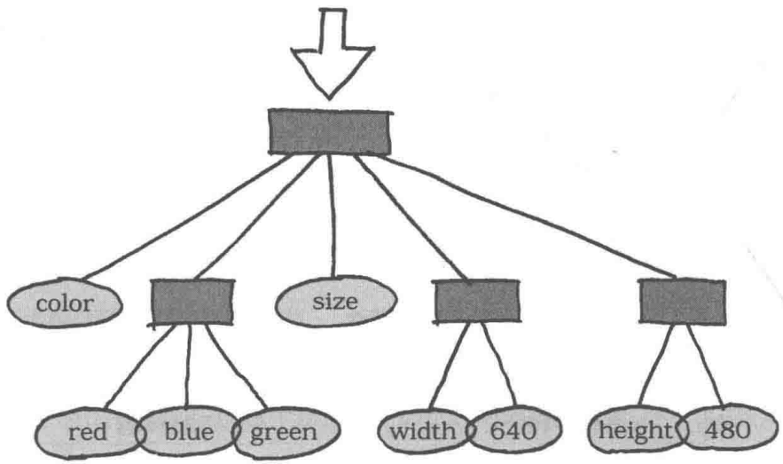

<!-- PDF p307 · 书页 274 -->

## 23.1 Interpreter 模式

学习到这里，大家应该已经掌握了不少设计模式。设计模式的目的之一就是提高类的可复用性。可复用性是指不用做太大修改（甚至是不做任何修改）就可以在多种应用场景使用之前编写的类。

在本章中，我们将学习 Interpreter 模式。

在 Interpreter 模式中，程序要解决的问题会被用非常简单的“迷你语言”表述出来，即用“迷你语言”编写的“迷你程序”把具体的问题表述出来。迷你程序是无法单独工作的，我们还需要用 Java 语言编写一个负责“翻译”（interpreter）的程序。翻译程序会理解迷你语言，并解释和运行迷你程序。这段翻译程序也被称为解释器。这样，当需要解决的问题发生变化时，不需要修改 Java 语言程序，只需要修改迷你语言程序即可应对。

下面，我们用图示展示一下当问题发生变化时，需要哪个级别的代码。使用 Java 语言编程时，需要修改的代码如图 23-1 所示。虽然我们希望需要修改的代码尽量少，但是多多少少都必须修改 Java 代码。

但是，在使用 Interpreter 模式后，我们就无需修改 Java 程序，只需修改用迷你语言编写的迷你程序即可（图 23-2）。

图23-1 当问题发生变化时，通常需要修改Java程序

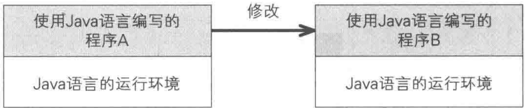

图 23-2 使用 Interpreter 模式后，修改用迷你语言编写的迷你程序

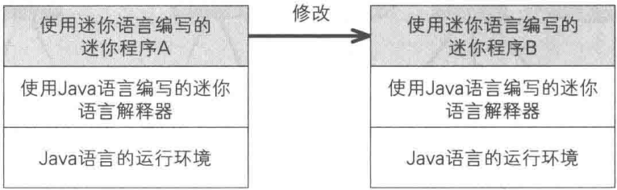

## 23.2 迷你语言

### 迷你语言的命令

在开始学习 Interpreter 模式的示例程序之前，我们先来了解一下本章中涉及的“迷你语言”。迷你语言的用途是控制无线玩具车。虽说是控制无线玩具车，其实能做的事情不过以下 3 种。

- 前进1米（go）

- 右转(right)\- 左转(left)

<!-- PDF p308 · 书页 275 -->

以上就是可以向玩具车发送的命令。go 是前进 1 米后停止的命令；right 是原地向右转的命令；left 是原地向左转的命令。在实际操作时，是不能完全没有偏差地原地转弯的。为了使问题简单化，我们这里并不会改变玩具车的位置，而是像将其放在旋转桌子上一样，让它转个方向。

如果只是这样，大家可能感觉没什么意思。所以，接下来我们再加一个循环命令。

- 重复(repeat)

以上命令组合起来就是可以控制无线玩具车的迷你语言了。我们会在本章使用迷你语言学习Interpreter模式。

图23-3 控制无线玩具车的迷你语言

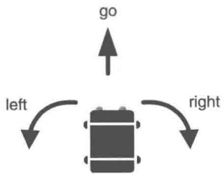

repeat

### 迷你语言程序示例

下面我们来看一段用迷你语言编写的迷你程序。下面这条语句可以控制无线玩具车前进（之后停止）。

program go end

为了便于大家看出语句的开头和结尾，我们在语句前后分别加上了 program 和 end 关键字（我们稍后会学习迷你语言的语法）。这个迷你程序的运行结果请参见图 23-4（GUI 界面是在习题 23-1 中加入的）。

<!-- PDF p309 · 书页 276 -->

图23-4 program go end的运行结果

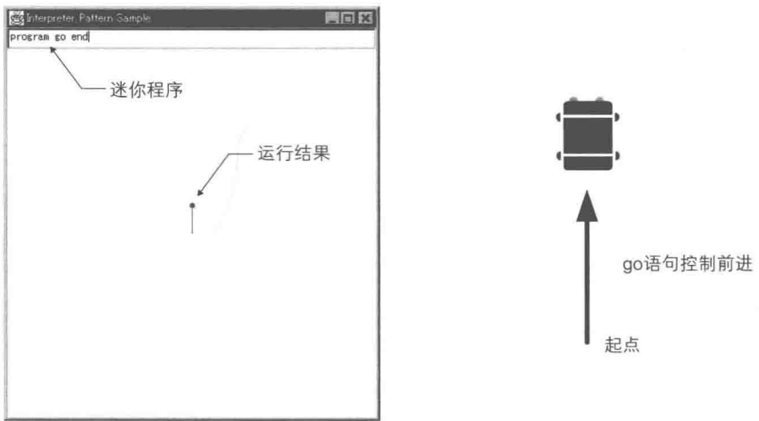

接下来是一段让无线玩具车先前进一米，接着让它右转两次再返回来的程序。

program go right right go end

再接下来的这段程序是让无线玩具车按照正方形路径行进。其运行结果如图 23-5 所示。

program go right go right go right go right end ....(A)

图 23-5 program go right go right go right go right end 的运行结果

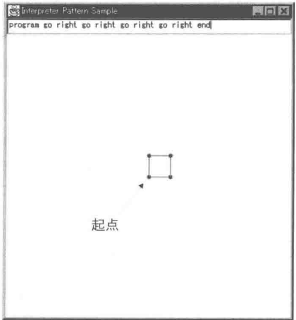

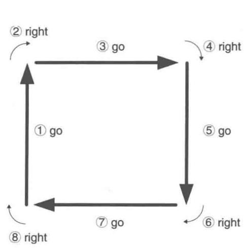

(A) 程序的最后（即 end 之前）之所以加上了一个 right，是因为当无线玩具车回到起点后，我们希望它的方向与出发时相同。细心的读者可能会发现，在（A）程序中，重复出现了 4 次 go right。这样，我们可以使用 repeat...end 语句来实现下面的（B）程序（为了能够编写出这段程序，我们需要定义迷你语言的语法）。其运行结果如图 23-6 所示。

program repeat 4 go right end end \*

<!-- PDF p310 · 书页 277 -->

```text
# 迷你语言示例：控制小车移动（go 前进 1 步，right / left 转向，repeat 重复）
program repeat 4 repeat 3 go right go left end right end end
```

图 23-6 program repeat 4 go right end end 的运行结果（与图 23-5 相同）

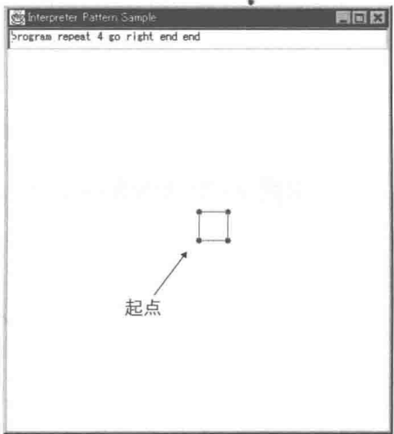

在（B）程序的最后出现了两个 end，其中第一个（左边）end 表示 repeat 的结束，第二个（右边）end 表示 program 的结束。也就是说，程序结构如下。

| program | 程序开始 |
| --- | --- |
| repeat | 循环开始 |
| 4 | 循环的次数 |
| go | 前进 |
| right | 右转 |
| end | 循环结束 |
| end | 程序结束 |

在大家的脑海中，车轮是不是已经骨碌骨碌转起来了呢？那么，我们再一起看看下面这段程序是如何操控无线玩具车的。

现在，玩具车会按照图 23-7 所示的锯齿形状路线前进。这里有两个 repeat，可能会让大家有些难以理解，不过按照下面这样分解一下就很容易理解了。

| program | 程序开始 |
| --- | --- |
| repeat | 循环开始(外侧) |
| 4 | 循环的次数 |
| repeat | 循环开始(内侧) |
| 3 | 循环的次数 |
| go | 前进 |
| right | 右转 |
| go | 前进 |
| left | 左转 |
| end | 循环结束(内侧) |
| right | 右转 |
| end | 循环结束(外侧) |
| end | 程序结束 |

<!-- PDF p311 · 书页 278 -->

内侧的循环语句是 go right go left，它是一条让无线玩具车“前进后右转，前进后左转”的命令。该命令会重复3次。这样，玩具车就会向右沿着锯齿形线路行进。接着，退至外侧循环看，玩具车会连续4次“沿着锯齿形线路行进一次后，右转一次”。这样，最终行进路线就变成了一个锯齿样的菱形。

图 23-7 program repeat 4 repeat 3 go right go left end right end end 的运行结果

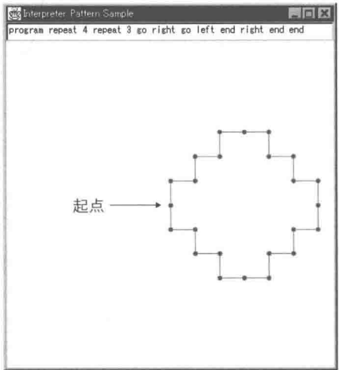

### 迷你语言的语法

图 23-8 展示了迷你语言的语法。这里使用的描述方法是 BNF 的一个变种 ① 。BNF 是 Backus-Naur Form 或 Backus Normal Form 的略称，它经常被用于描述语法。

图 23-8 示例程序中的解释器需要解释的迷你语言语法

```text
# 迷你语言的语法（BNF）：::= 表示“定义为”，| 表示“或”，* 表示“重复 0 次或多次”
<program> ::= program <command list>
<command list> ::= <command>* end
<command> ::= <repeat command> | <primitive command>
<repeat command> ::= repeat <number> <command list>
<primitive command> ::= go | right | left
```

我们按照自上而下的顺序进行学习。

```text
<program> ::= program <command list>
```

首先，我们定义了程序&lt;program&gt;，即“所谓&lt;program&gt;，是指 program 关键字后面跟着的命令列表&lt;command list&gt;”。“::=”的左边表示定义的名字，右边表示定义的内容。

```text
<command list> ::= <command>* end
```

接着，我们定义了命令列表 &lt;command list&gt;，即“所谓 &lt;command list&gt;，是指重复 0 次以上 &lt;command&gt; 后，接着一个 end 关键字”。“\*”表示前面的内容循环 0 次以上。

```text
<command> ::= <repeat command> | <primitive command>
```

<small>① 即 EBNF——扩展的巴科斯范式。——译者注</small>

<!-- PDF p312 · 书页 279 -->

现在，我们来定义 &lt;command&gt;，即“所谓 &lt;command&gt;，是指 &lt;repeat command&gt; 或者 &lt;primitive command&gt;”。该定义中的“|”表示“或”的意思。

```text
<repeat command> ::= repeat <number><command list>
```

接下来，我们定义循环命令，即“所谓< repeat command>，是指 repeat 关键字后面跟着循环次数 &lt;number&gt; 和要循环的命令列表 &lt;command list&gt;”。其中的命令列表 &lt;command list&gt; 之前已经定义过了，而在定义命令列表 &lt;command list&gt; 的时候使用了 &lt;command&gt;，在定义 &lt;command&gt; 的时候又使用了 &lt;repeat command&gt;，而在定义 &lt;repeat command&gt; 的时候又使用了 &lt;command list&gt;。像这样，在定义某个东西时，它自身又出现在了定义的内容中，我们称这种定义为递归定义。稍后，我们会使用 Java 语言实现迷你语言的解释器，到时候会有相应的代码结构来解释递归定义，因此，请大家先在脑海中记住这个概念。

```text
<primitive command> ::= go | right | left
```

这是基本命令 &lt;primitive command&gt; 的定义，即 “所谓 < primitive command >，是指 go 或者 right 或者 left”。

最后只剩下 &lt;number&gt; 了，要想定义出全部的 &lt;number&gt; 可能非常复杂，这里我们省略了它的定义。总之，请大家把 &lt;number&gt; 看作是 3、4 和 12345 这样的自然数即可。

注意 严格地说，这里使用的是 EBNF。在 BNF 中，循环不是用 \* 表示的，而是用递归定义来表示的。

### 终结符表达式与非终结符表达式

我们先来稍微了解一下语法术语。

前面讲到的像 &lt;primitive command&gt; 这样的不会被进一步展开的表达式被称为 “终结符表达式”（Nonterminal Expression）。我们知道，巴士和列车的终到站被称为终点站，这里的终结符就类似于终点站，它表示语法规则的终点。

与之相对的是，像&lt;program&gt;和&lt;command&gt;这样的需要被进一步展开的表达式被称为“非终结符表达式”。

## 23.3 示例程序

迷你语言的学习至此就结束了，下面我们来看看示例程序。这段示例程序实现了一个迷你程序的语法解析器。

在之前学习迷你程序的相关内容时，我们分别学习了对迷你程序的各个语法部分。像这样将迷你程序当作普通字符分解，然后看看各个部分分别是什么结构的过程，就是语法解析。

例如有如下迷你程序。

```text
# 例：重复 4 次“前进、右转”→ 走出一个正方形
program repeat 4 go right end end
```

将这段迷你程序推导成为图 23-9 中那样的结构（语法树）的处理，就是语法解析。

<!-- PDF p313 · 书页 280 -->

本章中的示例程序只会实现至推导出语法树。实际地“运行”程序的部分，我们将会在习题23-1中实现。

图 23-9 迷你程序 program repeat 4 go right end end 的语法树

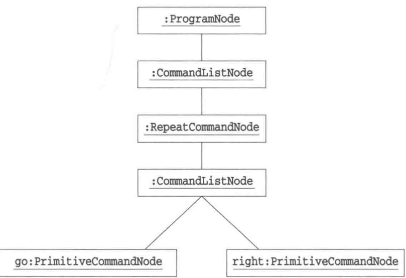

表23-1 类的一览

| 名字 | 说明 |
| --- | --- |
| Node | 表示语法树“节点”的类 |
| ProgramNode | 对应&lt;program>的类 |
| CommandListNode | 对应上年同期 list>的类 |
| CommandNode | 对应&lt;command>的类 |
| RepeatCommandNode | 对应&lt;repeat command>的类 |
| PrimitiveCommandNode | 对应&lt;primitive command>的类 |
| Context | 表示语法解析上下文的类 |
| ParseException | 表示语法解析中可能会发生的异常的类 |
| Main | 测试程序行为的类 |

<!-- PDF p314 · 书页 281 -->

图23-10 示例程序的类图

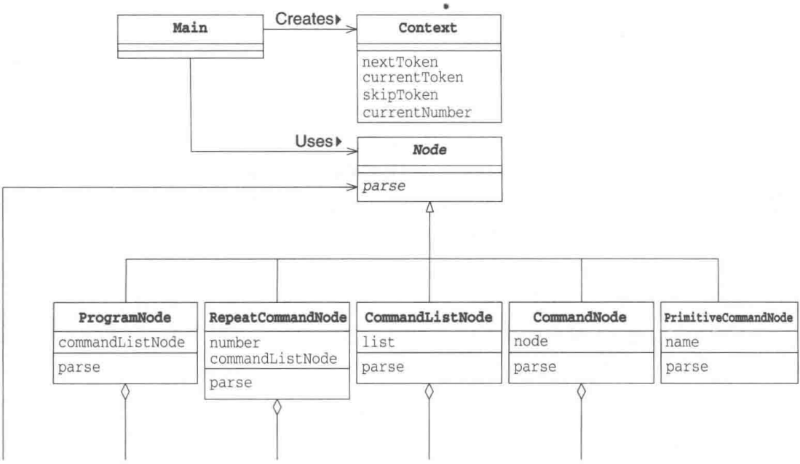

### Node类

Node 类（代码清单 23-1）是语法树中各个部分（节点）中的最顶层的类。在 Node 类中只声明了一个 parse 抽象方法，该方法用于“进行语法解析处理”。但 Node 类仅仅是声明该方法，具体怎么解析交由 Node 类的子类负责。parse 方法接收到的参数 Context 是表示语法解析上下文的类，稍后我们将来学习 parse 方法。在 parse 的声明中，我们使用了 throws 关键字。它表示在语法解析过程中如果发生了错误，parse 方法就会抛出 ParseException 异常。

如果只看 Node 类，我们还无法知道具体怎么进行语法解析，所以我们接着往下看。

代码清单 23-1 Node 类 (Node.java)

```java
/**
 * 【Interpreter 模式】：把语法规则一条条写成类，用这些类来解析（解释）程序
 * 每条 BNF 规则对应一个 Node 子类
 * Node：语法树节点的父类，parse() 负责解析自己对应的那部分文本
 */
public abstract class Node {
    public abstract void parse(Context context) throws ParseException;
}
```

### ProgramNode 类

下面我们按照图 23-8 中展示的迷你语言的语法描述（BNF）来看看各个类的定义。首先，我们看看表示程序 &lt;program&gt; 的 ProgramNode 类（代码清单 23-2）。在 ProgramNode 类中定义了一个 Node 类型的 CommandListNode 字段，该字段用于保存 &lt;command list&gt; 对应的结构（节点）。

那么，ProgramNode 的 parse 方法究竟进行了什么处理呢？通过查看迷你语言的 BNF 描述我们可以发现，&lt;program&gt; 的定义中最开始会出现 program 这个单词。因此，我们用下面的语句跳过这个单词。

```text
context.skipToken("program");
```

<!-- PDF p315 · 书页 282 -->

我们称语法解析时的处理单位为标记(token)。在迷你语言中，“标记”相当于“英文单词”。在一般的编程语言中，“+”和“==”等也是标记。更具体地说，词法分析（lex）是从文字中得到标记，而语法解析（parse）则是根据标记推导出语法树。

上面的 skipToken 方法可以跳过 program 这个标记。如果没有这个标记就会抛出 ParseException 异常。

继续查看 BNF 描述会发现，在 program 后面会跟着 &lt;command list&gt;。这里，我们会生成 &lt;command list&gt; 对应的 CommandListNode 类的实例，然后调用该实例的 parse 方法。请注意，ProgramNode 类的方法并不知道 &lt;command list&gt; 的内容。即在 ProgramNode 类中实现的内容，并没有超出下面的 BNF 所描述的范围。

```text
<program> ::= program <command list>
```

toString 方法用于生成表示该节点的字符串。在 Java 中，连接实例与字符串时会自动调用实例的 toString 方法，因此如下（1）与（2）是等价的。

```text
"[program " + commandListNode + "]";                                                                 ........ (1)
"[program " + commandListNode.toString() + "]";          ........ (2)
```

请注意，toString 方法的实现也与上面的 BNF 描述完全相符。

代码清单 23-2 ProgramNode 类 (ProgramNode.java)

```java
// <program> ::= program <command list>
// 解析步骤：① 跳过关键字 program ② 剩下的交给 CommandListNode 解析
public class ProgramNode extends Node {
    private Node commandListNode;
    public void parse(Context context) throws ParseException {
        context.skipToken("program");          // ①
        commandListNode = new CommandListNode(); // ②
        commandListNode.parse(context);
    }
    public String toString() {
        return "[program " + commandListNode + "]";
    }
}
```

### CommandListNode 类

下面我们来看看 CommandListNode 类 (代码清单 23-3)。&lt;command list&gt; 的 BNF 描述如下。

```text
<command list> ::= <command>* end
```

即重复 0 次以上 &lt;command&gt;，然后以 end 结束。为了能保存 0 次以上的 &lt;command&gt;，我们定义了 java.util.ArrayList 类型的字段 list，在该字段中保存与 &lt;command&gt; 对应的 CommandNode 类的实例。

CommandListNode 类的 parse 方法是怎么实现的呢？首先，如果当前的标记 contextCurrentToken() 是 null，表示后面没有任何标记（也就是已经解析至迷你程序的末尾）了。这时，parse 方法会先设置 ParseException 异常中的消息为“缺少 end(Missing 'end')”，然后抛出 ParseException 异常。

<!-- PDF p316 · 书页 283 -->

接下来，如果当前的标记是 end，表示已经解析至 &lt;command list&gt; 的末尾。这时，parse 方法会跳过 end，然后 break 出 while 循环。

再接下来，如果当前的标记不是 end，则表示当前标记是 &lt;command&gt;。这时，parse 方法会生成与 &lt;command&gt; 对应的 commandNode 的实例，并调用它的 parse 方法进行解析。然后，还会将 commandNode 的实例 add 至 list 字段中。

大家应该看出来了，这里的实现也没有超出 BNF 描述的范围。我们在编程时要尽量忠实于 BNF 描述，原封不动地将 BNF 描述转换为 Java 程序。这样做可以降低出现 Bug 的可能性。在编程过程中，往往很容易受到“如果这样改一下可以提高程序效率吧”这样的诱惑，会不自觉地想在类中加入读取更深层次的节点的处理，但这样反而可能会引入意想不到的 Bug。Interpreter 模式本来就采用了迷你语言这样的间接处理，所以耍一些小聪明来试图提高效率并不明智。

代码清单 23-3 CommandListNode 类 (CommandListNode.java)

```java
// <command list> ::= <command>* end
// 解析步骤：循环解析命令，直到遇到 end；没遇到 end 文本就结束了 → 报错
// （原文 contextCurrentToken() 为笔误，应为 context.currentToken()）
import java.util.ArrayList;
// <command list> ::= <command>* end
public class CommandListNode extends Node {
    private ArrayList list = new ArrayList(); // 解析出的命令
    public void parse(Context context) throws ParseException {
        while (true) {
            if (contextCurrentToken() == null) {               // 没有 end
                throw new ParseException("Missing 'end'");
            } else if (contextCurrentToken().equals("end")) {  // 遇到 end → 结束
                context.skipToken("end");
                break;
            } else {                                           // 其他 → 解析一条命令
                Node commandNode = new CommandNode();
                commandNode.parse(context);
                list.add(commandNode);
            }
        }
    }
    public String toString() {
        return list.toString();
    }
}
```

### CommandNode 类

如果大家理解了前面学习的 ProgramNode 类和 CommandListNode 类，那么应该也可以很快地理解 CommandNode 类（代码清单 23-4）。&lt;command&gt; 的 BNF 描述如下。

```text
<command> ::= <repeat command> | <primitive command>
```

在代码中的 Node 类型的 node 字段中保存的是与 &lt;repeat command&gt; 对应的 RepeatCommandNode 类的实例，或与 &lt;primitive command&gt; 对应的 PrimitiveCommandNode 类的实例。

代码清单 23-4 CommandNode 类 (CommandNode.java)

```java
// <command> ::= <repeat command> | <primitive command>
// 解析步骤：看当前单词是不是 repeat，决定交给哪个节点
public class CommandNode extends Node {
private Node node;
public void parse(Context context) throws ParseException {
    if (contextCurrentToken().equals("repeat")) {
        node = new RepeatCommandNode();     // 重复命令
        node.parse(context);
    } else {
        node = new PrimitiveCommandNode();  // 基本命令
        node.parse(context);
    }
}
public String toString() {
    return node.toString();
}
}
```

<!-- PDF p317 · 书页 284 -->

### RepeatCommandNode 类

RepeatCommandNode 类（代码清单 23-5）对应 &lt;repeat command&gt; 的类。&lt;repeat command&gt; 的 BNF 描述如下。

```text
<repeat command> ::= repeat <number><command list>
```

在代码中，&lt;number&gt;被保存在 int 型字段 number 中，&lt;command list&gt;被保存在 Node 型字段 commandListNode 中。

现在，大家应该都注意到parse方法的递归关系了。让我们追溯一下parse方法的调用关系。

- 在 RepeatCommandNode 类的 parse 方法中，会生成 CommandListNode 的实例，然后调用它的 parse 方法

- 在 CommandListNode 的 parse 方法中，会生成 CommandNode 的实例，然后调用它的 parse 方法

- 在 CommandNode 类的 parse 方法中，会生成 RepeatCommandNode 的实例，然后调用它的 parse 方法

- 在 RepeatCommandNode 类的 parse 方法中……

这样的parse方法调用到底要持续到什么时候呢？其实，它的终点就是终结符表达式。在CommandNode类的parse方法中，程序并不会一直进入if语句的RepeatCommandNode处理分支中，最终总是会进入PrimitiveCommandNode的处理分支。并且，不会从PrimitiveCommandNode的parse方法中再调用其他类的parse方法。关于这一点，稍后我们来学习。

如果不习惯递归定义的处理方式，可能会感觉到这里似乎进入了死循环。其实这是错觉。不论是在 BNF 描述中还是在 Java 程序中，一定都会结束于终结符表达式。如果没有结束于终结符表达式，那么一定是语法描述有问题。

代码清单 23-5 RepeatCommandNode 类 (RepeatCommandNode.java)

```java
// <repeat command> ::= repeat <number> <command list>
// 解析步骤：① 跳过 repeat ② 读次数 ③ 解析要重复的命令列表（递归）
public class RepeatCommandNode extends Node {
    private int number;            // 重复次数
    private Node commandListNode;  // 要重复的内容
public void parse(Context context) throws ParseException {
    context.skipToken("repeat");                // ①
    number = context.currentNumber();           // ②
    context.nextToken();
    commandListNode = new CommandListNode();    // ③
    commandListNode.parse(context);
}
public String toString() {
    return "[repeat " + number + " " + commandListNode + "]";
}
```

<!-- PDF p318 · 书页 285 -->

### PrimitiveCommandNode 类

PrimitiveCommandNode 类（代码清单 23-6）对应的 BNF 描述如下。

```text
<primitive command> ::= go | right | left
```

确实，PrimitiveCommandNode 类的 parse 方法没有调用其他类的 parse 方法。

代码清单 23-6 PrimitiveCommandNode 类 (PrimitiveCommandNode.java)

```java
// <primitive command> ::= go | right | left
// 解析步骤：读一个单词，必须是 go / right / left 之一，否则报错
public class PrimitiveCommandNode extends Node {
    private String name;
    public void parse(Context context) throws ParseException {
        name = contextcurrentToken();
        context.skipToken(name);
        if (!name.equals("go") && !name.equals("right") && !name.equals("left")) {
            throw new ParseException(name + " is undefined");
        }
    }
    public String toString() {
        return name;
    }
}
```

### Context类

至此，关于 Node 类以及它的子类的学习就全部结束了。剩下的就是 Context 类了。Context 类（代码清单 23-7）提供了语法解析所必须的方法。

表 23-2 Context 类提供的方法

| 名字 | 说明 |
| --- | --- |
| NextToken | 获取下一个标记(前进至下一个标记) |
| currentToken | 获取当前的标记(不会前进至下一个标记) |
| skipToken | 先检查当前标记,然后获取下一个标记(前进至下一个标记) |
| currentNumber | 获取当前标记对应的数值(不会前进至下一个标记) |

这里，我们使用 java.util PhillipsTokenizer 类来简化了我们的程序，它会将接收到的字符串分割为标记。在分割字符串时使用的分隔符是空格 “'''”、制表符 “'\t''”、换行符 “'\n''”、回车符 “'\r''”、换页符 “'\f''”（也可以使用其他分隔符，请根据需要查阅 Java 的 API 文档）。

<!-- PDF p319 · 书页 286 -->

表 23-3 Context 类使用的 java.util Powderizer 的方法

| 名字 | 说明 |
| --- | --- |
| NextToken | 获取下一个标记(前进至下一个标记) |
| hasMoreTokens | 检查是否还有下一个标记 |

代码清单 23-7 Context 类 (Context.java)

```java
/**
 * Context：负责把程序文本切成一个个单词（token），并提供“读取 / 跳过”等操作
 * 各个 Node 都通过它来读取文本
 */
import java.util.*;
public class Context {
    private StringTokenizer tokenizer; // 按空格切分文本的工具
    private String currentToken;       // 当前单词
    public Context(String text) {
        tokenizer = new StringTokenizer(text);
        nextToken();                   // 先读入第一个单词
    }
    // 前进到下一个单词（没有了就是 null）
    public String nextToken() {
        if (tokenizer.hasMoreTokens()) {
            currentToken = tokenizer.nextToken();
        } else {
            currentToken = null;
        }
        return currentToken;
    }
    public String currentToken() {
        return currentToken;
    }
    // 检查当前单词是否是期望的，是就跳过，不是就报语法错误
    public void skipToken(String token) throws ParseException {
        if (!token.equals(currentToken)) {
            throw new ParseException("Warning: " + token + " is expected, but " + currentToken + " is found.");
        }
        nextToken();
    }
    // 把当前单词当作数字读取
    public int currentNumber() throws ParseException {
        int number = 0;
        try {
            number = Integer.parseInt(currentToken);
        } catch (NumberFormatException e) {
            throw new ParseException("Warning: " + e);
        }
        return number;
    }
}
```

### UNIVERSITY 类

ParseException类（代码清单23-7）是表示语法解析时可能发生的异常的类。该类比较简单，没有什么需要特别注意的地方。

代码清单 23-8      ParseException 类 ( ParseException.java )

```java
// 语法错误时抛出的异常
public class ParseException extends Exception {
    public ParseException(String msg) {
        super(msg);
```

<!-- PDF p320 · 书页 287 -->

### Main类

Main 类（代码清单 23-9）是启动我们之前学习的迷你语言解释器的程序。它会读取 program.txt 文件，然后逐行解析迷你程序，并将解析结果显示出来。

在显示结果中，以“text=”开头的部分是迷你程序语句，以“node=”开头的部分是语法解析结果。图23-11展示了示例程序的运行结果。通过查看运行结果我们可以发现，语法解释器识别出了program ... end字符串中的迷你语言的语法元素，并为它们加上了[]。这表示语法解释器正确地理解了我们定义的迷你语言。

注意 将 CommandListNode 的实例转换为字符串显示出来——例如在 [go, right] 中加上大括号和逗号——的是 java.util.ArrayList 的 toString 方法。

代码清单 23-9 Main 类 (Main.java)

```java
// 使用：逐行读取 program.txt，每行解析成语法树并打印出来
import java.util.*;
import java.io.*;

public class Main {
    public static void main(String[] args) {
        try {
            BufferedReader reader = new BufferedReader(new FileReader("program.
txt"));
            String text;
            while ((text = reader.readLine()) != null) {
                System.out.println("text = \"\" + text + "\"");
                Node node = new ProgramNode();
                node.parse(new Context(text));
                System.out.println("node = " + node);
            }
            reader.close();
        } catch (Exception e) {
            e.printStackTrace();
        }
    }
}
```

代码清单 23-10 迷你程序示例（program.txt）

```text
# program.txt：要解析的迷你程序（每行一个）
program end
program go end
program go right go right go right go right end
program repeat 4 go right end end
program repeat 4 repeat 3 go right go left end right end end
```

<!-- PDF p321 · 书页 288 -->

图23-11 运行结果

```text
text = "program end" ←迷你程序的内容
node = [program []] ←语法解析结果
text = "program go end"
node = [program [go]]
text = "program go right go right go right go right end"
node = [program [go, right, go, right, go, right, go, right]]
text = "program repeat 4 go right end end"
node = [program [[repeat 4 [go, right]]]]
text = "program repeat 4 repeat 3 go right go left end right end end"
node = [program [[repeat 4 [[repeat 3 [go, right, go, left]], right]]]]
```

## 23.4 Interpreter 模式中的登场角色

在 Interpreter 模式中有以下登场角色。

### AbstractExpression（抽象表达式）

AbstractExpression 角色定义了语法树节点的共同接口 (API)。在示例程序中，由 Node 类扮演此角色。在示例程序中，共同接口 (API) 的名字是 parse，不过在图 23-12 中它的名字是 interpreter。

### ◆ TerminalExpression（终结符表达式）

TerminalExpression 角色对应 BNF 中的终结符表达式。在示例程序中，由 PrimitiveCommandNode 类扮演此角色。

### ◆ NonterminalExpression（非终结符表达式）

NonterminalExpression 角色对应 BNF 中的非终结符表达式。在示例程序中，由 ProgramNode 类、CommandNode 类、RepeatCommandNode 类和 CommandListNode 类扮演此角色。

### ◆ Context（文脉、上下文）

Context 角色为解释器进行语法解析提供了必要的信息。在示例程序中，由 Context 类扮演此角色。

### ◆ Client（请求者）

为了推导语法树，Client 角色会调用 TerminalExpression 角色和 NonterminalExpression 角色。在示例程序中，由 Main 类扮演此角色。

<!-- PDF p322 · 书页 289 -->

图23-12 Interpreter模式的类图

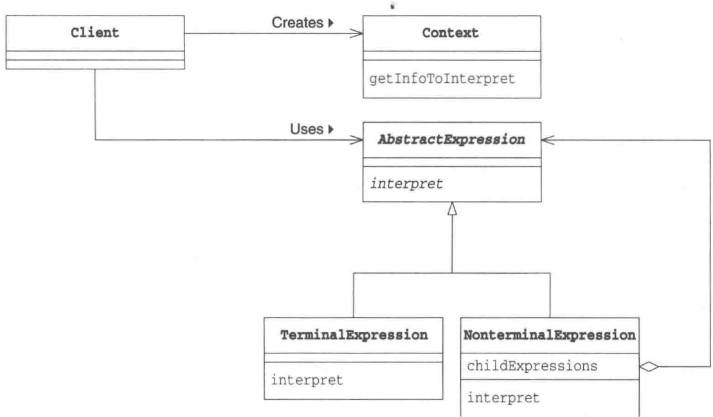

## 23.5 拓展思路的要点

### 还有其他哪些迷你语言

在本章中，我们设计了一种操控无线玩具车的迷你语言。当然，这不过是 Interpreter 模式的一个例子而已，这里我们再列举一些其他的迷你语言。

### ◆ 正则表达式

在 GoF 书（请参见附录 E [GoF]）中，作者使用正则表达式（regular expression）作为迷你语言示例。在书中，作者使用 Interpreter 模式解释了如下表达式，并推导出语法树。

```text
raining & (dogs | cats) *
```

这个表达式的意思是 “在 raining 后重复出现 0 次以上 dogs 或 cats”。

### ◆检索表达式

在 Grand 书（请参见附录 E [Grand]）中，作者讲解了表示单词组合的 Little Language 模式。在书中，该模式可以解释如下表达式并推导出语法树。

```text
garlic and not onions
```

这个表达式的意思是“包含 garlic 但不包含 onions”。

### ◆ 批处理语言

Interpreter 模式还可以处理批处理语言，即将基本命令组合在一起，并按顺序执行或是循环执行的语言。本章中的无线玩具车操控就是一种批处理语言。

<!-- PDF p323 · 书页 290 -->

### 跳过标记还是读取标记

在制作解释器时，经常会出现多读了一个标记或是漏读了一个标记的 Bug。在编写各个终结符表达式对应的方法时，我们必须时刻注意“进入这个方法时已经读至哪个标记了？出了这个方法时应该读至哪个标记？”

## 23.6 相关的设计模式

### ◆ Composite 模式（第 11 章）

NonterminalExpression 角色多是递归结构，因此常会使用 Composite 模式来实现 NonterminalExpression 角色。

### ◆ Flyweight 模式（第 20 章）

有时会使用 Flyweight 模式来共享 TerminalExpression 角色。

### ◆ Visitor 模式（第 13 章）

在推导出语法树后，有时会使用 Visitor 模式来访问语法树的各个节点。

## 23.7 本章所学知识以及本书的结束语

在本章中，我们学习了使用迷你语言解决问题的 Interpreter 模式。此外，我们还讨论了使用 BNF 递归定义语言的方法和推导语法树的方法。

到此为止，我们的 GoF 的 23 种设计模式之旅已经到达终点了。大家有哪些感想呢？对于有些简单的模式大家可能理解得比较透彻了，而对于有些复杂的模式，可能大家还是一知半解。不过，暂且抛开这些具体的模式不谈，想必大家已经掌握了从“设计模式”的角度去看程序的方法。抽象类和接口的作用、继承和委托的使用方法、类与方法的可见性、类的可替换性、不用修改代码即可将类作为组件复用的方法……大家是否回忆起了从各章节中学习到的设计模式呢？

那么，本书的内容就到此结束了。希望大家能够使用设计模式编写出非常漂亮的代码。谢谢大家阅读本书。希望有机会与大家相见。

Enjoy Patterns !

## 23.8 练习题

答案请参见附录 A（P.350）

### 习题23-1

在示例程序中，我们只进行了语法解析。请修改程序，让示例程序还可以“运行”迷你语言程序。关于如何“运行”go、right和left等基本命令(&lt;primitive command&gt;），大家可以自由发挥。

提示 这是本书中最后一道习题了。为了同时总结一下设计模式，我们在答案中还增加了以下功能。

<!-- PDF p324 · 书页 291 -->

- 使用GUI显示基本命令的“运行”结果

- 使用 Facade 模式（第 15 章）使解释器更易于使用

- 编写了一个生成基本命令的类（Factory Method 模式（第 4 章））

- 将解释器的相关代码单独整理至一个包中

图23-4至图23-7是在学习迷你语言时给大家看过的运行结果图。

<!-- PDF p325 -->

The image is too blurry to recognize any text content.

#### 答案（附录 A）

这里，我们将与 GUI 相关的类集中在 turtle 包中，而在 language 包中不放入任何与 GUI 相关的类。这样，只要在其他包中定义的类实现了 Executor 和 ExecutorFactory 接口，就可以在完全不修改 language 包的前提下编写另外一个程序来“运行”相同的程序。

表A23-1 类和接口的一览表

| 包 | 类 | 说明 |
| --- | --- | --- |
| language | InterpreterFacade | 使解释器更好用的类(Facade 模式中的 Facade 角色) |
| language | ExecutorFactory | 生成基本命令的接口(Factory Method 模式中的 Creator 角色) |
| language | Context | 与示例程序相同 |
| language | Node | 与示例程序相同 |
| language | Executor | 表示“运行”的接口 |
| language | ProgramNode | 与示例程序相同 |
| language | CommandNode | 与示例程序相同 |
| language | RepeatCommandNode | 与示例程序相同 |
| language | CommandListNode | 与示例程序相同 |
| language | PrimitiveCommandNode | 与示例程序相同 |
| language | ExecuteException | 运行时的异常类 |
| language | ParseException | 语法解析时的异常类 |
| turtle | TurtleCanvas | 实现海龟绘图的类(Factory Method 模式中的 ConcreteCreator 角色) |
| turtle | TurtleExecutor | (内部类) |
| turtle | GoExecutor | (内部类) |
| turtle | DirectionExecutor | (内部类) |
| 无名 | Main | 测试程序行为的类 |

代码清单 A23-1 InterpreterFacade 类 (InterpreterFacade.java)

```java
/**
 * 习题：让迷你语言真正“运行”起来 —— 控制海龟画图
 * 拆成两个包：language（通用的解释器）和 turtle（具体怎么执行命令）
 * InterpreterFacade：解释器的总入口（Facade 模式），负责解析并执行
 */
package language;

public class InterpreterFacade implements Executor {
    private ExecutorFactory factory;
    private Context context;
    private Node programNode;
    public InterpreterFacade(ExecutorFactory factory) {
        this.factory = factory;
    }
    public boolean parse(String text) {
        boolean ok = true;
        this.context = new Context(text);
        this.context.setExecutorFactory(factory);
        this.programNode = new ProgramNode();
        try {
programNode.parse(context);
System.out.println(programNode.toString());
} catch (ParseException e) {
    e.printStackTrace();
    ok = false;
}
return ok;
}
public void execute() throws ExecuteException {
    try {
        programNode.execute();
    } catch (ExecuteException e) {
        e.printStackTrace();
    }
}
```

<!-- PDF p384 · 书页 351 -->

代码清单 A23-2 ExecutorFactory 接口 (ExecutorFactory.java)

```java
// 工厂接口：根据命令名（go / right / left）创建执行器（Abstract Factory 的思路）
package language;

public interface ExecutorFactory {
    public abstract Executor createExecutor(String name);
}
```

代码清单 A23-3 Context 类 (Context.java)

```java
// 习题：Context 增加 ExecutorFactory，让节点能拿到工厂来创建执行器
package language;

import java.util.*;

public class Context implements ExecutorFactory {
    private ExecutorFactory factory;
    private StringTokenizer tokenizer;
    private String currentToken;
    public Context(String text) {
        tokenizer = new StringTokenizer(text);
        nextToken();
    }
    public String nextToken() {
        if (tokenizer.hasMoreTokens()) {
            currentToken = tokenizer.nextToken();
        } else {
            currentToken = null;
        }
        return currentToken;
    }
    public String currentToken() {
        return currentToken;
    }
    public void skipToken(String token) throws ParseException {
        if (!token.equals(currentToken)) {
            throw new ParseException("Warning: " + token + " is expected, but " + currentToken + " is found.");
        }
        nextToken();
    }
    public int currentNumber() throws ParseException {
        int number = 0;
try {
    number = Integer.parseInt(currentToken);
} catch (NumberFormatException e) {
    throw new ParseException("Warning: " + e);
}
return number;
}
public void setExecutorFactory(ExecutorFactory factory) {
    this.factory = factory;
}
public Executor createExecutor(String name) {
    return factory.createExecutor(name);
}
```

<!-- PDF p385 -->

代码清单 A23-4 Node 类 (Node.java)

```java
// 习题：Node 同时实现 Executor → 语法树节点既能解析也能执行
package language;

public abstract class Node implements Executor {
    public abstract void parse(Context context) throws ParseException;
}
```

代码清单 A23-5 Executor 接口 (Executor.java)

```java
// 执行器接口
package language;

public interface Executor {
    public abstract void execute() throws ExecuteException;
}
```

代码清单 A23-6 ProgramNode 类 (ProgramNode.java)

```java
// 习题：ProgramNode 的执行 = 执行命令列表
package language;

// <program> ::= program <command list>
public class ProgramNode extends Node {
    private Node commandListNode;
    public void parse(Context context) throws ParseException {
        context.skipToken("program");
        commandListNode = new CommandListNode();
        commandListNode.parse(context);
    }
    public void execute() throws ExecuteException {
        commandListNode.execute();
    }
    public String toString() {
        return "[program " + commandListNode + "]";
    }
}
```

代码清单 A23-7 CommandNode 类 (CommandNode.java)

```java
// 习题：CommandNode 的执行 = 执行它包含的那个节点
package language;

// <command> ::= <repeat command> | <primitive command>
public class CommandNode extends Node {
    private Node node;
public void parse(Context context) throws ParseException {
    if (contextCurrentToken().equals("repeat")) {
        node = new RepeatCommandNode();
        node.parse(context);
    } else {
        node = new PrimitiveCommandNode();
        node.parse(context);
    }
}
public void execute() throws ExecuteException {
    node.execute();
}
public String toString() {
    return node.toString();
}
```

<!-- PDF p386 · 书页 353 -->

代码清单 A23-8 RepeatCommandNode 类 (RepeatCommandNode.java)

```java
// 习题：RepeatCommandNode 的执行 = 把命令列表执行 number 次
package language;

// <repeat command> ::= repeat <number> <command list>
public class RepeatCommandNode extends Node {
    private int number;
    private Node commandListNode;
    public void parse(Context context) throws ParseException {
        context.skipToken("repeat");
        number = context.currentNumber();
        context.nextToken();
        commandListNode = new CommandListNode();
        commandListNode.parse(context);
    }
    public void execute() throws ExecuteException {
        for (int i = 0; i < number; i++) {
            commandListNode.execute();
        }
    }
    public String toString() {
        return "[repeat " + number + " " + commandListNode + "]";
    }
}
```

代码清单 A23-9 CommandListNode 类 (CommandListNode.java)

```java
// 习题：CommandListNode 的执行 = 依次执行每条命令
package language;

import java.util.*;

// <command list> ::= <command>* end
public class CommandListNode extends Node {
    private ArrayList list = new ArrayList();
    public void parse(Context context) throws ParseException {
        while (true) {
            if (contextCurrentToken() == null) {
                throw new ParseException("Missing 'end'");
            } else if (contextCurrentToken().equals("end")) {
                context.skipToken("end");
                break;
            } else {
Node commandNode = new CommandNode();
            commandNode.parse(context);
            list.add(commandNode);
        }
    }
}
public void execute() throws ExecuteException {
    Iterator it = list.iterator();
    while (it.hasNext()) {
        ((CommandNode)it.next()).execute();
    }
}
public String toString() {
    return list.toString();
}
}
```

<!-- PDF p387 -->

代码清单 A23-10 PrimitiveCommandNode 类 (PrimitiveCommandNode.java)

```java
// 习题：PrimitiveCommandNode 解析时通过工厂创建执行器，执行时交给执行器
package language;

// <primitive command> ::= go | right | left
public class PrimitiveCommandNode extends Node {
    private String name;
    private Executor executor;
    public void parse(Context context) throws ParseException {
        name = context.currentToken();
        context.skipToken(name);
        executor = context.createExecutor(name);
    }
    public void execute() throws ExecuteException {
        if (executor == null) {
            throw new ExecuteException(name + ": is not defined");
        } else {
            executor.execute();
        }
    }
    public String toString() {
        return name;
    }
}
```

代码清单 A23-11 ExecuteException 类 ( ExecuteException.java )

```java
// 执行出错时抛出的异常
package language;

public class ExecuteException extends Exception {
    public ExecuteException(String msg) {
        super(msg);
    }
}
```

代码清单 A23-12      ParseException 类 ( ParseException.java )

```java
// 语法错误时抛出的异常
package language;
public class ParseException extends Exception {
    public ParseException(String msg) {
```

<!-- PDF p388 · 书页 355 -->

代码清单 A23-13 TurtleCanvas 类 (TurtleCanvas.java)

```java
// 习题：海龟画布 —— 实现 ExecutorFactory，创建“前进”“转向”执行器，并在画布上画线
// （原文 language FabutorFactory 为笔误，应为 language.ExecutorFactory）
package turtle;

import language.Executor;
import language FabutorFactory;
import language ExecuteException;
import java.awt.*;

public class TurtleCanvas extends Canvas implements ExecutorFactory {
    final static int UNIT_LENGTH = 30;      // 前进时的长度单位
    final static int DIRECTION_UP = 0;       // 上方
    final static int DIRECTION_RIGHT = 3;   // 右方
    final static int DIRECTION_DOWN = 6;     // 下方
    final static int DIRECTION_LEFT = 9;      // 左方
    final static int RELATIVE_DIRECTION_RIGHT = 3; // 右转
    final static int RELATIVE_DIRECTION_LEFT = -3; // 左转
    final static int RADIUS = 3; // 半径
    private int direction = 0;
    private Point position;
    private Executor executor;
    public TurtleCanvas(int width, int height) {
        setSize(width, height);
        initialize();
    }
    public void setExecutor(Executor executor) {
        this.executor = executor;
    }
    void setRelativeDirection(int relativeDirection) {
        setDirection(direction + relativeDirection);
    }
    void setDirection(int direction) {
        if (direction < 0) {
            direction = 12 - (-direction) % 12;
        } else {
            direction = direction % 12;
        }
        this.direction = direction % 12;
    }
    void go(int length) {
        int newx = position.x;
        int newy = position.y;
        switch (direction) {
        case DIRECTION_UP:
            newy -= length;
            break;
        case DIRECTION_RIGHT:
            newx += length;
            break;
        case DIRECTION_DOWN:
            newy += length;
            break;
        case DIRECTION_LEFT:
            newx -= length;
            break;
default:
    break;
}
Graphics g = getGraphics();
if (g != null) {
    g.drawLine(position.x, position.y, newx, newy);
    g.fillOval(newx - RADIUS, newy - RADIUS, RADIUS * 2 + 1, RADIUS * 2 + 1);
}
position.x = newx;
position.y = newy;
}
public Executor createExecutor(String name) {
    if (name.equals("go")) {
        return new GoExecutor(this);
    } else if (name.equals("right")) {
        return new DirectionExecutor(this, RELATIVE_DIRECTION_RIGHT);
    } else if (name.equals("left")) {
        return new DirectionExecutor(this, RELATIVE_DIRECTION_LEFT);
    } else {
        return null;
    }
}
public void initialize() {
    Dimension size = getSize();
    position = new Point(size.width / 2, size.height / 2);
    direction = 0;
    setForeground(Color.red);
    setBackground(Color.white);
    Graphics g = getGraphics();
    if (g != null) {
        g.clearRect(0, 0, size.width, size.height);
    }
}
public void paint(Graphics g) {
    initialize();
    if (executor != null) {
        try {
            executor.execute();
        } catch (ExecuteException e) {
        }
    }
}
abstract class TurtleExecutor implements Executor {
protected TurtleCanvas canvas;
public TurtleExecutor(TurtleCanvas canvas) {
    this.canvas = canvas;
}
public abstract void execute();
}

class GoExecutor extends TurtleExecutor {
public GoExecutor(TurtleCanvas canvas) {
    super(canvas);
}
public void execute() {
    canvas.go(TurtleCanvas.UNIT_LENGTH);
}
```

<!-- PDF p390 · 书页 357 -->

```java
// 转向执行器：改变海龟的方向（relativeDirection：+1 右转、-1 左转）
class DirectionExecutor extends TurtleExecutor {
    private int relativeDirection;
    public DirectionExecutor(TurtleCanvas canvas, int relativeDirection) {
        super(canvas);
        this.relativeDirection = relativeDirection;
    }
    public void execute() {
        canvas.setRelativeDirection(relativeDirection);
    }
}
```

代码清单 A23-14 Main 类 (Main.java)

```java
// 习题：主窗口 —— 输入迷你程序，解析后让海龟在画布上执行
import language.InterpreterFacade;
import turtle.TurtleCanvas;

import java.util.*;
import java.io.*;
import java.awt.*;
import java.awt.event.*;

public class Main extends Frame implements ActionListener {
    private TurtleCanvas canvas = new TurtleCanvas(400, 400);
    private InterpreterFacade facade = new InterpreterFacade(canvas);
    private TextField programTextField = new TextField("program repeat 3 go right go left end end");

    // 构造函数
    public Main(String title) {
        super(title);

        canvas.setExecutor(facade);

        setLayout(new BorderLayout());

        programTextField.addActionListener(this);

        this.addWindowListener(new WindowAdapter() {
            public void windowClosing(WindowEvent e) {
                System.exit(0);
            }
        });

        add(programTextField, BorderLayout.NORTH);
        add(canvas, BorderLayout.CENTER);
        pack();
        parseAndExecute();
        show();
    }

    // ActionListener 接口中的方法
    public void actionPerformed(ActionEvent e) {
        if (e.getSource() == programTextField) {
            parseAndExecute();
        }
    }

    private void parseAndExecute() {
        String programText = programTextField.getText();
        System.out.println("programText = " + programText);
facade.parse(programText);
    canvas.repaint();
}

public static void main(String[] args) {
    new Main("Interpreter Pattern Sample");
}
```
